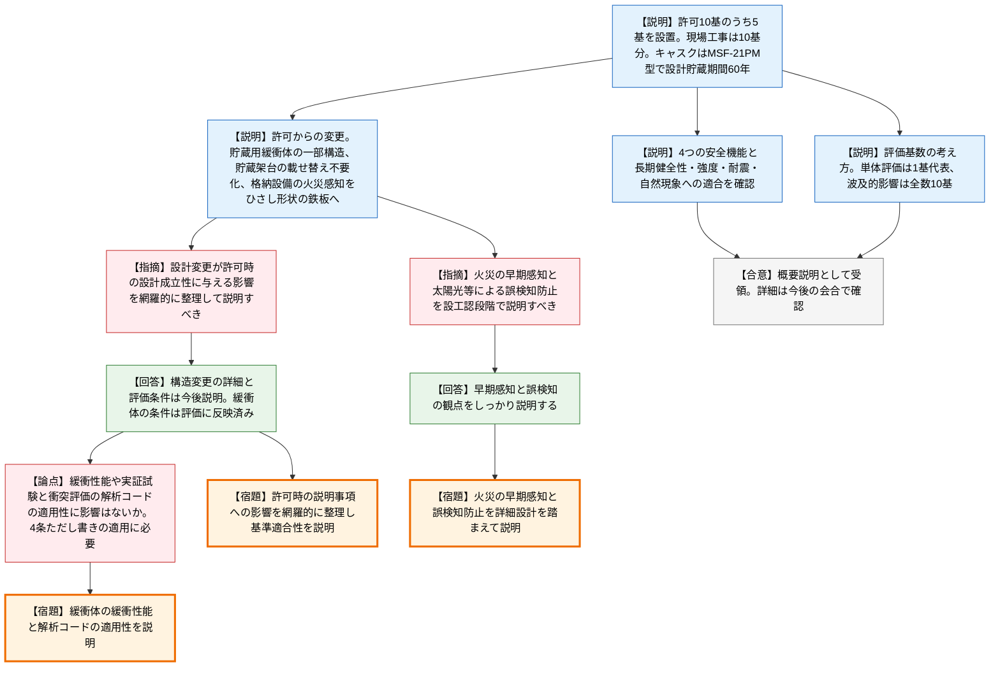
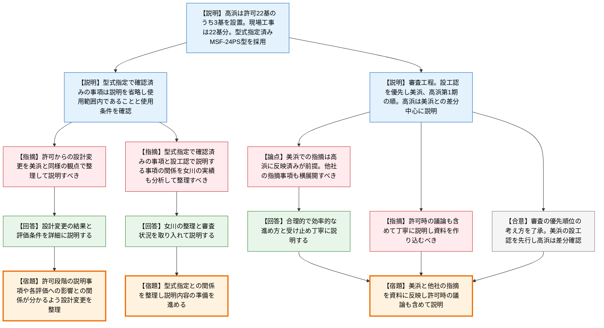

# 第1438回原子力発電所の新規制基準適合性に係る審査会合（令和8年10月6日）
> 出典 : https://youtube.com/live/uyeoC5ucs24?si=MepAxli-fPw4Gqaj

## 会合の概要
* **関西電力が美浜3号機・高浜1号機の使用済燃料乾式貯蔵施設について、設工認(設計及び工事計画認可申請)の概要を初説明**
  2026年8月31日に申請された両機の乾式貯蔵施設について、関西電力が設計の概要を説明した。美浜は許可時に10基としたキャスクのうち5基を今回設置し、高浜は美浜と共通する内容が多いため美浜との差分を中心に説明した。
* **規制側の最大の関心は「許可時からの設計変更が、許可時の説明事項(設計成立性)に与える影響」の網羅的な整理**
  貯蔵用緩衝体・貯蔵架台・格納設備の構造変更を受け、規制庁は、許可時に説明した事項や緩衝性能・解析コードの適用性などへの影響を漏れなく整理して説明するよう求めた。事業者は詳細を今後説明すると応じた。
* **火災の早期感知と誤検知防止が、大飯・高浜第2期の許可審査からの申し送りとして設工認段階の確認事項に**
  格納設備の火災感知(排気口の金属部を熱サーモカメラで感知する方式)について、許可審査中の案件でも「設工認段階で整理して説明する」とコメント済みであることを規制庁が示し、今回の設計変更後も同様に説明を求めた。
* **高浜は型式指定済みキャスクを採用するため、型式指定で確認済みの事項と設工認で説明する事項の切り分けを要請**
  規制庁は、先行する女川の審査実績を分析したうえで、両者の関係が分かる整理を求めた。
* **審査の優先順位は事業者案を規制側が了承し、設工認は美浜を先行、高浜第1期は美浜の差分確認で進める方針が確認された**
  美浜で受けた指摘は高浜に反映されることが前提とされ、他社の同種申請で出た指摘事項の横展開も求められた。

---

## 議題ごとの詳細整理

### 【議題1】関西電力（株）美浜発電所第3号機の使用済燃料乾式貯蔵施設の設置の工事に係る設計及び工事計画認可申請の審査について
* **議論の背景と論点:**
  美浜3号機の乾式貯蔵施設は、2025年10月29日に設置変更許可、同年6月26日に設計承認を受け、2026年8月31日に設工認を申請した。本会合は申請の概要説明であり、論点は、(1)許可時からの設計・構造の変更が、許可時に説明した設計成立性等に与える影響の整理、(2)緩衝性能など4条ただし書きの適用に関わる事項の説明、(3)格納設備の火災感知方式の変更に伴う早期感知・誤検知防止の説明、の3点である。なお、資料には非公開情報が含まれるため、発話・画面への映り込みへの注意が冒頭で促された。

* **質疑応答（詳細）:**
  **＜関西電力の説明の要点＞**
    * 【説明者側】関西電力
      設置変更許可では乾式キャスク10基を計画しているが、今回の工事では、美浜・高浜1号機向けのキャスク製造枠や、燃料を取り扱うエリアでの他作業との輻輳状況を踏まえ、このうち5基を設置する。将来の追加設置に備え、現場工事は10基分を実施する。追加設置基数は、各発電所の審査状況やキャスク製造枠等を踏まえて決める。
    * 【説明者側】関西電力
      設置位置は、地盤・地震、津波、外部火災等の自然現象と、敷地境界外の線量を考慮して選定した。キャスクは基礎等に固定せず、貯蔵用緩衝体を装着する方式とし、地震等で衝突が生じてもキャスクの安全機能が損なわれない設計とした。津波は基準津波の遡上波が到達しない高さに、外部火災は防火帯の内側に設置する。
    * 【説明者側】関西電力
      採用するキャスクは三菱重工製のMSF-21PM型で、貯蔵と構外への運搬の両方に使える兼用キャスクである。貯蔵架台にトラニオン部を介して横置きで固定し、設計貯蔵期間は60年、閉じ込め・臨界防止・遮蔽・除熱の4つの安全機能を期間中維持する。格納設備は1基に1基を貯蔵する規模で、遮蔽機能を持ち、キャスクを自然対流で冷却するため給排気の構造を備える。
    * 【説明者側】関西電力
      臨界防止は、バスケットプレートと中性子吸収材で担保し、3次元モデルによる保守的な評価で、実効増倍率が不確かさを含めても0.95以下となることを確認した。除熱は、燃料被覆管・キャスクの温度が許容温度を下回ることを確認し、機能の監視は表面温度の測定と給排気口の外観点検で行う。
    * 【説明者側】関西電力
      閉じ込めは、金属ガスケットでキャスク内部の負圧を維持する設計で、ガスケットの漏えい率が60年間の基準漏えい率より小さいことを確認した。1次蓋と2次蓋の間の圧力は圧力計で監視する。遮蔽は、キャスク表面と1メートル離れた位置で基準値を満足する。敷地境界外の線量は、10基設置を条件に、他施設の寄与を加えても目標値の年間50μSv以下となる。
    * 【説明者側】関西電力
      長期健全性は、照射・熱・化学的影響を考慮し、文献や試験データで60年間の経年変化の影響がないことを確認した。強度は、クラス3容器として金属キャスク構造規格等に基づき、貯蔵時・水平吊り上げ時のほか、取扱時の仮設架台への衝突、横倒し時の衝突などを評価した。耐震は、兼用キャスク告示の地震力(水平2300ガル、鉛直1600ガル)に対し安全機能が損なわれないことを確認し、キャスクの転倒、キャスク同士の衝突、格納設備のコンクリートパネルとの衝突といった波及的影響も評価した。津波・竜巻・外部火災に対しても安全機能が損なわれない設計とした。
    * 【説明者側】関西電力
      設置変更許可からの主な変更は3点である。(1)貯蔵用緩衝体は、キャスクへの取付作業の観点で一部構造を変更した(高さ3メートルからの水平落下、速度4メートル毎秒での衝突に対する性能という設計方針は不変)。(2)貯蔵架台は、許可時は貯蔵専用で運搬時に構外輸送専用架台へ載せ替える計画だったが、載せ替えなしで搬出できる構造に変更した。(3)格納設備は、火災感知を、排気口の金属部に設置した板形状の鉄板から、実証試験の結果を踏まえて早期に感知できるひさし形状の鉄板へ変更し、他区域との分離のため火災防護板を設置する。いずれも重量増加や除熱性能への影響を評価し、技術基準への適合を確認したとした。
    * 【説明者側】関西電力
      今回設置は5基だが、技術基準への適合性の評価基数は評価内容で使い分けている。キャスク単体の安全機能・健全性は設置基数や場所に依存しないため1基で代表し、外部火災・竜巻の波及的影響のように複数基や配置の影響を要するものは、最大設置基数の10基を全数として評価している。

  **＜質疑＞**
    * 【規制側】島田（規制庁）
      設計・構造の変更を踏まえた評価で技術基準への適合性を確認しているとの説明だが、詳細は今後確認する。そのうえで、許可時に説明した設計成立性を含む事項に、どのような影響があるのかを網羅的に整理したうえで、基準への適合性を説明するよう求める。
    * 【規制側】島田（規制庁）
      一例として、キャスクを基礎等に固定せず貯蔵用緩衝体を装着する設計となっているため、緩衝体の緩衝性能が1つのポイントとなる。今回の構造変更を踏まえても、許可時に実証試験で示した緩衝性能や、衝突評価に用いた解析コードの適用性に影響がないかなど、これに限らず網羅的に整理して説明してほしい。
    * 【説明者側】関西電力 高橋
      貯蔵用緩衝体、貯蔵架台、格納設備の構造変更については、今後詳細を説明する。緩衝体に関して必要な評価条件は、評価のインプットとして適切に取り込んでいる。
    * 【規制側】島田（規制庁）
      緩衝性能は、「4条ただし書き」の適用に必要となる事項であり、きちんと説明してほしい。
    * 【規制側】島田（規制庁）
      格納設備の火災感知は、美浜の会合で指摘した事項ではないが、許可の審査を継続している大飯・高浜第2期の会合で、許可時からの申し送り事項としてコメントしている。内容は、温度上昇した排気口の金属部を熱サーモカメラで感知する設計について、格納設備の設計や金属部の材料等の詳細設計を踏まえ、早期感知できること及び誤検知を防止できることを、設工認段階で改めて説明するというものである。今回の設計変更後の構造でも、早期感知と、太陽光などによる誤検知の防止について詳細を説明してほしい。
    * 【説明者側】関西電力 宮下
      早期感知と誤検知の観点について、しっかり説明する。

* **結論と宿題事項（アクションアイテム）:**
  * **決定事項:** 概要説明の位置づけであり、技術的な了承事項はない。
  * **宿題事項(規制側から事業者への要請):**
    * 許可時からの設計・構造の変更が、許可時に説明した設計成立性を含む事項(緩衝性能、実証試験、衝突評価に用いた解析コードの適用性等)に与える影響を網羅的に整理し、基準適合性を説明すること。
    * 「4条ただし書き」の適用に必要な緩衝体の緩衝性能を説明すること。
    * 変更後の格納設備について、火災の早期感知と、太陽光などによる誤検知の防止を説明すること。

### 【議題2】関西電力（株）高浜発電所第1号機の使用済燃料乾式貯蔵施設の設置の工事に係る設計及び工事計画認可申請の審査について
* **議論の背景と論点:**
  高浜1号機は2025年5月28日に設置変更許可を受け、2026年8月31日に設工認を申請した。採用するキャスクは2023年5月31日に型式指定を、2024年12月19日に核燃料輸送物設計承認を受けており、美浜との主な差分はこの点である。論点は、(1)美浜と同様に許可からの設計変更の影響を整理すること、(2)型式指定で確認済みの事項と設工認で説明する事項の切り分け、(3)資料2-2に示された乾式貯蔵施設の審査の優先順位と進め方、の3点である。

* **質疑応答（詳細）:**
  **＜関西電力の説明の要点(資料2-1)＞**
    * 【説明者側】関西電力 長谷川
      高浜は設置変更許可を22基で受領している。美浜・高浜1号機向けのキャスク製造枠8基のうち、美浜が5基のため、高浜には残る3基を設置する。将来の追加設置に備え、現場工事は22基分すべてを行う計画である。
    * 【説明者側】関西電力 長谷川
      キャスクは、型式指定を受けたMSF-24PS型の兼用キャスクを採用する。4つの安全機能に加え、長期健全性・強度・耐震・竜巻飛来物の衝突は型式指定で適合性が確認済みのため、本申請では説明を省略し、使用範囲(設計貯蔵期間、貯蔵姿勢、質量、寸法等)が型式指定の範囲内であることを確認した。型式指定で「申請時に別途確認する」とされた使用条件(貯蔵用緩衝体の緩衝性能、燃料の収納条件、格納設備の遮蔽・除熱機能等)については、本申請で評価している。収納燃料の初期濃縮度・最高燃焼度・冷却日数は、型式指定で確認した条件に包絡される。以降の評価内容と設置許可からの変更点は美浜と同じである。
  **＜関西電力の説明の要点(資料2-2 審査工程)＞**
    * 【説明者側】関西電力
      乾式貯蔵施設は美浜・高浜・大飯の3サイト4か所で計画し、いずれも審査中である。9月4日の面談で規制側から優先順位への意見があったため、考え方を示す。可能なら優先順位を付けず並行審査を希望するが、審査リソースを踏まえると、まず設工認を優先し、その中で美浜、高浜第1期の順に進めてほしい。設置変更許可申請は、大飯、高浜第2期の順を希望する。
    * 【説明者側】関西電力
      美浜と高浜第1期は共通点が多いため、美浜を先行して説明し、高浜第1期は美浜との差分を中心に説明して審査を効率化したい。

  **＜質疑＞**
    * 【規制側】藤原（規制庁）
      1点目として、議題1で美浜に出したコメントと同様に、資料2-1の19ページ以降にある許可からの変更内容について、高浜も美浜と同じ観点で確認する。許可段階の説明事項や各評価への影響との関係が分かるように整理して説明してほしい。
    * 【説明者側】関西電力 高橋
      美浜と同じコメントとして受け止め、設計変更の結果と評価条件を詳細に説明する。
    * 【規制側】藤原（規制庁）
      2点目として、高浜は美浜と異なり型式指定済みキャスクを採用している。設工認での技術基準適合性の示し方は、先行する女川などの審査実績を十分分析したうえで、型式指定で確認された事項と設工認で説明する事項の関係が分かるように整理してほしい。審査が効率的に進むよう、説明内容の整理と準備も進めてほしい。
    * 【説明者側】関西電力 杉山
      女川の審査も適宜確認している。型式指定の適用は女川の整理や審査状況を取り入れて説明する。
    * 【規制側】村田（規制庁、管理官）
      資料2-2の優先順位の考え方は了承する。美浜の設工認を優先して審査し、技術的基準への適合性が概ね確認できた段階で、高浜1号機については美浜との差分を確認する形で進めたい。そのためには説明資料をしっかり作り込むことが大事である。
    * 【規制側】村田（規制庁、管理官）
      今後は大飯も含めシリーズで審査するため、サイトごとに同じ指摘をすると非効率になる。美浜で受けた指摘は、差分の説明は別として、高浜に当然反映されており、それが最後にそろうものと認識して進める。他の事業者で同じような申請が出ており、他社で指摘した事項も申請内容に反映すべきで、そうした横展開も前提に効率的・効果的に審査を進めたい。
    * 【説明者側】関西電力 藤田
      その進め方なら審査が極めて合理的・効率的に進むと考える。丁寧な説明に努める。
    * 【規制側】金城（規制庁、審議官）
      許可が出たのは約1年前である。丁寧な説明とは、許可時に議論したことも含めてしっかり説明するということだと理解してほしい。規制側も審査リソースが変わっている部分があり、その点を心得て準備してほしい。
    * 【説明者側】関西電力 藤田
      承知した。
    * 【規制側】皆川（規制庁）
      関西電力のキャスクの審査では、まず美浜の設工認を優先して進める。本日指摘した事項は今後の審査会合で引き続き確認するので、準備してほしい。それ以外の項目は書類確認を進め、確認すべき事項が生じれば審査会合で確認する。
    * 【説明者側】関西電力 藤田
      本日は設計成立性への影響の網羅的な説明など具体的なコメントを受けた。これを含め、申請内容は丁寧に説明していく。

* **結論と宿題事項（アクションアイテム）:**
  * **決定事項:** 規制側は、関西電力の審査優先順位の考え方(設工認を優先し、美浜、高浜第1期の順)を了承した。高浜1号機は、美浜の技術基準適合性が概ね確認できた段階で、美浜との差分を確認する方針である。設置変更許可申請(大飯、高浜第2期)の順序は、今回の会合では規制側から特段の言及がなかった。
  * **宿題事項(規制側から事業者への要請):**
    * 許可段階の説明事項や各評価への影響との関係が分かるように、高浜の許可からの設計変更を整理して説明すること(美浜と同様の観点)。
    * 型式指定で確認された事項と設工認で説明する事項の関係を、女川の審査実績も分析して整理し、説明内容の準備を進めること。
    * 美浜で受けた指摘や他社の同種申請で出た指摘を、高浜の資料に反映すること。許可時の議論も含めて丁寧に説明すること。
  * **今後の予定:** 本日指摘した事項は今後の審査会合で引き続き確認する。それ以外の項目は書類確認を進め、必要に応じて会合で確認する。

### 【議題3】その他
* **議論の背景と論点:** 議題2の終了後、本日予定していた議題は以上として閉会した。
* **質疑応答（詳細）:** なし。
* **結論と宿題事項（アクションアイテム）:**
  * 特になし。

---

## 論理構造の可視化（Mermaid）

### 【議題1】美浜3号機 乾式貯蔵施設の設工認

### 【議題2】高浜1号機 乾式貯蔵施設の設工認と審査工程

