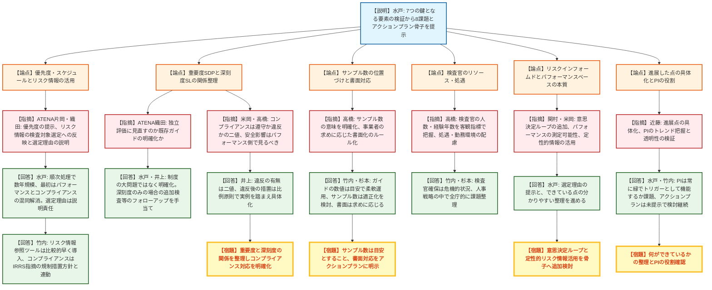
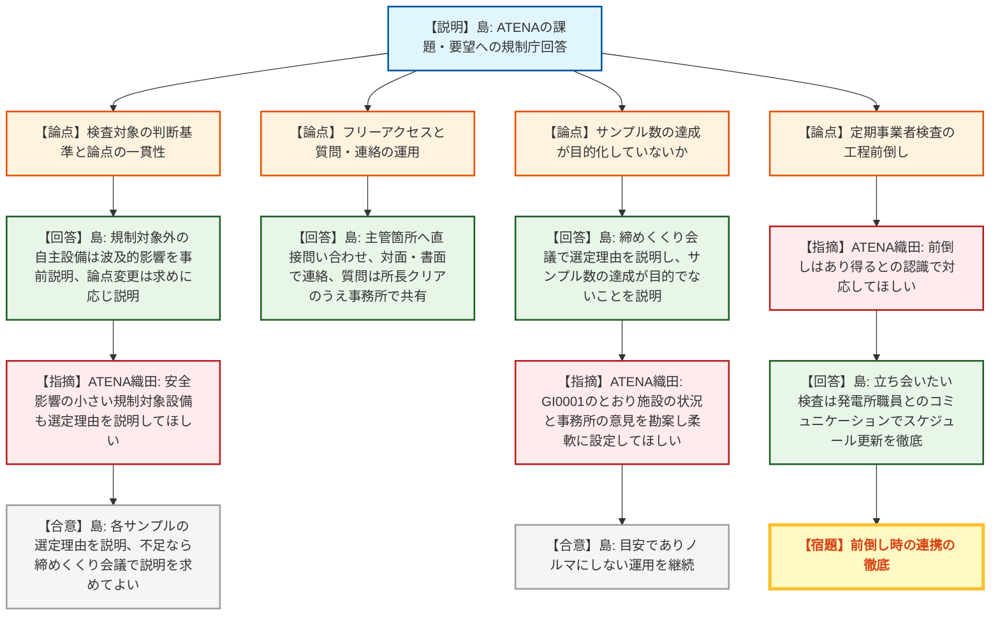
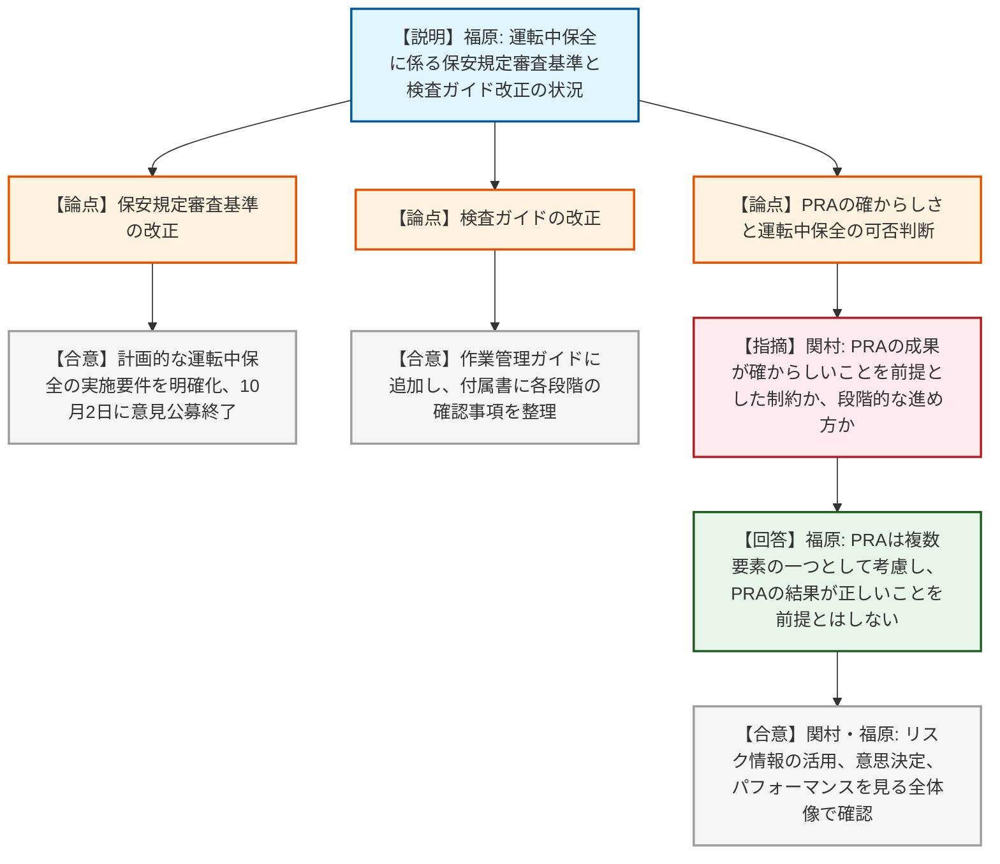
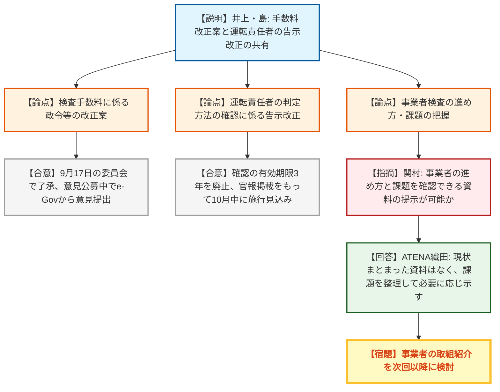

# 第21回検査制度に関する意見交換会合（令和8年10月6日）
> 出典 : https://youtube.com/live/pu1Xnjb-9LU?si=fEWECq4W3mjraotx

## 会合の概要
* **原子力規制検査の「鍵となる要素」の検証で8つの課題とアクションプラン骨子を提示（議題1）**
  規制庁の検証チームが、検査官アンケートやグループディスカッションから抽出した18の気づきを8課題に集約して提示した。着手順は人的リソースの制約から順次処理とし、最初に「パフォーマンスとコンプライアンスの混同の解消」に取り組む方針が示された。ATENAは優先度・スケジュールの提示を求め、全体の方向性には理解を示した。
* **深刻度（SL）と重要度（SDP）の関係をめぐる最大の論点**
  ATENAは「独立した評価とするのか、既存ルールの明確化なのか」を重ねて確認した。規制庁は制度自体に大きな問題はなく「明確化」が基本としつつ、深刻度のみで追加検査に進めるかが不明確な点を課題とした。有識者の高橋氏・米岡氏は、コンプライアンスは遵守か違反かの二値で捉え、安全への影響はパフォーマンス側で見るべきだとして、整理を強く求めた。
* **有識者から、検査官の人材・リソース、リスクインフォームドとパフォーマンスベースの本質、PIの役割まで踏み込んだ指摘**
  高橋氏は検査官のリソース・経験年数・処遇の客観指標での把握を求めた。関村氏はリスクインフォームドな意思決定のループとパフォーマンスベース検査の位置づけの明確化を、近藤氏は「できている点」の具体化とPI（パフォーマンス指標）が本来の役割を果たしているかの検証を求めた。規制庁は検査官確保が「かなり危機的な状況」であることも率直に認めた。
* **ATENAの課題・要望（3月30日）に対する規制庁の回答（議題2）**
  規制庁は、検査サンプル選定理由の締めくくり会議での説明、指摘件数のノルマ化の否定、フリーアクセスの徹底、質問の意図の補足、書面・対面での連絡などを回答した。ATENAは「基本的な方向に異論はない」と評価し、規制対象設備の選定理由の説明範囲や工程前倒し時の連携などを補足要望した。
* **運転中保全（オンラインメンテナンス）のルール改正状況と事務局報告（議題3・4）**
  保安規定審査基準の改正案（10月2日に意見公募終了）と、基本検査運用ガイド「作業管理」の付属書追加が報告され、PRA結果のみで運転中保全の可否を判断しない考え方が確認された。検査手数料の政令改正案は意見公募中、運転責任者の判定方法に係る告示改正は9月30日に決定され10月中の施行見込みと報告された。

---

## 議題ごとの詳細整理

### 【議題1】原子力規制検査制度の鍵となる要素に係る取り組み状況の検証について（2回目）
* **議論の背景と論点:**
  新検査制度の運用開始から5年を踏まえ、導入時に目指した7つの鍵となる要素について、導入時の姿と現状の差異を検証している。令和2〜6年度の検査官アンケートとグループディスカッションを経て、18の気づきから8つの課題とアクションプラン骨子（①リスク情報の活用環境整備、②低リスク施設へのグレーデッドアプローチの深化、③パフォーマンスとコンプライアンスの混同の解消、④軽微・緑の閾値（スクリーニング判断）の明確化、⑤施設の状況に応じたフリーアクセス、⑥事業者との円滑なコミュニケーション、⑦力量維持向上と知識継承、⑧基本検査以外の対応の運用明確化）が示された。主な論点は、重要度（SDP）と深刻度（SL）の関係整理、検査サンプル数の意味、リスク情報・パフォーマンスベースの考え方、検査官のリソース、PIの役割であった。

* **質疑応答（詳細）:**
    * 【規制庁】水戸（検査監督総括官）
      検証チームが抽出した8課題とアクションプラン骨子を説明した。課題を強調した資料だが、パフォーマンスベース、リスクインフォームド、フリーアクセスの検査は既に実現しており、その上でのさらなる課題提起である点に留意を求めた。骨子の具体化に向け、グループディスカッションは終了済みで、事業者・有識者の意見を受けたいとした。
    * 【ATENA】片岡（理事）
      今後の進め方をイメージしやすくするため、アクションプランの優先度とスケジュールもある程度示してほしい。
    * 【ATENA】織田
      ①について、インフラ整備と検索性向上に加え、得たリスク情報を検査対象の選定・検査の深度・リソース配分にどう反映するかを具体化し、事業者が求めれば検査対象とした理由を説明してほしい。②について、長期停止炉にもGI0001（共通事項に係る検査運用ガイド）の表1のような合理的な検査量の目安を検討する理解でよいか。
    * 【ATENA】織田
      ③については、重要度評価と深刻度評価を独立した評価に見直すのか、あるいは検査官への浸透不足が課題で既存ガイドの明確化なのかを確認したい。④については、気づき⑨（社会的影響に引っ張られた重要度判断への懸念）が軽微・緑の閾値の問題を指すのかを尋ねた。
    * 【規制庁】水戸
      全課題を同時並行で進めるのは人的リソース上困難であり、重要度・困難度・作業量を勘案して順次処理し、一巡に数年を要する見込みで、定期報告している検査課題の枠内で管理することを考えている。最初は検証チーム・検査官・委員会の注目度が高かった「パフォーマンスとコンプライアンスの混同の解消」から着手する見通しである。検査対象の選定理由は説明責任があるとして、事業者とのコミュニケーションの中で対応する。
    * 【規制庁】水戸
      長期停止炉はリスクプロファイルが運転中の原子炉と異なるため、どの監視領域の検査を適用するか、事業者にどのような活動があるかも含めてグレーデッドアプローチを検討し、意見交換会合で進捗を報告する。コンプライアンスについては制度そのものに大きな問題はないが、規制措置ガイドの明確化が必要と考える。ガイド上、深刻度は実質的悪影響・規制活動への影響・意図的不正の有無という別基準である一方、フロー図ではSDP結果を参考にSLを設定する記載もあり、SL1〜4もΔCDFのような明確な基準がなく、検査官が迷っている。
    * 【規制庁】水戸
      ④の課題は、スクリーニングガイドのステップ2「活動目的の達成や原子力安全・核物質防護の維持に影響を与えるか」の判断が定性的でばらつくことが中心である。軽微と緑の境界を整理し、考え方を事例集に明記する。
    * 【ATENA】織田
      ③のアクションプランにある「独立した評価を検討」は、ルール変更もあり得るが現段階では未定、という理解でよいか。
    * 【規制庁】井上（検査監督総括課）
      イメージは明確化である。現行の規制措置ガイドでも重大な法令違反はSDPに限らず別経路で扱う整理になっているため、サイトの安全機能が著しく低下していなくても大きなコンプライアンス違反が発覚した場合の対応を明確化することが主眼である。また、検査実施要領は重要度側から追加検査の実施を判断すると明記する一方、深刻度のみの場合に追加検査をフォローアップとして当てられるかは明確でなく、深刻度側の手当を明確化したい。
    * 【ATENA】織田
      9月30日にATENAが発行したレポート「事業者に期待される検査対応の基本姿勢」を紹介した。事業者が安全確保の第一義的責任を有する主体であることを明記し、事業者内への展開と浸透のフォローを進める。これは気づき⑪（事業者の一義的責任の実務上の定着が不十分）への取組である。
    * 【規制庁】竹内（検査監督総括課長）
      優先度について補足する。リスクインフォームド検査のため、検査官がリスク情報を参照し検査対象を選べるツールの導入は、システム面の課題が残るものの、整備後は使い方の講習で比較的早く導入できる見込みである。コンプライアンスの目安はこれまでほぼ存在せず時間を要し、IRRSで指摘されたエンフォースメントポリシー（規制措置方針）の整備とも連動して考え方を入れていく。着手できるものは並行して進める。
    * 【有識者】高橋
      （途中退席のため先に発言）アクションプランをどの程度具体化するのか、特に⑦の研修・技術指導は数値目標を立てられるのではないか。サンプル数の意味を明確にすべきで、必要がなければ達成できなくてよいのか、7〜9割でもよいのかがはっきりしないとサンプル数の達成自体が目的化しやすい。
    * 【有識者】高橋
      事業者が求めれば書面で示すことを手続きとしてルール化し、アクションプランに明示してほしい（行政手続法でも行政指導の書面化の一般ルールがある）。また、検査官のリソースや経験年数を客観指標で把握し、前進か後退かを意識すべきである。研修や同行指導の時間がなければ目標は空文化し、検査官は希少な専門人材であることを踏まえ、ストレスのある業務に就く検査官の処遇・勤務環境も考えてほしい。
    * 【規制庁】竹内
      指導者候補（ラインマネージャー）の育成はNRCのガイドも参考に試行段階であり、達成度の数値目標は設定可能と考える。サンプル数は検査手数料と連動する面があるが、達成できないものを無理にやらざるを得ないという検査官の声もあり、適正化を検討する。書面は、事業者の求めがあれば応じる。検査官は毎年10人単位で抜け、特に中途採用の応募が減って危機的状況にあり、若手の教育や人材確保の取組を進めている。
    * 【規制庁】杉本
      サンプル数は手数料の積算が出発点だが、ガイドの数値はあくまで目安で、検査官にも柔軟に運用するよう周知している。年度計画は年度初めに委員会で了承を得るが、年度途中に特定サイトで掘り下げた検査が必要になるなど、計画通りにならない例は従来もある。処遇は給与面を含め検査官に限った話ではないが、人事戦略の中で全庁的に課題を整理し改善を進める。
    * 【有識者】高橋
      検査手数料はその期間に必要な検査に対する料金であり、サンプル数未達でも必要な検査をしていれば問題はないので、サンプル数を過度に意識しないほうがよい。資料2（議題2）の回答にも、サンプル数が目的でないことを規制庁として明記したほうがよい。
    * 【有識者】関村
      リスクインフォームドな意思決定は事業者・検査官双方が行い、その決定を見直すループの中でリスク情報の活用を考えるべきで、骨子にこの視点を加えてほしい。パフォーマンスベース検査は規範的（プリスクリプティブ）な検査とは異なり、パフォーマンスが満たされなくても即座に安全上の問題にならないことを深層防護などの審査が担保している前提で成り立つ。測定可能なパフォーマンスとして示すことで、コンプライアンス違反とは明確に区別され、リスク情報を使わなくても適用できる。サイクル施設や廃止措置中の施設でも、測定可能なパラメータの提示が必要である。
    * 【規制庁】水戸
      検査サンプルを選んだ理由を示すことが重要であり、これまでに何ができていて何が課題かが見えにくかった点を分かりやすく整理する。そうすれば、どのパフォーマンスに影響するから調べるのかという整理もできる。
    * 【有識者】米岡
      リスク情報の件では、定性的情報を含めにくくて尻込みしていた検査官がいる可能性があり、実態があるなら定性的情報の活用方法の検討もアクションプランに加えてはどうか。コンプライアンスは法令を守っているかの白黒（0か1か）であり、「結果オーライ」のようなパフォーマンスベースの考えを差し挟むことに違和感がある。違反の性質に応じた深刻度と、安全への影響度である重要度を掛け合わせるのか足すのかも疑問である。
    * 【規制庁】水戸・井上
      水戸は、定性的リスク情報の課題は、PRAを使えない施設で定量化できない点や、許認可資料が膨大で目的の情報を探すのに苦労する点が主だったと回答した。違反の軽微なものから影響が大きいものまでを整理し、単純な0か1かにならないよう検討する。井上は、高橋氏の整理のとおり、違反か否かは二値で、違反後の措置は比例原則に従う、5年間の事例を踏まえ実例に基づき具体化したいとした。
    * 【有識者】近藤
      検査制度でできる範囲を考え、不正の余地をなくす仕組みなど他の制度と組み合わせる視点も必要である。5年目の検証の意義は大きいが、「進展している部分」を具体化して整理すれば、5年後の評価にも使える。また、検証の対象を実務だけでなく制度の仕組みにも広げ、PIが期待された機能を果たしているかを見るべきである。日本のPIは安全上の問題を示す値がほとんど出ておらず、閾値超過だけでなくトレンドで早期兆候を捉えているか、検査情報を補完し良好なパフォーマンスの維持を確認できているかという観点と、全国の発電所を共通指標で外部から確認できる透明性の観点がある。
    * 【規制庁】水戸・竹内
      水戸は、以前はルール通りかが主眼だったが、今は検査官全員がルール違反が施設の安全にどう影響するかを考えており、これが新検査制度の大きなメリットであること、昨年紹介したエンジニアリング検査ガイドではリスクブックのランキングを確認しながら検査していることを述べた。PIは米国と比べ相当に低く、追加検査のきっかけとしてほぼ常に緑という状況で、トリガーになっているのか、一方でパフォーマンスが良好な中で閾値を狭めてよいのかも難しく、アクションプランとしては提示できていないが引き続き考える。竹内は、運転上の制限の逸脱宣言は四半期ごとに報告を受けてホームページで公表しており、分かりやすく示す余地はあると補足した。

* **結論と宿題事項（アクションアイテム）:**
  * **結論:** 8課題とアクションプラン骨子について、事業者・有識者から多数の意見を得た。規制庁は意見を反映してアクションプランを具体化し、原子力規制委員会に諮る。着手は順次とし、パフォーマンスとコンプライアンスの混同の解消を最初に取り組む見通しである。
  * **宿題事項:**
    1. アクションプランの優先度・スケジュールを示すこと（ATENA片岡）。
    2. リスク情報を検査対象選定・検査の深度・リソース配分にどう反映するかを具体化し、事業者が求めた場合に選定理由を説明すること（ATENA織田）。
    3. 重要度と深刻度の関係を整理し、コンプライアンスの二値的な性格（違反の有無）と、違反後の比例的措置・追加検査等のフォローアップを区別して明確化すること（ATENA織田、高橋、米岡）。
    4. サンプル数の位置づけ（目安であり達成が目的でない）と、書面による対応のルール化をアクションプランに明示すること（高橋）。
    5. リスクインフォームドな意思決定のループ、パフォーマンスベース検査の考え方、定性的リスク情報の活用方法を骨子に追加検討すること（関村、米岡）。
    6. 「どこまでできていて何が課題か」（ポジティブな点を含む）を分かりやすく整理し、PIの役割（トレンド・透明性）も確認すること（近藤）。

### 【議題2】新検査制度に関する5年目の振り返りにおけるATENAから提示されたコメントに対する回答
* **議論の背景と論点:**
  3月30日の第19回意見交換会合でATENA（事業者）が示した、日常検査を担当する検査官に関する課題と要望に対する、規制庁（検査グループと規制事務所の検査官を含む）の回答である。論点は、検査対象や論点の一貫性、安全影響の小さい事象の指摘、フリーアクセスの運用、口頭でのやり取りによる認識のずれ、サンプル数の達成が目的化していないか、であった。

* **質疑応答（詳細）:**
    * 【規制庁】島（実用炉監視部門）
      課題への回答として次を示した。炉規法の規制対象外の自主設備の不適合を検査対象とする場合は、規制対象設備への波及的影響など原子力安全との関係を検査官が事前に説明する。検査の切り口が変わった理由は、事業者が分からなければその場で説明する。重要度が緑以下の事象は問題点の指摘にとどめ、是正内容はCAP活動を尊重し助言はしない。是正措置が不十分な場合はPI&Rチーム検査で確認する。
    * 【規制庁】島
      フリーアクセスの運用として、検査の取りまとめ箇所から主管箇所への直接問い合わせを依頼された場合は直接問い合わせる。口頭での認識齟齬は聞き手だけの問題ではなく検査官側の発話にも問題があり得るとして、細かな依頼を電話で行わず対面・書面で行う。検査の必要が感じられない検査サンプルについては、締めくくり会議で事業者に積極的に尋ね、選定理由を説明する。
    * 【規制庁】島
      要望への回答として、指摘件数を事務所にノルマとして課さないが、指摘の特定は検査官の重要な仕事であるとした。日常検査とPI&R検査の重複は配慮し、日常検査のQMS検査結果をPI&Rチームにインプットするが、必要なら深掘りもあり得るとした。また、質問は原則として所長のクリアを得て事務所内で共有し、回答は事務所の誰でも受け取れる運用とする。緊急時など所長クリア前に質問する場合も事後に共有する。個人的な見解を根拠に検査せず、検査対象は事務所内で認識を合わせ、本庁の実態調査も質問の意図を説明する。年度末などの質問集中は優先順位をつけ、低いものは翌期に回す。
    * 【規制庁】島
      サンプル数の達成が目的ではないことを、締めくくり会議でサンプル選定理由とともに説明し、リスクインフォームド検査・パフォーマンスベース検査を実施していることも説明する。議題1で織田氏が求めたリスク情報の活用状況の説明も、締めくくり会議で質問があれば検査官が説明する。
    * 【ATENA】片岡（理事）
      丁寧で柔軟かつ具体的な回答に謝意を述べた。コミュニケーションは双方向で現場が納得することが重要で、こじれたときは一対一にせず関係者を増やして継続したい。ATENAは事業者の期待事項、規制庁は検査官の振る舞いを文書化しており、共通認識として活用する。基本的な方向に異論はない。
    * 【ATENA】織田
      3点補足した。①炉規法の規制対象外の自主設備に限らず、安全影響の小さい規制対象設備を検査対象とする場合も、求めがあれば選定理由・根拠を説明してほしい。②定期事業者検査では作業の進み具合で検査が前倒しになることがあり、事前連絡がないと立ち会いの連携が難しいため、検査官側も前倒しはあり得るという認識で対応してほしい。③GI0001でサンプル数は標準的な値で施設の状況や事務所の意見も勘案して設定するとされているので、柔軟に必要なサンプル数を設定してほしい。
    * 【規制庁】島
      ①は各サンプルの選定理由を説明するので対応可能であり、説明がなければ締めくくり会議で対等な立場として求めてよい。②は、検査官は前倒しを承知しているはずで、どうしても立ち会いたい検査は事業者に予定の更新を頼み、抜き打ちで見に行く場合もあるが、スケジュールの更新を発電所職員とのコミュニケーションで徹底する。③は、検査計画でプラントの状況と事務所の意見を見て設定し、目安であって絶対に達成すべきものではなく、ノルマとはしない。
    * 【規制庁】竹内
      有識者からの意見があれば後日メール等でも構わないとし、構造的・共通の課題はこのような場で意見をもらい、フィードバックを今後も行いたい。

* **結論と宿題事項（アクションアイテム）:**
  * **結論:** 規制庁はATENAの課題・要望に対する具体的な回答を示し、ATENAは基本的な方向に異論がないとした。有識者からは、この場では追加の意見は出なかった（個別にメール等で寄せることも可とされた）。
  * **宿題事項:**
    1. 規制対象設備でも安全影響が小さいものを検査対象とする場合に、事業者の求めに応じ選定理由・根拠を説明する運用を検査官に徹底すること（ATENA織田、規制庁島が対応する旨を回答）。
    2. 定期事業者検査の前倒しを想定した検査官と発電所職員のコミュニケーション・スケジュール更新を徹底すること（ATENA織田、規制庁島）。
    3. サンプル数は目安でありノルマにしない運用を徹底し、資料2の回答にもその旨を明記することを検討すること（有識者高橋）。

### 【議題3】オンラインメンテナンスに関する検査ガイドの改定状況の報告
* **議論の背景と論点:**
  原子炉運転中の設備の点検・補修（運転中保全、オンラインメンテナンス）について、これまで現場実証結果などを本会合で説明してきた。今回は、3月の原子力規制委員会で了承された方針に基づき、運転中保全を計画的な保全活動として位置づけ、安全に実施するためのルールと確認軸を明確化する保安規定審査基準と検査ガイドの改正状況（9月2日の原子力規制委員会資料）が報告された。論点は、PRAの確からしさと運転中保全の可否判断の関係であった。

* **質疑応答（詳細）:**
    * 【規制庁】福原
      保安規定審査基準は従来、運転中保全をやむを得ず実施する場合を前提としていたが、計画的に実施する場合の要件を明確化する改正案とした。検査ガイドは既存の基本検査運用ガイド「作業管理」に運転中保全を検査対象として位置づけ、計画段階から作業完了までに検査官が確認する事項を付属書に整理した。保安規定審査基準改正案は10月2日に意見公募を終了し、意見を踏まえて改正作業を進める。
    * 【ATENA】織田
      ATENAは事業者と連携して対応してきたため、今日申し上げることは特にない。検査が効率的に進むよう、事業者との連携を続ける。
    * 【有識者】関村
      リスク情報を活用して効果的な安全確保を進める上で、最も重要な点から踏み出す取組は素晴らしい。安全性向上評価制度のガイドラインにはPRA手法に不十分な点があるとの前提の記述があり、運転中保全はPRAの成果が確からしいことを前提にした制約なのか、ステップバイステップで進めるという背景なのかを確認した。
    * 【規制庁】福原
      付属書に記載のとおり、PRAの結果だけで運転中保全の実施を決めるのではなく、PRAの結果は複数の要素の一つとして考慮するものであり、PRAの結果が正しいことを前提とする考え方ではない。
    * 【有識者】関村
      検査制度の中でリスク情報を活用して意思決定を行い、パフォーマンスをしっかり見るという全体像の中で確認していくという理解でよいか。
    * 【規制庁】福原
      そのとおりである。

* **結論と宿題事項（アクションアイテム）:**
  * **結論:** 運転中保全の実施要件と検査での確認方法に関する改正案が報告された。保安規定審査基準の改正案は意見公募を終え、今後、意見を踏まえて改正作業を進める。有識者からPRA結果は判断の一要素であるとの規制庁の考え方が確認された。
  * **宿題事項:** 特になし（規制庁は、意見公募で寄せられた意見を踏まえ改正に向けた作業を進める）。

### 【議題4】その他
* **議論の背景と論点:**
  事務局から、議事次第の参考に記載された2件（検査手数料に係る法令改正案、運転責任者に係る告示改正）の情報共有があり、あわせて有識者から議題2に関する要望が出された。

* **質疑応答（詳細）:**
    * 【規制庁】井上
      9月17日の原子力規制委員会で、原子力規制検査に係る手数料の見直しのための政令等の案が了承された。3月の本会合でも紹介した内容で、現在意見公募中のため、意見があればe-Govを通じて提出してほしい。
    * 【規制庁】島
      運転責任者の判定方法について、従来は3年ごとに原子力規制委員会の確認を受ける必要があったが、告示改正で確認の有効期限（3年）をなくし、変更があるまで有効とした。9月30日の委員会で決定され、官報掲載をもって施行となる。入稿済みで10月中の施行見込みであり、掲載後はATENAに連絡する。
    * 【規制庁】竹内
      手数料はパブリックコメント中であり意見は意見公募の窓口へ、運転責任者の告示改正はパブリックコメントを経た決定であり、この場の意見はないものとして報告にとどめるとした。
    * 【有識者】関村
      議題2で、規制庁の取組は公開の場で十分議論されている一方、事業者が事業者検査を含めどのように進め、どのような課題を持つかは、令和2年4月の本格運用時には議論できたが、現状をどこで確認できるか見えず、まとまった資料を本会合に示せないか、CNO会議の議論を参照すればよいのかを尋ねた。
    * 【ATENA】織田
      現状、そのようにまとめた資料は思いつかない。課題を整理して必要に応じて示す。
    * 【規制庁】竹内
      関村氏の要望を受け、事業者の取組の紹介を次回以降にしてもらえるよう、ATENAに検討を依頼した。議題1のアクションプランは、本日の意見を反映して策定する。

* **結論と宿題事項（アクションアイテム）:**
  * **結論:** 手数料の政令改正案は意見公募中、運転責任者の告示改正は決定済みで10月中に施行見込みとして共有された。
  * **宿題事項:**
    1. 事業者検査の進め方・課題について、事業者（ATENA）がまとまった情報を整理し、次回以降の会合で紹介することを検討すること（関村、竹内）。
    2. 議題1のアクションプランに、本日の意見を反映して策定すること（規制庁）。

---

## 論理構造の可視化（Mermaid）

### 【議題1】原子力規制検査制度の鍵となる要素に係る取り組み状況の検証について（2回目）

### 【議題2】新検査制度に関する5年目の振り返りにおけるATENAから提示されたコメントに対する回答

### 【議題3】オンラインメンテナンスに関する検査ガイドの改定状況の報告

### 【議題4】その他

