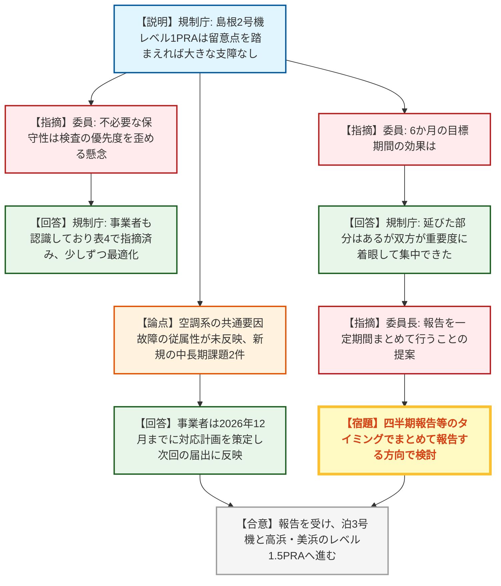
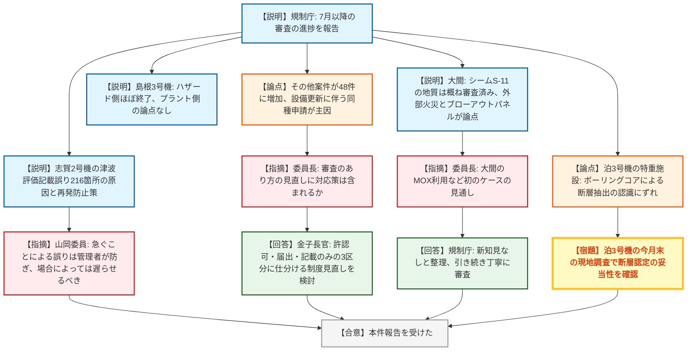
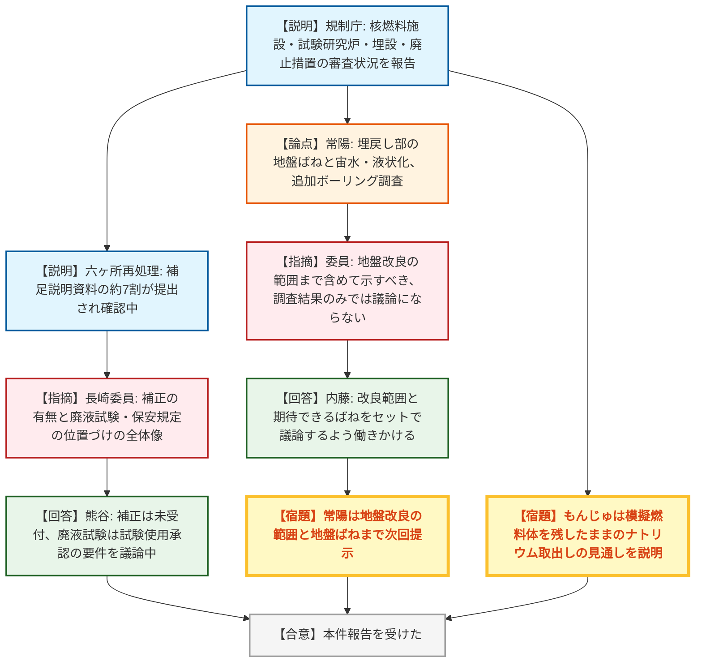
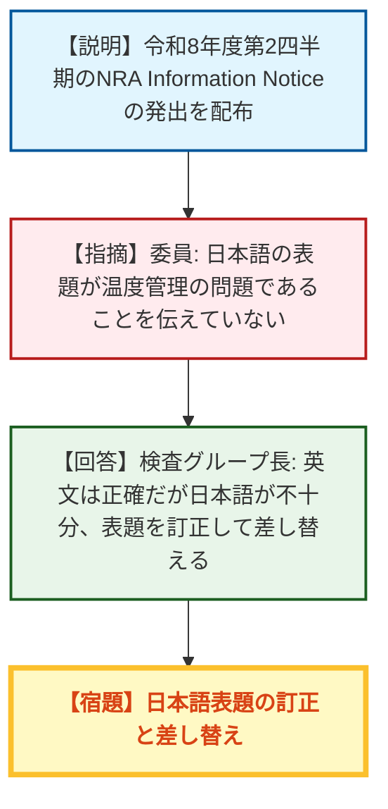

# 第35回原子力規制委員会（令和8年10月7日）
> 出典 : https://youtube.com/live/mrx5gNhi9rE?si=ol8V2C_QkGv8GLOE

## 会合の概要
* **島根2号機のレベル1PRAモデルは「大きな支障なし」、確認期間の短縮と報告のまとめ化へ**
  規制庁は、中国電力の島根2号機レベル1PRAモデルの適切性確認を終え、評価上の留意点はあるもののリスク評価に用いる上で大きな支障はないと報告した。目標とした6か月は守り切れなかったが、期間を意識することで着眼点が絞れたとの評価であった。委員長からは、報告実績が積み上がり緊急の課題も目立たないため、一定期間まとめての報告も検討するよう提案があった。
* **審査案件の進捗とハザード側審査の収束**
  島根3号機はハザード側の審査がほぼ終了し、プラント側にも残された論点はない。大間はシーム(S-11)に関する敷地の地質・地質構造が「おおむね審査済み」となった一方、国際海峡に面する外部火災評価やマグネット方式のブローアウトパネルなど先行実績のない論点が残る。泊3号機の特重施設は、ボーリングコアによる断層抽出の妥当性をめぐり、事業者と規制庁審査チームの認識にずれが残っている。
* **「その他」の審査案件が48件と過去最多、審査のあり方の見直しへ**
  設備更新に伴う同種の申請が各発電所から出ており、審査中の「その他」案件は1年前の約30件から48件へ約1.5倍に増えた。委員長が審査制度の見直し検討との関係を問い、金子長官は、許認可・届出・記載のみの3区分に仕分ける考え方を含めて制度全体を合理化していく方針を説明した。
* **核燃料施設は、六ヶ所再処理と常陽の地盤をめぐる論点が中心**
  六ヶ所再処理施設は設工認の補足説明資料の約7割が提出され確認中で、アクティブ試験で生じた溶液の処理については使用前事業者検査の漏えい検査として扱う方向で手続きを議論している。常陽は、地盤ばねを期待する埋戻し部周辺の地盤改良の範囲まで含めて次回示すよう、委員が事務局に進め方のコントロールを求めた。
* **NRA情報通知文書の表題を差し替え**
  配布された情報通知文書(NRA Information Notice)の日本語表題が、温度管理の問題であることを伝えていないとの委員の指摘を受け、検査グループが表題を修正して差し替える方針を示した。

---

## 議題ごとの詳細整理

### 【議題1】原子力規制検査で用いる確率論的リスク評価モデルの適切性確認等に係る報告（島根原子力発電所2号機及び中長期的課題への対応状況）
* **議論の背景と論点:**
  中国電力が作成した島根2号機のレベル1PRAモデルの適切性確認結果と、各プラント共通の中長期的課題に対する産業界(ATENA)の対応状況の報告である。論点は、①確認で特定された評価上の留意点と中長期課題の中身、②PRAモデルの保守性が検査の優先度に直結することへの懸念、③モデルの使い勝手のプラント間差、④確認期間6か月の目標の効果、⑤今後の報告の仕方であった。
  島根2号機については、令和7年10月にモデルを受領して以来、過去の確認に長時間を要した経験を踏まえ、確認項目を厳選し、リスクの高い事故シーケンスや個別プラントの特徴に着目して確認した。
  なお、評価上の留意点の一つ(表2のNo.3)は、非常用電気品室などの安全施設が置かれた区画の空調系が複数系統あり、共通要因で同時故障した場合に冷却されている安全施設も従属的に故障するが、この従属性がモデルに適切に反映されていない、というものである。事業者は2026年12月までに対応計画を策定し、2026年度内に炉心損傷頻度への影響を確認し、次回の安全性向上評価届出に反映するとしている。
  新規の中長期課題は2件である。No.1は、複数の人的過誤が組み合わさる場合の人的過誤確率の下限値の考え方で、独立とみなして乗算すると極めて小さな確率になる例があった。米国ではASME基準で下限値を設定するよう規定しているが、国内には同様の規定がない。No.2は、長期影響評価で想定する配管破断の選定基準の統一で、対象箇所の選定が配管口径と長さのいずれかを基準としており、柏崎刈羽7号機や女川2号機の確認時と考え方が異なっていた。いずれも学協会で規制庁の問題意識を説明して議論していく。
  産業界の対応は、国内機器故障率データの収集方法の改善(年度末に向けてガイド改定案のドラフトを作成予定)、内的事象PRAと内部溢水PRAの評価範囲の明確化(溢水PRAの導入が進むため、当面は現状運用を継続)などに一定の進捗が確認された。外部電源喪失事象の発生頻度の改善や中央制御室デジタル制御盤の人的過誤評価手法の整備は、基盤グループの意見交換会合の場で議論することが提案されている。

* **質疑応答（詳細）:**
    * 【規制側】委員
      産業界のレベル1PRAモデルは、規制検査用と一般的なプラント評価用で使い分けているのか、同じものなのかを尋ねた。
    * 【説明者側】田邉（検査評価室）
      同じものを使用している。
    * 【規制側】委員
      保守的な設定は、その機器が重要だと直接評価され検査の優先度を上げるため、不必要な保守性は検査の目的上、適切でない可能性がある。産業界がこれを認識し使い分けているかを尋ねた。
    * 【説明者側】米林（検査評価室）
      PRAモデルには限界があり、やむを得ず保守的に設定する部分があることは事業者も認識している。表4で保守的な想定を既に指摘しており、事業者も了解して、少しずつ最適化の方向に改善していく。
    * 【規制側】委員
      島根2号機に特徴的な点や、将来の3号機の評価時にどこが違ってくるかを尋ねた。
    * 【説明者側】田邉（検査評価室）
      一つはモデルの作り方が事業者ごとに異なる点である。島根2号機は室温評価に加え、窒素ガスの漏えいに関する事象を重要度高めにモデル化していた。もう一つは設備の特徴で、島根2号機ではFLSRと呼ばれる低圧の原子炉代替注水系がある。
    * 【規制側】委員
      検査で各発電所のモデルを使う立場から、例えば伊方3号機のモデルを使っていた人が大飯3号機のモデルを使うことになった場合、全く違うと最初は戸惑うと思われるが、使い勝手は概ね同じと考えてよいか、それぞれ特徴があって最初は大変なのかを尋ねた。あわせて、手順書が整備されており、それに従えば基本的に使えると考えてよいかを確認した。
    * 【説明者側】米林（検査評価室）
      伊方3号機が最初に開発されたモデルで、評価が充実している分、計算時間がかかる。大飯3号機以降は省力化・合理化され、計算時間は短くなった。PWRは開発元が1社だが、BWRは開発元が各社で異なり個性のあるモデル化がなされているため、使い勝手も違うと考えられる。モデル受領時に事業者から注意点をまとめた資料をもらい、使いづらい点は問い合わせることで、基本的に計算できる状況にある。
    * 【規制側】委員
      前回の女川2号機の報告で示した6か月の目標期間は、集中力や緊張感の持続に効果があるのか、現時点の感触を尋ねた。
    * 【説明者側】田邉（検査評価室）
      集中して行えたかという問いにはイエスである。6か月を明確に守れたわけではなく延びた部分はあるが、期間を設定することで双方が、どの設備、どのシーケンスの重要度が高いかに着眼して進められた。次の泊3号機でもキックオフ面談で6か月を双方が認識している。
    * 【規制側】山中委員長
      実績が積み上がり、緊急の課題も今のところ目立たないため、一件ごとの報告ではなく一定期間まとめての報告も検討してはどうか。ただし、まとめることで期間が短縮するなど合理化につながる場合に限る。
    * 【説明者側】田邉（検査評価室）
      検査グループの四半期ごとの報告などのタイミングを見計らい、効率的にまとめて報告する方向で進める。

* **結論と宿題事項（アクションアイテム）:**
  * **決定事項:** 本件報告を受けた。島根2号機のレベル1PRAモデルは、留意点を踏まえれば規制検査に活用できるとされた。
  * **今後の対応:** ①レベル1PRAは次に北海道電力泊3号機を対象とし、PWRの確認実績が多いため他プラントとの相違点を中心に短期間で確認する。②レベル1.5PRAは関西電力の高浜1・2号機と美浜3号機を対象とし、質問項目の事前送付に着手している。③中長期課題は基盤グループ側の意見交換会合や学協会で議論する。
  * **宿題事項:** 適切性確認結果の報告を、検査グループの四半期報告などのタイミングに合わせてまとめて行う方向で検討すること。

### 【議題2】原子力発電所の新規制基準適合性審査等の状況
* **議論の背景と論点:**
  前回報告(7月)以降の、新規制基準適合性審査の進捗報告である。論点は、①ハザード側・プラント側の個別プラントの進捗、②先行実績のない大間の審査の見通し、③「その他」案件の急増への対応であった。
  主な進捗は次のとおり。中部電力は9月25日、浜岡3・4号機の申請の取下げ願いを提出した。北陸電力の志賀2号機は、6月に判明した216箇所の津波評価に係る審査資料の記載誤りについて、10月2日の審査会合で原因、再発防止策及びその水平展開の説明を受け、適切に行われていることを確認した。電源開発の大間は、9月10日・11日の現地調査で、シームS-11の変状あり・なしの境界設定に用いたボーリングコアや露頭を確認し、敷地の地質・地質構造を「おおむね審査済み」とした。外部火災では、津軽海峡が国際航路で外国船舶が通行する国内唯一の発電所であり、漂流した船舶(タンカー等)の火災・爆発の影響が適切に考慮されているか示すよう求めている。居住性確保のブローアウトパネルには先行実績のないマグネット方式が採用されており、成立性の詳細な説明を求めている。島根3号機は、7月16日の現地調査で「新編日本の活断層」が示す推定活断層を確認し、ハザード側の審査はほぼ終了した。プラント側も論点は残っておらず、9月11日に補正書が提出されている。泊3号機の特重施設は、敷地内断層の抽出をめぐり2月、7月下旬、10月初旬と審査会合を重ね、現地でのボーリングコア確認が必要としている。設工認では、東海第二の防潮堤が、地中連続壁のコンクリート未充填・鉄筋変形という不具合を受けて設計変更し、不具合のある壁を残置したまま基礎には使わず追加の基礎を設け周辺地盤を改良する方針で、8月24日の会合で主要論点がおおむね収束した。事務局(規制庁)の専決で処理する予定である。柏崎刈羽6号機の長期施設管理計画は、ABWR初の申請で技術的に新たな点がなく、同じく専決処理の予定である。美浜3号機は、高圧タービンからの蒸気漏えい事象を踏まえても長期施設管理計画に反映すべき劣化管理や措置はないことを確認した。
  「その他」案件は、今回9件が処理を終え、18件が新規に申請され、審査中は48件となった。1年前の30件から約1.5倍に増えている。

* **質疑応答（詳細）:**
    * 【説明者側】名倉（地震・津波審査担当）
      志賀2号機の記載誤りは、原因や再発防止策が適切に整理されていることを確認し、今後は適正な資料を作成するよう申し伝えた。泊3号機の特重施設は、ボーリングコア観察による断層抽出のフローの修正は確認したが、抽出が適切に行われているかは現地で確認する必要があり、事業者に現地調査での説明を求めている。
    * 【説明者側】西崎（実用炉審査担当）
      大間の外部火災と居住性の論点、島根3号機のプラント側論点の解消、泊3号機の設工認(ハロゲン化物消火設備で、複数の火災区画をグループ化して同時にガスを噴射する設計の妥当性を、早期消火や人的保護の観点から示すよう求めている)を報告した。
    * 【説明者側】村田（高経年化審査担当）
      「その他」案件のうち、大飯3・4号機と高浜の使用済燃料貯蔵施設の許可申請では、外部火災評価で使う型式証明取得済みの特定兼用キャスクの設計条件を満たしていない点の対応を事業者に求めている。関西電力は昨日の審査会合で、申請4件(許可2件・設工認2件)のうち、美浜の設工認を優先してほしいと説明し、規制庁は美浜の設工認から審査を進める。
    * 【規制側】山岡委員
      志賀の記載誤りは、津波評価が複雑化し数が増える中で、急いで提出したい意識が働いて誤りが生じたことが明確になった。急ぐことで生じる誤りは、指導的立場の人がマネジメントして防ぐべきで、場合によっては少し提出を遅らせることも必要だと指摘した。
    * 【規制側】山岡委員
      大間のシーム(地層内の滑り面)は、風化によって比較的浅いところが活動することが分かったため風化層を取り除く対応がされた。現地で、風化層が丁寧に取り除かれていること、ボーリングコアで風化層が明確に識別できることを確認した。資料上は判定を数値化するよう求めた。島根3号機の推定活断層は、調査の結果、活動性なしと判断し問題ないことを確認した。泊3号機は、今月末に現地調査を行う。ボーリングコアの割れ目の認識に事業者と審査チームで若干のずれがあるため、現地でも認識を合わせる。地盤・斜面の安定性に関わる審査もあるため、その場所も見てくる。
    * 【規制側】杉山委員
      プラント側の許可審査では、東通1号機と志賀2号機が丸々残っているが、他は設工認審査を含め順調である。一方で、25ページ以降の「その他」案件が今回特に多いが、その状況はどうかと尋ねた。
    * 【説明者側】村田（高経年化審査担当）
      今回が過去最多である。技術的に難しい内容ではないが、設備の更新に伴い、同じような申請が各発電所から出てきていることが最大の要因である。
    * 【規制側】山中委員長
      大間は、国際海峡やMOXなど初めてのケースがいくつかあるが、今後の見通しはどうかと尋ねた。
    * 【説明者側】西崎（実用炉審査担当）
      先行実績のない設計方針を一つずつ丁寧に審査している。MOXの利用では、電源開発が最近得られた知見を整理し、見直しが必要な新知見はなかったとしている。ドイツのBWR2機の運転実績(政策変更で現在は停止)も反映して評価し、過去の知見を覆すものはなかったと整理されている。引き続き丁寧に見ていく。
    * 【規制側】山中委員長
      審査件数が増え、減ることはない状況で、現在検討中の審査のあり方の見直しに対応策は含まれるのか、と尋ねた。
    * 【説明者側】金子長官
      法律改正が必要な事項を中心に検討している。安全上の重要度に応じて、本当に許認可が必要なもの、届出で足りるもの、記載しておけば後で確認できるものの3区分に仕分けることも含め、制度を合理的に見直す考え方で議論を始めた。法律で区分した後、規則で提出書類や確認・認可・許可の内容を整理する。この全体の議論の中で、ここに出てきている案件の仕分けもできるようにしたい。現在の案件に不要なものがあるわけではないが、どこまで精査が必要かは運用の中で工夫できる余地がある。

* **結論と宿題事項（アクションアイテム）:**
  * **決定事項:** 本件報告を受けた。大間の敷地の地質・地質構造は「おおむね審査済み」。島根3号機はハザード側がほぼ終了し、プラント側の論点も残っていない。東海第二の防潮堤の設計変更は、主要論点がおおむね収束した。柏崎刈羽6号機の長期施設管理計画と東海第二の設計変更は、事務局の専決で処理する予定である。
  * **宿題事項:** ①泊3号機の特重施設は、今月末の現地調査でボーリングコアを確認し、断層認定の妥当性を判断する。②大間は、外部火災(外国船舶)とブローアウトパネルのマグネット方式の成立性を事業者に説明させる。③審査のあり方の見直しの中で、「その他」案件を合理的に仕分けられるよう議論を進める。

### 【議題3】核燃料施設等の新規制基準適合性審査等の状況
* **議論の背景と論点:**
  核燃料施設、試験研究炉、廃棄物埋設施設、廃止措置計画などの審査状況の報告である。論点は、①六ヶ所再処理施設の設工認の確認の進め方とアクティブ試験で生じた溶液の処理、②常陽の地盤ばねと地盤改良、③その他の施設の個別論点であった。
  日本原子力研究開発機構(JAEA)の原子力科学研究所の廃棄物施設は、保安規定の認可まで終了し、新規制基準に関する書面上の手続きが完了した。
  六ヶ所再処理施設は、当初6万ページの申請書について、設備の類型化と評価の代表例の整理を6月8日の審査会合で終え、大きな論点はないと評価した。現在は補足説明資料を用いて確認対象ごとに確認しており、約7割の資料が提出されている。設備が多い設工認は、既存の認可と変更のない部分と新設部分でメリハリをつけて確認している。溢水対策や可搬型の事故対策設備など再処理の特徴に係る部分は、ホワイトボードで論点を共有するなど、後戻りがないように進めている。アクティブ試験で生じた溶液を使用前確認の前に処理したいという事業者の計画は、10月2日の審査会合で議論した。MOX燃料加工施設は、再処理の最終補正と合わせて4回目の設工認を審査する。
  常陽は、設工認で、建屋の埋戻し部周辺の地盤ばねを期待する設計とするが、難透水層の上に宙水があり、埋戻し部に水の影響が及ぶとばねが期待できず液状化のおそれがあるため、ボーリング調査を実施した。粘土層やN値が非常に低く地盤強度を期待できない場所が確認され、追加調査を進めている。JAEAは、ばねを期待する部分は地盤改良を念頭に検討すると述べている。
  その他、高温工学試験研究炉(熱利用施設側の事故想定の整理に苦戦し継続審議)、STACY(負圧管理の範囲の考え方の整理を要求)、NSRR(試験用の新しいカプセルを確認中)、近畿大学原子炉(燃料の低濃縮化に伴う炉心の計算コードの不確かさの説明を要求)、日本原燃の廃棄物埋設(埋設の終了時期を本文に記載しない案に対し、設計の前提条件として一定のバッファーを持った時期設定を求めて事業者が持ち帰り検討中)、リサイクル燃料貯蔵(型式証明を取得したキャスクの許可変更の審査がまとまり、審査書を近日中に委員会に諮る予定)、京都大学のKUCA(設置許可上の代表炉心25炉心のうち、詳細設計で見る炉心を8炉心程度まで絞り込み、核的制限値との関係で最も厳しいものを選ぶよう議論)が報告された。廃止措置では、もんじゅ(中性子反射体は取り出し済みで、模擬燃料体を残したまま1次系ナトリウムの取出しを先行させる計画見直しについて、残置状態で後工程の作業ができる見通しの説明を要求)、人形峠(ほぼ収束)、東京大学(サンプルの代表性の説明を要求)が報告された。

* **質疑応答（詳細）:**
    * 【説明者側】内藤（研究炉等審査担当）
      常陽の地盤について、JAEAは追加ボーリング調査を実施している。調査結果に基づき、ばねをどう期待できるかの考えをまとめて資料を提出する予定で、それを待って審査を進める。
    * 【規制側】委員
      追加ボーリングの目的は、地盤改良が不要だと示すことではなく、どこにどれだけの地盤改良が必要かまで含めて次に示してもらうことだ。調査結果だけが出た段階では議論にならないため、進め方のコントロールを事務局に求めた。
    * 【説明者側】内藤（研究炉等審査担当）
      地盤改良の範囲と、それによってどのようなばねが期待できるかまでセットで議論しないと中途半端になる。事業者側への働きかけをしっかり行う。
    * 【規制側】長崎委員
      日本原燃の審査について、補正の状況と、廃液試験や保安規定・使用前事業者検査の位置づけ、全体像を尋ねた。
    * 【説明者側】熊谷（核燃料施設審査担当）
      補正はまだ受け付けておらず、補正に至る前の補足説明資料を順次確認しており、約7割が提出された段階で、残りの約3割は未提出である。廃液の試験は、使用前確認の交付前に実施することと、事業者が位置づけを使用前事業者検査の漏えい検査に切り替えたことを受け、規制上の手続きとして試験使用承認の申請が必要になる。承認の要件(保安規定に書くべきこと、工事をどこまで終えておくか)を議論している。保安規定は未申請で、将来出される保安規定の考え方を確認している段階である。
    * 【規制側】長崎委員
      保安規定の審査に入る前の、保安規定・使用前事業者検査・工事の状況の考え方を、再処理施設に特有の状況も踏まえて意見交換している、という理解でよいかを確認した。
    * 【説明者側】熊谷（核燃料施設審査担当）
      そのとおりである。再処理施設は、リスクが原子炉のように一箇所に集まらず複数の建屋に散らばっているため、漏えい検査の範囲を建屋ごとに特定し、順次完成までに確認する方法も考えられる。せん断を行わず、残っているわずかな排液だけで実施することも踏まえ、グレーデッドアプローチ的な考え方を検討している。
    * 【規制側】長崎委員
      事業者と規制委員会の考え方に大きな相違はなさそうで、比較的すっきりした方針で考え方を詰め、保安規定の提出・審査に進む流れでよいかを確認し、熊谷が了承した。

* **結論と宿題事項（アクションアイテム）:**
  * **決定事項:** 本件報告を受けた。JAEA原子力科学研究所の廃棄物施設は保安規定の認可まで終了した。リサイクル燃料貯蔵の許可変更は審査がまとまり、審査書を近日中に委員会に諮る予定である。
  * **宿題事項:** ①常陽は、地盤改良の範囲とそれによって期待できる地盤ばねまでセットで次に示すこと。②六ヶ所再処理施設は、廃液の試験について、試験使用承認の要件や保安規定の考え方を整理すること。③もんじゅは、模擬燃料体を残したまま1次系ナトリウムを取り出す計画について、後工程の作業の見通しを説明すること。④日本原燃の埋設は、埋設の終了時期を設計の前提条件としてどう設定するか、事業者が検討して持ち帰ること。

### 【その他】NRA情報通知文書(Information Notice)の発出
* **議論の背景と論点:**
  令和8年度第2四半期の被規制者向け情報通知文書(NRA Information Notice)の発出が配布された。論点は、日本語の表題が内容を伝えているかであった。
* **質疑応答（詳細）:**
    * 【規制側】委員
      日本語の表題(設計管理に関する環境条件の設置管理不備を示す趣旨のもの)は意味がつかみにくい。英語の表題はEnvironment Condition for Temperatureとあり、温度管理の問題だと以前報告を受けたため、より分かりやすい表題にするよう求めた。
    * 【説明者側】杉本（検査グループ長）
      構成管理が重要であること、環境条件の中でも温度に着目した指摘であることは英文には書かれていたが、日本語の表記が不十分だった。ご指摘を踏まえ、日本語の表題を訂正して発出し直す(差し替える)よう指示する。

* **結論と宿題事項（アクションアイテム）:**
  * **宿題事項:** 情報通知文書の日本語表題を、温度管理の問題であることが分かるものに訂正して差し替えること。

---

## 論理構造の可視化（Mermaid）

### 【議題1】PRAモデルの適切性確認等に係る報告

### 【議題2】原子力発電所の新規制基準適合性審査等の状況

### 【議題3】核燃料施設等の新規制基準適合性審査等の状況

### 【その他】NRA情報通知文書の表題

