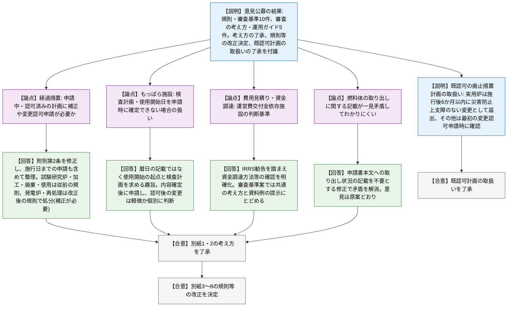
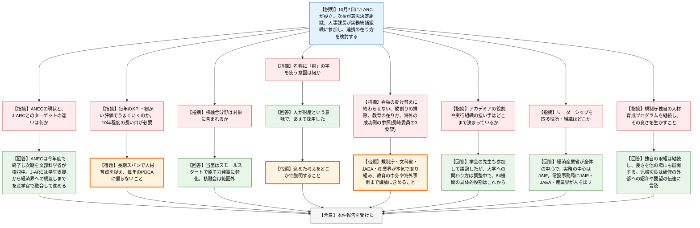

# 第36回原子力規制委員会（令和8年10月14日）
> 出典 : https://youtube.com/live/cifKSZrcUDg?si=w3c_cWFllvnoJHmY

## 会合の概要
* **廃止措置計画の審査実績を踏まえた規則等の改正を決定、意見公募への考え方も了承**
  試験研究炉等の規則・審査基準等の改正について、意見公募で寄せられた計15件(規則・審査基準10件、審査の考え方・運用ガイド5件)への考え方が了承され、各委員から異論なく改正が決定された。質疑は委員1名のコメントと委員長の確認のみで、技術的な議論は前回の委員会で終えているとの整理であった。
* **意見を受けて経過措置を拡大、「申請中」だけでなく今後の申請も対象に**
  意見公募時点では現に申請中の案件を念頭に整理していたが、施行日までに申請される事業も網羅するよう附則を修正した。試験研究炉・加工・廃棄・使用の各事業者は従前の規則で処分し、発電用原子炉設置者と再処理事業者は改正後の規則で処分する(申請の補正が必要)との整理が示された。
* **認可済みの廃止措置計画の扱いも了承、実用炉は施行後6か月以内の届出を求める**
  既に認可を受け変更認可を申請中でもない事業者のうち、実用発電用原子炉設置者には施行後6か月以内に「災害の防止上支障のない変更」としての届出を求める。それ以外は、施行後最初の変更認可申請の際に改正内容の反映を確認する方針で了承された。
* **「日本原子力人財コンソーシアム(J-ARC)」への参画を報告、委員から長期視点・縦割り排除・教育の中身まで注文が相次いだ**
  10月7日に設立されたJ-ARCに、次長が意思決定組織、人事課長が実務統括組織の構成員として参加する。委員からは、毎年のKPIで細かく評価する運用への懸念、「看板の掛け替え」に終わらせないこと、現場感覚を持つ人材の育成、規制庁独自の研修の継続などが求められた。
* **ANECとの役割分担や実行組織の担い手は「これから」、核融合も当面は対象外**
  ANEC(文部科学省系の教育コンソーシアム)は今年度末で終了し次期を検討中、J-ARCの対象は当面は原子力発電に特化し核融合は範囲外、アカデミアの関わり方も調整中であることが説明された。

---

## 議題ごとの詳細整理

### 【議題1】廃止措置計画の審査実績を踏まえた規制基準等の記載の具体化・表現の改善(試験研究の用に供する原子炉等の設置、運転等に関する規則等の改正)
* **議論の背景と論点:**
  * 背景: 廃止措置計画の審査実績を踏まえ、申請事項の適正化と審査基準等の記載整理を行うための規則等改正の最終段階である。
  * 経緯: 第24回委員会(令和8年度)で了承した意見公募の方針に基づき、パブリックコメントを実施した。規則・審査基準の改正案(行政手続法に基づく意見公募)は10件、審査の考え方・運用ガイドの改正案は5件の意見が提出された。
  * 付議事項: ①提出意見に対する考え方(別紙1、別紙2)の了承、②改正規則等(別紙3〜別紙8)の決定、③施行時点で既に認可を受けている廃止措置計画の取扱いの了承である。
  * 論点1(経過措置): 施行時点で既に申請中のものや認可済みのものに、補正申請や変更認可申請が必要かという意見が多く寄せられた。
  * 論点2(もっぱら施設): 廃止措置のためにもっぱら導入する性能維持施設について、申請時点で検査計画や使用開始日を確定させるのが難しいとして、柔軟な運用や軽微な変更・事後届出での扱いを求める意見があった。
  * 論点3(費用見積り・資金調達): 運営費交付金や予算措置に依存する施設について、確認の着眼点・書類例の明示や判断基準の提示を求める意見があった。
  * 論点4(記載の整合): 廃止措置計画の申請書本文に「燃料体の炉心等からの取り出しの状況」を記載する規定と、燃料体を取り出さない場合に「取り出す方法及び時期」を定める規定の関係が一見矛盾してわかりにくい、との指摘があった。

* **質疑応答（詳細）:**
    * 【説明者側】三田(原子力規制企画課 企画調査官)
      経過措置の意見に対し、意見公募時は現に申請中の案件を念頭に整理していたが、施行日までに申請される事業も網羅する方が適当と考え、改正規則の附則第2条を修正した。試験研究炉・加工・廃棄・使用の各事業者は、施行日時点で廃止措置計画の認可・変更認可を申請中であれば従前の規則に基づき処分する。発電用原子炉設置者と再処理事業者は、7月の説明どおり改正後の規則で処分するため、申請の補正が必要となる。
    * 【説明者側】三田(原子力規制企画課 企画調査官)
      もっぱら施設については、暦日で何月何日と書かせる趣旨ではなく、使用開始の起点を定め、使用開始前の検査も含めた検査計画があることを求める趣旨である。施設が廃止措置時に新たに設置されるため、事前に設計・工事計画を確認する必要がある。内容が確定してから申請してもらう必要があり、認可後の変更が軽微な変更として事後届出で足りるかは、内容に応じて個別に判断する。
    * 【説明者側】三田(原子力規制企画課 企画調査官)
      費用見積り・資金調達計画の説明書の改正は、IRRSミッション報告書に基づく勧告を踏まえ、原子炉施設の解体に要する資金の調達方法等を確認することを規定上明確化するものである。施設の性質や廃止措置の段階で個別判断が必要なため、審査基準案では共通の確認の考え方と確認資料の例を示すにとどめる。
    * 【説明者側】三田(原子力規制企画課 企画調査官)
      燃料体の取り出しの記載の関係は指摘のとおりわかりにくいため、該当する規則の条項で、申請書本文への「取り出しの状況」の記載を不要とするよう修正した。これにより審査の考え方上の矛盾に見える記載もなくなるため、当該意見は原案どおりとする。
    * 【説明者側】三田(原子力規制企画課 企画調査官)
      施行時点で既に認可を受け、変更認可の申請中でもない事業者については、安全上の重要度や申請状況を踏まえ、実用発電用原子炉設置者に施行後6か月以内に「廃止措置の実施に伴う災害の防止上支障のない変更」としての届出を求める。それ以外の事業者は、施行後最初の変更認可申請の際に、追加された申請書本文事項を記載する変更がなされていることを確認する。
    * 【規制側】委員
      細かい指摘を多くいただき、修正に至ったものもあって良かった。全体としてこの対応は妥当である。
    * 【規制側】委員長
      技術的な議論は前回の委員会で行ったため、今回の意見への回答について意見を求めた。続いて、廃止措置でも実用炉と試験研究炉では特殊性が異なり、それぞれに応じた意見に適切に考え方が示されているとの認識を述べた。
    * 【規制側】全委員
      別紙1・別紙2の考え方の了承、別紙3〜別紙8の規則等の改正決定、既認可の廃止措置計画の取扱い(資料1の6)の了承について、いずれも異論なく賛成した。

* **結論と宿題事項（アクションアイテム）:**
  * **決定事項:** 提出意見に対する考え方(別紙1、別紙2)を了承した。改正規則等(別紙3〜別紙8)を決定した。
  * **了承事項:** 施行時点で既に認可を受けている廃止措置計画の取扱い(実用炉は施行後6か月以内の届出、その他は最初の変更認可申請時に確認)を了承した。
  * **修正点(意見公募時点から):** ①燃料体が炉心から取り出されていない施設は、取り出しの状況に代えて取り出す方法・時期の記載を求めることを明確化、②経過措置の対象に、試験研究炉・加工・廃棄・使用の各事業者の今後の申請分を追加した。
  * **宿題事項:** 特になし。

### 【議題2】「日本原子力人財コンソーシアム」への対応
* **議論の背景と論点:**
  * 背景: 令和7年度の第28回委員会で、資源エネルギー庁が立ち上げた原子力人材育成強化の協議会への職員参加を了承した。協議会は3回開催され、3月31日に今後の方向性が取りまとめられた。
  * 経緯: 取りまとめで示された「産学官横断的な司令塔機能の創出(2026年度中目途)」を受けて議論の場が設置され、10月7日に日本原子力人財コンソーシアム(J-ARC)が設立された。
  * J-ARCの概要: 原子力人材に関する課題分析から施策の立案・実行までを一体的に推進する。意思決定組織(企業は役員級、行政は局長級)、実務統括組織(企業は部長級、行政は課長級)、常設の事務局で構成し、実務統括組織がロードマップとKPIを策定して意思決定組織が承認する。
  * 今後の対応: 次長が意思決定組織、人事課長が実務統括組織の構成員として参加し、可能な連携・協働の在り方を検討する。
  * 論点: ①ANECとの関係と対象の違い、②毎年の評価・KPI運用の是非、③対象分野(核融合を含むか)、④「アカデミア」の関与と実行組織の担い手、⑤リーダーシップを取る主体、⑥規制庁の独自の人材育成の位置づけである。

* **質疑応答（詳細）:**
    * 【規制側】山岡委員
      取組自体はよく、引き続き参加して意見を述べてほしい。既に動いているANEC(大学のコンソーシアム的なもの)の現状を尋ねた。
    * 【説明者側】菅生(人事課 課長補佐)
      ANECの動きは把握していないが、今年度で終了し、次期に向けて文部科学省が中心に何をするかを検討していると聞いている。
    * 【規制側】山岡委員
      ロードマップとKPIに沿って施策を実行し、毎年細かく評価する仕組みでうまくいくのかを強く懸念する。火山の人材育成は10年計画で行い、若い人が元気になったと感じたのは7〜8年目だったため、細かい評価は百害あって一利なしであり、長い目で考えるのがよい。
    * 【規制側】委員
      人が育つには長い時間がかかり、どの分野でも人が足りないと聞く。高専・大学から修士・博士課程までバランスよく育成につながることを期待する。
    * 【規制側】杉山委員
      ANECとの違いは文部科学省主導か経済産業省主導かではなく、ターゲットの違いではないか。ANECは学生(大学・高専)が主な対象という印象で、本件は産業界で活躍中の技術者が主な対象かを尋ねた。
    * 【説明者側】菅生(人事課 課長補佐)
      どちらを対象と分けるのではなく、産学官連携として、学生への支援・育成から経済界への橋渡しまでを融合して進める取組と認識している。
    * 【規制側】杉山委員
      ANECの参加機関にはQSTやNIFSがあり核融合分野も入っているが、今回の「原子力」に核融合は含まれるかを尋ねた。
    * 【説明者側】菅生(人事課 課長補佐)
      スモールスタートでできるところから始める方針で、核融合などは今は範囲から外れ、原子力発電に特化した人材育成となっている。
    * 【規制側】杉山委員
      「今は」という点が重要と受け止めた。名称の「人財」に財産の「財」の字を使うことに込めた考えを尋ねた。
    * 【説明者側】菅生(人事課 課長補佐)
      人が財産という意味で、最近この字を使う例が多く、あえて採用したと聞いている。
    * 【規制側】杉山委員
      その考えは、どこかでしっかり語ってほしい。
    * 【規制側】長崎委員
      提案に異論はなく、積極的に参加してほしい。「財」の字は財産の意味になっているのがよいと述べ、カナダのHQP(Highly Qualified Personnel)に近い印象と述べた。そのうえで3点を要望した。
    * 【規制側】長崎委員
      要望1として、定期的に会合を開き情報共有するだけの「看板の掛け替え」に終わらせず、規制庁に加え文部科学省、JAEA、産業界が本気で取り組むこと、また大学の話、事業者の話と責任を押し付け合う縦割りの発想を排することを求めた。文部科学省の令和5年12月の資料でも、40歳以下の大学教員の減少が顕著と示されている。
    * 【規制側】長崎委員
      要望2として、原子力安全の最後の砦は書類の立派さではなく、バルブやポンプの異音、燃料の取扱いといった「手の感触」を持つ人材であり、計算コードの出力を鵜呑みにせず物理から妥当性を理解できる人材でなければならないと述べた。工業高校、高専、専門職大学院まで含めた教育の在り方を議論するよう求め、例として、旧帝大を含め強電系でも交流回路が必修でなくなったという話を挙げた。
    * 【規制側】長崎委員
      要望3として、カナダのUNENEのような産官学連携のプラットフォーム(2002年開始、電力会社の大量採用では人材が育たないとして産官学が共同で始め、今も成功している)や、フランスのINSTNなど、海外の成功例を参考にするよう求めた。
    * 【規制側】委員
      図中の「アカデミア」は、大学、大学の協議会、学会のいずれかで関与の範囲が変わる。どこにどんな役割を期待するかは、設立時点でどこまで決まっているのかを尋ねた。参加84機関で目的や司令塔機能は一致していても、実行組織としてどの団体がどれだけ汗をかくのかの見通しを確認したかった。
    * 【説明者側】菅生(人事課 課長補佐)
      コアチームには学会の先生も参加し議論してきたが、大学の先生に上から指示することは馴染まないという議論もあり、関わり方は調整中である。参加予定の84機関には以前の人材育成ネットワークに参画していた大学も含まれるが、具体的な関わり方はこれからである。
    * 【規制側】委員
      計画のリーダーシップを取る役所・組織はどこかを尋ねた。
    * 【説明者側】渡邉(人事課長)
      全体としては経済産業省が中心で、実務の中心は日本原子力産業協会(JAIF)である。常設の企画推進事務局を設け、JAIF、JAEA、産業界から人を出してもらう体制を予定している。
    * 【規制側】委員
      経済産業省とJAIFが中心という理解を確認した。そのうえで、人材育成は1〜2年で答えが出るものではなく10年程度のスパンで考えるべきで、毎年PDCAを回すような仕組みは適さないと述べた。また、原子力は教育すべき内容と最先端の研究が乖離しつつある分野であること、博士課程に進む学生が少なく若手教員がほとんどいない実情(放射線防護も同様)を踏まえた全体計画を求めた。
    * 【規制側】委員
      規制委員会・規制庁は独自の人材育成プログラムを持っているが、これがあるからうちは十分、とならないよう、その良さを生かして独自に継続してほしいと述べ、人事課長に見解を尋ねた。
    * 【説明者側】渡邉(人事課長)
      独自の取組は引き続き行い、その良さを他の場にも展開していきたい。例えば、大阪大学での過去の取組では、規制庁職員や電力会社の人が学生に話をし、それぞれの話を聞いて学生同士で議論するといった形で、様々なプレイヤーを巻き込んでいく。
    * 【規制側】児嶋次長
      誰が主導してどう進むかはこれからだが、全体を見ながら関与していく。原子力の実務に特化した規制庁ならではの貢献として、実務に照らした人が面白さを直接語って興味を広げることを挙げた。これまで教育は文部科学省の分野として手を出しにくかったが、この場ができたので、規制庁の要望も率直に伝える機会にしたい。
    * 【規制側】児嶋次長
      人材育成センターの職員向け研修は初心者向けから高度なものまで多岐にわたり、内閣府など外部の職員を試験的に受け入れた例もある。関係機関に紹介してニーズを確かめることも今後あり得る。推進側も規制側も人材育成は同じ土俵で取り組むべきという委員会の従来の考え方に沿い、規制庁の良い取組を伸ばしていく。

* **結論と宿題事項（アクションアイテム）:**
  * **決定事項:** 本件報告を受けた。
  * **今後の対応:** 次長が意思決定組織、人事課長が実務統括組織の構成員としてJ-ARCに参加し、規制委員会として可能な連携・協働の在り方を検討する。
  * **委員からの要望事項:** ①10年程度の長い目で人材育成を捉え、毎年の細かい評価に偏らないこと、②縦割りを排し、規制庁・文部科学省・JAEA・産業界が本気で取り組むこと、③現場感覚を持つ人材や物理から妥当性を理解できる人材の育成まで含め、工業高校・高専・専門職大学院などの教育の在り方も議論すること、④カナダ(UNENE)・フランス(INSTN)など海外の成功例を参考にすること、⑤規制庁独自の人材育成プログラムを継続し、その良さを他にも展開すること、⑥名称に込めた「財」の意味をどこかで説明すること。
  * **未確定事項:** アカデミアの具体的な関わり方、実行組織の担い手、核融合分野を対象に含めるかは、いずれもこれから調整される。

---

## 論理構造の可視化（Mermaid）

### 【議題1】廃止措置計画の審査実績を踏まえた規制基準等の記載の具体化・表現の改善

### 【議題2】「日本原子力人財コンソーシアム」への対応

