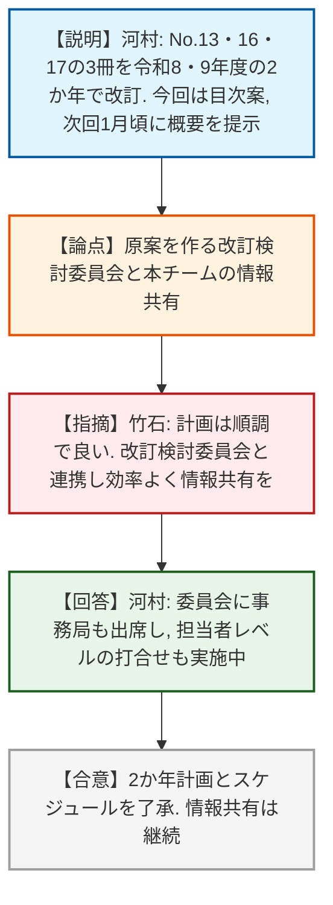
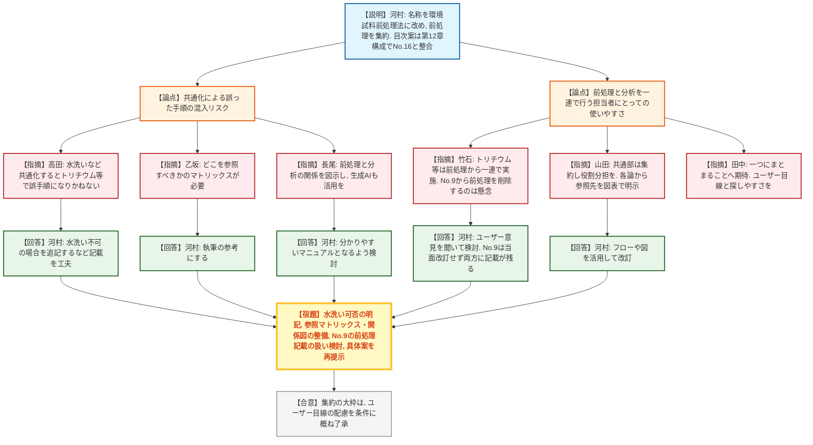
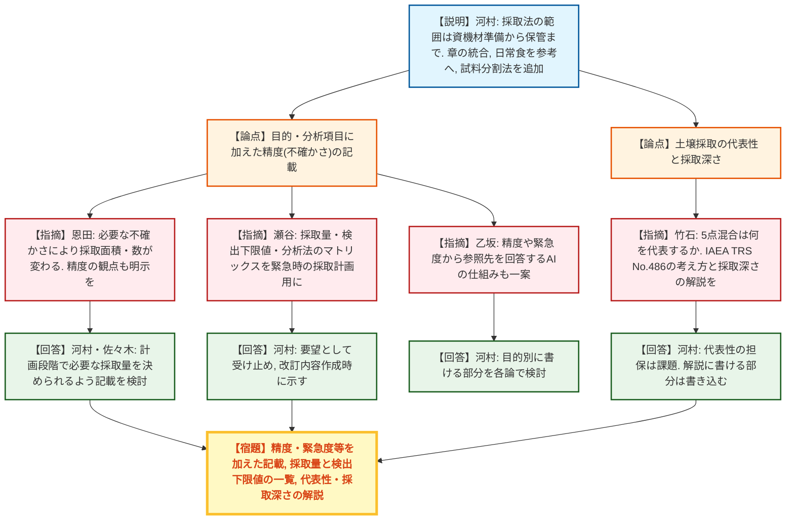
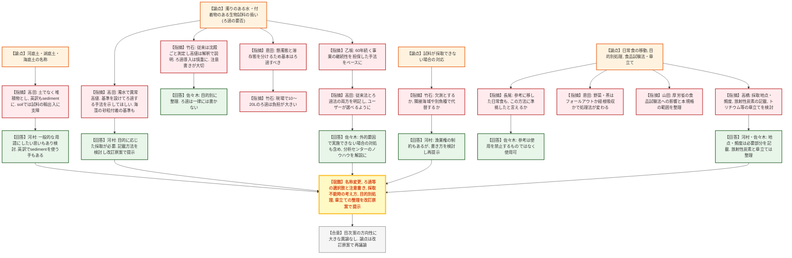
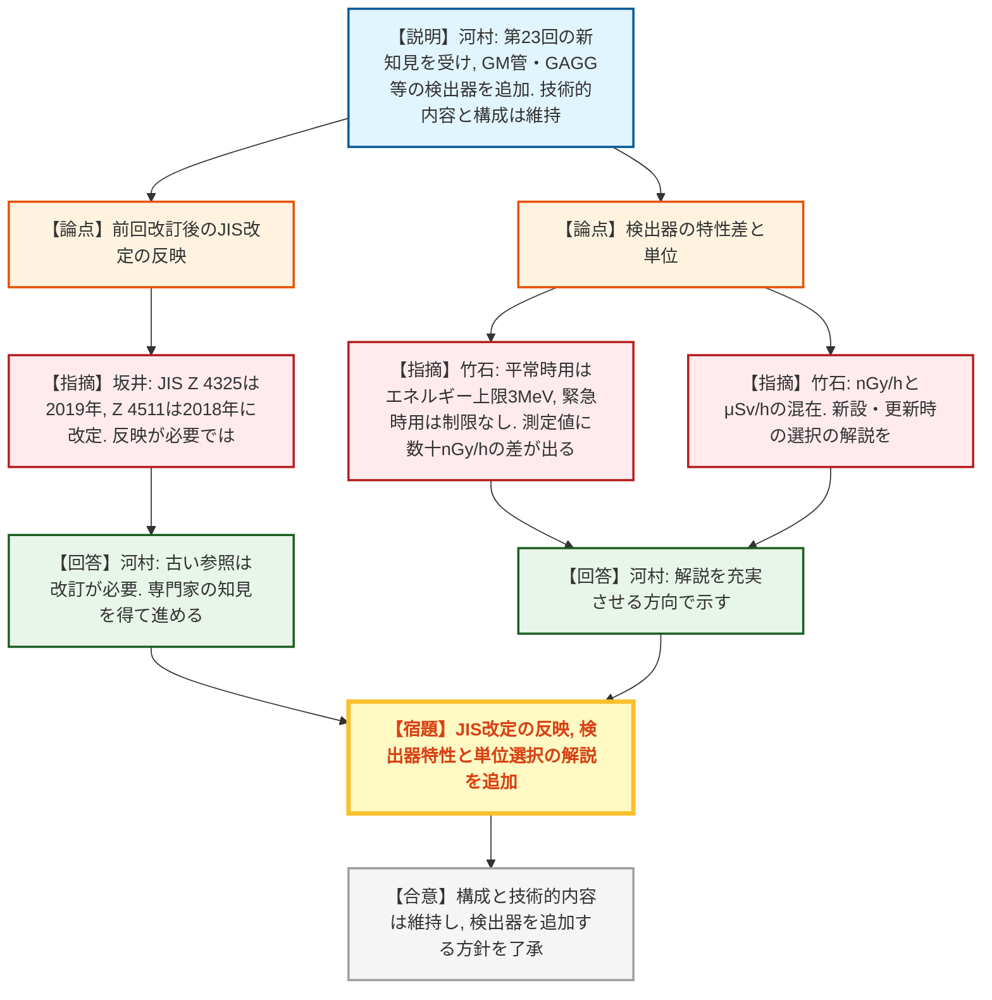
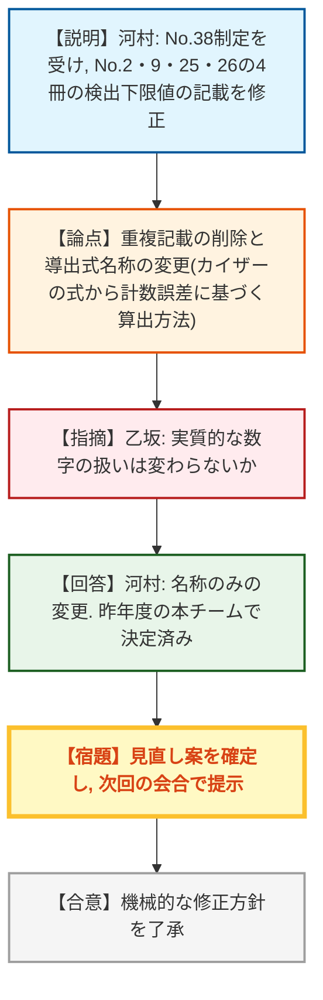
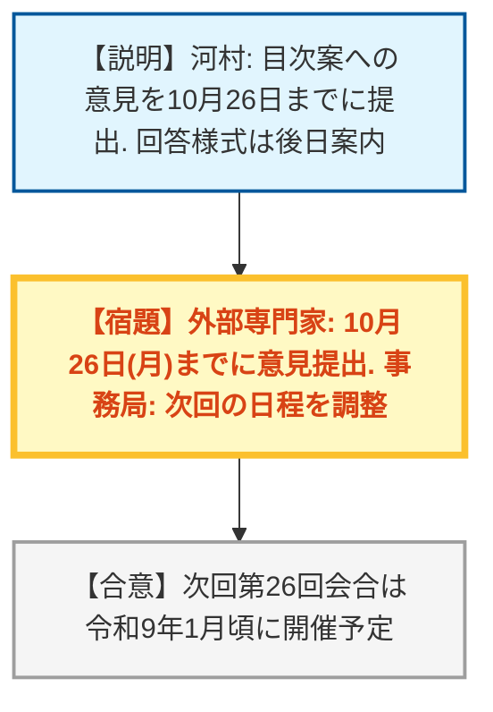

# 第25回環境放射線モニタリング技術検討チーム（令和8年10月19日）
> 出典 : https://youtube.com/live/HMZUpP8Z34c?si=FX3iZU-vt268N2yE

## 会合の概要
* **放射能測定法シリーズの2か年改訂計画（令和8・9年度）の提示**
  原子力規制庁（事務局）から、No.13「ゲルマニウム半導体検出器等を用いる機器分析のための試料の前処理法」、No.16「環境試料採取法」、No.17「連続モニタによる環境γ線測定法」の3冊を2か年で改訂する計画が示された。今回は目次案までを提示し、次回（令和9年1月頃）に概要を示す。外部専門家からは、スケジュールが当初計画どおり進んでいる点が評価された。
* **前処理法（No.13）と採取法（No.16）の統合・再編をめぐる「ユーザー目線」の議論**
  試料の前処理に関する記載をNo.13へ集約する事務局案に対し、トリチウム等の分析担当者は前処理から分析まで一連で行うため、マニュアルが分冊になると使いにくいとの懸念が相次いだ。事務局は、まずユーザーの意見を聞き、トリチウム分析法（No.9）の前処理記載は当面残す方針を示した。共通部分の集約と各論の完結性をどう両立させるかが、最大の争点となった。
* **「ろ過の要否」と「継続性」の対立**
  海水・陸水の濁りや懸濁物による高値の扱いについて、ろ過工程を採取法に盛り込むべきとする意見（高田・恩田）と、60年続く平常時モニタリングの継続性を重視してろ過を一律には導入すべきでないとする意見（竹石・乙坂）が出た。最終的に、継続性を担保した従来法を基本とし、状況に応じた選択肢と注意書き・解説を設ける方向で事務局が検討することとなった。
* **資料4: 連続モニタ改訂では検出器の拡充に伴う解説の充実を要望**
  GM管やGAGGなど、国内に導入済みの新しい検出器を網羅的に追加する方針が示された。専門家・規制庁担当者からは、JISの改定への反映、平常時用と緊急時用の検出器特性（エネルギー上限の有無による測定値の差）、nGy/hとμSv/hの単位の混在などについて、丁寧な解説が必要との指摘があった。
* **検出下限値の表現見直し（資料5）は機械的修正として了承の方向**
  測定法シリーズNo.38「放射能測定における品質保証」（令和8年6月制定）に基づき、No.2・9・25・26の4冊の検出下限値に関する記載を修正する。大きな異論はなく、次回の会合に修正案を提示して確認する。

---

## 議題ごとの詳細整理

### 【議題1】令和8年度の放射能測定法シリーズの改訂作業計画
* **議論の背景と論点:**
  * 背景: 放射能測定法シリーズは、地方自治体や原子力事業者など実務者が使いやすい標準的なマニュアルを作ることを目的とする。改訂は令和6年3月の第20回会合で定めた方針に基づいて行う。
  * 計画: 令和8・9年度の2か年で、No.13（試料の前処理法）、No.16（環境試料採取法）、No.17（連続モニタによる環境γ線測定法）の3冊を改訂する。No.13とNo.16は連動するため合わせて改訂し、いずれも平常時モニタリング用で、緊急時用のものは対象外とする。
  * 令和8年度のスケジュール: 今回の第25回会合で目次案を提示し、次回（令和9年1月頃）に概要を提示する。
  * 検出下限値の表現見直し（議題5）は別途、今年度中に改訂案を示す。
  * 論点: 原案を作成する「放射能測定法シリーズ改訂検討委員会」と、本検討チームとの情報共有の仕方。

* **質疑応答（詳細）:**
    * 【説明者側】河村（規制庁 環境放射線企画室）
      3冊を2か年で改訂する計画と令和8年度のスケジュールを説明した。検出下限値の表現見直しは、今年度制定のNo.38に基づき、別途今年度中に改訂案を示す。
    * 【外部専門家】竹石（原子力機構）
      計画どおり着実に進んでいる点は良い。原案は別の改訂検討委員会で作られているので、本チームの意見と委員会での検討の間で連携を取り、2年という短い期間で効率よく情報共有してほしい。
    * 【説明者側】河村（規制庁）
      改訂検討委員会には事務局も出席して常に情報共有しており、担当者レベルの打ち合わせも別に行っている。今後もこの形で進める。
    * 【座長】
      竹石氏のコメントに留意して作業計画を進めるよう、事務局に求めた。

* **結論と宿題事項（アクションアイテム）:**
  * **決定事項:** 3冊を2か年で改訂する計画と、令和8年度の作業スケジュールは特段の異論なく了承された。
  * **宿題:** 改訂検討委員会と本チームの間の情報共有を、効率よく継続すること。

### 【議題2】放射能測定法シリーズ「ゲルマニウム半導体検出器等を用いる機器分析のための試料の前処理法」の改訂について
* **議論の背景と論点:**
  * 背景: 初版発行から40年以上が経過し、一度も改訂されていない。
  * 改訂の方針（5点）: ①本測定法における前処理の定義を策定する、②No.16に記載の試料調製法など前処理に関する部分を統合する、③トリチウム、炭素14、ヨウ素129など各種分析に特化した前処理を既存の測定法から集約する、④単位系の修正と最新のJIS・IAEAマニュアルの反映、⑤記載方法の統一。
  * 改訂の方向性: 名称を「環境試料前処理法」に改め、前処理の範囲は「解体・乾燥・粉砕・灰化・均一化」までとし、酸分解や化学分離などの分析操作は含めない。写真・図表・生成AIを活用して視覚的に分かりやすくする。
  * 目次案: 現行は第9章まで、改訂案は第12章までとし、No.16の目次と揃えて互換性を確保する。「試験所間比較のための試料分割法」を解説に新規追加する。
  * 章内構成案: 共通する前処理を1項に集約し、以降は分析法ごと（ゲルマニウム半導体検出器用、トリチウム用など）に記載する。
  * 論点: 分析法が異なる前処理を一つのマニュアルにまとめることで、ユーザーが誤った手順を取るおそれはないか。トリチウム分析法等から前処理の記載を移すことの是非。

* **質疑応答（詳細）:**
    * 【外部専門家】高田（福島大学）
      資料2の4ページで、「生物試料の水洗い」など共通の前処理を1項に統一するのか。水洗いが不可の分析（トリチウム等）もあり、統一すると誤った手順になりかねない。分析ごとの前処理フローを行き来するのも使いにくい。
    * 【説明者側】河村（規制庁）
      分析法によって水洗いの可否は異なるため、「水洗いしてはいけない」場合を追記するなど、ユーザーが間違えないよう記載を工夫する。具体的な内容は今後示す。
    * 【外部専門家】乙坂（東京大学）
      環境試料の前処理法としてまとめる改訂自体は素晴らしい。一方で対象試料が多様になるため、本来してはならない扱いをしてしまうおそれがある。どの試料・分析ではどこを参照すればよいかを示すマトリックスがあると、試料のロスを減らせる。
    * 【説明者側】河村（規制庁）
      乙坂氏のコメントも参考にして執筆を進める。
    * 【外部専門家】長尾（金沢大学）
      写真・図表や生成AIの活用は大変良い。前処理と分析の関係性を図で示せば、実際に分析する人が迷わず間違えずに済む。
    * 【説明者側】河村（規制庁）
      長尾氏の提案を踏まえ、ユーザーに分かりやすいマニュアルになるよう検討する。
    * 【外部専門家】竹石（原子力機構）
      現場では、トリチウム・炭素14・ヨウ素129などの分析担当者が、凍結乾燥から有機物分解（過マンガン酸カリウム、過硫酸ナトリウム等）、蒸留、測定まで一人で通して行う場合が多い。前処理を分けると2冊を見なければならず使いづらい。集約自体はよいが、トリチウム分析法（No.9）から前処理の記載を削除することには引っかかりがある。
    * 【説明者側】河村（規制庁）
      悩ましい点と認識している。採取・前処理・測定の担当が分かれる場合は前処理法に集約されている利点がある。最も大事なのはユーザー目線であり、一連の記載を望む意見が多数であれば検討する。トリチウム分析法は数年前に改訂済みで今回は改訂しないため、当面は両方に同じ前処理が載る。統合してよいとなれば、次回のトリチウム分析法改訂時に「前処理は前処理法を参照」とする想定だが、現時点では未決定。
    * 【外部専門家】田中（島根県原子力環境センター）
      現状は複数のマニュアルを行き来しなければならず、一つにまとまることへの期待は大きい。ユーザー目線の視点を持って進めてほしい。担当者は3年周期で異動することも多く、「どこに何が書いてあるか」が探しやすいことも重要。
    * 【説明者側】河村（規制庁）
      ユーザーにとって一番使い勝手のよい形で改訂を進める。
    * 【外部専門家】山田（近畿大学）
      方向性は事務局案でよいと考える。各論に全て記載すると、規格のメンテナンス時に記載のずれが生じやすい。共通部分は集約して各論と役割分担したほうが規格を良い状態で維持できる（国際規格の作り方も同様）。その代わり、各論から他の規格のどこを見ればよいかをフロー図や表で明示してほしい。トリチウム分析法の改訂が後になっても、そのような配慮で両立できる。
    * 【説明者側】河村（規制庁）
      フローや図を活用し、ユーザーが間違いなく分析できるよう改訂する。
    * 【座長】
      ユーザーには、これまで使ってきた人、初めて使う人、現場で担当を分けている人など様々な層がある。将来の改訂も含めて整理したうえで、引き続き専門家の指導を受けながら改訂作業を行うよう求めた。

* **結論と宿題事項（アクションアイテム）:**
  * **決定事項:** 名称を「環境試料前処理法」とし、前処理を集約する大枠の方向性は、ユーザー目線の配慮を条件に概ね了承された。
  * **宿題:**
    1. 水洗いの可否など分析法ごとに異なる点を明記し、誤った手順を取らないよう記載を工夫すること。
    2. 試料・分析法と参照箇所の対応を示すマトリックスや、前処理と分析の関係を示す図・フローを整備すること。
    3. 前処理と分析を通して行う担当者の使いやすさを考慮し、トリチウム分析法（No.9）等の前処理記載の扱いは、ユーザーの意見を集めて引き続き検討すること。
    4. 具体的な改訂案ができた段階で、改めて外部専門家に意見を求めること。

### 【議題3】放射能測定法シリーズ「環境試料採取法」の改訂について
* **議論の背景と論点:**
  * 背景: 初版発行から40年以上が経過し、一度も改訂されていない（No.13と同様）。
  * 改訂の範囲: 採取資機材の準備から試料の採取、試料容器を含む輸送、保管までとする。試料の調製など前処理に関する部分はNo.13へ統合する。
  * 改訂の方向性: 調査内容・目的・分析項目の違いによる採取方法の違いを記載する。「試験所間比較のための試料分割法」を新規に追加する。写真・図表・生成AIを活用し、他の測定法シリーズと章立て・用語の整合を図る。
  * 目次案の主な変更: 現行の陸水と排水を第4章「陸水」に統合し、河底土・湖底土・海底土を第7章「底土」に統合する。淡水産生物と海産生物は第14章「水生生物」に統合する。日常食は、測定が必須でなく平常時モニタリングや水準調査でも測定していないことから、本編から参考へ移す。第20章の「トリチウム及び放射性ヨウ素等」は各章に分散して記載し、大気試料・水試料・生物試料の順に並べる。
  * 解説・参考の整理: 日常食関連は参考1にまとめ、前処理に関する参考1・2はNo.13へ移す。海水・海底土の参考は各章へ移す。参考8（ストロンチウム90とセシウム137の分析結果例）は、規制庁のデータベースで過去の測定結果が検索できるため削除を提案する。
  * 論点: 目的・精度・採取量など採取方法を左右する要素の記載、試料の名称（土か堆積物か）、水試料のろ過の要否、採取できない場合の対応、継続性の確保。

* **質疑応答（詳細）:**
    * 【外部専門家】恩田（筑波大学）
      「調査内容、目的、分析項目等の違いで採取方法が変わる」と明記するのは重要だが、それだけでは足りない。どの程度の不確かさのデータを得たいかによって、採取面積や数が変わるため、不確かさ（精度）の観点も分かりやすく示してほしい。福島の事故時にもこの点が問題になった。
    * 【説明者側】河村・佐々木（規制庁）
      現状は記載していないが、現場でこのような場合にはこの程度の不確かさという形で記載できるよう検討する。不確かさは主に採取量に関わるため、計画段階で必要な採取量（例えば海水ならより大量に）を決められるようにマニュアル化したい。
    * 【外部専門家】瀬谷（原子力機構 大洗研究所）
      採取量、検出下限値、分析法をマトリックスで示し、おおよそどの程度の検出下限値が得られるか分かる一覧表があるとよい。特に緊急時に採取計画を立てる際、ユーザーにとって大変便利になる。
    * 【説明者側】河村（規制庁）
      要望として受け止め、具体的な改訂内容の作成時に示す。
    * 【外部専門家】竹石（原子力機構）
      最終的にどのデータが必要か、平常時モニタリングでどう使うかという視点も大事。現行の土壌採取は、長方形の敷地の対角線の中央と四隅寄りの計5点を混合する方法だが、実際の現場にそのような理想的な場所はなく、混合試料が何を代表しているのか評価時に気になる。土壌は過去数年のばらつきが大きく、平常の変動幅から施設の影響を弁別することも難しい。IAEAのTRS No.486（恩田氏が参加）にあるサンプリング設計・戦略の考え方を踏まえ、最も代表性のあるデータを得る採取法を解説に書けないか。また採取深さは日本では5cmで統一しているが、農学では根の張る15〜20cmも使われ、福島では深さで濃度が大きく変わったため、その考え方も解説してほしい。
    * 【説明者側】河村（規制庁）
      代表性をいかに担保するかは常に課題。目的に応じて採取方法も異なるので、解説に書ける部分は書き込む。
    * 【外部専門家】乙坂（東京大学）
      「目的に応じて採取方法が変わる」ことは重要だが、書く立場では何をどこまで書くか難しい。将来的にはAIの活用により、フィールド、精度、緊急度、対象核種といった条件を入力すると、どのマニュアルのどの項を参照すべきか回答が得られる仕組みがあるとよい（今すぐの要望ではない）。
    * 【説明者側】河村（規制庁）
      AIを使う機会でもあるので、目的に応じた記載を具体的に書ける部分は各論で検討する。
    * 【外部専門家】高田（福島大学）
      ユーザーとして3点を要望する。第一に名称について、河底土・湖底土・海底土の「土」を、河川などから運ばれた粒子が降り積もったものという実態に合わせて「堆積物」に改め、英訳もsoilではなくsedimentとすべき。soilでは試料の海外輸出入にも支障が出る。第二に、濁った海水・陸水を採取すると、粒子中の放射性物質のために異常に高い値が出る。植物プランクトンや魚のごみ等の混入も前処理を煩雑にする。そのため、基準を設けて「こういう場合はろ過する」という手法を示してほしい。第三に、海藻等の指標生物に砂粒が多く付着し、水洗いでは除去が難しく、福島事故後に高値が出た例もあった。付着が多い場合は採取しない、といった基準も記載してほしい。濁りが強いときや天候による採取基準も項目として欲しい。
    * 【説明者側】河村（規制庁）
      名称は、歴史的経緯もあるが一般的な用語にしたい思いもあり検討する。英訳でsedimentを使う対応もあり得る。用語は解説にも詳しく書ける。濁りへの対応は、目的に応じた採取が必要であり、ろ過は前処理に入るかもしれないが、どう記載するか検討して改訂原案で示す。
    * 【外部専門家】竹石（原子力機構）
      従来の環境モニタリングは施設から放出されたものの評価であり、粒子状物質が放出されることもあるため、基本的にろ過をせず、海水にリンモリブデン酸アンモニウム（AMP）等を加えて沈殿させ、その沈殿をそのままゲルマニウム半導体検出器で測定してきた。大雨の泥でウラン・トリウム系列等が上がった場合は、解析・解釈の段階で原因を説明してきた。ろ過を取り入れると、この考え方に影響するため慎重な判断が必要。
    * 【説明者側】佐々木（規制庁）
      目的に応じて前処理方法を選ぶ。施設の影響を見るなら、同じ場所で定期的に採取して試料に含まれるかを調べる。長期変動やバックグラウンドを調べる目的で、土砂が流入している場合などは、採取日を変えるなどの対応もあり得る。ろ過のあり方は一律には書かないが、目的に応じた採取・前処理の整理を行う。
    * 【外部専門家】高田（福島大学）
      予備試料を取っておく、など状況に応じた示唆を記載してもらえるとよい。高値の原因が土砂であるというエビデンスを示せれば、ユーザーも納得できる。
    * 【外部専門家】竹石（原子力機構）
      濁った水や降雨直後は採取しない旨は、東海での独自のマニュアルには書いている（雨水の混入による真水の影響や、河川の泥からのウラン・トリウム系列、土壌のセシウムの影響があるため）。ただし採取後の試料をろ過して人為的に弁別することはしていない。濁度の基準も必要になり、操作が難しくなりすぎるのも問題。そのまま分析し、高ければ原因を調査し、自然変動なら注記して報告する形でよい。注意書きをきちんと付けてもらうことが大切。
    * 【説明者側】河村（規制庁）
      海藻や表層の付着物の問題も課題として認識した。「こういう場合はこうすることが望ましい」と書ける部分は記載し、正しく測定対象を測れるよう改訂したい。
    * 【外部専門家】恩田（筑波大学）
      IAEAなどの経験からも、バルク試料で環境モニタリングを行うのは世界的には多くない。日本では川や海の水がきれいで無視できる場合が多いという背景はあるが、懸濁態か溶存態かを知りたいので、私は基本的にはろ過すべきと考える。数字だけでは「このとき川が増水していた」などが評価できず、何のための数字か分からなくなる。緊急時の必要性は別として、ろ過して溶存態と懸濁態を分ける方法をしっかり記載してほしい。
    * 【外部専門家】竹石（原子力機構）
      意見はもっともだが、現場で10〜20Lの海水をろ過するのは非常に大変であり、現場との兼ね合いも考えてほしい。また、海産生物などは試料が採取できない場合がある。その場合は欠測とするのか、隣接海域や別の魚種（カレイが取れずヒラメは取れる等）で補うのか。濃縮係数が違うため単純に比較はできないが、モニタリングの連続性を保つため、その考え方を検討してほしい。
    * 【説明者側】河村（規制庁）
      不漁が数年続く場合もあり、漁業権の問題で採取場所を簡単に変えられない事情もあるが、欠測よりデータを取ったほうがよいという意見は理解できる。難しい問題だが、書き方を検討して専門家に示す。
    * 【外部専門家】乙坂（東京大学）
      ろ過の議論は重要だが、本シリーズの主なユーザーは自治体や政府のモニタリング事業者で、60年継続している事業であり、継続性が非常に大事。継続性を担保できる手法をベースとし、その上で現在指摘されている問題を整理する構成にしないと混乱を生じる。
    * 【外部専門家】長尾（金沢大学）
      ろ過の件は今後議論すればよい。別の観点で、日常食を本編から参考に移したが、日常食を分析する場合も、参考にあるこの方法に準拠したと捉えてよいか。
    * 【説明者側】佐々木（規制庁）
      解説は通常使うものの詳細な説明、参考は「メインでは使われていないが同様のことができる手法」であり、使用を禁止するものではない。日常食のモニタリングをしてはいけないわけではなく、参考の方法を使って構わない。
    * 【外部専門家】田中（島根県原子力環境センター）
      担当者は3年周期で異動することが多く、書いてあったはずの記載がどこにあるか分からなくなる。各冊の章立ての整合を図ってもらえるのはありがたく、探しやすさの視点も大事にしてほしい。
    * 【外部専門家】高田（福島大学）
      継続性が大切であることは理解している。その上で選択肢を与えてほしい。「マニュアルに書いていないからやらない」と言われてしまった経緯があるため、ろ過する場合の方法と継続性を担保する従来の方法の両方を明記し、AかBかをユーザーが選べるようにしてほしい。新設の地点などで新しい手法を試す際にも説明しやすい。
    * 【説明者側】佐々木（規制庁）
      試料が採取できない場合の話に直結する。近年の気候変化で、標準生物（指標植物など）ですら採取しにくくなっている。従来法の継続は大事だが、外的要因で実施できなくなった場合の対処について、原案を作成している日本分析センターが長年蓄積したノウハウを解説等にアドバイスとして加え、使いやすいマニュアルにしたい。
    * 【外部専門家】恩田（筑波大学）
      第9章「野菜」、第10章「茶」の目次について。平常時の測定でも、発電所からの放出に伴うフォールアウトを拾うという目的と、経根吸収を見るという目的の2つがあるが、現行は経根吸収を意識した記載になっている。福島では表面のフォールアウトを指標として非常に有用だった。目的により処理法も変わるので、対処法を考えてほしい。
    * 【説明者側】河村（規制庁）
      恩田氏のコメントを踏まえて改訂案を作成する。
    * 【外部専門家】山田（近畿大学）
      厚生労働省の食品中の放射性物質の試験法は、No.13（およびNo.16）を参照している。日常食の扱いや今回の変更が、食品側の試験法に与える影響の調査と、本規格が扱う範囲の明確化を併せて整理してほしい。そうすれば、食品側の試験法で不足する点を検討できる。
    * 【説明者側】河村（規制庁）
      山田氏のコメントを踏まえて改訂を進める。
    * 【規制側】高橋（規制庁）
      2点確認したい。第一に、トリチウム分析法には「試料採取地点及び採取頻度」の項目があるが、これらも改訂案に盛り込むのか。第二に、目次案の「トリチウム及び放射性ヨウ素等を各章内に移動」について、放射性炭素など、個別の測定法に特徴的な採取の記載（かなり細かいもの）を今回入れるのか。また、トリチウムや放射性炭素の大気試料は、第1章の大気浮遊じん、第2章の降下物とは性質が異なるため、章の名称や章立ても検討してほしい。
    * 【説明者側】河村・佐々木（規制庁）
      採取地点・頻度は、原子力災害対策指針の補足参考資料にも記載があるが、測定法シリーズにも記載したほうがよい部分は記載する。放射性炭素は現状では想定していなかったが、記載すべきという議論になれば検討する。大気中のトリチウム・放射性炭素は大気浮遊じんとは別のものなので、章立てをどうするかも含めてきちんと整理する。
    * 【座長】
      議題2・3を通じ、「求められる精度」など目的以外の要素への指摘が多かったこと、個別の前処理について専門的な課題提示と一部の対処法の提案が得られたこと、継続性の重要性と、変わり得る部分には選択肢を設けるべきとの具体的な提案があったことをまとめた。事務局は具体案ができた段階で改めて意見を聞くよう求めた。

* **結論と宿題事項（アクションアイテム）:**
  * **決定事項:** 目次案（統合・再編）の方向性に大きな異論はなかった。ただし、ろ過の導入、試料の名称変更、試料が採取できない場合の扱いなどは決着せず、改訂原案の作成時に再度議論する。
  * **宿題:**
    1. 採取方法が変わる要素に「目的・分析項目」だけでなく「求められる精度（不確かさ）、緊急度、対象核種」等を加えること。
    2. 採取量と検出下限値、分析法の関係を示す一覧表の検討と、採取の代表性（サンプリング設計、採取深さ等）を解説に記載すること。
    3. 河底土・湖底土・海底土の名称（堆積物への変更）と、英訳としてsedimentを用いることを検討すること。
    4. 濁りのある水のろ過、海藻等の付着物、降雨・濁りがある場合の採取基準について、継続性を担保した従来法を基本とし、状況に応じた選択肢と注意書きを検討すること。
    5. 試料が採取できない場合の考え方（欠測とするか、隣接海域や別種で代替するか）を検討すること。
    6. 野菜・茶などで、フォールアウトの指標か経根吸収の指標かという目的による違いを踏まえた対処法を検討すること。
    7. 厚生労働省の食品中の放射性物質の試験法への影響の整理、採取地点・頻度の記載、トリチウム・放射性炭素に関する章立てを整理すること。

### 【議題4】放射能測定法シリーズ「連続モニタによる環境γ線測定法」の改訂について
* **議論の背景と論点:**
  * 背景: 昨年の第23回会合で「費用対効果の高い環境放射線モニタリング実施に資する新知見の導入」が議論され、JEMIMA（日本電気計測器工業会）から新しい検出器の報告を受けた。これを受け、No.17の検出器に関する情報を更新する。
  * 改訂の方向性: 国内に導入されているγ線連続モニタを網羅的に記載し、ユーザーの検出器選択の幅を広げる。前回改訂（平成29年）で福島第一原発事故の知見は反映済みのため、現行の技術的内容は原則改訂せず、新たな検出器を追加する。構成（固定式・可搬式のモニタリングポストと走行サーベイシステム）は踏襲し、別冊の参考資料は変更せず存置する。
  * 目次案: 検出器の章にGM管、GAGG等の新しい検出器を追加し、第2章の用語解説は付録へ移す。現行第8〜10章のNaI検出器による空間γ線スペクトルの解析を第6章にまとめ、NaI以外のスペクトルが測れる検出器も同章に記載する。現行の付録1〜3は解説へ、付録4の参考文献は巻末にまとめる。
  * 論点: 前回改訂後に改定されたJISの反映、検出器の特性差や単位の整理。

* **質疑応答（詳細）:**
    * 【説明者側】河村（規制庁）
      改訂の背景、方向性、目次案を説明した。
    * 【規制側】坂井（規制庁 技術基盤グループ）
      技術的内容を原則改訂しないとしても、前回改訂後のJISの改定は反映する必要がある。JIS Z 4325は2019年にIEC 61017対応も含め改定され、方向特性の規定値も変わっている。JIS Z 4511は引用が旧版だが2018年に改定され、校正に関する内容が変わり機能確認などになった。放射線障害予防規定のガイドにも反映されている。その認識でよいか。
    * 【説明者側】河村（規制庁）
      参照しているJISが古くなっている部分は改訂が必要と考えており、坂井氏をはじめ専門家の知見をいただきながら進める。
    * 【外部専門家】竹石（原子力機構）
      様々な検出器を採用できることは自治体にとって費用対効果の面で使いやすい。ただし、平常時はバックグラウンドの変動を見ており、NaIシンチレーションカウンターは人工放射線の監視のため3MeVで上限を切っている。緊急時用（OIL2の20μSv/hなど）はエネルギーを制限せず高線量を測るため、宇宙線等の影響が入る。この特性差を記載しないと、同じ自治体のホームページで数十nGy/h程度の差が出て混乱する。目的に応じた特性を解説してほしい。また、従来の固定観測局は現在でもnGy/h、緊急時モニタリングはμSv/hと単位が混在している。新設・更新時にどちらを選ぶか、ICRU 95による実用量の見直しもあり難しいが、自治体が迷わないよう解説をつけてほしい。
    * 【説明者側】河村（規制庁）
      解説を充実させ、方向性をお示ししたうえで今後議論いただく。
    * 【座長】
      新しいJISへの対応と、検出器の選択肢が増えた際の丁寧な解説が必要というコメントを踏まえ、改訂作業を進めるよう事務局に求めた。

* **結論と宿題事項（アクションアイテム）:**
  * **決定事項:** 現行の構成と技術的内容は維持し、新たな検出器を追加する方針は了承された。
  * **宿題:**
    1. 前回改訂後に改定されたJIS（Z 4325、Z 4511等）の反映。
    2. 平常時用・緊急時用の検出器特性（エネルギー上限の有無による測定値の差）の解説。
    3. nGy/hとμSv/hなど単位の選択に関する解説。

### 【議題5】放射能測定法シリーズの検出下限値の表現の見直しについて
* **議論の背景と論点:**
  * 背景: 測定法シリーズNo.38「放射能測定における品質保証」が令和8年6月に新規制定された。
  * 見直しの対象: 直近で改訂したNo.2（放射性ストロンチウム分析法）、No.9（トリチウム分析法）、No.25（放射性炭素分析法）、No.26（ヨウ素129分析法）の4冊の、品質保証に関する部分（検出下限値の記載）。
  * 見直しの内容: No.38を引用して重複する記載は原則削除する。検出下限値の導出式の名称は、カイザーの式から計数誤差に基づく算出方法に変更する。
  * 論点: 名称変更が実質的な数値の扱いに影響するか。

* **質疑応答（詳細）:**
    * 【説明者側】河村（規制庁）
      見直しは機械的な修正であり、次回の会合に修正案を示して確認いただく。
    * 【外部専門家】乙坂（東京大学）
      導出式の名称変更は、実質的な数字の扱いは変わらないという理解でよいか。
    * 【説明者側】河村（規制庁）
      そのとおり。名称のみの変更であり、この名称は昨年度の本チームで決定したものである。
    * 【座長】
      事務局に、見直し案の確定作業を行うよう求めた。

* **結論と宿題事項（アクションアイテム）:**
  * **決定事項:** No.38に基づく4冊の機械的な修正方針に異論はなく、了承された。
  * **宿題:** 事務局が見直し案を確定し、次回の会合で提示すること。

### 【議題6】その他
* **議論の背景と論点:**
  * 追加の指摘や意見の有無、および今後の進め方の確認。

* **質疑応答（詳細）:**
    * 【説明者側】河村（規制庁）
      各冊子の目次案について気づいた点があれば、10月26日（月）までに提出してほしい。回答様式は改めて案内する。
    * 【説明者側】河村（規制庁）
      次回の第26回会合は、令和9年1月頃の開催に向けて調整し、改めて連絡する。

* **結論と宿題事項（アクションアイテム）:**
  * **宿題:** 外部専門家は、目次案への意見を10月26日（月）までに事務局へ提出する。事務局は次回（令和9年1月頃）の会合の日程を調整・連絡する。

---

## 論理構造の可視化（Mermaid）

### 【議題1】令和8年度の放射能測定法シリーズの改訂作業計画

### 【議題2】「ゲルマニウム半導体検出器等を用いる機器分析のための試料の前処理法」の改訂

### 【議題3】「環境試料採取法」の改訂（その1: 採取方法・精度・代表性）

### 【議題3】「環境試料採取法」の改訂（その2: 名称・ろ過・継続性・採取不能時の対応）

### 【議題4】「連続モニタによる環境γ線測定法」の改訂

### 【議題5】放射能測定法シリーズの検出下限値の表現の見直し

### 【議題6】その他

