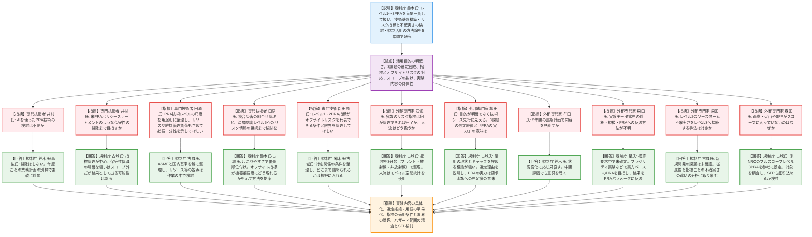
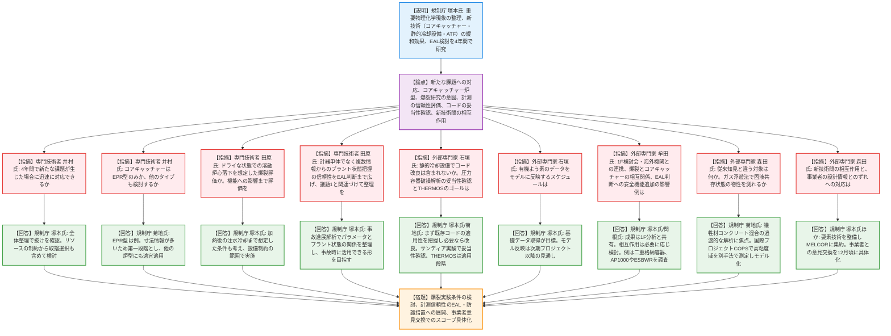
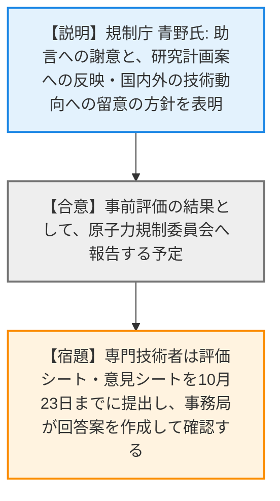

# 第15回シビアアクシデント技術評価検討会（令和8年10月19日）
> 出典 : https://youtube.com/live/-BMAmMWxn8U?si=BSPZZb8NvkvqMvx1

# 会合の概要
* **令和9年度開始の新規安全研究2件の「事前評価」:** 外部専門家3名（福井大 石垣氏、東京都市大 牟田氏、九州大 森田氏）と専門技術者2名（三菱重工 井村氏、東芝 田原氏）から、研究手法や成果の取りまとめ方の技術的妥当性について助言を聴取した。主査は置かず、技術基盤課の川島氏が事務局として進行した。評価の視点は「過去研究・最新知見の反映」「解析・実験手法の適切さ」「結果評価手法の適切さ」「重大な見落としの有無」の4点。
* **PRA研究（議題1）の最大の論点は「目的の明確化」:** 牟田氏が「どう使うか」という出口側の目的が弱く、技術シーズ先行に見えると指摘した。田原氏も「活用目的に対してどの程度のPRAが必要十分か」という整理を求めた。規制庁は、活用できている指標と、評価はできるが活用方法が不明確な指標の差を埋めることが狙いだと説明した。
* **PRA研究では、首尾一貫したレベル1〜3PRAとオフサイト防護の接続が焦点:** レベル1・2PRAの指標がオフサイトリスクを代表できる条件と限界、複合災害の組合せ、深層防護レベル5（防護措置）へのリスク情報の接続、使用済燃料プール（SFP）や竜巻・火山の扱いなど、スコープの抜けに関する指摘が相次いだ。
* **格納容器閉じ込め研究（議題2）では、新技術（コアキャッチャー・静的冷却設備・ATF）の知見の具体性が問われた:** 犠牲材コンクリートが混合した固液共存状態のデブリ物性（粘性）の測定方法、既存解析コードの適用限界、新技術間の相互作用の扱いなどが議論された。
* **予算・計画の不確定さが随所に表れた:** 実験の具体的な規模や内容は、来年度の新規事業として概算要求中のため確定していない。この点は森田氏から具体性の欠如を指摘された。規制庁は、5年間（議題2は4年間）の計画のため、技術動向に応じた見直しと中間評価での再確認を約束した。

---

# 議題ごとの詳細整理（テキスト）

## 【議題1】安全研究プロジェクトの技術的観点からの評価（確率論的リスク評価を対象にしたレギュラトリーサイエンス研究 事前評価）
* **議論の背景と論点:**
  * 背景: 研究で得た科学的知見と、規制活動で実際に必要な知見の間にギャップがあり、成果をそのまま規制に使うことが難しい。
  * 背景: 日本ではPRAの規制活用が原子力規制検査（主にレベル1PRA）に偏っており、米国のようにリスク情報を活用した合理化が進んでいない。炉心損傷頻度などの炉内評価だけでは、避難などを含む原子力災害の実際のリスクを示せないという認識もある。
  * 研究の目的: PRAを原子力安全規制に活用するための知見の取得・拡充を、レベル1〜3PRAを首尾一貫した形で扱いながら進める。
  * 研究の柱: (1) PRAの技術基盤の構築、(2) PRAから得られるリスク情報の技術的検討、(3) 規制活動に活用するための方法論の検討。
  * 計画: 令和9年度から令和13年度までの5年間。
  * 論点: 研究の目的設定（活用先から逆算できているか）、選定した3課題（人間信頼性・実験データ拡充・複合災害）の妥当性、レベル1・2PRA指標とオフサイトリスクの対応関係、スコープ（SFP、自然ハザード）、実験内容の具体性、長期計画の見直し方針。
* **質疑応答（詳細）:**
  * 【説明者側】（規制庁 鈴木氏）からの説明
    PRAの技術レベルの特定、リスク指標（オフサイト影響を含む）の整理、不確実さの活用方法の検討、諸外国のリスク情報活用事例の調査とケーススタディを実施する。成果目標と工程は、現状PRAの整理が3年、不確実さにつながる項目の検討が5年、指標整理が5年、不確実さの整理が4年、諸外国の事例調査が3年と課題検討が2年と説明した。
  * 【専門技術者】（三菱重工 井村氏）の指摘
    近年はAIを使ったPRA技術の発表が増えており、本研究でAIの検討は不要なのかと質問した。
  * 【説明者側】（規制庁 鈴木氏・高梨氏）の回答
    現時点でAI技術に焦点を当てた検討は含まれていないが、排除する意図はない。技術の進歩が速いため、中長期計画に固定して書き込まず、年度ごとの業務計画で柔軟に対応する別の研究枠で必要に応じて検討すると回答した。
  * 【専門技術者】（三菱重工 井村氏）の指摘
    背景にある米国のPRAポリシーステートメント（1995年）は過剰な保守性の排除を目標としている。本研究も規制活動の保守性の排除まで見据えているのかと質問した。
  * 【説明者側】（規制庁 古城氏）の回答
    本研究の中心は、規制分野でPRAを活用する際の指標の整理である。明確に保守性を低減することは現時点でスコープ外だが、リスクを最適に評価する結果として保守性が減る可能性はあると回答した。
  * 【専門技術者】（東芝 田原氏）の指摘
    PRAの技術レベルを何の尺度で評価するのか（解析手法の成熟度、モデルの完全性、データの充実度、不確実さなど）が重要である。絶対的な尺度だけでなく、用途ごとに必要な技術レベルを整理してほしい。さらに、解析リソース、迅速性、モデルの維持管理負荷も含め、活用目的に対してどの程度のPRAが必要十分かを整理すれば、活用拡大につながると述べた。
  * 【説明者側】（規制庁 古城氏）の回答
    比較の出発点は、まずASMEの目的別レベル区分と、日本原子力学会の標準など国内の基準である。保守性の維持管理のしやすさやリソースという視点は興味深いので、作業の中で入れられないか検討すると回答した。
  * 【専門技術者】（東芝 田原氏）の指摘
    複合災害では、地震・津波による事故だけでなく、内部事象の事故と同時期の豪雨で避難などの防護措置の実効性が下がる組合せも考えられる。事故を起こすハザードと防護措置の実効性に影響する災害を分けて整理し、組み合わせる方法が有用である。また、深層防護レベル5（オフサイト対応）を切り離さず、プラント側のリスク情報や放出情報をどう防護措置につなげるか、そのために必要な情報・評価技術まで検討してほしいと要望した。
  * 【説明者側】（規制庁 鈴木氏・古城氏）の回答
    組合せは排除せず、起こりやすさで優先順位をつけたリストの中から重点箇所を決めると鈴木氏が回答した。古城氏は、オフサイト側の指標がプラント側のリスク情報（例えば機器の重要度の違い）としてどう現れるかを示す方法の提案が、本プロジェクトの重要な対象だと述べた。
  * 【専門技術者】（東芝 田原氏）の指摘
    レベル1・2PRAの指標にはサイト固有の人口や気象が入らないため、レベル3PRAのオフサイトリスクとの対応関係はサイト特性で変わりうる。代替指標を提案するだけでなく、どのような条件なら代表できるか、どのような場合はレベル3PRAによる直接評価が必要かという適用条件や限界まで整理してほしいと述べた。
  * 【説明者側】（規制庁 鈴木氏・古城氏）の回答
    両者の対応関係がどういう条件で成り立つかを整理して検討する。適用条件や限界をどこまで詰められるかは分からないが、視野に入れる。古城氏は、オフサイト固有の情報が代表できる範囲とできない範囲の分類を行い、どの視点でレベル3PRAが必要か、レベル2PRAでどのソースタームを分析すべきかにつなげると補足した。
  * 【外部専門家】（福井大 石垣氏）の質問
    リスク指標は項目が多いが、具体的にどの項目について何が整理できれば指標として整理できたと言えるのかと質問した。
  * 【説明者側】（規制庁 古城氏）の回答
    指標は3分類である。(1)炉心損傷頻度などプラント関連の指標は、PRA標準に基づいて評価できる。(2)放射線関連の指標は、レベル3PRAの実績があるもの（汚染面積・汚染密度など）で、計算できるかが論点になる。(3)非放射線の影響（避難・屋内退避の人口、ストレス、時間、経済影響）が最も難しく、明確なゴールはまだ見えないが、福島事故の知見で追加すべき項目があれば入れていくと答えた。
  * 【外部専門家】（福井大 石垣氏）の質問
    複合災害PRAの人口動態について、人流シミュレーションを別途行うのかと質問した。
  * 【説明者側】（規制庁 古城氏）の回答
    人流データには、昼夜・季節・観光客を含む人口動態を反映できるモバイル空間統計を用いる。可能なら災害時の実際の人流データも扱うことを検討する。解析では人口の動きと、放出された放射性物質が人口分布にどう当たるかも計算すると答えた。
  * 【外部専門家】（東京都市大 牟田氏）の質問
    6ページで「リスク情報を適切に示せていない」と課題を挙げているが、何に対して示すのか、という目的が明確に述べられていない。研究のトーンが、技術シーズができるのでどう使うか、というものに見えるが、その意図かと確認した。
  * 【説明者側】（規制庁 古城氏）の回答
    PRAが示す指標は目的で異なるという指摘の通りである。取り組む理由は、活用できている分野・指標がある一方、評価はできるが活用方法が明確でない指標もあることだ。どこまで技術的に成熟すれば活用に乗せられるか、何が埋まれば活用できるかを議論できるようにしたいと答えた。牟田氏は、その「ギャップ」の視点は重要で、研究の中で把握しておいてほしいと応じた。
  * 【外部専門家】（東京都市大 牟田氏）の質問
    人間信頼性・重要現象の実験・複合災害のモデル化の3課題は、どういう経緯で選ばれたのかと質問した。
  * 【説明者側】（規制庁 古城氏）の回答
    レベル1PRAは福島事故以降、人的過誤の従属性や時間変化、組織論の議論が進んだため選んだ。レベル2PRAは、現象の知見は増えたがリスク評価上重要な現象の確率が明確でないため選んだ。レベル3PRAは手法の成熟度が国際水準に遜色ないと見て、地震・津波と原子力災害の競合（複合災害）を重要と考えて選んだと回答した。牟田氏は、数ある課題のうち特に重要としてこの3つを選んだ経緯も明確にしておいた方がよいと述べた。
  * 【外部専門家】（東京都市大 牟田氏）の質問
    8ページの「PRAの実力」とはどういう概念かと質問した。
  * 【説明者側】（規制庁 古城氏）の回答
    使おうとしている目的に対し、現存するPRAが要求される技術レベルをどこまで満たしているか、という意味だと説明した。牟田氏は、わかりにくい言葉遣いなので、もっと平易な概念で説明する方がよいと助言した。
  * 【外部専門家】（東京都市大 牟田氏）の質問
    研究期間が5年と長く、状況変化があり得る。研究項目の中身を見直す考えはあるかと質問した。
  * 【説明者側】（規制庁 鈴木氏）の回答
    AIの話にもあった通り状況や知見は変わるため、見直していく。5年計画には中間評価があり、その段階でも意見をいただき議論できると答えた。
  * 【外部専門家】（九州大 森田氏）の質問
    実験データの拡充について、対象とする現象・機器、実験の規模、装置、委託の有無などの具体的な記載がない。重要現象の実験結果をPRAのパラメータにどう反映するのかも示してほしいと述べた。
  * 【説明者側】（規制庁 星氏）の回答
    ご指摘の通りである。本研究は来年度からの新規事業として財務省に概算要求中で、予算が確定しておらず、実験の具体化はできていない。構想としては、建屋・機器が実際にどこまで耐えられるかというフラジリティの実験を考えている。地震が大きいと炉心損傷に直結すると見なす現状の評価ではなく、事実に基づく実力ベースのPRAを目指すとした。福島第一2号機でRCICが70時間以上動いた例のように、従来のPRAで想定されなかった高圧注水の成立可否は炉心損傷頻度を大きく変えるため、客観的な事実の積み上げが必要だと説明した。実験結果はフラジリティ曲線などを通じてPRAのパラメータに反映するというイメージでよいという森田氏の確認に、肯定した。
  * 【外部専門家】（九州大 森田氏）の質問
    首尾一貫した評価では、レベル1→2→3の接続で不確実さが下流に伝播しにくい手法が重要である。特にレベル2のMELCORによるソースタームの不確実さの大きさを、レベル3にどう接続するかの研究は対象にならないのかと質問した。
  * 【説明者側】（規制庁 古城氏）の回答
    ソースタームの不確実さの受け渡し自体は先行経験が多く、現時点では新たに開発すべき明確な課題は見出していない。一方、上流の想定が下流に影響する従属性（人的過誤の時間変化、複合災害、オフサイト状況のリンク）や、レベル1・2・3の指標ごとの不確実さの違いの分析は取り組む。レベル3を中心にレベル2へ情報を共有する中で不確実さをどう扱うかも検討すると答えた。森田氏は、まさにそこが重要であり、しっかり進めてほしいと述べた。
  * 【外部専門家】（九州大 森田氏）の質問
    10ページの外部事象が地震・津波・内部火災だけで、竜巻や火山が入らないのはなぜか。さらに、多数基立地や複合ハザードを考えるなら、炉心以外の放射性物質源である使用済燃料プール（SFP）のPRAも必要ではないかと質問した。
  * 【説明者側】（規制庁 古城氏）の回答
    設定の参考にしたのは、米NRCがVogtle原子力発電所を対象に実施したフルスコープのレベル3PRAで、そこで扱われた内部事象・外部事象（内部火災を含む）に、日本特有の地震・津波を加えた。竜巻・火山はハザードとして認識しているが、リスク評価すべき程度にプラントへ影響するかを含め、対象を精査し直す。SFPは現状含めていないが、盛り込めるか今後検討すると回答した。森田氏は、1F事故を考えれば多数基・複合ハザードでSFPは必ず議論になるので、ぜひ検討してほしいと述べた。
* **結論と宿題事項（アクションアイテム）:**
  * 本検討会は評価の合否を決める場ではなく、専門家の意見を聴取する場である。専門技術者には評価シート・意見シートを10月23日までに事務局へ提出するよう依頼があり、意見への回答案は後日各委員に確認をとる。
  * 実験内容（対象現象・規模・装置・PRAへの反映方法）を具体化する。予算（概算要求）の確定後に詰める（宿題）。
  * 3課題を選んだ経緯と、「PRAの実力」などの用語を、わかりやすく説明する（宿題）。
  * レベル1・2PRA指標がオフサイトリスクを代表できる条件と限界を、可能な範囲で整理する（宿題）。
  * 竜巻・火山などのハザード範囲を精査し、SFPを対象に含められるか検討する（宿題）。
  * PRAの技術レベル整理では、用途別の必要十分性と、リソース・維持管理負荷の視点を取り入れられないか検討する（宿題）。
  * AIなどの技術動向は、年度ごとの業務計画の枠で柔軟に対応する。計画の見直しは中間評価でも行う。

## 【議題2】安全研究プロジェクトの技術的観点からの評価（新設軽水炉の格納容器閉じ込め機能の維持に関する研究 事前評価）
* **議論の背景と論点:**
  * 背景: 福島第一事故の教訓から継続的な改善が必要で、新規制基準後も新知見が得られ続けている。
  * 背景: 政府方針で新設軽水炉への建て替えが推進される見込みで、既設炉でも事故耐性燃料（ATF）の導入が見込まれる。
  * 背景: 深層防護の観点から、緊急時活動レベル（EAL）の見直しなど周辺公衆の防護措置の改善が続いている。
  * 研究の目的: 1F事故の解明や重大事故対策の有効性評価の妥当性確認に資する知見の取得・拡充。計画は令和9年度から令和12年度の4年間である。
  * 研究の柱: (1) 格納容器内の重要物理化学現象の整理（コンクリートの爆裂、ATF・有機よう素によるソースターム、溶融デブリの特性・挙動）、(2) 新技術による緩和効果の検討（コアキャッチャー、静的冷却設備、ATF導入時の炉心損傷後の事故進展）、(3) 新たな安全対策設備を考慮したEALの検討。
  * 論点: 新たな試験の必要が生じたときの対応、検討対象のコアキャッチャー炉型、爆裂研究の問題意識、計測機器の信頼性評価の広げ方、解析コードの妥当性確認とゴール、新技術間の相互作用、事業者の設計情報との整合。
* **質疑応答（詳細）:**
  * 【説明者側】（規制庁 塚本氏）からの説明
    重要物理化学現象として、コンクリート爆裂（1F1号機でペデスタルコンクリートが鉄筋を残して消失した原因の一候補）、ATF（クロム・アルミを含む）によるFP放出挙動・化学形態への影響、フランスASNRとの協力による有機よう素の放射線分解、溶融デブリの特性・挙動を調べる。緩和効果の検討では、MELCOR、CFD・FEM、THERMOSによるコアキャッチャー上のデブリ挙動解析、静的冷却設備の実験データ取得とベンチマーク、ATF導入時の炉心損傷後の事故進展を扱う。EALでは、海外の先進軽水炉の考え方の調査、設計情報に基づく事故進展解析、プラントパラメータによる判断に関わる計測機器の特性確認を行う。
  * 【専門技術者】（三菱重工 井村氏）の指摘
    SA分野も国内外で研究が速く進む。4年間の中で新たな課題が生じた場合に、迅速に対応する考えはあるかと質問した。
  * 【説明者側】（規制庁 塚本氏）の回答
    項目1-Aの「新知見・新技術を踏まえた整理」で、抜けがないか整理する。抜けがあれば対処するが、リソースに限りがあるため、新しいものを入れるなら何かを捨てる選択も必要になり、重要性に鑑みて検討すると答えた。
  * 【専門技術者】（三菱重工 井村氏）の質問
    コアキャッチャーの検討が欧州加圧水型炉（EPR）型を想定しているようだが、世界には他のタイプもある。EPR型のみか、他のタイプも検討するのかと質問した。
  * 【説明者側】（規制庁 菊地氏）の回答
    EPR型はあくまで例である。海外にはVVER、国内でもSRZ-1200やHI-ABWRなどコアキャッチャー導入の例がある。EPRを第一段階に選んだのは、設計が古く寸法などの知見が多く公開されているからで、最新知見が更新され次第、他のプラントにも適宜適用すると答えた。
  * 【専門技術者】（東芝 田原氏）の質問
    爆裂研究は、新設炉の中にはドライウェルを事前に水張りせず、乾いた状態で溶融炉心を落下させてから冷却する設計概念がある。この場合の急激な加熱によってペデスタル等に新たな損傷モードが生じうるかまで確認する意図か。もしそうなら、爆裂の程度や進展範囲が要求機能に影響するかまでつなげて評価してほしい。また、既設炉でも事前水張りが成立しない場合に関連するため、知見の適用範囲も整理してほしいと述べた。
  * 【説明者側】（規制庁 塚本氏）の回答
    ご指摘の条件を想定している。従来は加熱だけで実験データを取得してきたが、今回は加熱後の注水冷却を想定した設定も考えている。実験設備の制約があるため、温度設定がどの範囲でできるかを見極めた上で、ターゲットとして取り組みたい。計測項目も、指摘を参考に反映できるものは反映していくと答えた。
  * 【専門技術者】（東芝 田原氏）の指摘
    重大事故環境下での計測機器の信頼性評価は重要だが、実際の事故対応は複数パラメータを組み合わせて状態を把握する。一部の計器が使えなくなった場合も含め、利用可能な複数の情報からEAL判断に必要なプラント状態をどの程度の信頼性で認識できるかまで評価を広げてほしい。この成果を議題1のEAL・深層防護に着目したリスク情報活用と関連づけ、一連の流れとして整理すれば、規制や防災への活用に有用だと述べた。
  * 【説明者側】（規制庁 塚本氏）の回答
    事故時には使えるものは使うしかなく、通常は使わないとしている計器を使う研究の意図もある。他のパラメータについては、EALの検討で事故進展解析によりプラント状態と圧力・温度などパラメータの関係を整理する。シーケンスもプラントも多様なため、事故時に活用できる形で整理したいと答えた。
  * 【外部専門家】（福井大 石垣氏）の質問
    静的冷却設備は既存解析コードの予測性能の評価が目標のようだが、コード改良はスコープに入っていないのかと質問した。
  * 【説明者側】（規制庁 塚本氏）の回答
    静的冷却設備への経験が浅いため、まず実験データを得て既存コードがどこまで使えるかを把握する。特定のモデルが対応できなければ、改良も考える。このプロジェクト内でできるかは時期によるが、次のプロジェクトへつなげる場合もあると答えた。
  * 【外部専門家】（福井大 石垣氏）の質問
    圧力容器の破損解析（CFD・FEM）は、バリデーションをどうするのかと質問した。
  * 【説明者側】（規制庁 菊地氏）の回答
    EPRのような炉型は下部に計装貫通部がないため、既設炉のような貫通部の溶融破損は想定されず、どこからどう壊れるかを見るのが目的になる。過去のサンディア国立研究所の下部ヘッド破損実験などで妥当性確認を進めながら解析する方針と答えた。
  * 【外部専門家】（福井大 石垣氏）の質問
    THERMOSの開発は何をゴールとしているのかと質問した。
  * 【説明者側】（規制庁 菊地氏）の回答
    既存コードで扱えない領域や実機環境を解析し、不確かさを低減することが目的である。開発は前のプロジェクトで終わり、今回は開発から適用の段階に切り替え、その第一段階としてドライ型コアキャッチャーに適用する。有効性評価への具体的な反映はこれからだが、解析で重要な視点（どんな条件が厳しいか）を抽出する、と答えた。
  * 【外部専門家】（福井大 石垣氏）の質問
    有機よう素の放射線分解実験のデータを、評価モデルに持ってくるスケジュール感はどうかと質問した。
  * 【説明者側】（規制庁 塚本氏）の回答
    ATFの実験も含め、ここでの目標は基礎的な実験データの取得である。直ちにMELCORやソースターム評価モデルに使うのではなく、ソースターム評価の結果を見る際にどこに留意すべきかという知見が第一段階の活用になる。モデルへの反映は、共同研究が続く3年目以降の次期プロジェクトになるとの見通しを示した。
  * 【外部専門家】（東京都市大 牟田氏）の質問
    6〜8ページで言及される、1F事故分析検討会との連携と、海外機関との連携はどうなるのかと質問した。
  * 【説明者側】（規制庁 塚本氏）の回答
    爆裂研究は1F事故分析の検討会が起点であり、成果は1F分析に随時共有する。1F側の別部署が行うコンクリート実験や、格納容器内の調査で得られる新知見も取り入れる。国際プロジェクトは多くが他機関が実験し、規制庁がデータを受けてベンチマーク解析を行う形だが、取りたいデータや条件は主張して実施機関と交渉すると答えた。
  * 【外部専門家】（東京都市大 牟田氏）の質問
    爆裂現象の解明が進めば、コアキャッチャー側の研究方針にも影響するのではないか。そこまで考えているかと質問した。
  * 【説明者側】（規制庁 塚本氏）の回答
    同じ領域の話なので相互の対応はあり得るが、本プロジェクトではまず個別に見ていく。たとえばTHERMOS解析でデブリの広がりが想定より早く、ペデスタルなどに接触するとなれば、溶融炉心・コンクリート相互作用（MCCI）など別の現象も考える必要が出る。原子炉の安全まで目的を広げる場合には、相互作用も検討すると答えた。
  * 【外部専門家】（東京都市大 牟田氏）の質問
    12ページの「安全機能の追加がEAL判断基準に影響する」とは、具体的にどのような安全機能がどう影響するのか、例を示してほしいと質問した。
  * 【説明者側】（規制庁 関根氏）の回答
    代表的な例は、格納容器が二重になっている場合、バウンダリーが一つ消失した時点で判断するのか、二つ失われた時点で判断するのか、という問題である。実際の判断パラメータも影響を受けうるので、AP1000やESBWRのように静的安全設備やコアキャッチャーを備えた先進炉を調査して確認すると答えた。
  * 【外部専門家】（九州大 森田氏）の質問
    犠牲材を用いたコアキャッチャーは、従来から溶融物の広がり実験やモデル開発が盛んである。今回は、従来知見で予測できないどこを対象にするのかと質問した。
  * 【説明者側】（規制庁 菊地氏）の回答
    従来の解析は、物性値の変化を初期条件として考慮できても、床面から犠牲材コンクリートが混合してくるような過渡的な解析ができていない。それを踏まえ、どの温度や溶融状態で放出されたときにどう挙動するかに焦点を当てる、と答えた。
  * 【外部専門家】（九州大 森田氏）の質問
    物性測定にガス浮遊法を使うようだが、完全な液相の物性しか測れないのではないか。コアキャッチャー上の溶融物は、固化しながら固液共存状態で広がるため、その状態の物性が標準モデルで評価しづらいという問題の本質ではないかと述べた。モデル化はターゲットに入っているのかと質問した。
  * 【説明者側】（規制庁 菊地氏）の回答
    ご指摘の通り、部分固化しつつ固まらない状態の粘性は計測が極めて困難である。これを国際プロジェクトCOPSで進める。COPSでは、ガス浮遊法で液相の粘性を測ると同時に、高粘度域は別手法で粘性係数を測定し、それらを用いてモデル化を行うと答えた。森田氏は、成果を楽しみにしていると述べた。
  * 【外部専門家】（九州大 森田氏）の質問
    コアキャッチャーのデブリ長期冷却と静的冷却設備による格納容器の除熱が競合しないかなど、新技術間の相互作用は問題にならないのか。統合的な解析や評価方法の検討は予定されているのかと質問した。
  * 【説明者側】（規制庁 塚本氏）の回答
    単一の技術だけでは全体の安全性は語れないという指摘の通りである。ただし、まずは個別に、デブリの冷却性や水との相互作用が格納容器への熱源・境界条件としてどうなるか、静的冷却設備がどの状況で使えなくなるかを見ていかないと、格納容器の応答が見えない。そこで、総合的な解析の要素技術を本プロジェクトで整備し、最終的にMELCORに集約していくと答えた。
  * 【外部専門家】（九州大 森田氏）の質問
    対象は国内で現在検討中の新設軽水炉の炉型で、設計情報が確定していない。研究のターゲットがずれないよう、事業者との意見交換をする予定はあるのかと質問した。
  * 【説明者側】（規制庁）の回答
    事業者と安全研究に関する技術的意見交換をする枠組みがあり、規制委員会からも進めるよう指示を受けている。新しいSA対策の新技術についても、できれば事業者と意見交換して、具体的な計画のあるものを研究スコープに取り込みたい。具体的な検討は12月頃を予定しており、そこで提案していきたいと答えた。
* **結論と宿題事項（アクションアイテム）:**
  * 本議題も意見聴取の場で、了承・不了承の結論は出していない。評価シート・意見シートの提出は10月23日までに専門技術者へ依頼され、意見への回答案は後日確認を依頼する。
  * 爆裂実験は、加熱後の注水冷却条件（事前水張りなし）まで含めて、実験設備の制約の範囲で実施できるよう検討する（宿題）。
  * 計測機器の信頼性は、個別機器にとどまらず、複数パラメータからプラント状態をどの程度の信頼性で把握できるか、さらに議題1のEAL・防護措置との一連の流れとしてまとめられないか検討する（宿題）。
  * コアキャッチャーはEPR型を第一段階とし、情報の更新に応じて他の炉型にも適用する。
  * 新技術間の相互作用と統合的評価は、本プロジェクトでは要素技術の整備にとどめ、最終的にMELCORへ集約する。
  * 事業者との技術的意見交換（12月頃に具体的な検討を予定）を通じて、研究スコープを具体的な計画に合わせる（宿題）。

## 【議題3】その他
* **議論の背景と論点:**
  * 全体を通した追加の意見は特になく、シビアアクシデント研究部門の青野管理官が挨拶した。
* **質疑応答（詳細）:**
  * 【説明者側】（規制庁 青野氏）からの説明
    令和9年度開始の2件の新規安全研究プロジェクトの計画案について、技術的妥当性に加え大局的な観点からも助言をいただいたことに謝意を示した。リスク情報活用のための技術基盤の構築と、建て替えで導入が見込まれる最新のSA対策技術に関する知見の蓄積が目的であり、助言を十分に踏まえ、国内外の技術動向にも留意して進めると述べた。
* **結論と宿題事項（アクションアイテム）:**
  * 専門家のコメント・助言は、研究計画案の充実に活用し、安全研究プロジェクトの事前評価として原子力規制委員会へ報告する予定（宿題）。
  * 専門技術者は評価シート・意見シートを10月23日までに提出し、事務局が回答案を作成して確認の連絡をする（宿題）。

---

# 論理構造の可視化（Mermaid）

### 【議題1】安全研究プロジェクトの技術的観点からの評価（確率論的リスク評価を対象にしたレギュラトリーサイエンス研究 事前評価）

### 【議題2】安全研究プロジェクトの技術的観点からの評価（新設軽水炉の格納容器閉じ込め機能の維持に関する研究 事前評価）

### 【議題3】その他

