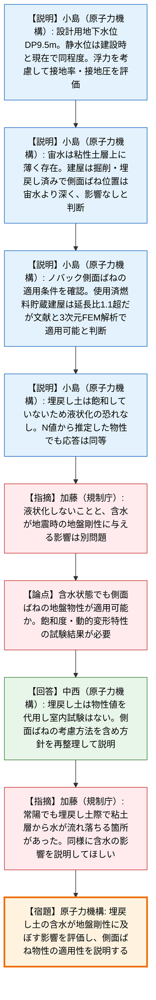
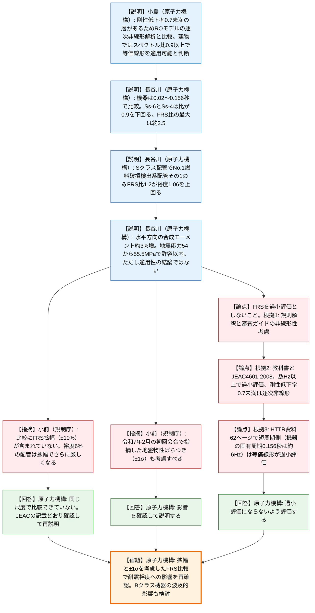
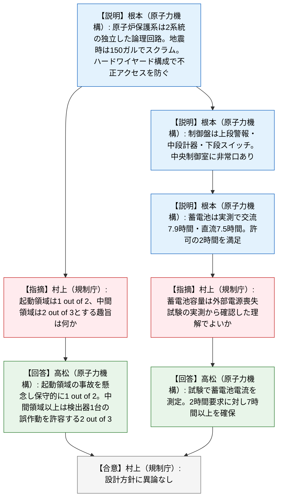
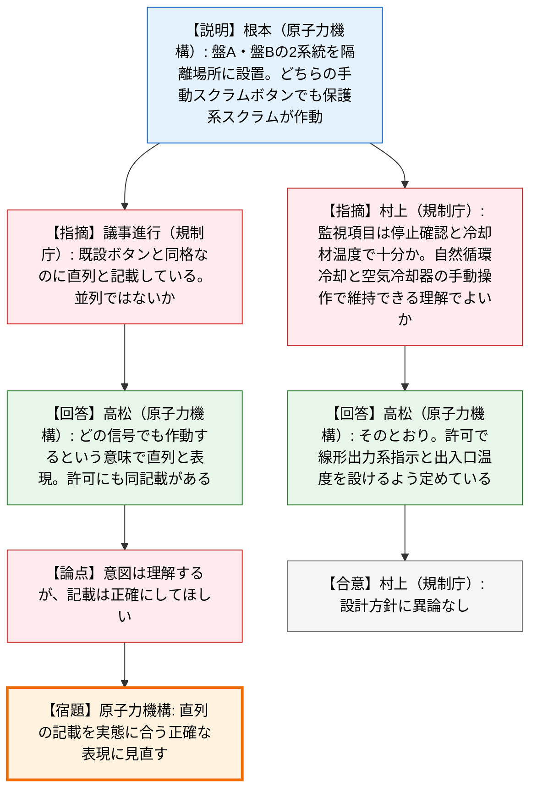
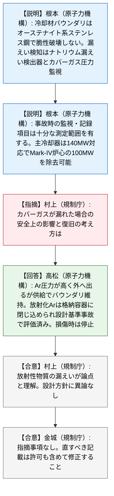

# 第597回核燃料施設等の新規制基準適合性に係る審査会合（令和8年10月20日）
> 出典 : https://youtube.com/live/1YvxDe5pajM?si=FPJoW7WlVQGBUDcK

## 会合の概要
* **HTTRの基準地震動追加に伴う設工認は、「宙水・埋戻し土」と「等価線形解析の適用性」の両面で課題が残り、結論に至らず継続審査**
  JAEAは、地下水位・宙水の状況やノバック側面ばねの適用性、地盤の等価線形解析の適用性を説明した。規制庁は、埋戻し土の含水状態が地震時の地盤剛性に及ぼす影響の説明と、床応答スペクトル（FRS）が過小評価とならない評価を求め、JAEAは検討途上として持ち帰った。
* **最大の焦点は、等価線形解析が短周期側で床応答を過小評価する懸念と、燃料破損検出系配管の耐震裕度1.06**
  逐次非線形解析と等価線形解析のFRS比は、最大で約1.2倍（燃料破損検出系配管その1の一次固有周期）となり、同配管の耐震裕度1.06を上回った。JAEAは水平方向の地震応力増加を約3%と試算して許容応力以内としたが、規制庁はFRSの拡幅（±10%）や地盤物性のばらつき（±1σ）を考慮するとさらに厳しくなると強く警告した。
* **規制庁は規則・ガイド・規格・実データの3点を根拠に、FRS過小評価の回避を重ねて要求**
  規則解釈・審査ガイドの「地盤の非線形性の考慮」、教科書およびJEAC4601-2008の記載（数Hz以上で過小評価、剛性低下率0.7未満は逐次非線形）、およびHTTR自身の比較図（機器配管の固有周期は約6Hzで過小評価域）を挙げ、JAEAは過小評価にならないよう評価すると回答した。
* **常陽の設工認（第2回申請）3資料は、設計方針に異論なく、指摘事項なしで終了**
  原子炉保護系・制御室・蓄電池、中央制御室外原子炉停止盤、原子炉冷却材バウンダリ等のいずれも、既設品の健全性を前提に許可との整合が確認された。規制庁の質疑は設計趣旨の理解確認が中心で、論点らしい論点は、スクラムボタンの「直列」という記載の正確性にとどまった。
* **全体として、HTTR側は技術的な宿題が次回に持ち越され、常陽側は円滑に了承される明暗の分かれた会合**

---

## 議題ごとの詳細整理

### 【議題1】日本原子力研究開発機構大洗原子力工学研究所（北地区）のHTTR（高温工学試験研究炉）の基準地震動の追加に伴う設計及び工事の計画の認可申請について
令和6年12月20日に申請された案件で、令和8年4月23日の審査会合に続く説明である。会合では、(A) 地下水・埋戻し土・側面ばねに係る説明（資料1-1）と、(B) 地盤の等価線形解析の適用性に係る説明（資料1-2）を順に扱った。

#### (A) 設計用床応答スペクトルの作成方針（地下水及び埋戻し土、側面ばね適用に係る説明）（資料1-1）
* **議論の背景と論点:**
  * 背景: 標準応答スペクトルに基づく基準地震動を取り入れるため、設計用床応答スペクトルの作成方針を確認している。
  * 経緯: 技術的な審議は令和7年2月の初回会合から時間が空いており、その間にJAEAが地盤物性ばらつきを考慮した地震応答解析結果の取りまとめと、解析モデルの妥当性検討を進めた。
  * 論点1: 地下水位（静水位）と宙水が地震応答解析（浮力、側面ばね）に与える影響。
  * 論点2: ノバック側面ばねの適用性（地盤の成層性、建物平面の延長比、建物と地盤の密着性）。
  * 論点3: 使用済燃料貯蔵建屋周辺の埋戻し土が含水している場合の、地震時の地盤剛性への影響。

* **質疑応答（詳細）:**
    * 【説明者側】住田（原子力機構）— 冒頭
      技術的な審議は令和7年2月以来間が空いたが、その間に地盤物性ばらつきを考慮した地震応答解析結果の取りまとめと、地盤・解析モデルの妥当性検討を進めた。本日は、地下水・埋戻し土・側面ばねの適用、および地盤の等価線形解析の適用性を説明する。
    * 【説明者側】小島（原子力機構）— 対象建物と地下水位
      解析対象は、Sクラス機器の間接支持構造物である原子炉建屋、BDBA対応施設である使用済燃料貯蔵建屋、動的解析を要するBクラス機器の間接支持構造物である冷却棟である。設計用地下水位はDP9.5mで、昭和61〜63年の観測と近年の観測孔データ（2018年以降）で静水位が同程度であることを確認した。原子炉建屋は基礎底面の一部が設計用地下水位より深いため、浮き上がり非線形を考慮した非線形地震応答解析で、浮力を考慮して接地率・接地圧を評価している。
    * 【説明者側】小島（原子力機構）— 宙水
      粘性土層（MUC層）の上に宙水が確認されている（DP約29.5〜30.6m、厚さ1〜2m程度）が、建設時の観測と現状とで同程度である。建屋は建設時に当該層より深く掘削しマンメイドロックや透水性のある埋戻し土で埋め戻しており、側面ばねは宙水の存在する層より深い位置に設定しているため、宙水の影響はないと判断した。冷却棟は側面ばねを設定していない。
    * 【説明者側】小島（原子力機構）— 側面ばねの適用条件
      ノバック側面ばねは、JEACに記載の条件（地盤が成層で水平方向に均質、建物平面の影響、建物と地盤の密着性）を確認して設定した。原子炉建屋は延長比が適用条件の1.1以下で、地下部分が周辺地盤と75%以上密着し、3.11地震の観測記録とのシミュレーションでも整合している。使用済燃料貯蔵建屋は延長比が1.1を超えるが、延長比1.7程度までの適用性を確認した文献があること、質点系SR解析と疑似3次元FEM解析がほぼ整合することから適用可能と判断した。
    * 【説明者側】小島（原子力機構）— 埋戻し土と液状化
      宙水確認ボーリングでは、使用済燃料貯蔵建屋周辺で一部に含水がやや多いコアが確認されたが、地盤内に地下水が滞水しているわけではなく、液状化判定の対象（地下水位以深の飽和土）に当たらないため、液状化の恐れはないと判断した。また、埋戻し土の物性を標準貫入試験のN値から推定した値に置き換えた地震応答解析でも、最大応答加速度・加速度応答スペクトル・最大せん断ひずみはほぼ同等で、影響は小さい。
    * 【規制側】加藤（規制庁）
      液状化の恐れがないことは理解したが、含水状態が地震時の地盤剛性に及ぼす影響を考慮する必要があるかは別問題である。含水が確認された以上、その状態でも側面ばねの設定に用いた地盤物性が適用可能であることを、必要に応じて飽和度や動的変形特性の試験結果を用いて説明してほしい。
    * 【説明者側】中西（原子力機構）
      埋戻し土は今回、物性値を代用して評価しており、室内試験の結果は現状ない。側面ばねをどう考慮するかも含め、総合的に方針を確認して説明する。
    * 【規制側】加藤（規制庁）
      常陽でも、埋戻し土の際まで粘土層があり、そこから滝のように水が流れ落ちている箇所があった。それと同様に、わずかに含まれる水が地盤剛性にどう影響するかを説明してほしい。
    * 【説明者側】中西（原子力機構）
      承知した。

* **結論と宿題事項（アクションアイテム）:**
  * **宿題（原子力機構）:** 使用済燃料貯蔵建屋周辺の埋戻し土の含水状態が地震時の地盤剛性に及ぼす影響を評価し、側面ばねの設定に用いた地盤物性が適用可能であることを、飽和度・動的変形特性の試験結果等も用いて説明する（側面ばねの考慮方法を含めた総合的な方針の再整理）。

#### (B) 設計用床応答スペクトルの作成方針（地盤の等価線形解析の適用性に係る説明）（資料1-2）
* **議論の背景と論点:**
  * 背景: 地盤応答解析に等価線形解析（SHAKE）を用いているが、一部の支持地盤で剛性低下率の平均値が0.7を下回る。
  * JEAC4601-2008の考え方: 剛性低下率0.7未満では逐次非線形解析の適用を求める趣旨があり、JAEAは建物・機器の両面から逐次非線形解析（ROモデル）と比較した。
  * 論点1: 建物の観点では、加速度応答スペクトル比の平均値が0.9以上か。
  * 論点2: 機器配管の観点では、FRS比が耐震裕度を下回るか（燃料破損検出系配管その1が裕度を上回る）。
  * 論点3: 等価線形解析のFRSが短周期側で過小評価とならないか。

* **質疑応答（詳細）:**
    * 【説明者側】小島（原子力機構）— 建物
      原子炉建屋の地盤モデルで、逐次非線形解析と等価線形解析の加速度応答スペクトル比の平均値を算出した。JEAC4601-2008では比の平均値が0.9を下回るのは剛性低下率の平均値が0.7程度の場合とされるが、HTTRでは0.7を下回っても比は0.9以上でほぼ同等であり、等価線形解析を適用できると判断した。
    * 【説明者側】長谷川（原子力機構、HTTR技術課）— 機器
      耐震評価で用いる周期域の下限0.02秒から、耐震Sクラス機器の最大固有周期0.156秒までを対象に比を算出した。Ss-1・Ss-2のNS方向とSs-3は平均値が0.9以上または同等だが、Ss-6とSs-4は0.9を下回る。短周期側で逐次非線形解析が上回る程度は、JEAC4601-2008およびその元文献で示される程度と同程度である。
    * 【説明者側】長谷川（原子力機構、HTTR技術課）— Sクラス機器配管
      FRS比の最大値が約2.5であることから、耐震裕度2.5未満のSクラス機器配管を抽出して比較した。表1のNo.2〜23は一次固有周期でのFRS比が耐震裕度を下回るが、No.1の燃料破損検出系配管その1は、一次固有周期でFRS比が1.2倍と、耐震裕度1.06を上回った。
    * 【説明者側】長谷川（原子力機構、HTTR技術課）— 当該配管の詳細評価
      当該配管は外径約10mm・厚さ約1.7mmで、原子炉圧力容器側面のスタンドパイプから格納容器内隔離弁に至る。一次応力評価では、発生応力118MPa、許容応力126MPaで、比は1.06である。水平方向の合成モーメント成分にFRS比1.2を乗じて再計算すると合成モーメントは約3%増加し、地震応力は54MPaから55.5MPaに増えるものの許容応力は超えない。
    * 【説明者側】長谷川（原子力機構、HTTR技術課）— 現時点の整理
      現状の検討結果では、燃料破損検出系配管その1を含むSクラス機器配管は許容値を超えていない。ただしこれは等価線形解析の適用性を結論づけるものではなく、引き続き検討する。また、波及的影響の観点で時刻歴応答解析を実施したBクラス機器への影響も検討する。
    * 【説明者側】小島（原子力機構）— 鉛直方向と常陽との比較
      鉛直方向の地盤応答は、ひずみレベルに応じて変化するせん断弾性係数と線形として設定した体積弾性係数を用いてP波速度を算定している。また、約700m離れた常陽とHTTRは地層構成・層厚に一部違いがあり、HTTRの方が剛性低下が相対的に大きく、各敷地の地質状況を反映した結果である。
    * 【規制側】小前（規制庁）— FRSの拡幅
      燃料破損検出系配管の一次固有周期（0.066秒）でFRS比が1.2倍という説明だが、このFRSの比較には拡幅が行われていない。JEAC4601-1987には、機器の固有周期のずれや地盤物性のずれ、SRモデルの違い等を含めて±10%拡幅した設計用FRSを用いると記載されている。拡幅しない理由はあるか。
    * 【説明者側】原子力機構（担当者）
      現在は検討段階で、等価線形解析と逐次非線形解析を同じ尺度で比較していない部分がある。JEACの記載どおり同じ尺度（拡幅）で比較し、確認した上で再度説明する。
    * 【規制側】小前（規制庁）
      拡幅すると結果はかなり厳しくなると考える。当該配管の耐震裕度1.06は6%しかなく、拡幅でさらに厳しくなる。令和7年2月10日の初回会合でも、耐震裕度が極めて少なくなること、プラスマイナス1σの地盤物性のばらつきも考慮する必要があることを指摘している。これらも踏まえて検討してほしい。
    * 【説明者側】原子力機構（担当者）
      指摘の点は影響を確認して説明する。
    * 【規制側】小前（規制庁）— コメントと根拠3点（1）規則・ガイド
      等価線形解析・逐次非線形解析の適用にあたり、FRSを過小評価としないよう十分留意して検討してほしい。根拠の1点目は、規則とガイドの記載である。規則の解釈では地盤の非線形性を必要に応じて考慮することとされ、設工認審査ガイドにも、解放基盤表面からの地震波の伝播特性を適切に考慮し、必要に応じて地盤の非線形応答に関する動的変形特性を考慮すると書かれている。
    * 【規制側】小前（規制庁）— 根拠（2）参考文献と規格
      2点目は、JAEAが参考文献に挙げる『地盤の地震応答解析』の191ページに、SHAKE（等価線形解析）は数Hzより高振動数で過小評価となる旨の注意が記載されている点である。JEAC4601-2008の87ページにも、支持地盤の剛性低下率の平均値が0.7を下回る場合は地盤の材料非線形性を考慮した逐次非線形解析を用いるとあり、等価線形解析をどんな場合にも使ってよいわけではない。
    * 【規制側】小前（規制庁）— 根拠（3）HTTR自身のデータ
      3点目が最も重要で、HTTR自身の特性である。資料62ページ（縦軸が逐次非線形／等価線形の比）を見ると、長周期側では等価線形が過大評価、短周期側では過小評価になっている。機器配管の固有周期0.156秒は約6Hzで、数Hzより高い側では等価線形が過小評価になっている。今後FRSを考える際は、過小評価とならないよう留意してほしい。
    * 【説明者側】原子力機構（担当者）
      いただいたコメントの内容も確認した上で、過小評価にならないよう評価していく。
    * 【規制側】小前（規制庁）
      検討には時間がかかるかもしれないが、よろしくお願いする。

* **結論と宿題事項（アクションアイテム）:**
  * **宿題（原子力機構）:** 燃料破損検出系配管その1を含め、等価線形解析と逐次非線形解析のFRSを、JEAC4601に記載のFRS拡幅（±10%）を適用した同じ尺度で比較し、耐震評価への影響を再確認して説明する。
  * **宿題（原子力機構）:** 地盤物性のばらつき（±1σ）も考慮した場合の耐震裕度への影響を確認する。
  * **宿題（原子力機構）:** FRSが過小評価とならないよう、規則・ガイド・規格・HTTRの比較結果を踏まえて等価線形解析の適用方針を再整理する。Bクラス機器（波及的影響）への影響も検討する。
  * 議題1全体として、規制庁から「本日は検討途上」との認識が示され、次回の審査会合に向けた資料作成が求められた。結論は出ていない。

### 【議題2】日本原子力研究開発機構大洗原子力工学研究所（南地区）の原子炉施設（高速実験炉原子炉施設（常陽））の変更に係る設計及び工事の計画の認可申請について
令和7年1月6日付で申請された、常陽の新規制基準適合性に係る設工認の第2回申請で、前回の令和8年9月11日の審査会合に続く説明である。技術基準規則への適合性と設置変更許可の設計方針との整合性を、既設品を前提に確認する構成で、3資料を順に扱った。

#### (A) 原子炉制御室及び安全保護回路並びに保安電源設備（資料2-1）
* **議論の背景と論点:**
  * 背景: 技術基準規則第32条第1項第1号・第3〜7号（原子炉保護系の機能・信頼性）、第34条第2項・第3項（制御室の誤操作防止、避難経路）、第40条第3項（蓄電池）への適合性確認。
  * 論点1: 原子炉保護系の作動信号の多重性（起動領域と中間領域で1 out of 2と2 out of 3が異なる理由）。
  * 論点2: 蓄電池の容量評価の根拠（実測値の妥当性）。

* **質疑応答（詳細）:**
    * 【説明者側】根本（原子力機構）— 原子炉保護系
      過渡時は許可添付書類十の安全評価のとおり、作動設定値により燃料の許容限界を超えない。地震時は作動設定値150ガルでスクラムし、停止機能や崩壊熱除去機能（Sクラス）は150ガル程度で機能を喪失しない。論理回路は独立した2系統で、駆動源喪失時はスクラムするフェールセーフである。ハードワイヤードロジックのアナログ回路で、アイソレータ等により他の計測制御系から機能分離し、施錠・出入管理により不正アクセスを防ぐ。
    * 【説明者側】根本（原子力機構）— 制御室
      常陽は異常時に運転員の操作を要しないため、期待される対応は、炉心の中性子束密度、一次主冷却系の温度・流量、格納容器内の圧力・温度の監視である。盤は上段に警報、中段に計器、下段に操作スイッチを配置し、警報は重要度に応じて色分けしている。中央制御室には出入口に加えて非常口があり、屋外へ直接避難できる。
    * 【説明者側】根本（原子力機構）— 蓄電池
      常陽は全交流電源喪失をBDBAとして扱い、原子炉停止・崩壊熱除去に電源を要する動的機器はなく、パラメータ監視は交流無停電電源装置に期待する。蓄電池は負荷に対し100%の容量で2時間放電可能なものを設置しており、実測値による評価では交流7.9時間、直流7.5時間で、許可の2時間を満足する。使用前事業者検査は3号検査（適合性確認検査・品質管理検査）で、既設品のため外観検査を予定している。
    * 【規制側】村上（規制庁）— 作動信号の多重性
      作動信号の7ページで、炉周期短（炉周期5秒）に対する作動が、起動領域では1 out of 2、中間領域では2 out of 3になっている。安全設計上の趣旨があるのか、技術的な理由（起動領域は中性子が少なく検出器を多く置いても意味が薄い等）があるのか、確認したい。
    * 【説明者側】高松（原子力機構）
      1 out of 2のほうが確実にスクラムする保守的な構成であり、起動領域での事故を懸念してそうしている。中間領域以上は一定の出力が出ており、検出器1台の誤作動による作動を許容する2 out of 3としている。
    * 【規制側】村上（規制庁）
      懸念の度合いに応じて信頼性を調整している設計と理解した。
    * 【規制側】村上（規制庁）— 蓄電池
      動的機器に電源が必要ないため、外部電源喪失試験で全交流電源喪失を模擬し、その際の蓄電池の実測値から容量が十分であることを確認した、という理解でよいか。
    * 【説明者側】高松（原子力機構）
      そのとおりである。外部電源を落とす試験で蓄電池から流れる電流を測定した値を実測値として使い、許可の要求である2時間に対し7時間以上の容量を確保している。
    * 【規制側】村上（規制庁）
      設計方針に異論はない。

* **結論と宿題事項（アクションアイテム）:**
  * 宿題・指摘事項はなく、設計方針に異論なしとして整理された。

#### (B) 中央制御室外原子炉停止盤の設置について（資料2-2）
* **議論の背景と論点:**
  * 背景: 技術基準規則第34条第5項（中央制御室外から原子炉を停止する設備）への適合性確認。
  * 論点1: 盤に設ける監視項目で、中央制御室が使えない場合の安全維持に十分か。
  * 論点2: 資料・許可における手動スクラムボタンの「直列」という記載の正確性。

* **質疑応答（詳細）:**
    * 【説明者側】根本（原子力機構）— 設置内容
      中央制御室外原子炉停止盤は2系統（盤A・盤B）あり、中央制御室から隔離された場所に設置する。盤Aには手動スクラムボタン、線形出力系（チャンネル6・7）の指示計、A系統の原子炉出入口温度指示計、盤Bには手動スクラムボタン、チャンネル8の指示計、B系統の原子炉出入口温度指示計を設ける。どちらの手動スクラムボタンでも原子炉保護系スクラムが作動し、中央制御室の手動スクラムボタンの操作を阻害しない。扉は通常は施錠し、緊急時はハンドルカバーを破壊して開放できる。
    * 【説明者側】根本（原子力機構）— 検査
      使用前事業者検査は3号検査として適合性確認検査・品質管理検査を予定し、中央制御室外原子炉停止盤については配置検査、施錠検査、作動検査を予定している。
    * 【規制側】村上（規制庁）— 監視項目
      監視項目が、スクラムボタンで停止し、各計装で停止を確認し、冷却材温度を見ておけばよい、というものになっている。最悪でも自然循環で冷却でき、温度が過冷却にも過熱にもなっていないことを監視し、必要なら空気冷却器を手動操作できれば安全な状態を維持できる、という理解でよいか。
    * 【説明者側】高松（原子力機構）
      そのとおりである。許可の時点で、線形出力系の指示と出入口温度を設けるよう定めており、それに沿った設計である。
    * 【規制側】村上（規制庁）
      設計方針に異論はない。
    * 【規制側】議事進行（規制庁）— 記載の正確性
      11ページのチャートで、今回設ける手動スクラムボタンを既設の中央制御室の手動スクラムボタンに「直列」と表現しているが、直列は上流・下流の関係を指すはずで、既設ボタンと同格であればむしろ並列ではないか。
    * 【説明者側】高松（原子力機構）
      どの信号が作動しても機能するという意味で「直列」という言葉を使っており、許可にも「直列にて設置する」と記載されている。
    * 【規制側】議事進行（規制庁）
      意図は理解するが、記載としては正確なものにしてほしい。
    * 【説明者側】高松（原子力機構）
      承知した。

* **結論と宿題事項（アクションアイテム）:**
  * **宿題（原子力機構）:** 手動スクラムボタンの「直列」という記載を、実態（どのボタンでも作動する構成）に合わせた正確な表現に見直す（許可の記載を含め、直すべき点を修正する）。設計方針自体には異論なし。

#### (C) 原子炉冷却材バウンダリ、最終ヒートシンク、計測設備について（資料2-3）
* **議論の背景と論点:**
  * 背景: 技術基準規則第62条第3項・第5項・第6項（原子炉冷却材バウンダリの破壊靱性、漏えい検知、予熱設備）、第63条第2項（設計基準事故時の監視・記録）、第69条第1項第7号（最終ヒートシンクへの熱輸送）への適合性確認。
  * 論点: カバーガスバウンダリが損なわれた場合の安全上の影響と、復旧の考え方。

* **質疑応答（詳細）:**
    * 【説明者側】根本（原子力機構）— 冷却材バウンダリ
      冷却材バウンダリは、高温強度とナトリウムとの共存性に優れ、低温でも破壊靱性が高く脆性的挙動を示さないオーステナイト系ステンレス鋼で構成されるため、事故時等に瞬間的な破壊は生じない。高経年化に係る技術評価で、サーベイランス材を用いて中性子照射の影響も確認済みである。漏えい検知は、冷却材はナトリウム漏えい検出器、カバーガスは圧力監視で行い、予熱設備で必要な機器・配管を約150℃に予熱できる。
    * 【説明者側】根本（原子力機構）— 監視・記録と最終ヒートシンク
      設計基準事故時の監視対象は、線形出力系（3チャンネル）、原子炉出入口の冷却材温度、原子炉容器内液位、一次冷却材流量、格納容器内の圧力・温度であり、例えば線形出力系は保護系設定値105%に対して125%まで測定できる。中央制御室で監視・記録でき、記録計は外部電源喪失時に非常用電源から給電される。最終ヒートシンク（大気）への熱輸送を担う主冷却器は、既工認の熱出力140MWに対応し、Mark-IV炉心の熱出力100MWを除去できる。
    * 【規制側】村上（規制庁）— カバーガスバウンダリ
      カバーガスが漏れた場合、検知までは分かったが、安全上のインパクトはどの程度か。プラントの設備で元どおりに復旧できるのか、通常運転時にすぐ復旧できるのかを知りたい。
    * 【説明者側】高松（原子力機構）
      アルゴンガス側の圧力が高いため、バウンダリが損なわれるとアルゴンガスが出ていく。減った分は供給してバウンダリ自体は維持するが、放射化されたアルゴンガスが出ていくため、格納容器内に閉じ込められて徐々に出ていく過程が設計基準事故の中で想定され、評価されている。試験研究炉のため、バウンダリが壊れる事態になれば停止する扱いで、発電炉のように直しながら運転を続ける想定ではない。
    * 【規制側】村上（規制庁）
      放射性物質の漏えいが問題になるということを理解した。設計方針に特に異論はない。

* **結論と宿題事項（アクションアイテム）:**
  * 宿題・指摘事項はなく、設計方針に異論なしとして整理された。
  * 議題2全体として、規制庁（金城審議官）から「設計方針に従っており指摘はない」と総括されたが、スクラムボタンの「直列／並列」の記載のように、直すべき点は許可の記載を含めて確実に修正するよう要請があった。JAEA（高松）は承知したと回答した。次回の審査会合に向けた資料準備を求めて終了した。

---

## 論理構造の可視化（Mermaid）

### 【議題1-(A)】地下水・埋戻し土・側面ばね（資料1-1）

### 【議題1-(B)】地盤の等価線形解析の適用性（資料1-2）

### 【議題2-(A)】原子炉制御室及び安全保護回路並びに保安電源設備（資料2-1）

### 【議題2-(B)】中央制御室外原子炉停止盤（資料2-2）

### 【議題2-(C)】原子炉冷却材バウンダリ、最終ヒートシンク、計測設備（資料2-3）

