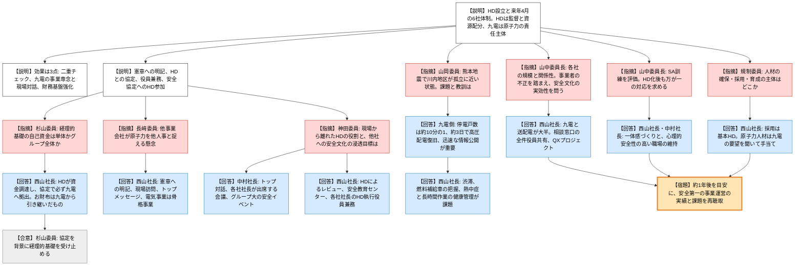

# 第38回原子力規制委員会臨時会議（令和8年10月21日）
> 出典 : https://youtube.com/live/VTWzJinxRQQ?si=U_qML83sET_BbF7-

## 会合の概要
* **純粋持株会社体制への移行後も、原子力安全が最優先であることの確認**
  九電から、10月1日にキューデンホールディングス（HD）を設立し、来年4月に九州電力を含む主要事業会社6社をHDが直接保有する体制へ移行する計画が説明された。「2年前の5月に委員長から求められた、新体制後に安全最優先の取組を確認する」という宿題への回答の場であり、規制側は体制・仕組みの説明を概ね理解したと評価した。
* **経理的基礎（資金面の担保）をめぐる杉山委員との確認**
  HDが資金調達を担う体制で、原子炉設置変更許可申請の「経理的基礎」の読み方が変わらないかが問われた。HDと九電が協定を締結し、必要な資金はHDが必ず九電に拠出する旨を民法上の契約として明確にしたと回答があった（資本金が同額なのは、九電の「お財布」をそのままHDが引き継いだため）。
* **「他人事化」と安全文化の浸透が最大の関心事**
  長﨑委員・神田委員は、原子力を担わない他事業会社の社員が原子力安全を他人事と捉えないか、HDは現場から離れた立場で何を担うのかを質した。事業者側は、HDによる原子力安全取組のレビュー、事業会社社長の執行役員兼務、トップメッセージ、グループ共通の安全教育などで対応すると説明した。
* **安全文化の実効性は「時間が経ってから」検証する方針**
  山中委員長は、今年初めにある事業者で原子力安全を揺るがしかねない不正が発覚したことを踏まえ、規制側も我がこととして組織文化の改善に取り組んでいると述べた。そのうえで、約1年後を目安に、今日示された意気込みが実現できているかを再度聴取したいと要請した。
* **熊本地震の教訓と人材確保・育成**
  山岡委員の質問を契機に、地震時の復旧対応（渋滞・燃料補給・作業員の安全と健康管理）の教訓が共有された。終盤には、採用はHDで一括して行う方向である一方、原子力部門の人材は九電と連携して手当てするとの回答があった。

---

## 議題ごとの詳細整理

### 【議題】原子力規制委員会と九州電力株式会社経営層による意見交換（資料：新たなグループ体制および原子力安全確保に向けた取組みについて）
* **議論の背景と論点:**
  * **背景**
    * 九電グループは10月1日に純粋持株会社「キューデンホールディングス」を設立し、HD社長に西山氏、九州電力社長に中村氏が就任した。
    * 来年4月には九州電力を含む主要事業会社6社をHDが直接保有する体制に移行する予定である。
    * 出席者は、九州電力の中村社長・篠原常務、HDの西山社長・木戸常務。
  * **経緯**
    * 2年前の5月の規制委員会で、委員長が「新体制になった後、HD社長も出席した上で安全最優先の取組を確認する」旨を述べていた。
    * 前回の意見交換は令和7年11月19日に実施されている。
  * **論点**
    * HDの関与（資源配分・役員兼務・協定・安全協定の当事者化）が、事業主体である九電の原子力安全確保責任を損なわないか。
    * 資金調達主体がHDに移ることで、設置変更許可申請の「経理的基礎」の説明がどう変わるか。
    * 原子力を担わない他事業会社を含むグループ全体に、原子力安全文化をどう浸透させるか。
    * 組織文化の実効性（不正を許さない仕組みと風通しの良さ）と、人材の確保・育成体制をどう維持するか。

* **質疑応答（詳細）:**
  **＜九電による説明（中村社長）＞**
    * 【説明者側】中村社長（九州電力）
      ホールディングス化の目的は、HDが原子力安全の継続的向上を大前提にグループ経営の舵取りと監督を担い、九電を含む各事業会社が事業運営に専念して迅速な意思決定を行うことである。九電は引き続き原子力事業の責任主体であり、そのガバナンスは現行から変わらない。
    * 【説明者側】中村社長（九州電力）
      期待する効果は3点ある。①HDが客観的立場から原子力事業を監督・助言する二重のチェック体制、②九電が電気事業に特化することで、社長自身が発電所へ出向き所員と対話できる、③グループ財務基盤の強化（直ちに効果が出るものではないが、安全投資の原資となる）である。
    * 【説明者側】中村社長（九州電力）
      原子力安全の最優先は「九電グループ企業行動憲章」に明記し、HPで公開している。HDは必要な経営資源を確実に配分する旨を、九電との間の協定に定め、これも公開している。
    * 【説明者側】中村社長（九州電力）
      HD社長が九電の取締役を、九電社長がHDの執行役員をそれぞれ兼務し、原子力のリスク情報をHDへ迅速に共有できる体制とした。また安全協定は、立地自治体（佐賀県・鹿児島県）との間でHDも当事者に加わる形で改定済みであり、他の周辺自治体とも対話を重ねる。

  **＜経理的基礎・資金面＞**
    * 【規制側】杉山委員
      設置変更許可申請書添付書類の経理的基礎では、工事費を自己資金・社債・借入で調達すると書くのが典型である。HDが上に立つ場合、「自己資金」は九電単体の資金か、グループ全体の資金かを確認したい。
    * 【説明者側】西山社長（HD）
      今後グループ全体の資金調達はHDが行うため、経理的基礎はHD側が最も重要になる。原子力はグループにとって最も重要な事業であり、HDと九電が協定を結び、必要な資金はHDが必ず九電に調達・拠出することを明確にした。
    * 【規制側】杉山委員
      添付書類にそこまで書くことを求める意図はないが、今後九電の記載に変化が出た場合は、この協定が背景にあるものと受け止めればよいと理解した。なお、資料3ページの対比表で資本金が同額なのは、同じ「お財布」だからか。
    * 【説明者側】西山社長（HD）
      九電が持っていたお財布をそのままHDが引き継いだ形であり、今後はそこから九電へ資源を拠出する。協定は民法上の契約として有効であり、HDには履行義務があると認識している。

  **＜資金の競合時の優先順位と、グループ内の一体感＞**
    * 【規制側】長﨑委員
      燃料価格の高騰などでグループ経営環境が悪化し、成長投資と原子力安全投資が競合する場合でも、安全第一で資金を振り向けるとの説明を受け、安心した。そのうえで、来年4月以降は原子力が九電だけの事業となり、他社の社員が「関係ない」と感じる懸念がある。福島第一事故の教訓や原子力への責任を他人事にせず、意識として根付かせる考えを伺いたい。
    * 【説明者側】西山社長（HD）
      原子力は最も安全を重視すべき事業であり、東日本大震災後の長期停止で大きな赤字を抱えた時期も安全投資は揺るがせなかった。企業行動憲章に、原子力安全が事業の大前提であることを明記した。加えて、自ら現場を回って言い続けること、電気事業は創業以来の骨格事業でありリソースを振り向けるというメッセージを社員へ出し続けることで対応する。
    * 【規制側】長﨑委員
      「キューデン」ホールディングスというカタカナ表記には、世界展開を意識した思いがあると推察する。そのうえで、原子力の安全には責任をもって取り組んでほしい。
    * 【説明者側】西山社長（HD）
      「九電」は地元になじんだ名前であり、自治体首長との面談でも「九電さんはしっかりやってくれている」という言葉が返ってくる。創業の電気事業を大切にするため、この響きを残す意図でカタカナ表記とした。

  **＜熊本地震の対応と教訓＞**
    * 【規制側】山岡委員
      火山モニタリングへの日頃の協力に謝意を示したうえで、10年の間隔で熊本地震が再び発生し、鹿児島方面が鉄道・高速道路の不通で孤立状態に近くなった。川内原子力発電所の所員の通勤などにも影響があったと聞くが、どのような課題と対応があったか。
    * 【説明者側】九電側回答者
      停電戸数は10年前の約10分の1に抑えられた。これは送電・変電設備への対策が効いたためと考えている。道路が通じないと高圧発電機車が現地に到着できないなどの課題があったが、関係者・協力会社の尽力により、約3日で高圧配電を復旧できた。川内地区では新幹線の不通により高速移動が難しくなったため、道路事情など多面的なシナリオを想定して今後も対応する必要がある。
    * 【規制側】山岡委員
      10年のうちに大きな地震を2回経験したことで、原子力安全に役立つ教訓はあるか。
    * 【説明者側】九電側回答者
      原子力は地域社会の理解・安心が不可欠な事業であり、地震後は地域・自治体から状況説明を求める声があった。川内原子力総合事務所、鹿児島支店、本店が一体となって地震と原子力の状況を説明した。迅速・積極的な情報公開と、分かりやすい説明を続ける必要性を再認識した。
    * 【説明者側】西山社長（HD）（補足）
      2016年の熊本地震時は九電社長として非常災害対策本部長を務めた。地震では渋滞や余震があり、作業員の安全確保が課題となった。燃料補給車の位置が分からない問題にはGPSでの把握や定期連絡で対応し、真夏だったことから熱中症対策としての作業インターバル管理や、長時間作業をしたがる従業員の健康管理も課題として認識した。

  **＜HDの役割と原子力安全文化の浸透＞**
    * 【規制側】神田委員
      現場から離れた組織であるHDに、九電の原子力安全文化向上の面でどのような役割と効果を期待するのか。また九電以外のグループ企業への浸透では、何を目標とし、均てん化が狙いなのか、各社の事業に合わせた取り組みはあるのか。
    * 【説明者側】中村社長（九州電力）
      コンプライアンス経営と原子力安全最優先の事業運営をグループで共有する。経営トップがあらゆる機会に社員・協力会社と対話を重ね、協定の文言にとどまらず実行を担保するための浸透を図る。HDの会議体には各事業会社の社長が出席し、価値観を共有する。人的ネットワークやノウハウは各社間で共有され、情報は遮断されない。安全文化に関するグループ大のイベントも、HD化前から継続している。
    * 【説明者側】西山社長（HD）（補足）
      HDは九電の原子力安全の取組をレビューし、十分か、質をさらに高められないかという目線で働きかけることが使命であり、原子力の安全・安定運転はグループの企業価値向上に直結する。安全全般ではHD管理のグループ共通の安全教育センターで研修を実施しており、原子力についても「九電が行う事業」という認識にならないよう、各事業会社の社長をHD執行役員として役員会議に参加させ、九電社長から原子力安全の取組を報告させる。
    * 【規制側】神田委員
      安全文化は外から測り知れず、何かが起きて初めて分かる面もあるため、今後もよろしくお願いする。
    * 【説明者側】西山社長（HD）
      安全と効率化・収益性が相反するときは迷わず安全を優先するよう社員にメッセージを出している。水力の更新工事で、並行作業に安全上の問題があるとして工程を3か月延ばす提案が上がり、役員会議でも異論なく安全優先で工期延長を決めた例があり、現時点で組織風土は悪くないと理解している。

  **＜グループ会社の規模・関係性と、組織文化の実効性＞**
    * 【規制側】山中委員長
      HDと九電以外の事業会社の規模と、九電との関係の密接さを知りたい。今年初め、ある事業者で原子力安全を揺るがしかねない不正が発覚した。規制側も組織文化の改善に取り組んでおり、HD化により原子力と異なる事業の会社が加わる中でも、安全文化の構築と、それを阻害するものの除去をグループとして実施してほしい。
    * 【説明者側】西山社長（HD）
      詳細な数字は手元にないが、人員・資産の大半を九州電力と九州電力送配電が占める。来年4月に水力など再エネを移管する九電みらいエナジーは1000人弱の規模になる見込みで、QTnetは従業員数が不明、キューデン・インターナショナルと都市開発会社は100〜200人規模である。各社とも「九電」ブランドの恩恵を受けており、一体感の維持と、九電が必要とする際の人的支援の取りまとめがHDの役割である。
    * 【規制側】山中委員長
      体制・仕組み・意気込みは伝わった。時間が経ってから課題がないか、意気込みが実現できているかを、できれば1年後あたりに改めて聴取したい。両社長の見解を伺う。
    * 【説明者側】西山社長（HD）
      安全の取組は仕組みと人の両方が備わらなければ機能しない。コンプライアンス相談窓口への相談は全て役員に共有し、途中でフィルターがかからない運用としている。HD化により、自社外の窓口へも声を上げやすくなる面もある。人の面では、社員から「さん付け」で呼ばれる関係づくりや、QXプロジェクト（3年目）で、違和感を素直に声に上げられる職場を目指している。
    * 【説明者側】中村社長（九州電力）（補足）
      役員が計画的・組織的に社員と対話し、HD化の趣旨や不安に耳を傾けてきた。安全文化の浸透状況を社員の受け止めとして直接把握し、時間経過を踏まえたフォローアップを行う。

  **＜万が一の災害対応と一体感の醸成＞**
    * 【規制側】山中委員長
      九電のSA（シビアアクシデント）対応訓練を何度か直接拝見したが、他社に比べて相当キビキビした活動で、意識の高さを感じた。HD化後も、原子力に直接関わらない会社を含め、万が一の対応がしっかりできるようにしてほしい。
    * 【説明者側】西山社長（HD）
      評価に感謝し、社員にも伝える。定期検査の時期に、協力会社も含めた1000人規模の焼肉大会などで経営層と社員が交流する場があり、他の事業会社の経営層も誘って顔を出すなど、原子力を含む電気事業がグループの大事な事業であるという意識を作る手立てを考えたい。
    * 【説明者側】中村社長（九州電力）（補足）
      ポジティブな評価は士気を高める。人が入れ替わる中でも慢心せず、心理的安全性の高い、何でも言い合える職場を作り続ける努力が必要であり、原子力事業の様々な課題にも前向きに取り組む組織風土を風化させない。

  **＜経営層の締めの発言（木戸常務・篠原常務）＞**
    * 【規制側】山中委員長
      原子力の安全について、木戸常務・篠原常務からも一言いただきたい。
    * 【説明者側】木戸常務（HD）
      HD化の検討は3年前から、原子力の安全確保を大前提として具体的に始めた。災害対応でもHDが危機管理官を中心に支援できる体制を作り、グループの人的資本、すなわち「現場は人」であることを重視する。来年4月に6社体制となる際も、各社社長がHD執行役員としてボードメンバーに入る前提で、機能の果たし方を設計している。
    * 【説明者側】篠原常務（九州電力）
      技術の継承や人材育成など様々な課題の礎は「対話」であると考える。規制委員会・規制庁との対話、部門内・協力会社・部門外の社員、社会との対話が建前になってはならない。役員が同じフロアで気軽に相談できる風土があり、これが現場に浸透すれば適切な事業運営につながる。

  **＜人材の確保・採用・育成＞**
    * 【規制側】規制委員
      人の確保・採用と育成は、HDが一括して行うのか、各社が行うのか。
    * 【説明者側】西山社長（HD）
      採用は基本的にHDで行う。原子力人材は九電原子力部門の要望を聞いて手当てを続ける。事務系は入社後に複数部門を試して希望とニーズをマッチングする配属を昨年から始めており、技術系も事前に希望を聞いた上で配属する取組を今年から始めた。
    * 【説明者側】木戸常務（HD）（補足）
      成長事業で専門性のある人材（ICT等）は、各社で個別に採用する面もある。当面は九電を中心に出向を含む人材交流を進め、将来は少しずつ変わっていく見通しである。
    * 【説明者側】中村社長（九州電力）（補足）
      九州の電力需要の伸びや、エネルギー情勢で原子力への認知が高まっていることを背景に、人事部門だけでなく、学校の先生との関係や就職セミナーなどで、原子力事業に携わる社員自身が魅力を伝える機会を通じて、人材確保を進める。

* **結論と宿題事項（アクションアイテム）:**
  * **決定事項:** 事業者側から示された、協定による資源配分の担保、役員兼務、企業行動憲章への明記、安全協定の改定といった体制・仕組み、および意気込みについて、委員長は前回の要請に対する回答として受け止めた。
  * **宿題事項（規制側からの要請）:** 山中委員長は、原子力安全第一の事業運営が実際にどのように行われたか、何らかの課題があったかについて、遠くない将来（できれば1年後あたり）に、改めて実情を聴取する機会を設けたいと述べた。
  * **確認事項:** 杉山委員は、今後の許認可申請の経理的基礎の記載が、HDと九電の協定を背景としたものになると理解した。

---

## 論理構造の可視化（Mermaid）

### 【議題】原子力規制委員会と九州電力株式会社経営層による意見交換

