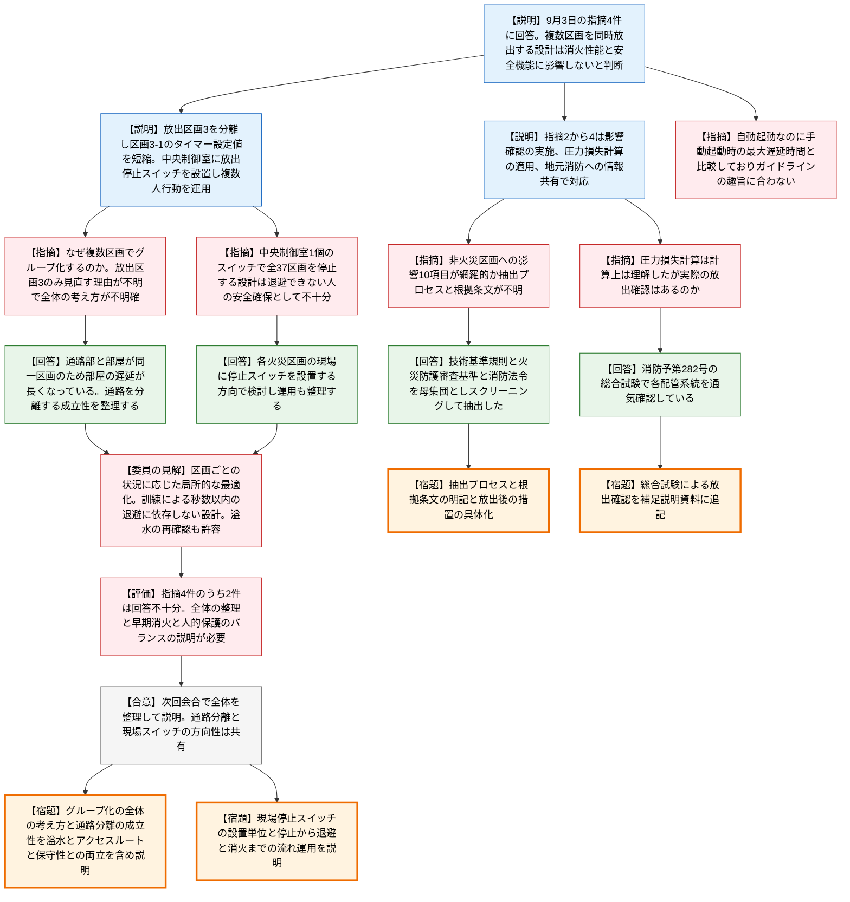

# 第1439回原子力発電所の新規制基準適合性に係る審査会合（令和8年10月22日）
> 出典 : https://youtube.com/live/_FRJVAFeYbM?si=saKn_IolkkNb7bxk

## 会合の概要
* **北海道電力が、泊3号機の火災防護(ハロゲン化物消火設備の複数区画同時放出)に関する9月3日の審査会合での指摘事項4件に回答**
  北海道電力は、複数の火災区画をグループ化して消火剤を同時放出する設計は早期消火・人命安全・消火性能の観点で問題ないと説明した。一方で、最も多くの区画を束ねた放出区画3の分割や、中央制御室への放出停止スイッチの設置といった改善策も併せて提示した。
* **規制庁は指摘4件のうち2件の回答を「不十分」と評価**
  なぜ単一区画ではなく複数区画のグループ化とするのか、なぜ放出区画3のみを見直せば足りるのか、という全体の設定の考え方が示されていない点が最大の問題とされた。自動起動の消火設備に対し、手動起動時の最大遅延時間と比較している点も、ガイドラインの趣旨に合わないと指摘された。
* **審査の過程で、事業者自身が設計見直しの方向性を示した**
  通路(退避時間が長い)と部屋(退避時間が短い)を同一の放出区画にまとめていることで、部屋の遅延時間が通路に引っ張られて長くなっている実態が確認された。事業者は、通路を分離する方向で成立性を整理すると述べた。
* **中央制御室1か所での全放出区画の一括停止は、見直しが必要との認識で一致**
  事業者は、全37放出区画のタイマー停止を中央制御室の当直課長席の1個のスイッチで行う計画だった。規制庁・委員の指摘を受け、各火災区画の出入口付近の現場に停止スイッチを設置する方向で検討すると応じた。
* **杉山委員は「区画ごとの状況に応じた局所的な最適化」を促し、訓練による秒数以内の退避に過度に依存しない設計を求めた**
  溢水対策等との関係で再確認が必要になっても、トータルで合理的であればその方針も検討すべきとし、次回会合で全体の整理を説明することが求められた。

---

## 議題ごとの詳細整理

### 【議題1】北海道電力（株）泊発電所3号機の設計及び工事の計画の審査について
* **議論の背景と論点:**
  * **背景:**
    * 9月3日の審査会合で、泊3号機の火災防護に関する指摘事項4件を受けており、本会合はその回答。
    * 設備は、複数の火災区画をグループ化し、いずれかで火災が発生すると、グループ内の全区画へハロゲン化物消火剤を同時に放出する設計(放出区画は全37個)。自動起動方式で、放出前に在域者が退避するための放出遅延タイマーを設定している。
    * 資料には非公開情報が含まれるため、発話・画面への映り込みに注意するよう冒頭で促された。
  * **論点:**
    * (1) 複数区画のグループ化の合理性(技術基準規則第11条の早期消火の観点、他条文への影響)と、同一グループ内の全区画から遅延時間内に安全に退避できること。
    * (2) 火災が発生していない区画にも消火剤を放出する影響を、網羅的に説明できているか。
    * (3) 複数区画同時放出に対する圧力損失計算の適用性と、噴射ヘッドの放出開始時間差の影響。
    * (4) 火災時に地元消防が円滑に活動するための情報共有。

* **質疑応答（詳細）:**
  **＜北海道電力の説明の要点＞**
    * 【説明者側】北海道電力 新井
      指摘事項1(グループ化)について。早期消火の観点から、手動起動より速やかに起動できる自動起動方式を採用している。ハロゲン化物消火設備は遅延装置を設けないことも可能だが、在域者の存在を前提に、実測した退避時間に基づく必要最小限の時間を遅延時間として設定している。
    * 【説明者側】北海道電力 新井
      通路や袋小路を含む区画の同時放出では、通路を通らなければ避難できない袋小路側の退避時間を含めて設定した。区画数と在域者数が最も多い放出区画3では、ピーク時の人数・配置を模擬した退避実証試験で、タイマー設定値の140秒以内に全員が退避できることを確認した。
    * 【説明者側】北海道電力 新井
      火災の延焼防止の観点では、消防法令の設計条件を満足し、耐火壁・不燃材・難燃ケーブルの使用により火災の発生と延焼の可能性を低減している。非火災区画の機器や人命安全への影響がなく、要求される施設が同一火災で同時に機能喪失しない設計であることも確認したとし、十分な保安水準を確保していると判断した。
    * 【説明者側】北海道電力 新井
      さらなる早期消火・人命安全の向上策として、負傷者の発生を想定した中央制御室への放出停止スイッチの設置、複数人行動の運用・教育・装備の整備を行う。また、最も多くの火災区画を束ね、タイマー設定値が大きい放出区画3を2つに分離・細分化し、放出区画3-1のタイマー設定値を短縮する。
    * 【説明者側】北海道電力 新井
      指摘事項2(非火災区画への放出の影響)について。設備・人員・消火剤濃度・プラント運転・熱分解生成物・煙感知器作動時の対応・放出後の措置などを確認し、必要な保安水準を確保しており問題ない設計とした。
    * 【説明者側】北海道電力 新井
      指摘事項3(圧力損失計算)について。日本消火装置工業会の設計工事基準書に基づき、貯蔵容器から各噴射ヘッドまでの配管を区間に分け、流量・配管長・高低差から圧力損失を計算している。複数区画同時放出の影響は配管長・分岐・噴射ヘッド数・各区間の流量に反映されるため、単一区画と計算原理は変わらず適用できると判断した。
    * 【説明者側】北海道電力 新井
      噴射ヘッドへの消火剤到達の時間差は、この手法では直接評価できない。そのため配管が最長となる区画について別途評価し、必要な消火剤の供給が確保されることを確認したことから、消火性能に影響しないと考える。
    * 【説明者側】北海道電力 新井
      指摘事項4(地元消防との情報共有)について。ハロゲン化物消火設備の運用開始までに、同時放出範囲を明示した設計情報、消防隊の進入経路・人員の退避経路の資料を地元消防へ提供する。発電所員・自衛消防隊・公設消防の役割、対応手順、連絡体制を定めたマニュアルを整備して共有し、合同訓練も実施する。地元消防とは協議を開始している。

  **＜質疑＞**
    * 【規制側】規制庁 室長
      なぜ単一区画ではなく複数区画でグループ化する設計としたのか、理由を質問した。
    * 【説明者側】北海道電力 武田
      溢水対策やアクセスルート、保守スペースの確保に有利なため、できるだけ区画をまとめる設計としてきたと回答した。
    * 【規制側】規制庁 室長
      回答の前提となるこの理由も含めて説明するよう求めた。そのうえで、2〜3ページの説明は不十分であるとした。
    * 【規制側】規制庁 室長
      放出区画3の細分化だけでは、どのように分割されるのかが分からず、初期の消火剤放出までの時間が遅れる部屋が他の部屋に引っ張られる影響がどの程度残るのかも不明である。
    * 【規制側】規制庁 室長
      消防庁ガイドラインの遅延タイマーとの比較に、手動起動時の最大遅延時間を用いているが、今回は自動起動の設計であるため、自動起動との比較でなければガイドラインの趣旨に合わない。また、3ページの「4」の確認内容は、早期消火の観点とはあまり関係がない。
    * 【規制側】規制庁 室長
      可能な限りガイドラインに即して放出区画を設定し、実現が困難な箇所にどのような措置をとるのかを含めて、早期消火の観点から全体として合理的な設計になるよう再検討し、結果を説明するよう求めた。
    * 【説明者側】北海道電力 金田
      溢水対策やアクセスルート、保守スペースの確保に有利なため区画をまとめてきたが、指摘を受け、退避時間の長い通路部と短い部屋を同一の放出区画にまとめていることが、遅延が長くなる要因であると理解した。通路部と部屋を別の放出区画に分けることの成立性を、他条文への影響も含めて整理して説明する。
    * 【説明者側】北海道電力 金田
      具体的には、資料1-2の5〜7ページの表(各放出区画の退避時間とタイマー設定値)で黄色に着色した通路をまず単独の区画にして、各部屋の退避時間を短く設定できるようにする。同様の箇所があれば、それも整理して説明する。
    * 【規制側】規制庁 室長
      3ページ「5」の放出停止スイッチは、設定されている37の放出区画のうち任意のものを停止できるのかを質問した。
    * 【説明者側】北海道電力 武田
      火災時の連絡先は、過去から現在まで必ず中央制御室の当直課長であるため、停止スイッチを当直課長席に設けるのが判断が早いと考えた。現在の設計資料では、中央制御室に1個だけ設置する計画で、そのスイッチで残りの37区画すべてのタイマーを止める仕様になっている。
    * 【説明者側】北海道電力 金田
      現場の作業員が当直課長に連絡して放出を停止するまでの動線・時間や、逃げ遅れた人の退避を確認したうえで消火することを考えると、中央制御室の1か所だけで達成できるかは疑義がある。すべての火災区画の出入口付近に、簡単な操作で停止できる現場スイッチを設置できないか検討し、停止から退避、消火までの流れ、運用周知を含めて整理して説明する。
    * 【規制側】規制庁 室長
      停止スイッチの設置方針は、放出区画の分割の見直しにも関連して変わってくるため、総合的にまとめて説明するよう求めた。
    * 【規制側】規制庁 室長
      4ページの「非火災区画への影響」の確認項目10点が網羅的かどうか分からないため、どのようなプロセスで抽出したのかを質問した。
    * 【説明者側】北海道電力 平田
      まず、設工認で要求される全事項への影響を網羅的に評価するため、技術基準規則の各条文を母集団とし、非火災区画への放出が影響を及ぼす可能性の有無とその評価観点から影響項目を抽出した。これに、同時放出が火災防護審査基準と消防法関係法令の要求に影響しないかの確認を加えて母集団とし、スクリーニングで確認項目を抽出した。
    * 【規制側】規制庁 室長
      各項目を技術基準規則、火災防護審査基準などのどこから引いてきたのかを、今後資料に充実させるよう求めた。また、10項目のうち9の「放出後の措置」は、具体性をさらに説明するよう求めた。
    * 【規制側】規制庁 室長
      5ページの圧力損失計算や時間差の評価は計算上は理解したが、実際に消火剤が放出されることを確認していないのかを質問した。
    * 【説明者側】北海道電力 新井
      設置完了後の完成試験で、消防予第282号の総合試験を行う。設置した各配管系統について起動装置を操作して試験用ガスを放出し、配管の通気状況や各部の作動状況を確認することで、各系統が確実に通気され、所定の放出系統として成立していることを確認している。
    * 【規制側】規制庁 室長
      計算に加えて実際の確認も行っているため、その内容も補足説明資料に記載するよう求めた。

  **＜会合のまとめ(規制庁)＞**
    * 【規制側】規制庁 中川
      4件のうち2件は回答が不十分と評価した。1つ目は、早期消火を踏まえた合理的なグループ化で、放出区画3の分離・細分化のみを見直す理由が示されておらず、全体の設定の考え方が不明確であるため、改めて検討して説明するよう求めた。
    * 【規制側】規制庁 中川
      2つ目は、遅延時間内に退避できない場合の人命安全の取り組みで、中央制御室で火災が発生していない区画まで含めて自動起動の消火を停止するとの説明について、講ずべき措置を踏まえ見直しが必要ないかを説明するよう求めた。
    * 【規制側】規制庁 中川
      3つ目は、非火災区画への消火剤放出の影響の確認項目を網羅的に抽出していることを示すため、抽出プロセスを説明すること。4つ目は、複数区画への消火に用いる消火手法の妥当性について、実機での総合試験を行っているとの説明があったため、その内容を補足説明資料に追加することである。
    * 【規制側】規制庁 中川
      以上を資料として準備し、次回の審査会合で説明するよう求めた。
    * 【説明者側】北海道電力 金田
      スイッチはそれぞれの火災区画に設置し、その場で停止・再放出できる形にすることが、早期消火と退避の確実性の観点で有益と考える。通路を長い区画に含めたことで部屋の退避時間が引っ張られている実態も資料の整理で分かったため、通路は分離すべきと考える。溢水対策、アクセスルート、約50年運転することを踏まえた保守性を達成する形で分割し、考え方も含めて早急に整理して説明する。
    * 【規制側】杉山委員
      金田常務の方針で検討してほしい。当初案は、多くの区画を少数にまとめて同じように扱うもので、最も厳しい箇所に合わせると他に無理が生じ、人の対応にしわ寄せがいく懸念があった。区画ごとの状況に応じて、より細かく見てほしい。
    * 【規制側】杉山委員
      停止スイッチを局所に置き、一度止めて再放出することにすれば、現場に人がいればその人が消火作業を行うこともできるため、現実的に考えてよい。
    * 【規制側】杉山委員
      訓練によって何秒以内の退避を達成するという対応は現実的でない。建屋に入域する人に退避を徹底させ、運転期間中維持することにも限界があり、転倒や走れない場合もある。建屋のマップや、どの区画が連動しているかを全員が把握しているわけではなく、秒数内に出ろと言われても逃げる先が分からない。手近な扉の先が同一の放出区画でなければ消火剤は吹いてこないと分かるだけでも大きく違う。
    * 【規制側】杉山委員
      全体の統一的な考えではなく、局所ごとに状況を反映して最適化してほしい。溢水対策との兼ね合いで溢水の再確認が必要になっても、他の対策とのバランスを取ってトータルで合理的であれば、その方針も検討してほしい。また、時間をかけて検討することも許容する旨を述べた。
    * 【規制側】規制庁 西崎管理官
      放出区画3だけを見直す理由、それで十分とする理由の説明が不足している。消火剤放出の影響10項目が網羅的に抽出されたかも、体系的な検討のプロセスの説明が必要である。
    * 【規制側】規制庁 西崎管理官
      中央制御室で全区画の自動起動を停止する設計は見直しが必要と考える。見直し後のスイッチが放出区画ごとか火災区画ごとかも、次回説明してほしい。
    * 【規制側】規制庁 西崎管理官
      溢水対策やSA(重大事故等対処)のアクセスルート確保という事業者の考え方自体は否定しないが、それを優先して他がおろそかになってもいけない。早期消火性と人的な保護のバランスを取る必要があり、その取り方の説明がまだ十分でないため、改めて整理してほしい。
    * 【説明者側】北海道電力 金田
      既存設備がある状態でも、基準や原子力安全と両立させる形で火災防護を成し遂げるために、まだやれることがあると考える。具体的な方法を早急に整理する。訓練は実施するが、作業員に過剰な期待をしなくても対応できるよう、設備側でできる対応をできるだけ行う。既設のため達成できない点は、理由を含めて説明する。

* **結論と宿題事項（アクションアイテム）:**
  * **決定事項:** 指摘事項4件のうち2件は回答が不十分とされ、継続審査となった。次回の審査会合で資料を整理して説明する。
  * **宿題事項(規制側から事業者への要請):**
    * 早期消火の観点を踏まえた火災区画グループ化の設定について、複数区画でまとめる理由、放出区画3のみを見直す理由、全体としての設定の考え方を示し、通路と部屋の分離を含めた見直し案とその成立性(溢水対策・アクセスルート・保守性との両立)を説明すること。
    * 遅延時間内に退避できない場合の人命安全の取り組みとして、中央制御室1か所での一括停止の設計を見直し、現場への停止スイッチ設置(放出区画ごとか火災区画ごとかを含む)と、停止から退避・消火までの流れ、運用周知を説明すること。
    * 非火災区画への消火剤放出の影響を示す確認項目について、抽出プロセスと各項目の根拠条文・基準を資料に明記し、「放出後の措置」の具体性も説明すること。
    * 圧力損失計算等に加え、消防予第282号の総合試験による実際の放出確認の内容を補足説明資料に追加すること。
    * 早期消火性と人的保護のバランスの取り方を整理して説明すること。

---

## 論理構造の可視化（Mermaid）

### 【議題1】泊3号機 火災防護(ハロゲン化物消火設備の複数区画同時放出)

