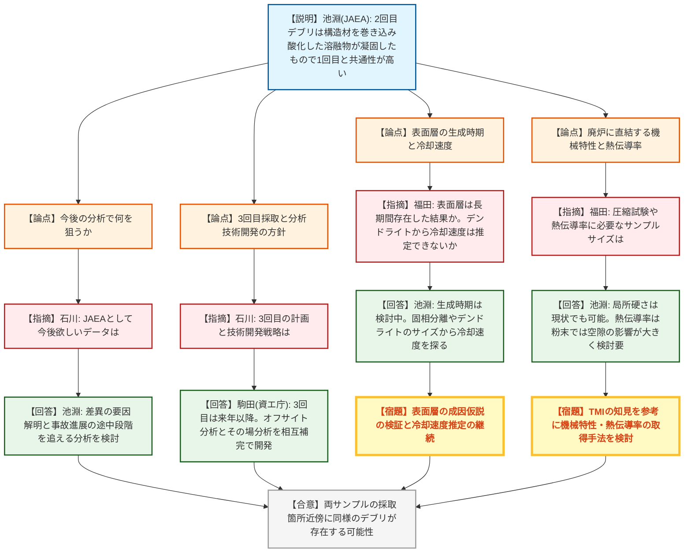
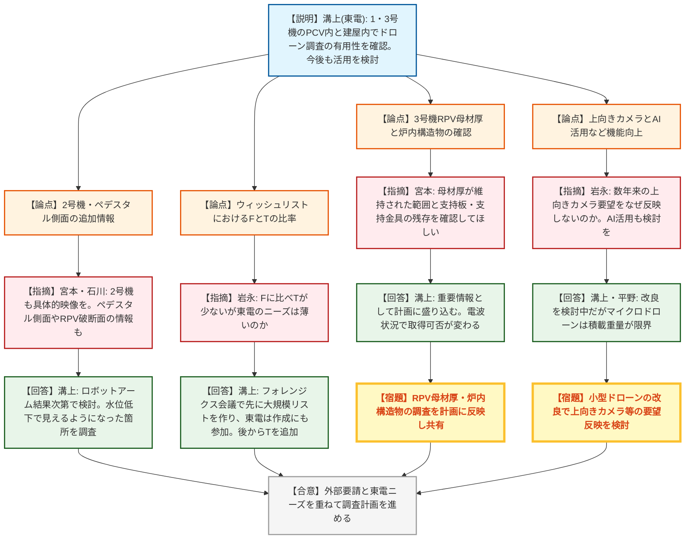
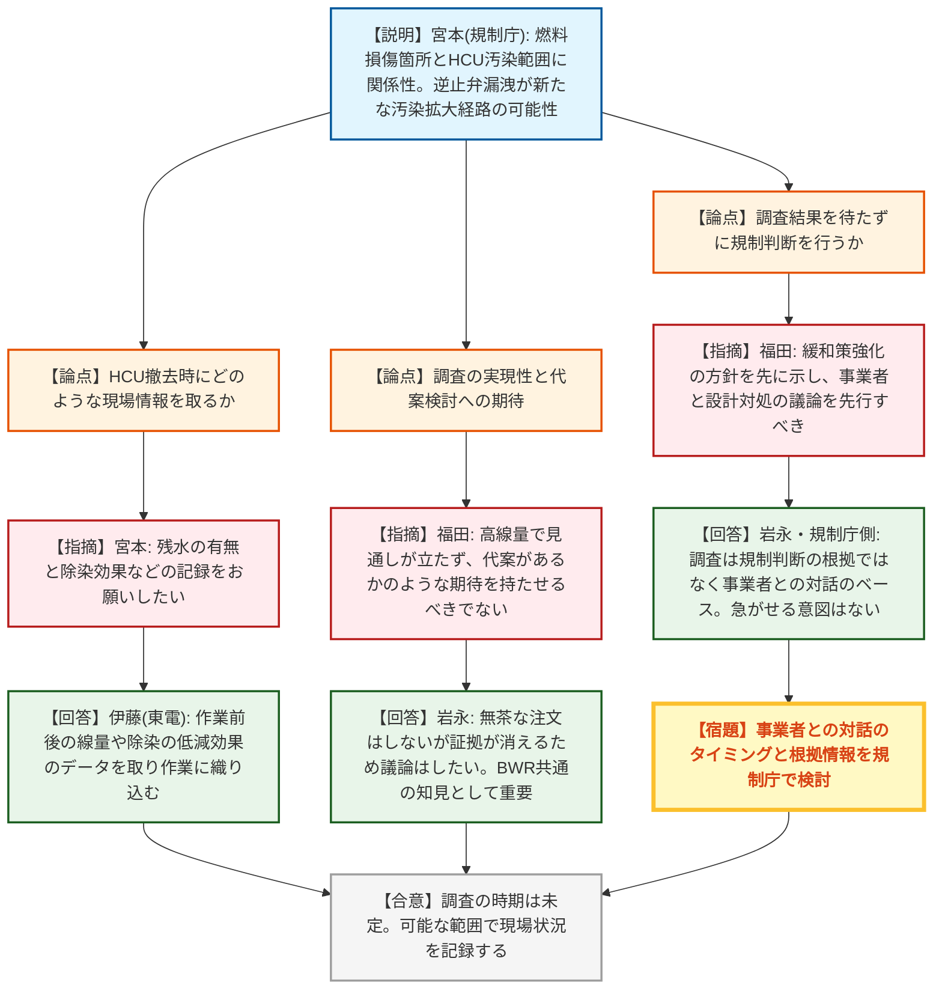
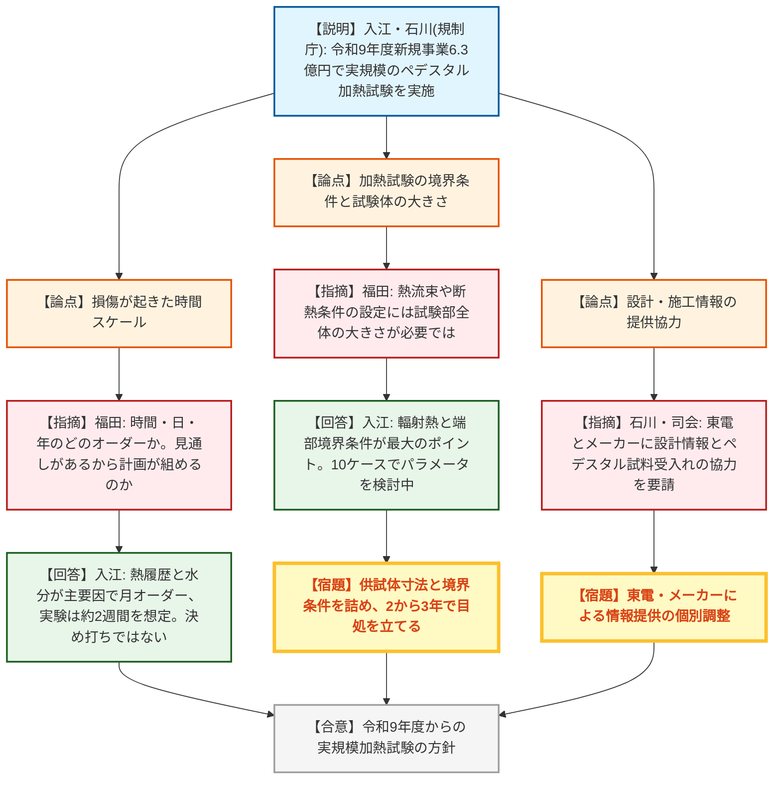

# 第16回福島第一原子力発電所廃炉・事故調査に係る連絡・調整会議（令和8年10月23日）
> 出典 : https://youtube.com/live/qDRZaBUudL4?si=WdWcdj3kGbjP4RiA

## 会合の概要
* **2回目燃料デブリの分析結果が出揃い、1回目と「共通の生成過程」を示唆**
  JAEAから、2号機で2回目に取り出した燃料デブリ（2025年4月取出し）の主要な分析結果が報告された。ウラン・ジルコニウム・鉄・クロム・酸素系の微細混合層が主体で、被覆管やチャンネルボックスを巻き込んだ溶融物が酸化しながら凝固したと推定され、1回目と採取位置は離れていても近傍に同様のデブリが存在する可能性が示された。規制側・有識者は、表面層の生成時期や、取出し・加工に直結する機械特性・熱伝導率のデータ取得に強い関心を示した。
* **ドローン調査の成果は大きいが、「上向きカメラ」など長年の要望は積載量の壁に直面**
  東京電力から、1〜3号機のPCV内・原子炉建屋内でのドローン調査の全体状況が示された。規制庁は、RPV内の母材厚さ・炉内構造物の残存状況・ペデスタル側面の損傷など、より多くの情報を持ち帰る機能（上向きカメラ、厚み測定、AI活用）を数年来求めているが、東電はマイクロドローンの積載重量が限界であり、小型ドローンの改良で反映を検討するという回答にとどまった。
* **3号機HCU調査：「燃料損傷とHCU汚染の関連」を示す規制庁に、有識者が「期待を持たせる議論は慎むべき」と釘を刺す**
  規制庁1F室は、溶融燃料を含む溶融物がCRDガイドチューブ内に堆積し、制御棒駆動機構を経てHCUへ汚染が広がった可能性と、逆止弁からの漏洩という新たな汚染拡大経路を報告した。これに対し福田氏は、現場が極めて高線量で調査の見通しが立たない現状を踏まえ、代案検討を期待させる議論への懸念と、調査結果を待たずに規制判断（緩和策強化の要否）を行う覚悟の有無を問うた。
* **規制庁が令和9年度に新規事業（6.3億円）として実規模のペデスタルコンクリート加熱試験を計画**
  1号機ペデスタルのコンクリートが壁内側で全周・高さ約1mにわたり消失し、鉄筋とインナースカートが残るという特異な損傷の解明に向け、小型供試体では再現困難な寸法効果を踏まえた実規模加熱試験を行う。熱の履歴と水分の挙動が主要因と見ており、東電に設計・施工情報の提供を求めた。

---

## 議題ごとの詳細整理

### 【議題1】2回目燃料デブリの試験的取出の分析結果（資料1：JAEA）
* **議論の背景と論点:**
  * 背景：試験的取り出しで2号機ペデスタル内から燃料デブリが2回採取された。1回目は当初計画の分析を終え報告済みで、今回は2回目（2025年4月取出し、大洗の研究施設で受入れ）の主要な分析結果の報告である。
  * 分析の狙い：①サンプルの構成成分・燃料割合の把握（採取箇所の状況把握）、②生成条件（経験温度・雰囲気）の推定（採取箇所周辺の評価）。
  * 論点1：2回目の特徴は何か、1回目とどう違うか（元素組成・同位体比・放射能・断面組織）。
  * 論点2：生成過程の推定と炉内状況推定図への反映、および採取箇所近傍のデブリの同質性。
  * 論点3：今後に必要な分析（事故進展の途中段階の情報、機械特性・熱伝導率など取出し・加工に資するデータ）。

* **質疑応答（詳細）:**
    * 【説明者側】池淵（JAEA）
      外観は茶褐色で表面に黒色部があり不均一、空隙が多数ある。元素ではウランが最多で、鉄・クロム・ニッケルの構造材成分も含むが、1回目よりニッケルが少なく金属層も少ない。ZrとUの比率は、燃料単独ではなく被覆管やチャンネルボックスを巻き込んだ組成に近い。
    * 【説明者側】池淵（JAEA）
      ウラン235の割合は約2%で炉心平均に近く、広い範囲の混合が示唆される。Cs-137は1回目・2回目とも炉心平均より数桁低く（事故時の高温での揮発と推定）、Eu-154やCm-244は炉心平均と同程度でウランと挙動を共にした。断面は空隙が分散した組織で、空隙の多いものは破砕による加工が可能と示唆される。
    * 【説明者側】池淵（JAEA）
      構造材成分（鉄・クロム・ニッケル）が炉心平均より多く、溶融物が下方へ移行する過程で炉心下部構造材を巻き込んだと推定。2回目はニッケルをほぼ含まず、構造材が酸化して酸化物層と金属に分かれ、酸化物層が2回目のデブリを構成した可能性がある。微細混合領域（Zr・U・Fe・Cr・O）に加え、鉄ニッケル系金属は水蒸気で鉄・クロムが優先酸化して生じ、表面の鉄ニッケル系層状堆積物は凝固後の冷却水との相互作用で生成した可能性がある。
    * 【説明者側】池淵（JAEA）
      生成した化合物は1回目と同様で、おおむね同じ温度範囲で溶融物の凝固が完了したと推定される（結晶成長度合いや層分離の有無には違いあり）。炉内状況推定図の「燃料の溶融混合・構造材を巻き込みながらの酸化」「凝固の温度領域」といった大まかな過程は両者で似通っており、全体を断定はできないが、2回の採取箇所近傍には同様のデブリが存在する可能性がある。
    * 【規制側】石川（規制庁1F室）
      JAEAとして、現行のデブリ分析の目的やアカデミックな観点から、今後欲しいデータはあるか。
    * 【説明者側】池淵（JAEA）
      1回目と2回目の差異の有無という当初目的のデータは得られた。結晶成長や層分離の程度の違いの要因は詰める必要があり、2回目に付随する粒状サンプルにも注目して差異を追う。今回のサンプルは表面から採取され構造材が強く酸化した多孔質のもので、事故時系列では後半の情報を拾っている可能性が高いため、事故進展の途中段階の情報が得られる分析（深さ方向など）を検討したい。
    * 【規制側】石川（規制庁1F室）
      資源エネルギー庁に対し、3回目のデブリ採取の計画概要を質問。
    * 【事業者側】駒田（資源エネルギー庁）
      10月2日から2号機でロボットアームを用いたPCV内部調査・試験的取り出し作業を進めており、現在はアクセスルートを構築中。その後、3次元形状データを取得し、3回目の試験的取り出しに進む。アクセスルート構築と3次元形状データ取得に3〜4か月以上かかる見込みで、3回目は来年以降となる。時期は今後の調査結果や現場状況で判断される。
    * 【規制側】石川（規制庁1F室）
      資源エネルギー庁が補助金等で進めるデブリ分析の技術開発は、どのような戦略か。
    * 【事業者側】駒田（資源エネルギー庁）
      取出し・収納・移送・保管などの廃炉作業に必要な情報を取得する観点で、分析施設で詳細に素性・構造・物性を把握する「バッチ分析（オフサイト分析）」と、炉内の現場で存在・分布を把握する「その場分析・遠隔測定技術」の両方を支援している。取得できる情報の種類・精度・適用条件が異なるため相互補完の位置づけで、今後も取出しの進展と現場ニーズを踏まえ、適用可能性や限界を確認しながら進める。
    * 【規制側】福田氏（有識者）
      11ページの表面層は、デブリ生成からどの程度後にできたものか。表面から採取されたので、長期間存在したからこそ持つ特徴かもしれない。
    * 【説明者側】池淵（JAEA）
      検討中の段階。1回目のデブリにも同様の表面層があるが、1回目はウランも層状に堆積しており、冷却水中の析出だけでは一概に説明できない。事故直後に数百度に保たれていた時期に水が入って生じた可能性など、複数の仮説を立てて検討している。局所的には、鉄・クロムが多い箇所にウラン・ジルコニウム系が樹枝状（デンドライト）に晶出した、比較的低温で生成した組織も見られる。
    * 【規制側】福田氏（有識者）
      デンドライトがあれば冷却速度の推定ができないか。
    * 【説明者側】池淵（JAEA）
      結晶サイズに加え、12ページのZr・U・O系に見られる固相分離の傾向について、分離した結晶のサイズや分離が起こる温度域から冷却速度を推定できないかアプローチしている。
    * 【規制側】福田氏（有識者）
      事故分析よりも廃炉の関心として、機械特性（せめて圧縮試験）と、現場加工を考えると熱伝導率を知りたい。どの程度のサイズのサンプルがあれば可能か。
    * 【説明者側】池淵（JAEA）
      マクロな破壊試験に必要な具体寸法の情報は現時点でないが、TMI（スリーマイル島）の例では回収物に破壊強度試験を実施しており、今回のような1cm未満ではなく、かなり大きなものが対象だった。一方、断面試料に対するマイクロインデンテーション（微小硬さ）のような、構成層ごとの局所データであれば現状でも取得可能。熱伝導率もTMIでの過去試験を参考にするが、現状の粒・粉末状のサンプルでは粒間の空隙の影響が大きく出るため、データ解釈を含め検討が必要。
    * 【規制側】石川（規制庁1F室）
      硬さは今後重要な因子となると認識しており、JAEAがTMIの事例（酸化物が多いと非常に硬くなる等）を紹介していることも踏まえ、技術開発を含めて引き続き進めてほしい。

* **結論と宿題事項（アクションアイテム）:**
    1. 1回目と2回目のデブリは、採取位置が離れていても、組成・構造・生成過程に共通性があり、採取箇所近傍に同様のデブリが存在する可能性がある（炉内全体の断定はしない）。
    2. 表面層の生成時期・冷却速度（固相分離やデンドライトの情報）については、JAEAが複数仮説に基づき検討を継続する。
    3. 事故進展の途中段階を追える分析、および機械特性（硬さ等）・熱伝導率など廃炉に直結するデータの取得手法の検討が期待事項として共有された。
    4. 3回目の試験的取り出しは来年以降の見込み。その成果は本会議でも紹介してほしい（司会）。

### 【議題2】ドローンによる炉内調査関係の全体の状況報告（資料2：東京電力）
* **議論の背景と論点:**
  * 背景：東電は、震災以降十分に調査できていないエリアを中心に調査を進めており、近年は機動性の高いドローンを活用している（1号機PCV内気中部：2023年度、3号機PCV内：2025年、2回目を今年度中に検討、1・3号機の原子炉建屋内調査にも使用）。
  * 現状：1号機・3号機ともPCV水位低下によりドライウェル地下階が気中に露出し、ペデスタル内外の堆積物の広がりや線量が把握されつつある（空間線量は1号機で最大約10Gy/h、3号機はペデスタル内で最大約7.5Gy/h、周囲で約6Gy/h）。
  * 今後：1号機はRPV内部への侵入口の確認、塊状堆積物の採取分析、ベント管内の流出状況の確認。3号機はRPV内でのさらに上方への飛行、堆積物の採取、地下階への流出の確認。2号機はロボットアーム調査の結果を踏まえドローン活用を検討する。
  * 論点：①規制庁が重視する情報（母材厚さ、炉内構造物、ペデスタル側面）の取得、②ドローンの機能向上（上向きカメラ・AI活用）、③事故調査項目の「ウィッシュリスト」におけるF・Tの偏り。

* **質疑応答（詳細）:**
    * 【説明者側】溝上（東京電力）
      1・3号機のPCV内調査と原子炉建屋内調査での成果（PCVトップヘッド健全性、堆積物の広がり、1号機の非常用復水器（アイソレーションコンデンサー）の弁、3号機の高圧注水系配管等に著しい破損・変形や過度な腐食がないこと）を説明。調査項目は1F事故調査中長期計画に基づき、米DOEのフォレンジクス会議の助言も踏まえて設定し、ドローンで情報取得が期待できる項目を整理した。
    * 【規制側】宮本（規制庁1F室）
      3号機で母材の厚みが維持されているように見える部分について、どの範囲まで寸法が維持されているか注目している。RPV開口部の断面の母材厚が分かる形で調べてほしい。
    * 【事業者側】溝上（東京電力）
      重要な情報と認識し調査計画に盛り込むが、前回調査は電波の到達が厳しく詳細を見られなかった。電波状況の改善の程度で取得できる情報も変わる。
    * 【規制側】宮本（規制庁1F室）
      水位低下後の追加調査で、炉内構造物の残存状況（支持板・支持金具など。現状確認できているのはハウジングやガイドチューブ）も識別できるか確認してほしい。2号機も3号機並みの具体的な映像を取る予定か。
    * 【事業者側】溝上（東京電力）
      炉内構造物を含めて検討し、詳細な調査計画はこれから詰めて適宜共有する。2号機はロボットアームが高い調査能力を持つので、その結果次第でドローンの要否を検討する。
    * 【規制側】石川（規制庁1F室）
      追加で、ペデスタル側面の情報（前回は水面付近で下が見えなかった欠け部）、およびRPV下部ヘッドの破断面（原文は聞き取り不明瞭）の情報も取得できればお願いしたい。
    * 【事業者側】溝上（東京電力）
      当時水面付近だった箇所が今は見える状況と思われ、しっかり見ていく。
    * 【規制側】岩永（規制庁）
      上向きカメラによる直接の目視は数年前から要望しているのに反映されない。今後反映する意思はあるか。またパイロットの操縦経験をAIに学習させる、フィジカルAIの活用や、飛行型・水中潜航型などツール全般の検討も含め、現状のニーズを抜本的に反映してほしい。
    * 【事業者側】溝上（東京電力）
      ドローンの改造・改良を検討中だが確定事項はない。上向きカメラの搭載や線量計をどう載せるかなどを検討している。
    * 【事業者側】平野（東京電力）
      上向きカメラは東電も強く期待しているが、マイクロドローンは搭載重量が限界で、操縦用カメラを載せるのが精一杯のため3号機のマイクロドローンでは難しい。今後の小型ドローンの改良で期待を反映できないか検討する。
    * 【規制側】岩永（規制庁）
      10ページ以降のウィッシュリストで、F（フォレンジクス会議由来とみられる区分）に比べTの項目が少ないが、東電自身のニーズは薄いのか、外部要請が多いと理解すればよいか。
    * 【事業者側】溝上（東京電力）
      経緯として、まずフォレンジクス会議で大規模なウィッシュリストが作られ、その作成には東電も参加して議論した。完成後に、追加で必要な項目としてTを加えたもので、東電の希望が少ないわけではない。
    * 【規制側】岩永（規制庁）
      規制庁もフォレンジクス会議に参加しており、F・Tのほかにも別区分（N）があり、現場調査結果を整理してウィッシュリストの一部を作りたい。成果は毎年のアニュアルレポートにまとまっている。外部からの要請を取り込みつつ、東電のニーズも重ねて進めているという理解でよいか。

* **結論と宿題事項（アクションアイテム）:**
    1. 東電：3号機RPV母材厚・炉内構造物（支持板、支持金具）・ペデスタル側面の損傷・RPV破断部の断面について、電波状況の改善を前提に、取得可能な情報を調査計画に盛り込む（規制庁へ適宜共有）。
    2. 東電：2号機のドローン活用の要否は、ロボットアームによる調査結果を踏まえて検討する。
    3. 東電：上向きカメラ、線量計搭載、AI活用を含むドローンの改良を引き続き検討する（現時点で確定事項はなく、積載重量の制約を課題として認識）。
    4. 規制側：ウィッシュリストへの参画（東電・規制庁・フォレンジクス会議）を通じ、ニーズを重ねて進める姿勢が確認された。

### 【議題3】3号機制御棒駆動水圧系水圧制御ユニット（HCU）に係る調査状況（続報）（資料3：規制庁）
* **議論の背景と論点:**
  * 背景：昨日の事故分析検討会と同じ資料での報告。前回の連絡・調整会議後、事故分析検討会で2回の続報を実施済み。
  * 事故時の推定：炉心損傷開始は解析上5時10分頃、急速減圧は9時頃で、減圧時の水位は有効燃料底部（BAF）付近まで低下しており、RPV内の冷却水は枯渇していたと推定。CRDポンプ機能喪失・HPCI停止後、CRD系統の内部水が炉内圧力で行き来した可能性がある。
  * 調査結果：RPV内の冷却水が枯渇しCRD内に冷却材が残存する状態で、制御棒駆動機構とHCUは1対1の関係にあり、上部の燃料集合体の影響を受けやすい。PCV内部調査では、溶融燃料を含む溶融物がCRDガイドチューブ内に堆積しており、制御棒駆動機構を経てHCUに汚染が広がった可能性がある。HCUの高線量箇所とRPV開口部の位置に類似性があり、ペデスタル壁の欠け箇所はCRD配管破損箇所の真下に当たる。
  * 新知見：東電の汚染メカニズム検討から、逆止弁からの漏洩がHCU汚染に寄与した可能性があり、対策が必要と規制庁は考える（ATENAにも伝達済み）。
  * 論点：①今後の調査（HCU撤去時の残水・除染効果の確認など）をどう進めるか、②調査の見通しの厳しさ、③規制判断と調査の関係（調査結果を待つのか）。

* **質疑応答（詳細）:**
    * 【説明者側】宮本（規制庁1F室）
      今回の報告のポイントは、炉心損傷を生じた燃料集合体と、HCUの汚染範囲に関係性が存在する可能性があること。HCUの高汚染が確認された箇所とRPVの破断箇所の類似性、ペデスタル外の東側で線量率が高いとの東電の確認結果から、HCUへの漏水の移行の可能性が十分考えられる。
    * 【規制側】司会（規制庁）
      本会議は分析内容の議論よりも調査をどう進めるかの場であるため、東電やNDFに期待することを説明してほしい。
    * 【規制側】宮本（規制庁1F室）
      HCU撤去などの準備工事が予定されており、現場は高線量で詳細調査が難しいのは認識している。撤去するHCUに残水があるか、除染でどれほど効果が出るか（効果が小さければ床側からの汚染の寄与を疑う必要がある）など、現場の状況を可能な限り記録してほしい。
    * 【事業者側】伊藤（東京電力）
      作業前後の線量や、除染を施す場合の低減効果などのデータを取りながら、現場作業に織り込んでいく。
    * 【規制側】福田氏（有識者）
      東電はそう答えるしかないだろうが、HCUへの経路も汚染されていて人が行ける状況ではなく、いつできるかすら言える段階ではない。検討します、という段階ではないことを認識してほしい。
    * 【規制側】岩永（規制庁）
      容易でないことは承知で、無茶な注文をつけるつもりはない。ただ、手をこまねけば証拠も消えていくので、残水の確認や線量の由来の特定など、これまでにできることはやってきた。代案や、廃炉工程の中でできそうなこと、将来のロボットへの機能付加についても、この場で議論したい。
    * 【規制側】福田氏（有識者）
      あたかも代案があるかのような期待を持たせるのは欺瞞で、現状は代案を示せる状況にない。HCUは南北にあるが、どちらを先に片付けるか、双方を片付けるか自体が未定で、一方は遮蔽で線量を下げる案すらある。調査と廃炉の優先関係、作業員の被ばく線量の配分の問題でもあり、楽観的な期待を発信する議論は慎重にすべき。
    * 【規制側】岩永（規制庁）
      HCUの情報はBWR共通の要素で、現役の炉や今後も同様の構造になるため、他号機や将来の炉の安全に学ぶべき点として重要。ただし、状況を見ながらという指摘は理解した。
    * 【規制側】福田氏（有識者）
      HCUへの汚染移行の恐れがあるなら、調べに行かなくても規制庁が判断すべき。資料に書かれた逆止弁を含む汚染拡大防止対策は緩和策の強化に当たる。CRDポンプ強化などが考えられるが、炉心が溶融する状況で電源が残っているのは矛盾するため、どのような緩和策があり得るか、規制庁側の強化策の考え方まで含めて示すべきだ。調査が進まないと規制上の強化ができないと考えると、調査が追いつかない。事業者全体（BWR事業者）と、設計上の対処を行うか否かの議論を先行すべきで、調査待ちか、分析にかかわらず判断する覚悟か、はっきり示してほしい。
    * 【規制側】岩永（規制庁）
      RCWの調査時点からRPV・格納容器のバイパスを強く懸念しており、ATENAが事前対策のリスクをなかなか認めなかったため、事実を示した上で対策を求めるために宮本が現場に入って調べてきた。最終的な規制判断の根拠とするより、事業者との緩和策の踏み込んだ議論のベースにしたい。
    * 【規制側】規制庁側（議事進行役）
      個人の担当範囲を超える判断だが、1F事故調査の知見を規制に反映するか、規制には反映せず事業者の自主的対策に委ねて安全性向上を図るかは、事業者と対話する必要がある。HCU調査を急げというつもりは全くなく、調査結果は事業者との対話の根拠をより強くするものと位置づけ、タイミングや情報は今後検討する。

* **結論と宿題事項（アクションアイテム）:**
    1. 東電：HCU撤去・除染の際、作業前後の線量・除染による低減効果・残水の有無など可能な範囲で現場状況を記録する（調査の時期や方法は未定、見通しが立たない段階であることを全員が確認）。
    2. 規制庁：逆止弁からの漏洩を新たな汚染拡大要因として事業者側（ATENA等）と議論する。調査結果を待たずに規制対応（緩和策強化・事業者自主対策）をどう位置づけるか、事業者との対話のタイミングと根拠情報を検討する。
    3. 論点として残った事項：福田氏が求めた「調査待ちか、分析にかかわらず判断するか」の明確化は、規制庁側が今後検討するとの回答にとどまり、結論は持ち越し。

### 【議題4】東京電力福島第一原子力発電所事故時の原子炉格納容器内コンクリートの損傷解明に係る分析及び検証試験事業について（資料4：規制庁）
* **議論の背景と論点:**
  * 背景：令和9年度要求の新規事業（予算額6.3億円。既存の基礎実験・数値解析事業を切り離して振り替え、さらに実規模加熱試験を追加。位置づけは日本成長戦略のいわゆる投資枠）の紹介。
  * 経緯：2022年の1号機PCV内部調査（東電の水中ドローン）で、ペデスタル壁の内側の高さ約1mにわたり全周でコンクリートが消失し、鉄筋とインナースカートは残存する特異な損傷が判明。一般的なデブリ落下によるMCCI（溶融炉心コンクリート相互作用）とは異なる損傷形態と見ている。
  * 規制庁の取組：模擬供試体を用いた熱化学分析から開始し、PCV内の温度・ガス・圧力変化を仮説として2025年から数値解析を実施。加熱・除冷に伴う化学結合の変化とコンクリート中の水の挙動が主要因として絞り込まれ、小さな供試体では再現できない寸法効果が確認された。
  * 論点：①損傷が起きた時間スケールの見通し、②加熱試験の境界条件（熱流束・輻射熱・断熱）の設定、③設計・施工情報の提供協力。

* **質疑応答（詳細）:**
    * 【説明者側】入江（規制庁1F室）
      小さな5〜10cm程度の供試体ではこの損傷は検証できないため、実規模（4分の1のカットモデル（直方体または円筒形）を検討中）で、10ケースの加熱モードで試験を行う。福島第一1号機のペデスタル損傷メカニズムの理解と、その知見の他の原子力発電所への提供（過酷事故時にも閉じ込め機能を維持できるコンクリート構造の設計高度化）が目的。複数年度にわたり本事業にリソースを割く。
    * 【説明者側】石川（規制庁1F室）
      東電に、ペデスタルに関連した設計・施工情報の提供と、今年度に島根（中国電力）・敦賀（日本原電）ほかの発電所で行ったペデスタルの試料受入れに関する協力の継続を要請。メーカーを含めて協力いただきたい（司会も同旨）。
    * 【規制側】福田氏（有識者）
      損傷が起きた時間スケール（時間・日・年オーダー）の見通しがあるからこの計画が組めるのか。どこまで絞り込んでいるか。
    * 【説明者側】入江（規制庁1F室）
      最重要の点と認識している。コンクリートの観点では熱履歴と水分状態が最も効くトリガーと見ており、3月12日からの乾燥に近い状態での加熱（上下動あり）と、3月23日以降の注水による「水の洗礼」の二段階を大きな枠組みとしている。3月23日の注水前にひび割れ等が入り、注水の影響で消失したと数値解析上は考えている。月オーダー（最大約1か月、実験では約2週間程度を想定。決め打ちではない）を見込むが、実験では炙り続けられないので工夫する。
    * 【規制側】福田氏（有識者）
      約1000℃から800℃、600℃へと冷却される急冷に近い状態を想定するのか。温度だけでなく熱流束も効くため、境界条件の設定が気になる。試験部全体にもある程度の大きさがないと熱流束も断熱条件も保てないのではないか。
    * 【説明者側】入江（規制庁1F室）
      熱の履歴、水蒸気の影響は加味しているが、圧力の影響は小さいとみている。MCCIと異なり輻射熱が問題となるため、10ケースの中で熱のかかり方や輻射熱の扱いなどのパラメータを検討している。供試体の大きさと端部の境界条件が最大のポイントで、非常に大きくして中央だけを見る方法も含め悩ましい。5年間の計画のうち2〜3年で目処を立てたい。
    * 【説明者側】石川（規制庁1F室）
      輻射熱の元は1Fでは溶融物と考えており、溶融物自身の性質は別途検討しているので、将来展望としてそれも絡められればと考えている。

* **結論と宿題事項（アクションアイテム）:**
    1. 規制庁：令和9年度（2027年度）から実規模加熱試験を開始できるよう、供試体の大きさ・境界条件（熱流束、輻射熱、断熱）・10ケースの加熱モードのパラメータを詰める。約5年の計画のうち2〜3年での目処立てを目標とする。
    2. 東電（およびメーカー）：ペデスタルの設計・施工情報の提供、実機ペデスタル試料の受入れなどへの継続的な協力（個別に依頼が行われる）。

### 【議題5】その他
* **議論の背景と論点:** 特に議題はなく、司会が確認のうえ会合を終了した。
* **結論と宿題事項（アクションアイテム）:** なし。

---

## 論理構造の可視化（Mermaid）

### 【議題1】2回目燃料デブリの試験的取出の分析結果

### 【議題2】ドローンによる炉内調査関係の全体の状況報告

### 【議題3】3号機制御棒駆動水圧系水圧制御ユニット(HCU)に係る調査状況

### 【議題4】原子炉格納容器内コンクリートの損傷解明に係る分析及び検証試験事業

