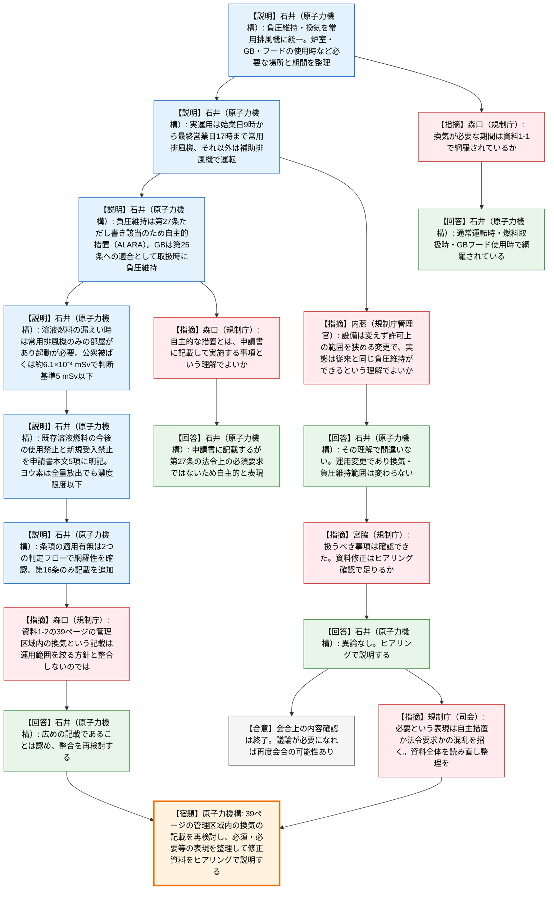

# 第598回核燃料施設等の新規制基準適合性に係る審査会合（令和8年10月23日）
> 出典 : https://youtube.com/live/tIuwDXCTuHI?si=sw3EOrn0oMzut3m5

## 会合の概要
* **STACYの換気空調設備の運用見直しは、前回（6月17日）の指摘16件への回答がほぼ受け入れられ、会合としての確認事項は出尽くしたとして終了**
  原子力機構は、負圧維持・換気の手段を常用排風機に一本化する方針に改め、必要な場所・期間を明確にして16件の指摘事項に回答した。規制庁（事務局）は「本審査会合で扱うべき事項は確認できた」と整理し、残る資料修正はヒアリングで確認することで足りるとした。
* **「負圧維持は自主的な放射線防護措置であり、法令上の必須要求ではない」という整理が回答の軸**
  試験炉設置許可基準規則第27条第1号のただし書き（公衆に放射線障害を及ぼす恐れがない場合は適用除外）にSTACYが該当するため、通常運転時の炉室の負圧維持は自主措置（ALARAの考え方）とした。グローブボックスは第25条（放射線業務従事者の防護）への適合として、核燃料物質の取扱時に負圧を維持する。
* **溶液燃料の漏えい時は常用排風機でしか換気できない部屋があり、公衆・従事者の被ばくも判断基準を十分下回る**
  溶液燃料の貯蔵室や廃棄貯蔵室は常用排風機のみの系統のため、漏えい検知時は常用排風機を起動または運転確認する運用とした。換気空調設備の閉じ込め機能を期待しなくても、公衆被ばくは約6.1×10⁻⁴ mSv（判断基準5 mSv）と評価された。
* **規制庁の指摘は「記載の整合」と「誤解を招く表現」にとどまった**
  資料1-2の39ページに「管理区域内の換気」と広めの記載が残る点を規制庁が指摘し、原子力機構が再検討することになった。また規制庁は、「必須」「必要」といった表現が自主措置か法令要求かの混乱を招かないよう、資料全体の読み直しを求めた。
* **設備は変えず運用上の範囲を絞り込む変更であることが、質疑で確認された**
  規制庁の内藤管理官が、「負圧維持が必要な場所と時間を明確にして許可上の範囲を狭めるが、設備は変えないので実態として従来と同じ負圧維持ができる」という理解を確認し、原子力機構は了承した。

---

## 議題ごとの詳細整理

### 【議題1】日本原子力研究開発機構原子力科学研究所の原子炉施設（STACY（定常臨界実験装置）施設）の設置変更許可申請について
令和8年3月30日に申請された、STACYの設備の一部の運用方法の見直しに係る設置変更許可申請である。前回の6月17日の会合に続く説明で、資料1-1（運用方針の変更）と資料1-2（審査会合指摘事項16件への回答）を順に扱った。

#### (A) 審査会合指摘事項等を踏まえた運用方針の変更（資料1-1）
* **議論の背景と論点:**
  * 背景: 当初申請は、負圧維持・換気を常用排風機または補助排風機で行うとしていたが、運転管理が複雑になるため簡素化・明確化が必要と判断した。
  * 変更方針: 負圧維持・換気の手段を常用排風機に統一し、補助排風機による換気は取りやめる（ただし補助排風機は設備として残る）。
  * 論点1: 通常運転時、核燃料物質・グローブボックス・フードの使用時、運転時の異常な過渡変化・設計基準事故時のそれぞれで、負圧・換気を確保すべき範囲と期間をどう整理するか。
  * 論点2: 許可申請書に書く最低限の運用と、実際の運用（週の始業日の9時から最終営業日の17時まで常用排風機を連続運転し、それ以外は補助排風機で運転）をどう区別して記載するか。

* **質疑応答（詳細）:**
  * 【説明者側】石井（原子力機構）
    通常運転時や核燃料物質の取扱時は、使用前に手動で起動して終了まで換気空調設備を運転する。粉末燃料の機械的破損の確認時は、運転中の常用排風機を継続する。溶液燃料や放射性廃棄物の漏えい検知時は、常用排風機が止まっていることが想定されるため手動で起動し、放射性物質の放出の恐れがなくなるまで運転する。
  * 【規制側】森口（規制庁）
    現行許可は24時間365日の常時運転の表記だが、変更後は場面ごとに整理されている。資料1-1の2ページの右下にある「放射性物質の放出の恐れがなくなるまで」には燃料の回収や除染の実施を含むが、換気が必要な期間はここに網羅的に抽出されているという理解でよいか。
  * 【説明者側】石井（原子力機構）
    放射性物質の放出が想定される、または放射性物質を取り扱うのは、原子炉の通常運転時、核燃料物質の取扱時、グローブボックス・フードの使用時であり、記載したもので網羅性は確保されている。

#### (B) 審査会合指摘事項への回答（資料1-2）
* **議論の背景と論点:**
  * 背景: 前回6月17日の会合で16件の指摘事項があり、その回答を一括して説明した。
  * 論点1（指摘1・2・9・10）: 負圧維持・換気設備・グローブボックス常時負圧が、試験炉設置許可基準規則の第25条・第27条の法令要求か自主措置か。
  * 論点2（指摘3〜5）: 溶液燃料等の漏えい時に常用排風機の起動が必要な理由、漏えい検知の可否、換気設備を止めることで新たに設計対応が必要な設備がないか。
  * 論点3（指摘6・7・8）: 運用見直し前後の従事者・公衆の被ばく量の変化。
  * 論点4（指摘11〜16）: 既存溶液燃料の使用・受入制限の明記、気体廃棄物中のヨウ素濃度、分析設備の許可範囲からの除外、換気回数、事象選定への影響、条項の適用有無の網羅性。
  * 論点5（資料1-2の39ページ）: 変更後の記載が「管理区域内の換気」と広く、運用範囲を絞る方針と整合するか。

* **質疑応答（詳細）:**
  * 【説明者側】石井（原子力機構）— 指摘1・2・9（負圧維持と法令要求）
    通常運転時の負圧維持は第27条第1号のただし書き（公衆に放射線障害を及ぼす恐れがない場合は除外）に該当するため、法令上の必須事項ではなくALARAに基づく自主的措置として申請書に記載する。グローブボックスは、溶液燃料サンプリングで内部に漏えいして閉じ込め機能を期待しない場合でも従事者の被ばくは約4.3×10⁻¹ mSvと小さいが、第25条への適合として核燃料物質の取扱時に負圧を維持する。
  * 【説明者側】石井（原子力機構）— 指摘3・4（溶液燃料の漏えい）
    溶液燃料や放射性液体廃棄物が漏えいし得る貯蔵室・廃棄貯蔵室は常用排風機のみの系統で、補助排風機では換気できないため、漏えい検知時は常用排風機を起動または運転確認する運用が必要となる。漏えい検知器（差圧式・電極式）は貯蔵量の約2%程度の漏えいで検知でき、エリアモニターは線量が著しく上昇しないため検知手段にならない。
  * 【説明者側】石井（原子力機構）— 指摘5〜7（被ばく評価）
    溶液燃料の漏えいを想定して換気空調設備の閉じ込め・放出低減機能を期待しない条件でも、公衆被ばくは約6.1×10⁻⁴ mSvと判断基準5 mSvを十分下回り、新たな設計対応は不要である。従事者は、漏えい確認後に当該区域から退避し、常用排風機を運転した状態で回収等を行う運用により被ばくを約8.4×10⁻¹ mSvに抑えられ、運用見直し前後で通常運転時と設計基準事故時の公衆被ばくに変化はない。
  * 【説明者側】石井（原子力機構）— 指摘8・11・12（放出割合・燃料制限・ヨウ素濃度）
    設計基準事故の概要図に、粉末燃料の機械的破損は気体状放射性物質の全量放出、溶液燃料の漏えいはミストの10%が壁に沈着し残り90%が建屋外へ移行する旨を追記した。核分裂生成物であるヨウ素を新たに生成させないため、既存の溶液燃料を今後のSTACYの運転で使用しないこと、新たな溶液燃料を受け入れないことを、申請書本文の5項に明記する。溶液燃料の運転停止から約15年経過しており、内蔵ヨウ素の全量が放出されても周辺監視区域外の濃度限度を十分下回り、NSRRの年間放出量にも影響しない。
  * 【説明者側】石井（原子力機構）— 指摘13〜16（分析設備・換気回数・事象選定・適用条項）
    分析室2〜4のグローブボックス・フードは構造・系統構成・運用を変えないため、放射性物質の漏えい防止・換気機能は維持される。当初申請で削除する予定だった各室・グローブボックスの換気回数の記載は現行通り残す。運転時の異常な過渡変化・設計基準事故の代表事象に換気空調設備の機能を期待したものはなく、事象選定に影響しない。条項の適用有無は判定フロー（申請対象設備から条項を見るフローと、安全機能から他設備への影響を見るフロー）で網羅性を確認し、第16条のみ、核分裂生成物を含む溶液燃料を受け入れない旨の追記が必要とした。
  * 【規制側】森口（規制庁）
    資料1-2の7ページの「自主的な放射線防護措置として負圧状態を維持する」とは、許可申請書に記載して実施する事項という理解でよいか。
  * 【説明者側】石井（原子力機構）
    申請書には記載するが、第27条の法令上の必須要求ではないため「自主的」と表現している。
  * 【規制側】森口（規制庁）
    資料1-2の39ページに「変更後も管理区域内の外気及び負圧維持を行うとともに、核燃料物質の取扱時において管理区域内の換気を行う」とあり、運用範囲を炉室・グローブボックス・フードなど使用箇所に限定する方針と整合していないように読める。整合を図る必要はないか。
  * 【説明者側】石井（原子力機構）
    確かに広めの記載であり、常用排風機が管理区域内全域を換気することは系統図でも示している。一方で添付書類8の核燃料物質の取扱設備・貯蔵設備では当該部屋の換気に限定している。記載の整合は再度検討する。
  * 【規制側】宮脇（規制庁）
    本日の説明で本審査会合で扱うべき事項は確認できたと理解している。森口氏とのやり取りは資料の明確化に関するもので、資料の修正は事務局によるヒアリングでの確認で足りると考えるが、原子力機構に異論や、この場で述べておきたい論点はあるか。
  * 【説明者側】石井（原子力機構）
    異論はなく、先ほどのコメントは再検討してヒアリングで説明する。
  * 【規制側】内藤（規制庁管理官）
    これまでは常用排風機で管理区域の建屋全体を負圧に維持してきたが、安全上は負圧を維持すべき場所と時間は限られているので、許可上の範囲を狭める。ただし設備は変えないため、実態としては従来と同じ負圧維持ができてしまう、という変更の理解でよいか。
  * 【説明者側】石井（原子力機構）
    ご理解の通りで、運用の変更であり、常用排風機を運転すれば従来どおり換気でき、負圧を維持できる範囲に変わりはない。
  * 【規制側】内藤（規制庁管理官）
    必要な範囲を明確にし、それが実現できる設備構成であることを説明する形で、設備は要求に対して高いスペックのものがそのままついている、ということだと理解した。
  * 【規制側】規制庁（司会）
    規制要求上は換気空調設備の運転は必須ではないが、運用として自ら決めた事項に対し、その達成に必要な範囲がある。「必要である」といった表現をすると混乱を招くため、その視点で資料を読み直し、誤解を招く箇所があれば整理してほしい。ストーリー全体は今日の会合でかなりクリアになった。

* **結論と宿題事項（アクションアイテム）:**
  * 会合上の内容確認は一通り終了し、資料修正はヒアリングでの事務局確認で足りるとされた。事実確認の中で議論が必要になれば、再度会合を開く可能性があると規制庁が述べた。
  * **宿題（原子力機構）:** 資料1-2の39ページの「管理区域内の換気」等の記載を、運用範囲を限定する方針と整合するよう再検討する。
  * **宿題（原子力機構）:** 負圧維持・換気が法令要求ではなく自主措置であることが誤解されないよう、資料全体の表現（「必須」「必要」等）を読み直して整理する。

---

## 論理構造の可視化（Mermaid）

### 【議題1】STACY施設の設置変更許可申請（換気空調設備の運用見直し）

