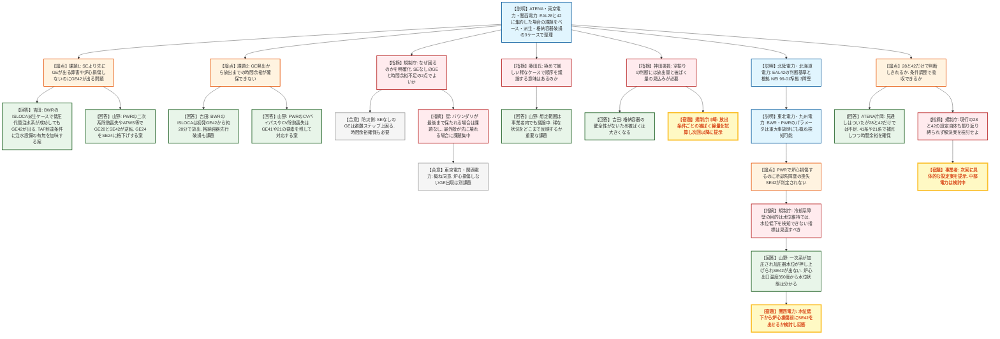

# 第20回緊急時活動レベルの見直し等への対応に係る会合（エスカレーション）（令和8年10月26日）
> 出典 : https://youtube.com/live/F7lAD5A-q5E?si=gos5hCG8sI8EVNhx

## 会合の概要
* **EAL28（炉心損傷）とEAL42（障壁の喪失）に集約した場合の課題整理（BWR・PWR）**
  事業者側（ATENA、東京電力、関西電力）は、EALをEAL28とEAL42に集約した場合の課題を、有効性評価のシナリオ（ベースケース）、有効性評価で期待する設備が使えない場合（派生ケース）、格納容器先行破損ケースに分けて説明した。ベースケースは概ね問題がない一方、派生ケースと格納容器先行破損ケースには課題が残ることが示された。
* **課題は2種類に整理された**
  ①SE（施設敷地緊急事態）より先にGE（全面緊急事態）が出てしまう順序逆転や、炉心損傷しないのにGEが出る弊害。②GE発出から放射性物質の放出までの時間余裕が確保できない問題。規制庁側は、この2点がなぜ問題なのかを明確にしながら議論すべきだと整理した。
* **格納容器バウンダリが先に失われるケースが最大の課題**
  規制庁の星氏は、格納容器が最後まで保たれる事故では課題が少なく、ISLOCAやバイパス事象のように最外殻の障壁が最初に壊れるケースで課題が集中していると整理し、事業者もこれを概ね認めた。一方、外部有識者からは、極めて稀で厳しい前提のケースまで順序や数分の差を議論する意味があるのかとの疑問も出た。
* **EAL42の判断基準の根拠とプラントパラメータの検知性**
  事業者は、EAL42が米国のNEI 99-01を参考に設定されていることと、各判断基準を重大事故時にも使える計器で検知できるかを、BWR・PWR別に説明した。全体として検知可能とされたが、PWRの事例について規制庁から、炉心損傷に至るのに冷却系障壁の喪失（SE42）が判定されない点は障壁の考え方の問題ではないかと指摘された。
* **28と42だけにこだわらず、現行設定の見直しも含めた具体案を次回提示へ**
  事業者はEAL28・42の条件調整や補完的な指標（EAL41系・21系の要素を残す等）による解決の見通しを語ったが、まだ検討途中である。規制庁は、EAL28・42だけに縛られず現行設定の妥当性も振り返るよう求め、自らも想定放出条件ごとの被ばく線量を試算して示す方針を述べた。

---

## 議題ごとの詳細整理

### 【議題】現行のEAL体系における事象のエスカレーションの整理
（資料1：EAL28、42に集約した場合の課題について／資料2：EAL42シリーズ（障壁の喪失）の判断基準の根拠整理／資料3：EAL42におけるプラントパラメータの検知性について）

* **議論の背景と論点:**
  * 背景
    * 第16回（5月13日）の会合の続きにあたる。第17〜19回は再処理施設に関する2回と屋内退避の解除に関する1回だった。
    * EALの発出タイミングについて、EAL28（炉心損傷）とEAL42（障壁の喪失）に集約した場合の課題を事業者が整理した。
  * 論点
    * 課題①：SEより先にGEが出る、あるいは炉心損傷しないのにGE42が出るといった、発出順序上の弊害がないか。
    * 課題②：GE発出後、放射性物質の放出までに防護措置のための時間余裕が確保できるか。
    * EAL42の判断基準は、どのような根拠で設定されているか。
    * EAL42のパラメータは、重大事故時にも検知できるか。
    * EAL28・42だけでSE・GEの防災アクションを取れるのか、それとも条件の調整や補完的な指標が必要か。

* **質疑応答（詳細）:**
  * 【資料1 説明者側】吉田（東京電力、BWR）
    資料1のBWRの整理では、ベースケース（有効性評価）、派生ケース（有効性評価で期待しない設備を使う場合）、格納容器破損ケース（PRAで評価される格納容器先行破損）の3ケースを定義した。ベースケースはどちらの観点でも問題がなかった。派生ケースは弊害と時間余裕の両方に課題があり、格納容器破損ケースは時間余裕に課題があるとした。課題があるのは、派生ケースではいずれもISLOCAシナリオである。
  * 【資料1 説明者側】吉田（東京電力、BWR）
    ISLOCAの派生ケースの弊害は次のとおり。原子炉隔離時冷却系で注水する有効性評価に対し、各注水設備が順に失われ、最後に低圧代替注水系で注水できたとする。この場合、急速減圧後に水位が有効燃料頂部（TAF）まで低下してSE42が出る。さらに中央制御室から隔離できないことでGE42が出るが、炉心損傷は回避できるのでGE28は出ない。
  * 【資料1 説明者側】吉田（東京電力、BWR）
    ISLOCAの派生ケースで低圧代替注水系も使えない場合、水位がTAFに到達した時点でAL42からGE42まで出る。その後、炉心損傷してGE28が出ると、破断箇所から環境への放出に至る。最初のGE42から放出までは約20分で、時間余裕がない。
  * 【資料1 説明者側】吉田（東京電力、BWR）
    集約前のGE21・22は、注水設備の機能喪失から10分程度で出る。GE42は約23分後である。初発GEの時刻に大差はないとの見方も示した。そこで、TAF到達の条件に注水系の準備状況等の条件を加え、注水成功が見込める場合はGEを出さない整理も可能と考えた。NEI 99-01にも同様の記載があるとし、機械翻訳を資料に付けた。ただし低圧代替注水系はSA設備であり、失敗すれば炉心損傷に至る。この点をどう取るかは議論が必要とした。
  * 【資料1 説明者側】吉田（東京電力、BWR）
    格納容器破損ケースは、崩壊熱除去機能喪失のシナリオを代表として、LOCAありとなしの2種類で整理した。LOCAありでは最初に水位不明でSE42、格納容器雰囲気温度が最高使用温度（171℃）に達してGE42が出る。LOCAなしでは、約2時間後にドライウェル圧力（スクラム設定点13.7kPa）でAL42、約3時間後にサプレッションプールの熱容量制限到達でGE42が出る。いずれも炉心損傷前の格納容器ベントに失敗して過圧破損し、全注水機能を喪失して炉心損傷に至る。この格納容器先行破損は、炉心損傷後の放出までの時間余裕に課題があるとされた。
  * 【資料1 説明者側】山野（関西電力、PWR）
    PWRもBWRと同じ整理をしたが、格納容器先行破損は派生ケースに含めた。①の弊害はベースケースにも派生ケースにも課題があるとし、②の時間余裕は、CVバイパスのISLOCA、CVバイパスのSGTR、CV除熱機能喪失の各派生ケースにあるとした。
  * 【資料1 説明者側】山野（関西電力、PWR）
    弊害（順序逆転）の対象は、二次系除熱機能喪失、SBOでRCPシールLOCAなし、原子炉停止機能喪失（ATWS）、格納容器過温破損のシナリオである。集約で現行のSE24やSE21が除外され、GE28とSE42の順序が逆転する（約3.1時間後）。対策案として、GE24をSE24に格下げしてGE28より前に出す案を挙げた。SBOでRCPシールLOCAありや、ECCS注水・再循環機能喪失、格納容器過圧破損、水素燃焼は、順序・時間とも問題なしとした。
  * 【資料1 説明者側】山野（関西電力、PWR）
    時間余裕の課題は次のとおり。CV除熱機能喪失の派生ケースでは、約8.8時間後に格納容器が最高使用圧力に達する。自然対流冷却も失敗すると、約15時間後に2Pdで先行破損し、約16.5時間後に炉心損傷する。CVバイパスのISLOCAは、約35時間後にGE28・42が出て放出までの余裕がない。CVバイパスのSGTRも、約35時間後に炉心損傷に至る。解決案として、GE41やGE21の要素を何らかの形で残すことを挙げた。
  * 【規制側】司会（規制庁）
    今回の確認は、EAL28とEAL42だけでSEとGEの防災アクションを取れるかという観点である。課題や弊害の何が問題なのかを明確にしながら議論すべきだと述べ、「GEの前にSEがないのは困る」という認識でよいかを問うた。
  * 【規制側】防災担当
    SE段階で要介護者等が避難を開始し、一般の住民が避難の準備をするため、SEなしにいきなりGEとなるとステップが踏めなくなると答えた。司会は、課題を「①いきなりGEになるケース」と「②GEから放出開始までの時間余裕がないケース」の2点と整理した。
  * 【規制側】星（規制庁）
    格納容器バウンダリが最後まで保たれる事故シナリオでは、おおむね課題はない。バイパスのように最も外側のバウンダリが最初に壊れる場合に課題が集中していると整理し、これで正しいか確認した。
  * 【説明者側】吉田（東京電力）、山野（関西電力）
    東京電力は、BWRでも格納容器バウンダリが壊れるシナリオに問題が集中していると答えた。ただし、炉心損傷しないのにGEが出る点は別の課題だとした。関西電力は時間余裕の課題は同意見だが、GEが初発となる点は別の問題だとした。
  * 【規制側】構成員（藤田氏）
    例示には事象進展が極めて速い厳しい前提のものがあり、AL・SE・GEの順序を完全に守らせる意味が実質的にあるのか疑問を示した。数分の差を議論することが住民の準備時間の観点で意味があるかを問うた。
  * 【説明者側】山野（関西電力）
    どこまでのシナリオを想定して検討するかは、事業者内でも議論になっている。派生ケースは多くの設備を壊した結果の稀な状況であり、どこまでEALの議論に反映するかは重要な課題と認識していると答えた。
  * 【規制側】規制庁
    炉心損傷には至らないが被覆管が部分的に損傷（パーフォレーション）するケースは登場するのか、影響が小さいのかを問うた。これはEAL28を指標とする場合に、それ以前の放出はゼロとは限らないという観点からの質問である。
  * 【説明者側】吉田（東京電力）
    派生ケースの解析は実施していないが、ベースケースでは注水遅れの許容を評価している。完全な無注水から約5〜10分を超えると被覆管温度が1,200℃に達し、パーフォレーションが起こり得る。ギャップガス放出（追加放出）の10倍がEAL28の判断基準で、被覆管の1%程度の破損に相当する。わずかな追加放出ではEAL28は判断されず、注水さえできれば炉心損傷は回避できると考えている。
  * 【規制側】神田委員
    資料1の7ページの「空振りを恐れず設備故障によるGEを出すか、空振りGEの回避を優先するか」は、オフサイトから見れば防護措置の準備を空振りでも行うかどうかの問題である。隔離失敗箇所からの放出量と被ばく量（例えば最初の1週間）が分からなければ判断しにくいと述べた。被ばくの見込みに応じて必要な防護措置とその準備時間を整理すれば議論しやすいとした。原災指針では、確定的影響の恐れには予防的避難、確率的影響のリスクには屋内退避等が妥当とされていると指摘した。
  * 【規制側】司会（規制庁）
    GE42のときはまだ炉心損傷前なので、GEをその時点では出さない判断もあり得るかもしれない。しかしEAL28のGEは空振りにならないという認識でよいか確認した。
  * 【説明者側】吉田（東京電力）
    ベースケースは炉心損傷防止シナリオなのでGE42にもならず、SEで止まる。派生ケースは耐震性の高い設備まで次々に壊した想定である。ISLOCAに限っては、ベースケースと同様に炉心損傷を回避できるのに、GE42が出て余計な負担がかかるのは問題だと述べた。格納容器の健全性がない状態での炉心損傷なので、被ばくはかなり大きくなると定性的には言えるとした。
  * 【規制側】川崎（規制庁）
    今回のような極端なケースの解析はこれまで行っていない。規制庁が時間と放出条件ごとの被ばく線量を評価して、次回以降に示すとした。ただし、かなり大きな数字になると思うとも述べた。
  * 【規制側】司会（規制庁）
    議論の向かう先を共有する意図で、次のように述べた。格納容器が失われた状態で炉心損傷が起きるのは非常にまずい。そのため、より手前の段階で検知し、AL・SE・GEの順に措置を取れるようにして、避難が間に合わない事態をなくすのが目的である。
  * 【資料2 説明者側】山田（北陸電力、BWR）
    EAL42は、燃料被覆管、原子炉冷却系、格納容器の3枚の障壁のうち、何枚が失われたかで評価する。判断基準は通報規則と原災指針に基づき、事業者がNEI 99-01を参考に設定して防災業務計画に定め、届出ている。BWRの燃料被覆管障壁は、TAF（有効燃料頂部）未満または水位不明が喪失の恐れ、有効燃料長の3分の2未満が喪失である。さらに、格納容器雰囲気モニタ（CAMS）が追加放出の10倍相当（被覆管の約1%損傷）を超えると、炉心損傷と判定する。
  * 【資料2 説明者側】山田（北陸電力、BWR）
    BWRの原子炉冷却系障壁は、TAFまたは水位不明、急速減圧の運転操作、ドライウェル圧力高（13.7kPa、ECCS作動点）、格納容器放射線モニタ指示値の有意な上昇、機器室の温度上昇を基準としている。ドライウェル圧力は、LOCA時のECCS作動点として設定されている。格納容器障壁は、運転禁止領域（熱容量制限）、最高使用圧力・温度、可燃性ガス濃度（水素4%・酸素5%）が喪失の恐れである。格納容器ベント、隔離失敗によるバイパス、機器室の温度上昇が喪失である。有効燃料長の3分の2は、再循環配管破断時の水位回復の限界を考慮した値で、ABWRも記載を合わせている。
  * 【資料2 説明者側】宮内（北海道電力、PWR）
    PWRも、NEI 99-01に基づく3障壁の喪失・喪失の恐れの組み合わせで判断するが、パラメータはBWRより簡素である。燃料被覆管障壁は、炉心出口温度350℃以上が喪失の恐れ、600℃または650℃以上が喪失である（NEIは華氏700度・摂氏371度、華氏1,200度・摂氏649度）。原子炉冷却系障壁は、RCS漏洩の規模で見て、ECCSが作動する程度の漏洩であれば喪失とする。格納容器障壁は、スプレー設定圧力以上の圧力上昇が10分以上継続する場合が喪失の恐れである（NEIは15分）。瞬時値で判断しない点はNEIと同じ思想とした。国内基準は事象進展も考慮して3障壁の組み合わせを重視しており、NEIの数重視の考え方とは判定の違いがあることも付記した。
  * 【資料3 説明者側】三浦（東北電力、BWR）、山崎（九州電力、PWR）
    EAL42の判断に必要なパラメータを、女川（BWR）と川内（PWR）の防災業務計画から抽出し、重大事故時に機能を期待できる計器で検知可能かを確認した。BWRは、雰囲気モニタ等の一部を除いて検知可能である。重大事故時に機能を期待できない計器は、一次系やPCVの複数パラメータを総合的に確認すれば障壁喪失を検知できるとした。PWRも一部を除いて検知可能で、設備ベースの項目（抽出ラインの隔離、高圧注入ポンプ、CV隔離）は抽出流量や充てん流量等の関連パラメータで確認できるとした。DB・SAの計器について整理した結果であるとも述べた。
  * 【規制側】規制庁担当者
    PWRとBWRで冷却系障壁における減圧操作の扱いが異なる点に着目し、資料1の30ページ（二次系除熱機能喪失）について質問した。ここで想定するフィードアンドブリードの失敗とは、一次系のフィードアンドブリードを指しているのか確認した。あわせて、EAL42が出るタイミングや、冷却系障壁が喪失しないとされる理由を問うた。
  * 【説明者側】山野（関西電力）
    一次系のフィードアンドブリードを指す。蒸気発生器への給水が失われ、高圧注入が働かないとフィードアンドブリードができない。このケースで加圧器安全弁が作動する時点（炉心出口温度が約350℃以上に相当）で、燃料被覆管障壁の判定からEAL42が出る。一方、一次系は逃げ場がなく加圧されて加圧器水位が押し上げられるため、ECCS作動設定を下回らず、冷却系障壁の喪失（SE42）が判定されない。減圧した時点でようやくSE42が出るので、GE28の後になる。
  * 【規制側】規制庁担当者
    冷却系障壁の目的は圧力バウンダリの維持だけでなく水位の維持ではないか。水位が下がっているのに障壁喪失を判断できない指標はおかしい。炉心損傷すれば水位は低くなるはずで、炉心出口温度350℃以上などから冷却材がないことを検知し、炉心損傷前にSEを出せるのではないかと提起した。
  * 【説明者側】山野（関西電力）、澤田（関西電力）
    課題と認識した。炉心出口温度350℃に達するのは冷却状態が悪化した結果なので、原子炉内の水位状態は350℃から分かると考える。冷却系障壁の見直しで順序逆転を解消できるかは、事業者で改めて検討して回答するとした。
  * 【規制側】司会（規制庁）
    今の議論は、EAL28に関連した判断を42側で行う話か。この質問に対し、規制庁担当者は、被覆管そのものが燃料被覆管障壁で、冷却系障壁が何を指すのかを再整理すべきだと答えた。圧力が高いまま水が減る状況を検知できない指標は、見直す余地があるとした。
  * 【規制側】司会（規制庁）、川崎（規制庁）
    「28と42だけで判断しきれるか。判断条件の調整で吸収できる課題か」と司会が問うた。川崎氏は、今の段階ではEAL28・42に組み込むことにこだわる必要はなく、解決案も事業者から提案されていると答えた。そのうえで、具体的にどういう設定にするかの提案を次回に求めた。
  * 【説明者側】松井（中部電力）、片岡（ATENA）
    中部電力は、検討の途中で、まとまり次第次回に提示したいと述べた。ATENAの片岡氏は、周辺住民への過度な負担を避けるという出発点については、EAL28・42を主軸にすることで一定の見通しはついたと述べた。ただし28・42だけでは足りず、住民防護の時間余裕を確保する前提で、EAL41系やEAL21系の補完的指標、水位パラメータの考慮などで吸収できるか引き続き議論したいとした。
  * 【規制側】規制庁
    28・42だけにこだわるわけではなく、確信もない。EAL42の設定根拠にはNEI 99-01等の国際基準も踏まえつつ、現行のEAL28・42の設定自体が正しいかも振り返ってほしいと述べた。具体例として、炉心損傷の判断や、注水が生きていてもTAFに到達すればGEが出る現状を挙げた。必ずしも現状に縛られずに解決案を検討するよう求めた。
  * 【規制側】構成員（感想）
    以前のEAL議論では、個別機器の可否ではなく水位維持のような機能をパラメータで見るイメージを持っていた。今回着目した28・42は事象の最終結果に近く、パラメータで見ること自体が結論に直結する。そのため、低い値で見れば時間を確保できる、とはならない印象だとして、パラメータへの置き換えが有効でない部分もあると述べた。

* **結論と宿題事項（アクションアイテム）:**
  * 本会合では最終的な結論は出ておらず、事業者の説明と、規制庁・構成員との論点整理にとどまった。
  * 共通認識として確認した事項
    * SEなしにいきなりGEが出る事態は避ける。
    * GEから放出開始までに、住民防護のための時間余裕を確保する。
    * 課題は格納容器バウンダリが先に失われるケース（ISLOCA、バイパス、格納容器先行破損）に集中している。
  * 宿題事項
    * 事業者（ATENA・各電力）：EAL28・42の判断条件の調整や、補完的な指標（EAL41系・21系の要素を残す、GE24をSE24に格下げする、TAF到達条件に注水設備の有無等を加味する等）を、具体的な設定案として次回提示する。中部電力は検討中で、次回に提示したいと述べた。
    * 関西電力等（PWR）：水位低下を検知して炉心損傷前に冷却系障壁の喪失（SE42）を判定できないか、冷却系障壁の考え方を含めて検討し、回答する。
    * 規制庁：放出時間・条件ごとの被ばく線量を評価して、次回以降に提示する。
    * 規制庁：事実確認のラップアップ面談等を通じ、事業者への依頼事項を明確に示す。
  * 次回の開催日は、会合内では示されなかった。

---

## 論理構造の可視化（Mermaid）

### 【議題】現行のEAL体系における事象のエスカレーションの整理

