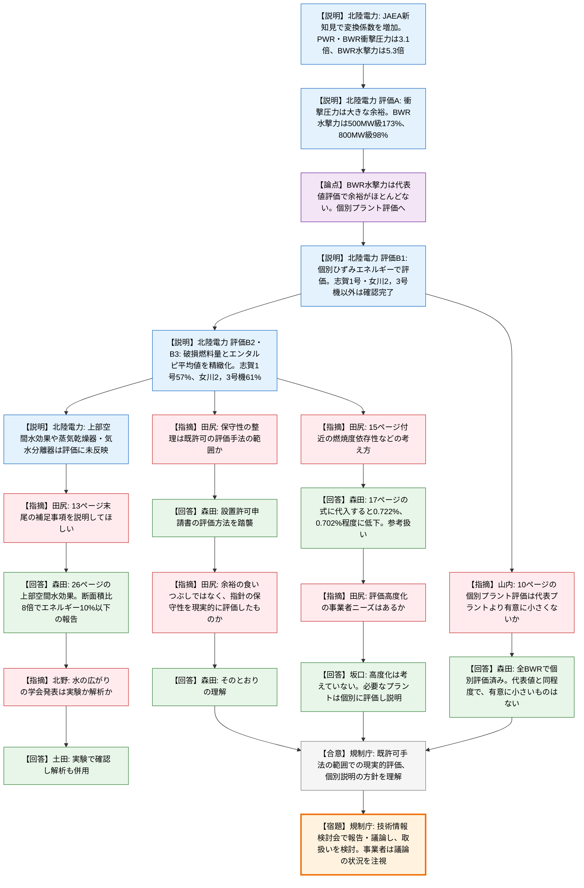

# 第29回新規制要件に関する事業者意見の聴取に係る会合（RIAに関する最新知見）（令和8年10月26日）
> 出典 : https://youtube.com/live/rwJGGKKgRow?si=nns8UM3svjhIfkge

## 会合の概要
* **JAEAの新知見を受け、RIA時の原子炉圧力容器への影響をATENAが評価**
  JAEAがNSRR実験で、高燃焼度燃料のPCMI破損時に生じる機械的エネルギーが従来の評価曲線（未照射燃料の浸水燃料破裂の包絡線）を上回ることを示した。技術情報検討会（本年1月）での規制庁の概略評価は個別パラメータを考慮していなかったため、ATENA（北陸電力）が各プラントでの評価結果を説明した。
* **PWR・BWRの衝撃圧力は新知見を反映しても大きな余裕、BWRの水撃力は代表値評価では余裕がほとんどない**
  機械的エネルギー変換係数を新知見の3.1倍（BWR水撃力は5.3倍）に増やして評価した。衝撃圧力は余裕が十分に残った一方、BWR水撃力は代表値で500MW級が173%、800MW級でも98%と余裕がほとんどなくなり、個別プラントでの詳細評価に進んだ。
* **志賀1号・女川2，3号機は保守性の整理と精緻化で基準を満足**
  個別のひずみエネルギーに置き換えても100%を超えたこの3プラントについて、破損燃料量とエンタルピ平均値を現実的な値に置き換えた結果、志賀1号は57%、女川2，3号機は61%となり、吸収し得るひずみエネルギーを下回った。
* **規制側の関心は「余裕の食いつぶしではなく、既許可手法の範囲での現実的評価か」**
  規制庁は、新たな考え方で余裕を食いつぶしたのではなく、指針に織り込まれていた大きな保守性を既許可の評価手法の枠内で現実的にしたものか、と繰り返し確認し、北陸電力が肯定した。
* **事業者は評価高度化もRIA指針の見直しも不要との立場**
  ATENAは、現行指針は保守性を含んだままでも十分使えるとし、必要なプラントは個別に説明する方針を示した。規制庁は今後、技術情報検討会で取扱いを議論する予定である。

---

## 議題ごとの詳細整理

### 【議題（1）】RIAに関する新知見について
* **議論の背景と論点:**
  * 背景
    * RIA（反応度事故）の評価は旧原子力安全委員会のRIA指針と専門部会報告書に基づく。PCMI破損や浸水燃料破裂で生じる衝撃圧力・水撃力が、原子炉圧力容器の弾性変形で吸収できる範囲に収まることを確認している。
    * 従来の評価は、PCMI破損時の機械的エネルギーが未照射燃料の浸水燃料破裂によるもの（NSRR実験の包絡線）を超えないという前提だった。
  * 経緯
    * 本年1月、JAEAが「高燃焼度燃料のPCMI破損時の機械的エネルギーが従来の評価曲線を上回る」との実験結果を発表し、第77回技術情報検討会に報告された（参考資料29-1）。
    * 検討会での規制庁の評価は個別パラメータを考慮しておらず、事業者側の評価結果の確認が目的となった。
  * 論点
    * 新知見（変換係数の増加）を反映しても、全プラントで原子炉圧力容器への影響がないと言えるか。
    * 余裕が乏しいBWRの水撃力で、保守性の整理による精緻化は、既許可の手法の範囲で妥当か。
    * 事業者は、新知見や保守性を踏まえた評価の高度化（RIA指針の見直し）を求めるか。

* **質疑応答（詳細）:**
  **＜会合の趣旨説明と事業者の評価説明＞**
    * 【規制側】田尻（規制庁技術基盤課）
      従来の評価はPCMI破損時の機械的エネルギーが未照射燃料の評価曲線を超えない前提だったが、JAEAの論文でこれを上回る試験結果が得られた。規制庁の概略評価は個別パラメータを考慮していないため、事業者の評価で考慮した点を具体的に説明してほしい。
    * 【説明者側】森田・坂口（北陸電力）
      資料29-1の背景として、機械的エネルギー変換係数（燃料エンタルピのうち機械的エネルギーに費やされる割合）を新知見で増やし、各プラントの原子炉圧力容器への影響を確認したと説明した。対象は廃止措置移行プラントを除く既設プラントと、設置許可申請済みの新設プラント（大間）である。
    * 【説明者側】森田（北陸電力）
      評価Aでは代表値を用い、PWR衝撃圧力は変換係数0.2%を0.62%（3.1倍）にして、2ループ6.6%、3ループ7.0%、4ループ6.7%と大きな余裕を確認した。BWR衝撃圧力は0.23%を0.713%（3.1倍）にしても余裕が十分に残り、500MW級で85%となるなど、いずれも十分な余裕が確認された。
    * 【説明者側】森田（北陸電力）
      BWR水撃力は0.23%を1.219%（5.3倍）にすると、500MW級で173%、800MW級でも98%となり、余裕がないか超過するプラントが出た。このため全BWRプラントを対象に、個別のひずみエネルギーを考慮した評価B1を行った。
    * 【説明者側】森田（北陸電力）
      B1で志賀1号と女川2，3号機以外は余裕を確認できた。この3プラントは評価B2で保守性を整理し、①破損が生じる燃料の量、②機械的エネルギー変換係数、③燃料エンタルピ（ピーク出力部）の平均値の3パラメータに保守性があるとした。
    * 【説明者側】森田（北陸電力）
      ②は新知見そのものなので据え置き、①と③のみを評価B3で個別評価した。破損燃料量は志賀1号が104kg、女川2，3号機が145kg（従来は200kg）、エンタルピ平均値は志賀1号が68cal/gUO2、女川2，3号機が66cal/gUO2（従来は100cal/gUO2）で、結果は志賀1号57%、女川2，3号機61%となった。
    * 【説明者側】森田（北陸電力）
      現行モデルは、破損燃料上方の水が広がることによるエネルギーの分散（上部空間水効果）と、蒸気乾燥器・気水分離器の影響を考慮していない。これらを見込めば水撃力はさらに低減できるが、評価には反映していないと補足した。

  **＜保守性の考え方（既許可手法との関係）＞**
    * 【規制側】田尻（規制庁）
      今回の保守性の整理は、専門部会報告書で見込まれていた余裕を、既許可の申請書で認められた評価手法の範囲で見直したものか。
    * 【説明者側】森田（北陸電力）
      その理解のとおりで、基本的に設置許可申請書に記載の評価方法を踏襲している。
    * 【規制側】田尻（規制庁）
      余裕があったものを「余裕なし」と評価し直したのではなく、全プラントに適用できるよう指針に大きな保守性を見込んでいたものを、現実的に評価したという意味合いでよいか。
    * 【説明者側】森田（北陸電力）
      そのとおりの理解である。

  **＜資料13ページ末尾の補足事項（上部空間水効果）＞**
    * 【規制側】田尻（規制庁）
      13ページ末尾の記載は、評価式上は見込まれないが実態としては補正が見込める要素という説明か。非公開情報のパラメータを避けつつ、後ろの参考資料で説明してほしい。
    * 【説明者側】森田（北陸電力）
      26ページの上部空間水効果は、現行の水撃力評価が破損燃料の真上の水がそのまま持ち上がるとする保守的なモデルであるのに対し、実際には水が広がるという効果である。破損燃料と炉心の断面積比が8倍程度あれば、エネルギーが10%以下になるという報告が2003年秋の日本原子力学会であった。
    * 【規制側】田尻（規制庁）
      指針に基づく評価では、全てを詳細に解析すると手間もモデル化も大変なので、評価上は大丈夫だった要素が別にある。細かい解析はしていないが、余裕を相応に見込める要素として追加で説明されたと理解した。
    * 【規制側】北野（規制庁システム安全研究部）
      チャンネルボックスが砲身のような筒となり、水がそのまま上へ向かうイメージがあるが、26ページの水の広がりを示した学会発表は実験によるものか、解析によるものか。
    * 【説明者側】土田（グローバル・ニュークリア・フュエル・ジャパン）
      2003年の学会発表は、実験で確認した上で解析も併用して、この知見を発表したものである。

  **＜燃焼度依存性など新知見以外の補正要因＞**
    * 【規制側】田尻（規制庁）
      15ページ付近の、JAEAが1月に発表した論文に基づく部分以外に、燃焼度依存性などを踏まえた評価も示されている。この点の考え方を説明してほしい。
    * 【説明者側】森田（北陸電力）
      17ページのとおり、JAEAの雑誌論文の式は最大燃料エンタルピ増分と燃焼度（50GWd/tが閾値）に依存する。個別評価では燃焼度は最大でも65GWd/t程度なので、破損燃料量と燃焼度のメッシュ（25〜40、40〜65）ごとに式へ代入すると、1.219%ではなく0.722%、0.702%程度に小さくなる。主ロジックではなく、この式が認められた場合の参考として示した。
    * 【規制側】田尻（規制庁）
      今回新たに説明された以外にも、過去の論文を踏まえれば補正を見込めるという説明と理解した。そこで、より保守的でない評価を取り入れるニーズが事業者にあるのかを聞きたい。
    * 【説明者側】坂口（北陸電力）
      最新知見で精緻化は可能だが、現時点では評価の高度化は考えていない。志賀1号や女川2，3号機は個別評価が必要なため詳細に評価するが、その他のプラントは従来の保守性を含んだままでも十分な余裕があり、反映する必要性は低いと考える。
    * 【規制側】田尻（規制庁）
      統一的に反映するより、必要なプラントで個別評価の中で考慮し、個別に説明する方が事業者にも説明しやすいのではないかと理解した。

  **＜個別プラント評価の確認＞**
    * 【規制側】山内（規制庁）
      10ページの表で、1100MW級などの個別プラント評価欄に「代表プラント評価と同程度」とある。これは、個別に評価しても代表プラント評価より有意に小さくならず、水撃力の評価が70%台に収まったという意味でよいか。
    * 【説明者側】森田（北陸電力）
      そのとおりで、各プラントの個別の数字があり、表の73%や72%は丸めた数字である。志賀1号・女川2，3号機以外のプラントも個別に評価し、代表プラント評価より有意に小さくなるものがないことを確認している。
    * 【規制側】山内（規制庁）
      志賀や女川以外も個別に評価し、代表プラントの数字を有意に下回るものがないことを確認していると理解した。

  **＜総括＞**
    * 【規制側】金城（原子力規制部長）
      新知見でRIA指針の余裕が低くなる、あるいは超えるものがあったが、パラメータの一部を現実的にして評価し直せば余裕が確認できた。実用炉の審査でも多くの保守性があると感じており、上部空間水効果や圧力容器内の構造物を考慮すれば保守性があることは規制側も認識している。指針を見直す必要性は、ATENAの意見として「保守性が積まれているが十分使える」と伺った。

* **結論と宿題事項（アクションアイテム）:**
  * **決定事項:**
    * PWR衝撃圧力・BWR衝撃圧力は新知見を反映しても余裕が大きく、原子炉圧力容器への影響はない。
    * BWR水撃力は代表値評価で余裕が乏しい、または超過するプラントがあったが、個別評価と保守性の精緻化により、志賀1号（57%）・女川2，3号機（61%）を含め基準を満足するとのATENAの評価が示された。規制庁は、既許可の手法の範囲での現実的な評価であるという理解を確認した。
    * 事業者は評価の高度化やRIA指針の見直しの必要性は低いとの立場で、必要なプラントは個別に説明する方針が確認された。
  * **宿題事項:**
    * 規制庁は本日聴取した内容を、今後の技術情報検討会に報告して議論し、取扱いは規制庁側で検討する。規制側から事業者への追加の宿題は示されていない。
    * 事業者は、議論の状況を注視するよう求められた。

---

## 論理構造の可視化（Mermaid）

### 【議題（1）】RIAに関する新知見について

