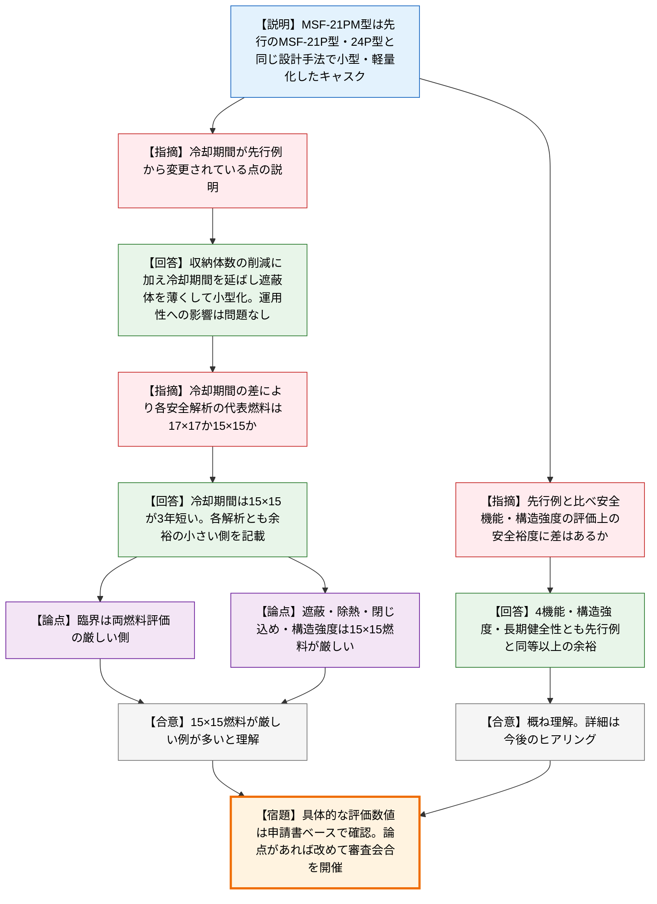
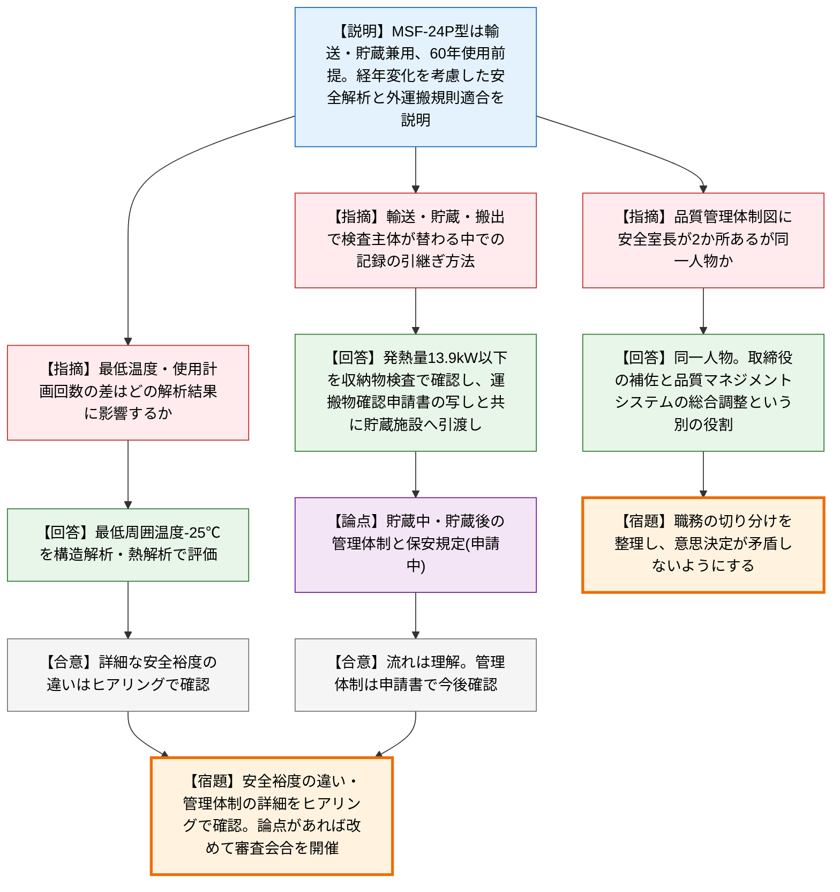

# 第21回輸送容器及び使用済燃料貯蔵施設に係る特定容器に関する審査会合（令和8年10月26日）
> 出典 : https://youtube.com/live/nq4_hYPouks?si=-H2P7nRm0frrmmfm

## 会合の概要
* **三菱重工の新型キャスクMSF-21PM型の型式証明申請は、先行2型式を踏襲した小型・軽量化設計との位置づけ**
  三菱重工から、MSF-21P型・MSF-24P型と同じ設計手法で収納体数と外径・質量を縮小したMSF-21PM型の申請概要が説明された。規制庁は「新たな技術的論点はない」との認識を示しつつ、先行例との安全裕度の差と、冷却期間の延長が各安全解析の代表燃料に与える影響を重点的に確認した。
* **冷却期間の延長による小型化と、代表燃料(15×15燃料)の整理**
  遮蔽体を薄くするため冷却期間を延ばした設計であり、17×17燃料と15×15燃料で冷却期間に3年差がある。事業者は、臨界・遮蔽・除熱・閉じ込め・構造強度のいずれも、余裕の小さい側の評価結果(多くは15×15燃料)を記載していると整理し、規制庁は数値を申請書ベースで確認する方針を示した。
* **日本原電の敦賀2号機用MSF-24P型輸送物の設計承認申請も、新たな技術的論点はないとの認識**
  2026年9月30日に申請された、輸送・貯蔵兼用で60年使用を前提とする輸送容器の概要が説明された。先行のMSF-21P型との差は収納体数(21体から24体)と一部の解析条件(最低周囲温度-25℃、トラニオン等の使用回数設定)であり、規制庁は詳細をヒアリングで確認するとした。
* **輸送から乾式貯蔵、再処理工場への搬出まで、検査主体が入れ替わる点の記録管理が焦点**
  規制庁は、1容器あたり発熱量13.9kW以下の確認等で、発電所発送前(日本原電)、貯蔵期間中(貯蔵施設側)、貯蔵後発送前と検査主体が替わる点に着目し、記録の引継ぎ方法を質した。日本原電は運搬物確認申請書の写しとともに貯蔵事業者へ引き渡す方針を説明したが、貯蔵施設側の保安規定は申請中で、管理体制は今後確認することになった。
* **品質保証体制図における「安全室長」の二重記載に対する整理要請**
  体制図に2か所現れる安全室長について、規制庁が職務の切り分けを質した。日本原電は同一人物で、実施部門管理責任者の補佐と品質マネジメントシステムの総合調整という別の役割だと説明し、規制庁は意思決定が矛盾しないよう整理することを求めた。

---

## 議題ごとの詳細整理

### 【議題1】三菱重工業株式会社の使用済燃料貯蔵施設に係る特定容器等の設計の型式証明申請について
* **議論の背景と論点:**
  * 背景: 三菱重工が、使用済燃料貯蔵施設に係る特定容器MSF-21PM型(金属製の缶式キャスク、PWR使用済燃料用)の設計の型式証明を申請した。今回は申請概要の説明(資料1)であり、審査工程案も示された。
  * 経緯: 設計は、型式証明を受けた先行のMSF-21P型・MSF-24P型を基に、輸送取扱設備への適合性向上を目的として外径の短縮と質量の低減を図った軽量タイプである。
  * 論点1: 重量・外径の低減によって、基本的安全機能(臨界防止・遮蔽・閉じ込め・除熱)と構造強度の評価上の安全裕度に先行例との差があるか。
  * 論点2: 冷却期間を先行例から変更していることが、各安全解析の代表燃料(17×17燃料か15×15燃料か)の選定にどう影響するか。

* **質疑応答（詳細）:**
    * 【説明者側】岸本・雪島(三菱重工)
      MSF-21PM型は、先行のMSF-21P型・MSF-24P型と同じ設計手法で燃料の収納等を最適化した小型・軽量キャスクである。構造・材質・安全評価条件は先行設計と同じか包絡する条件であり、事業許可基準規則の第3・4・5・6・9・14・15条への適合性を説明する予定とした。
    * 【規制側】井口(規制庁)
      先行容器を基に取扱い性を向上させた軽量化容器であり、新たな技術的論点はないと理解している。ただし重量・外径の低減により、基本的安全機能と構造強度の評価上の安全裕度に先行例と差があれば説明してほしいと求めた。
    * 【説明者側】齋藤(三菱重工)
      臨界防止・遮蔽・閉じ込め・除熱の4機能は、MSF-24P型と全く同じ設計手法で評価し、設計基準に対する余裕が同等以上になる設計としている。構造強度も同等以上で、長期健全性も材質・構造が同じで使用条件が同等以下であるため、同程度の性能を持つ。
    * 【規制側】井口(規制庁)
      概ね理解した。詳細は今後のヒアリングで説明を受ける。
    * 【規制側】木原(規制庁)
      容器側の設計は先行例と同等以上との回答だが、資料17ページの燃料仕様のうち冷却期間は先行例から数値が変わっている。冷却期間の見直しや設計への取り込みの内容を説明してほしいと求めた。
    * 【説明者側】齋藤(三菱重工)
      小型・軽量化をコンセプトとしており、24体から21体への収納体数の削減に加え、使用済燃料の冷却期間を延ばして遮蔽体の厚みを薄くし、さらに小型化した。冷却期間が長いと運用性は下がるが、実用上のニーズに照らして問題ないことを確認している。
    * 【規制側】木原(規制庁)
      MSF-24P型より質量が十数トン減っており、収納体数の削減と冷却期間の延長で遮蔽等に対応していると理解した。冷却期間の違いで、14ページの臨界・遮蔽・閉じ込め・除熱・構造強度の各安全解析の代表燃料(17×17燃料か15×15燃料か)が変わり得るため、現状の整理を説明してほしいと求めた。
    * 【説明者側】齋藤(三菱重工)
      17×17燃料と15×15燃料の冷却期間には3年の差があり、15×15燃料の方が短い。14ページの数値は、いずれの燃料でも設計基準値に対する余裕が少ない側の評価結果を記載している。臨界防止はウラン量に差がなく両燃料を評価した上で厳しい側を記載し、遮蔽(線源強度)・除熱(崩壊熱)・閉じ込め(初期封入ガスの差異等も考慮し両方評価)・構造強度(収納燃料の重量)は、いずれも15×15燃料の方が厳しいため、その結果を記載している。
    * 【規制側】木原(規制庁)
      基本的に15×15燃料が厳しい例が多いと理解した。具体的な数値は申請書ベースで確認する。

* **結論と宿題事項（アクションアイテム）:**
  * 本日は概要説明であり、規制庁が申請書を中心に事実関係の確認を進める。論点が出た場合は改めて審査会合を開催する。
  * 規制庁は、先行例を踏まえた設計方針や、代表燃料ごとの評価の具体的な数値を、申請書とヒアリングで確認する(三菱重工は申請書の中で説明する旨を回答)。
  * 安全裕度の先行例との差、各安全解析の代表燃料の選定根拠は、今後のヒアリングで詳細を説明する。

### 【議題2】日本原子力発電株式会社の核燃料輸送物設計承認申請について
* **議論の背景と論点:**
  * 背景: 日本原電が2026年9月30日に、敦賀発電所2号機の使用済燃料を、原子力発電所・乾式貯蔵施設・再処理工場間で輸送するMSF-24P型核燃料輸送物の設計承認を申請した(資料2)。
  * 経緯: MSF-24P型はPWR使用済燃料を最大24体収納できるBM型核分裂性輸送物で、輸送・貯蔵兼用の設計(使用予定年数・貯蔵予定期間はともに60年)である。構造は、日本原電が承認実績を持つMSF-21P型と同様である。
  * 論点1: 最低周囲温度(-25℃)やトラニオン等の使用計画回数といった先行例との解析条件の差が、具体的にどの解析結果に影響するか。
  * 論点2: 輸送、乾式貯蔵、再処理工場への搬出の間で検査の主体が替わる中で、検査記録をどう引き継ぐか。
  * 論点3: 品質管理体制図における安全室長の位置づけ。

* **質疑応答（詳細）:**
    * 【説明者側】竹本・杉原(日本原子力発電)
      MSF-24P型は、二次蓋と三次蓋による多重の防水構造と、アルミニウム合金製バスケット内の中性子吸収材で臨界を防止する。収納燃料は17×17型PWR燃料(48,000MWd/t型のA型と39,000MWd/t型のB型、混載可)で、容器全体の発熱量を13.9kW以下に制限している。構造・熱・密封・遮蔽・臨界の各解析は基準を満足し、60年使用を前提にバスケット・レジン・金属ガスケット・トラニオン・三次蓋等で経年変化を考慮した上で、外運搬規則への適合を確認したと説明した。
    * 【規制側】濱田(規制庁)
      先行の同型式輸送物と設計は同様で、解析条件の差は規則適合性に影響しないと理解し、新たな技術的論点はないと認識している。その上で、最低温度や使用計画回数の差が、具体的にどの項目の解析結果を変えるのかを説明してほしいと求めた。
    * 【説明者側】杉原(日本原子力発電)
      最低周囲温度を-25℃と設定したことで、構造解析(構造健全性)と熱解析で、最低温度の評価を-25℃で実施している。
    * 【規制側】濱田(規制庁)
      理解した。具体的な安全裕度の違い等の詳細は、ヒアリングで確認する。
    * 【規制側】木原(規制庁)
      20ページの検査体系では、発電所発送前(日本原電)、貯蔵期間中(乾式貯蔵施設側)、貯蔵後発送前(再処理工場へ搬出する際、日本原電)と、1つの容器に対する検査でも主体が入れ替わる。1容器あたり13.9kW以下の発熱量確認の記録について、どのタイミングで、どの書類で引き渡すのか、想定する手続きを説明してほしいと求めた。
    * 【説明者側】杉原(日本原子力発電)
      まず1容器あたり13.9kWを超えないよう燃料を選定し、発電所発送前検査の収納物検査で確認する。その記録は、搬出前に申請する運搬物確認申請書の写し(収納物検査や燃料選定の記録を含む)とともに貯蔵施設側へ引き渡す。貯蔵後は、貯蔵施設から搬出する前の貯蔵後発送前検査で、発送前検査や貯蔵機能維持確認検査の記録を確認して必要な記録を作成し、貯蔵中の記録は検査のたびに貯蔵施設から送付してもらう。ただし、中間貯蔵に係る保安規定の内容(記録の受け渡しを含む)は現在申請中である。
    * 【規制側】木原(規制庁)
      運搬物確認の際に写しを受け手側に渡し、貯蔵期間中は受け手側で管理し、最終的に日本原電が受領して貯蔵後の発送を行う流れと理解した。貯蔵中・貯蔵後の管理体制の考え方は、申請書の記載も含めて今後確認する。
    * 【規制側】熊谷(規制庁)
      23ページの品質管理の体制図に安全室長が2か所あり、同一人物か、同一人物ならば業務をどう分割しているのかを質した。
    * 【説明者側】室井(日本原子力発電)
      同一人物である。社長直下の実施部門管理責任者(安全室担当取締役)の下の安全室長は、担当取締役を補佐する役割を表し、右側の安全室長は、品質マネジメントシステムに係る事項の総合調整や運用を行う。
    * 【規制側】熊谷(規制庁)
      今後の審査で確認するが、職務規定上の役割が明確で、下位の室長レベルで合意した内容が、上位の安全室長の別の判断で覆らないよう、切り分けをしっかり整理してほしいと要請した。
    * 【説明者側】室井(日本原子力発電)
      承知した。

* **結論と宿題事項（アクションアイテム）:**
  * 本日は概要説明であり、規制庁が事実関係の確認を進める。論点があれば改めて審査会合を開催する。
  * 日本原電は、解析条件の差(最低周囲温度-25℃、トラニオン等の使用計画回数)に伴う具体的な安全裕度の違いを、ヒアリングで説明する。
  * 規制庁は、貯蔵中・貯蔵後の管理体制と記録の引継ぎ(申請書での記載、保安規定の内容)を今後確認する。
  * 日本原電は、品質管理体制図の2か所の安全室長の職務を切り分けて整理する。

---

## 論理構造の可視化（Mermaid）

### 【議題1】三菱重工業 MSF-21PM型 型式証明申請

### 【議題2】日本原子力発電 敦賀2号機 MSF-24P型 核燃料輸送物設計承認申請

