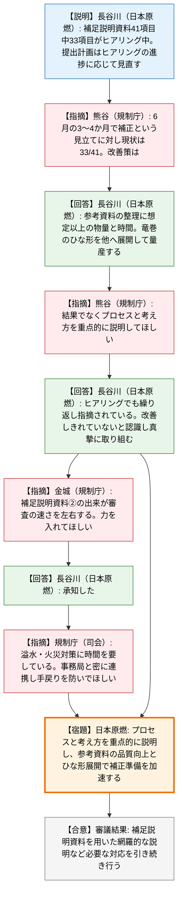
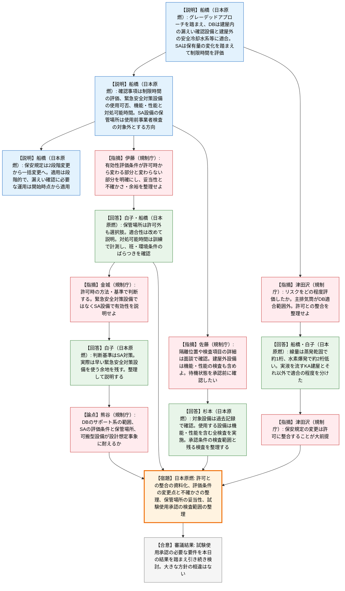

# 第599回核燃料施設等の新規制基準適合性に係る審査会合（令和8年10月27日）
> 出典 : https://youtube.com/live/_r30sv09POI?si=fM4jfooeX8W2IQNe

## 会合の概要
* **設工認の補正に向けた準備は、補足説明資料41項目のうち33項目がヒアリング中で、当初の「3〜4か月で補正」の見立てより遅れている**
  日本原燃は、参考資料に技術基準適合と許可との整合を網羅的に整理する作業に想定以上の物量と時間がかかっているとした。竜巻で決めたひな形を他の条文へ展開して改善するとの説明に対し、規制庁は「結果ではなく、そこに至ったプロセスと考え方を説明すること」を求めた。
* **実液を使う漏えい確認でのDB・SA適合の考え方が、10月2日会合の指摘を踏まえて示された**
  日本原燃は、グレーデッドアプローチを取り入れ、DBは漏えい確認対象設備を有する建屋内の設備と建屋外の安全冷却水系等に限って適合させ、SAは保有量の変化を踏まえて制限時間を評価し、必要な設備を整備する方針を説明した。規制庁は、10月2日の指摘を踏まえた中身になっていると受け止めた。
* **規制庁の関心は「許可との整合」と、SA設備の配置・保管場所の妥当性、有効性評価条件の変更点の明確化に集中した**
  高レベル廃液ガラス固化建屋（KA建屋）とそれ以外で適合の程度を分けた根拠や、主排気筒系統がDB適合の範囲に入っていない点、可搬型設備の保管場所を使用前事業者検査の対象外とする点について、追加説明が求められた。
* **保安規定の変更は、前回示した2段階の変更申請から、規制基準対応に係る変更の一括申請へ方針転換された**
  施設の状況に応じて段階的に適用し、適用範囲と時期は附則で明確にする。漏えい確認に必要なDB・SA設備の運用は、漏えい確認の開始時点から適用する。
* **両者の認識に大きな相違はないが、結論は出さず、資料化して議論を継続する**
  規制庁は「許可時に用いた方法・基準に適合する組み立て」を求め、日本原燃も「許可との整合をどこまで図るかを資料化して示す」と応じた。審議結果は、補足説明資料による網羅的な説明の継続と、試験使用承認の要件の引き続きの検討とされた。

---

## 議題ごとの詳細整理

### 【議題1】日本原燃株式会社再処理事業所再処理施設及び廃棄物管理施設の設計及び工事の計画の認可申請について
日本原燃から資料1「再処理施設 廃棄物管理施設 設工認申請の対応状況について」の説明を受け、(A) 設工認の補正に向けた取組状況と、(B) 使用前事業者検査における漏えい確認の2点を順に確認した。

#### (A) 設工認の補正に向けた取組状況
* **議論の背景と論点:**
  * 背景: 日本原燃は6月の会合で全体計画を説明し、3〜4か月をめどに補足説明資料を整理しながら補正書の準備を進める見立てを示していた。
  * 進捗: 前回10月2日の会合以降、設計基準関係では外部衝撃のうち竜巻の参考資料の確認が継続し、重大事故関係では制御室・監視測定設備・緊急時対策所等の条文が新たに確認対象となった。補足説明資料のうち補正書の準備に直結するもの（資料の5〜6ページの別紙・参考資料）は、41項目中33項目がヒアリング中である。
  * 論点1: 当初の見立てと現状に差がある中で、日本原燃はどう改善を図るのか。
  * 論点2: ヒアリングでの説明の仕方（結果の提示か、根拠に至るプロセスの説明か）が、審査の効率に影響していないか。

* **質疑応答（詳細）:**
  * 【説明者側】長谷川（日本原燃）
    資料4ページで主な条文ごとに、技術的根拠の整理、補正書として示す事項の整理の状況を示した。前回会合からの進捗は、竜巻で参考資料の確認が継続していることと、重大事故関係の複数の条文が新たに確認に入ったことである。補足説明資料は41項目中33項目がヒアリング中で、提出計画（7〜13ページ）はヒアリングの進捗に応じて適宜見直す。
  * 【規制側】熊谷（規制庁）
    比較的進んでいるのは、新たに設備を設置する重大事故関係である。設計基準側は既存設備との整合確認が必要なため継続が長引いていると見ている。6月に「あと3〜4か月で補正」という見立てだったが、41項目中33項目にとどまる。現状を踏まえて改善を考えていることはあるか。
  * 【説明者側】長谷川（日本原燃）
    いま力を入れているのは、補足説明資料②のうち参考資料である。再処理施設は一品ものであり、参考にできる先行実績がないため、技術基準適合と許可との整合を審査官に網羅的に確認してもらうツールとして参考資料を丁寧に整理している。これが当初想定より物量・時間を要した主な要因である。改善策として、竜巻で整理したものをひな形に決め、他の条文へ展開して量産していく。
  * 【規制側】熊谷（規制庁）
    内容は承知した。一方、審査官から指摘が出ている点として、説明が結果の提示になりがちである。全体計画までは結果でよかったが、今は根拠を確認する段階なので、答えそのものより、そこに至ったプロセスと考え方を重点的に説明してほしい。
  * 【説明者側】長谷川（日本原燃）
    日々のヒアリングでも「結果ではなくプロセスと考え方を説明してほしい」と繰り返し指摘されており、まだ改善しきれていない部分が多いと認識している。真摯に踏まえて取り組む。
  * 【規制側】金城（規制庁）
    この会合の裏側でも、審査官は提出資料を確認して審査を進めている。②の資料の出来は、審査をまとめるうえで大事であり、出来が良ければ審査も早くまとまるので、力を入れて作ってほしい。今週末の現地確認の際にも、状況を聞きたい。
  * 【規制側】規制庁（司会）
    規制庁側が何を見ているかを理解したうえで、計画的に進めてほしい。特に溢水対策や火災対策に時間を要しているように見えるので、日本原燃と規制庁事務局でよくコミュニケーションを取り、手戻りが出ないよう進めてほしい。

* **結論と宿題事項（アクションアイテム）:**
  * 会合としての審議結果は、「補正申請に向けて、補足説明資料を用いた網羅的な説明など必要な対応を引き続き行うこと」とされた。
  * **宿題（日本原燃）:** ヒアリングで、結果ではなくプロセスと考え方を重点的に説明する。
  * **宿題（日本原燃）:** 補足説明資料②のうち参考資料の品質を上げ、竜巻のひな形を他の条文へ展開して整理を加速する。溢水・火災対策は、規制庁事務局と密に連携して手戻りを防ぐ。

#### (B) 使用前事業者検査における漏えい確認の対応
* **議論の背景と論点:**
  * 背景: 日本原燃は、使用前事業者検査の信頼性を高めるため、過去の検査記録による確認に加えて、できる限り実液を用いた漏えい確認を行う方針で、現行の保安規定に基づく対処で安全を確保できると10月2日に説明していた。
  * 経緯: 規制庁は、漏えい確認でも原則として新規制基準のDB・SAへの適合が必要であると指摘した。ただし、DBは建屋ごとなどに切り分けて適合させる整理も可能であること、SAは時間余裕の評価でSA適合と同等の状態であることを示せば適合を不要とできることも示し、再処理施設の特徴を踏まえた合理的な規制を進めたいとした。10月7日の規制委員会でも、グレーデッドアプローチの観点を取り入れて検討する旨が示された。
  * 論点1: グレーデッドアプローチを踏まえ、DB適合の範囲をどう設定するか（資料17ページ）。
  * 論点2: 保有量が減っている現状を踏まえた、SA（蒸発乾固・水素爆発）の評価の考え方（資料18〜21ページ）。
  * 論点3: 漏えい確認時に必要な措置を保安規定にどう反映するか（資料22〜23ページ）。
  * 論点4: 許可との整合、評価条件の変更点の明確化、SA設備の保管場所の妥当性。

* **日本原燃の説明の概要（資料15〜24ページ）:**
  * 全体の考え方: 漏えい確認では新たな遮断は行わず、系統内の液の保有量は通常運転より少ない。この点を考慮し、DBは現行の保安規定の運用措置で対処しつつ、漏えい確認を行う建屋は設計想定事象に耐えるよう必要な設備を適合させる。SAは、漏えい確認を行う建屋のSAシナリオに必要な設備を整備する。
  * DB適合の範囲（17ページ）: 漏えい確認対象設備を有する建屋内は、漏えい確認に使用する設備と安全機能を確保する設備を適合させる。建屋外は、安全冷却水系、安全圧縮空気系、非常用DG等と計測制御設備を対象とする。漏えい確認のステップごとに段階的に使用前事業者検査を行い、試験使用承認を得る。漏えい確認の対象設備そのものは、確認に先立って材料・寸法・耐圧・漏えいの検査を実施する。
  * SA評価の流れ（18ページ、高レベル廃液ガラス固化建屋（KA建屋）を例示）: 確認事項は3つである。①蒸発乾固・水素爆発に至るまでの制限時間を、事業変更許可の有効性評価の方法で、貯槽の保有量や崩壊熱密度の変化を踏まえた条件のもとで評価する。②緊急安全対策の設備が、地震などの設計想定事象でも使えるかを確認し、使える確証がない設備にはSA設備を整備する。③SA設備・緊急安全対策設備の機能・性能と対処可能時間を確認する。最終的に制限時間と対処可能時間を比較し、安全に漏えい確認できるかを判断する。SA設備の保管場所は許可で認められた場所または使用に適切な場所とし、保管に関する使用前事業者検査とシーケンス訓練は実施しない方向である。
  * 評価条件の設定（29〜30ページ）: 漏えい確認は2つのフェーズで実施し、各貯槽の液量や崩壊熱密度が変化する。各フェーズで結果が厳しくなる状態（例: フェーズ1の②では混合槽Aの液量が増加する）を評価条件とする。
  * 整備するSA設備の例（37ページ）: 蒸発乾固対策のうち、システム1・6で内部ループへ通水し、システム4・5で排気をセルへ導出する。
  * 保安規定の変更方針（22〜23ページ）: 前回会合で説明した2段階の変更申請を、規制基準対応に係る変更の一括申請へ見直した。変更内容は、継続的な安全性向上の取組方針の追加、高レベル濃縮廃液等の保有量管理、ガラス固化工程停止時の運用、重大事故対応の体制整備、漏えい確認時の運転制限や安全対策に係る運用などである。適用は施設の状況に応じて段階的とし、適用範囲と時期は附則で明確にする。漏えい確認までに適合させるDB・SA設備の運用は、漏えい確認の開始時点から適用する。
  * 他の建屋: KA建屋を例に説明したが、漏えい確認を行う他の建屋も同様の考え方で整理する。

* **質疑応答（詳細）:**
  * 【規制側】津田沢（規制庁）
    16ページのグレーデッドアプローチに関し、今回の漏えい確認のリスクをどの程度評価しているのか。また17ページでは、事故時の放出経路である主排気筒がDB適合の範囲に入っていない。参考資料26ページでは、KA建屋には火災・溢水の防護対策設備を設置するとある一方、非常用DG等には設置の記載がない。保安規定の認可では許可との整合が法令上求められるので、整理して説明してほしい。
  * 【説明者側】船橋（日本原燃）— リスク評価
    現状の液の保有量では、施設全体の放射能量は通常運転時よりかなり低い。事業変更許可の条件で敷地境界の被ばく線量を評価したところ、蒸発乾固は許可時より約1桁、水素爆発は約2桁低い結果になった。ただし発生頻度は変わらないため、重大事故の発生防止対策に重点を置いて対策する。
  * 【説明者側】船橋（日本原燃）— 主排気筒系統
    VOG（槽類の排ガス処理系）等の下流の系統や主排気筒を経由する放出は、運転を停止すれば発生を抑止できる。事象の進展も、規定済みの「何かあれば設備を止める」運用措置で大部分を防止できる。このため、今回のDB適合の対象にはしていない。
  * 【説明者側】白子（日本原燃）— KA建屋とそれ以外の切り分け
    DBでどこまで適合させるかは、現状と漏えい確認時でプラントの状態が変わるか否かが最大のポイントである。KA建屋は、核燃料物質を含む実液を流すため現状と異なる状態を作り出すので、SA評価を行い、火災・溢水の対策も設ける。建屋外の安全圧縮空気・安全冷却水は、維持管理の観点から現在も2系統を使用しており、漏えい確認時も同じ状態で使い続ける。核燃料物質も流れず、火災・溢水のリスクが上がることもない。そのため適合の程度に差を設けた。
  * 【規制側】津田沢（規制庁）
    趣旨は分かったが、新規制基準にかかる保安規定の変更であるため、許可に整合することが大前提である。その点を整理してほしい。
  * 【規制側】伊藤（規制庁）
    18ページの有効性評価について、評価方法は事業許可時のものを使い、貯槽の評価条件は現状を踏まえて変更されるのは、反映すべき事項と考える。ただしSAに必要な設備を使うパターンでは、設備の配置も許可時から変わり得る。条件に変更がある場合とない場合を明確に分け、変更する部分は妥当性を整理して説明する必要があると思うが、どうか。
  * 【説明者側】白子（日本原燃）
    現在も新規制基準対応工事で保管庫のレイアウト変更や保管棚の設置を行っており、漏えい確認の時期によっては、許可で認められた場所以外に設備を保管することも一つの手段として考えている。その場合の適切性は、新規制基準への適合を改めて説明する。
  * 【規制側】伊藤（規制庁）
    場所の妥当性だけでなく、他の有効性評価条件それぞれの妥当性、評価結果との関係、各条件がどの程度の不確かさを見込んで全体として余裕があるのかも要点となる。整理して説明してほしい。
  * 【説明者側】船橋（日本原燃）
    不確かさについては、18ページの確認事項3のとおり、整備するSA設備を使って実際の手順で時間を計測し、対処可能時間を確認する。班ごとのばらつきが出ないか、厳冬期や夜間といった環境条件に左右されないかも、訓練を通じて確認して評価する。
  * 【規制側】規制庁（発言者名不明、審査側）
    やりとりが噛み合っていないので補足する。許可時の評価では、沸騰に至るまでの時間は断熱で保守的に評価しているため不確かさが入り込む余地は小さい。不確かさを見ていたのは放出量の評価側で、移行率や、気相部に移行したものがダクトを通って外へ出るまでの沈着などが対象だった。今回の沸騰までの時間や水素濃度が基準値に達するまでの時間は不確かさで動くポイントが少ないと思うが、許可時の評価も踏まえて何をどう見るかを整理して説明してほしい。
  * 【説明者側】船橋（日本原燃）
    変わる部分と変わらない部分があると理解しており、整理して説明する。
  * 【規制側】伊藤（規制庁）
    補正の審査と同様に、どういう考え方でどういう結論に至るかという過程が大事である。改めてお願いする。
  * 【規制側】佐藤（規制庁）
    17ページの図はざっくりしているので、隔離位置などの詳細は個別の面談で確認する。使用前事業者検査の例示に挙がった「材料・寸法・耐圧・漏えい」には、寸法検査や外観検査等を設定するなら含めてほしい。建屋外の安全冷却水系・安全圧縮空気系・非常用DG等は、必要なときに使えることを確認するため、機能・性能の検査も含める方向で精査してほしい。
  * 【説明者側】杉本（日本原燃）
    試験使用承認の範囲の大枠は、検査の実施方針の共通事項に記載したうえで、個別の部分は面談で調整する。漏えい確認の対象設備は、材料・寸法・耐圧・漏えいの検査について過去の記録を用いて確認する。安全冷却水など漏えい確認に使う設備は、DB適合に必要な、機能・性能を含むすべての使用前事業者検査を実施する。
  * 【規制側】佐藤（規制庁）
    18ページで、SA設備の保管場所について「使用に際し適切な場所に配置するが、保管に関する使用前事業者検査は実施しない」とある。工事中の試験で最終的な保管場所に置かれていないことは理解しているが、今回の試験のためにどういう状態で可搬型設備を待機させ、使用できる状態にしておくのかをよく検討してほしい。試験使用承認の前に、その状況を確認したい。
  * 【説明者側】杉本（日本原燃）
    試験使用承認の条件として必要な検査の範囲と、漏えい確認の完了後に実施する残りの検査について、今後詳細を詰めて整理する。
  * 【規制側】熊谷（規制庁）
    資料構成は、10月2日の規制庁側の説明を踏まえ、必要な対策が取られる中身になっていると理解した。今後の確認事項は、DBでサポート系の設備にどこまで求めるか（グレーデッドアプローチをどう考えるか）、SAでは評価条件や保管場所の妥当性、特に可搬型設備中心のSA対策が設計想定事象に耐えるかである。今日結論は出しにくいが、情報を踏まえて規制庁でも議論する。
  * 【説明者側】白子（日本原燃）
    規制基準適合の過程で漏えい確認を行う際の現状（アズイズ）のリスクを踏まえ、許可や設工認とどこまで整合を図れば安全に実施できるかを、口頭回答の内容も含めて資料化し、再度示して議論を続ける。大きな方針は概ね議論できていると認識しており、今後は細部を詰める。
  * 【規制側】金城（規制庁）
    具体的な確認は申請が来てからになるが、大きな考え方は双方揃ってきた。規制庁は許可との整合を求め、日本原燃は許可時の方法を使って組み立てるという説明で、許可時に用いた基準で判断することになるので、そこに適合する組み立てにしてほしい。18ページの制限時間の前提となるシナリオは許可時の方法で確認し、インベントリは量が少なくなるので数値が出てくると思う。福島事故後は、SAは起こるものとして準備し、水素爆発も起こりうるが、基準には7日間の対処と6日目頃までの外部支援という方策も示されているので、それをフルに使って組み立ててほしい。また緊急安全対策の設備は、保安規定上、実用炉でも使うことはあるが、SA対策の有効性は、SA設備で説明してもらうことになる。この整理をしっかりしてほしい。
  * 【説明者側】白子（日本原燃）
    時間の評価は許可で認められたSA設備で行う。一方、実際に事象が起きたときには、電源車を使う緊急安全対策の設備のほうが早く対処できる場合があるので、その選択肢を残している。判断基準はあくまでSA対策であるとの認識で、整理して説明する。
  * 【規制側】金城（規制庁）
    認識はそれほどずれていないので、準備をお願いする。
  * 【規制側】規制庁（司会）
    今回は、あくまで現在ある溶液・廃液を使った確認であり、実際のリスクを現実的なリスクとして捉え、その特性に合わせたグレーデッドアプローチの考え方も踏まえて議論してほしい。

* **結論と宿題事項（アクションアイテム）:**
  * 会合としての審議結果は、「再処理施設の漏えい確認については、試験使用承認に当たっての必要な要件を、本日の会合結果を踏まえ引き続き検討すること」とされた。日本原燃の認識は、大きな方針は概ね共有できており、今後は細部を資料化して議論するというものである。日本原燃にコメントはなかった。
  * **宿題（日本原燃）:** 漏えい確認の対象建屋・設備の整理について、許可との整合を前提に説明する（主排気筒系統がDB適合の範囲外であること、KA建屋とそれ以外とで適合の程度を分けた考え方を含む）。
  * **宿題（日本原燃）:** 有効性評価の条件のうち、許可時から変更する部分と変更しない部分を区別し、変更部分の妥当性と、不確かさ・余裕の見方を整理して説明する。
  * **宿題（日本原燃）:** SA設備（可搬型設備）の待機・保管場所の妥当性と、試験使用承認の前の待機状態の確認方法を整理する。
  * **宿題（日本原燃）:** 試験使用承認の条件として必要な検査の範囲（過去記録による確認、機能・性能の検査を含む）と、完了後に残る検査を整理する。許可との整合をどこまで図るかを資料化して再度示し、緊急安全対策の設備とSA設備の位置づけも整理して説明する。

### 全体を通した連絡事項
* 規制庁の熊谷氏と金城部長が、今週金曜日に日本原燃の現地を訪問する。これまで書類中心だった確認に対して、議論が続く火災・溢水対策の具体的な実施状況や、漏えい確認時のテレビカメラの視認性など、資料では確認できない点を現地で確認する。あわせて、社長との面談や若手プロパー職員との面談を通じ、事業に取り組む意識のあり方と現状を確認する予定である。
* 日本原燃は、現地調査が充実したものになるよう準備を進めており、意見交換も、あらかじめ受けたテーマに答えられるよう、経営層・若手のそれぞれについて準備していると述べた。

---

## 論理構造の可視化（Mermaid）

### 【議題1(A)】設工認の補正に向けた取組状況

### 【議題1(B)】使用前事業者検査における漏えい確認の対応

