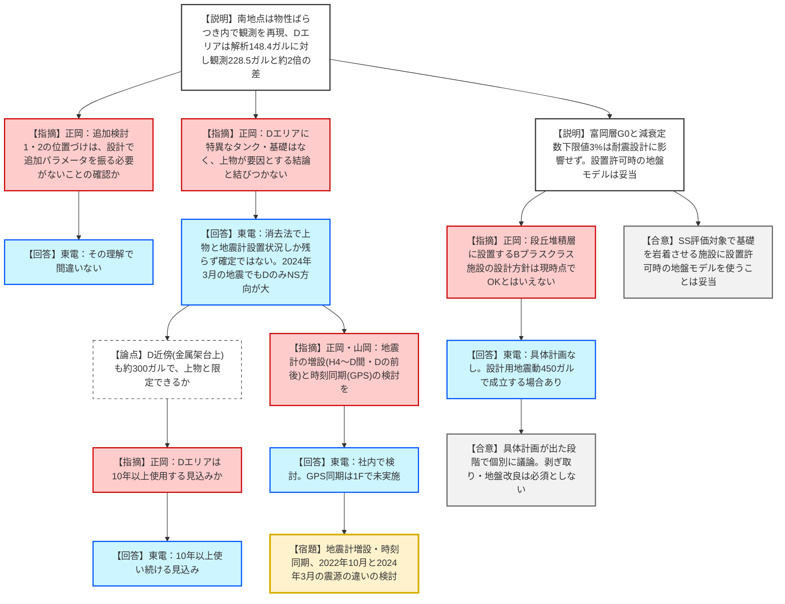
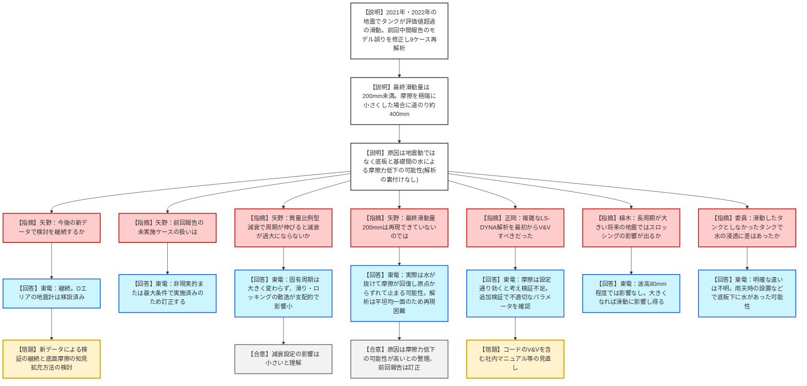
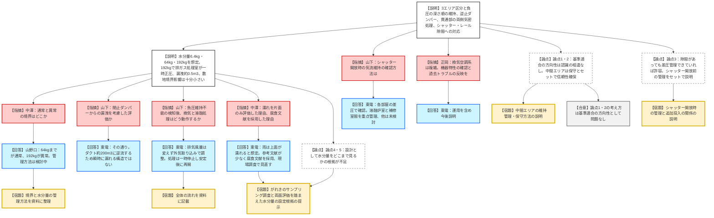

# 第30回特定原子力施設の実施計画の審査等に係る技術会合（令和8年10月27日）
> 出典 : https://youtube.com/live/PtjUK62N3HI?si=cSm5pqchNavRUkw1

## 会合の概要
* **地盤モデルの妥当性（議題1-1）:** 令和7年7月の第26回会合のコメントを受け、東京電力は地盤物性のばらつきを考慮した地震応答解析を実施。自由地盤の南地点の観測記録は再現できた一方、タンクエリアのDエリアでは最大でも解析148.4ガルに対し観測228.5ガルと約2倍の差が残った。規制庁は設置許可時の地盤モデルがSS評価対象の施設に妥当である点は了承しつつ、Dエリアの差の原因を「上物」と断定できない点を問題視し、地震計の増設・時刻同期など観測体制の強化を強く促した。
* **地震時のタンク滑動（議題1-2）:** 前回の中間報告に解析モデルの誤りが見つかったため再解析。最終滑動量は観測の200mmに届かなかったが、東京電力は、タンク底板と基礎の間の水による摩擦力低下が原因との説明にとどまった（解析による裏付けは得られていない）。規制庁からはV&Vの不備と解析コードの使い方の管理に対する注意が出た。
* **溶融設備の閉じ込め設計方針（議題2）:** 令和10年度（2028年度）の実施計画変更認可申請を前に、手戻り防止のため方針を事前議論。負圧維持を基本とするエリア区分・逆止ダンパー等の構成について規制庁は論点1・2を中心に基準適合の方向性は認めたが、「設計としてどこまでの水分量を見込むか」の根拠が資料から読み取れないとして、濡れ厚さの現場調査と運用管理を含めた再説明を求めた。
* **全体の進捗:** 3議題とも審査の最終結論には至らず、東京電力に追加の検討・資料整理が宿題として残った。議題3（資料3-1、申請スケジュール）は説明を省略し、コメントなしで終了した。

## 議題ごとの詳細整理

### 【議題1-1】福島第一原子力発電所における地盤モデルの妥当性について（資料1-1）
* **議論の背景と論点:**
    * 背景: 第26回技術会合（令和7年7月）で、地表面で観測された地震応答が解析で再現できないことについて、既存データを用いた追加検討と原因推定を求められていた。
    * 経緯: 東京電力は2023年度のボーリング調査結果等を用い、2022年10月21日の地震（EW方向の揺れが卓越）の観測記録と解析を比較した。ステップ1は自由地盤の南地点、ステップ2は施設の基礎地盤であるDエリアを対象とし、追加検討として富岡層のG0の影響と減衰定数の下限値の影響を調べた。
    * 論点1: Dエリアの観測記録が解析で再現できず約2倍の差が残る要因は何か（「上物」の影響とする説明で良いか）。
    * 論点2: 今後もDエリアを使用する前提で、観測体制をどう強化するか（地震計の増設・時刻同期）。
    * 論点3: 段丘堆積層に設置するBプラスクラス施設の設計方針（23ページ）をどう扱うか。
* **質疑応答（詳細）:**
    * **【説明者側（東電）】**: 南地点では、減衰定数hの下限値（3%）を設定しない、段丘堆積層の初期せん断弾性係数G0を平均値−1σ、富岡層のG0を平均値＋1σとすると観測記録を再現できた。同じパラメータをDエリアに適用し、基礎・改良地盤のモデル化も外したが、解析148.4ガルに対し観測228.5ガルと約2倍の差が残り、原因は地盤モデル以外のDエリア特有の要因と考えている。
    * **【説明者側（東電）】**: 追加検討として、富岡層のG0のばらつきは地表面加速度に有意な影響を与えず、地表面加速度は表層の段丘堆積層での増幅で決まることを示した。減衰定数の下限値3%の有無も、検討用地震動Ss-900のような大きな地震では耐震設計結果に影響しないと判断した。
    * **【規制側（規制庁・正岡）】**: 追加検討の位置づけは、「現行の耐震設計で使う減衰定数の下限値設定や富岡層の平均値の使用が、再現性の面でフィットしなくても設計上問題ないことを示すもの」との理解で良いか。東京電力は、その理解で間違いないと答えた。
    * **【規制側（規制庁・正岡）】**: Dエリアだけ観測記録が大きく、K4・H4は南地点と同程度の約100ガルである。43ページの比較ではDエリアに特異なタンクや基礎があるとも言えず、「上物が要因」とする結論と結びつかない。
    * **【説明者側（東電）】**: 上物が要因と確定したわけではなく、考えられる要因を消していくと、構造物と地震計の設置状況しか残らないのが実情である。2024年3月15日の地震でもDエリアの記録が大きく、Dエリアのみ北南方向（NS方向）が大きく他エリアはEW方向が大きいことから、地盤の方向性ではなく構造物や設置状況の影響と考えている。
    * **【規制側（規制庁・正岡）】**: Dの近傍（タンク基礎ではなく金属架台上の地震計）でもEWが約300ガルと3倍前後あり、上物と限定できるかも腑に落ちない。Dエリアは汚染水処理の残水など比較的インベントリの高いタンクがあるが、当面使い続けるのか。東京電力は、10年以上使い続けると聞いていると回答した。
    * **【規制側（規制庁・正岡）】**: 今後の大きな地震に備え、影響範囲を絞り込めるよう地震計の追加など観測体制の強化を検討してほしい。規制庁内では、H4からDを結ぶ線上でDの前後に設置するのが有意義との議論があり、手戻りを避けるため事前に議論したい。東京電力は社内で検討すると答えた。
    * **【規制側（規制庁・正岡）】**: 各地震計の時刻が同期しておらず、時刻歴波形の横軸（位相）の議論ができなかった。同期は技術的に難しいのか。
    * **【説明者側（東電）】**: 一般的にはGPS時刻で統一されるべきだが、1Fでは現状できていない。観測拡充の検討の中で合わせて検討する。
    * **【規制側（規制庁・正岡）】**: 23ページ最下段のBプラスクラス（段丘堆積層に設置する場合の考慮）は、今回の結論からは、ばらつきを考えても大丈夫とは現時点でいえない。そもそも段丘堆積層に支持するBプラスクラス施設の具体計画はあるか。
    * **【説明者側（東電）】**: 現在、そうした計画は出ていないが、今後の可能性はある。Bプラスクラスの設計用地震動は450ガル（900ガルの半分）であり、段丘堆積層上に設置しても耐震設計が成立する場合があると考えている。
    * **【規制側（規制庁・正岡）】**: 具体計画が出た段階で、申請前や審査の中で個別に議論する形とし、段丘堆積層の剥ぎ取りや地盤改良を必須とするものではないと理解した。東京電力はその理解で良いと答えた。
    * **【規制側（山岡委員）】**: 結論に異存はない。7ページのオービットでEW方向が卓越するのは、震源が東側で逆断層であることと整合する。41ページではDエリアは初動・主要動が特に大きく、後続のコーダ波は他エリアと大差ないため、広域の構造は似ており、Dエリアの局所的な影響であることは間違いないと考えられる。
    * **【規制側（山岡委員）】**: 地震計の増設は構造調査に比べ最も低コストで効果が大きい。2022年10月と2024年3月の地震の震源の違い（東京電力は未分析と回答）も確認すべきであり、GPSによる時刻合わせは計測の常識として必ず行ってほしい。
* **結論と宿題事項（アクションアイテム）:**
    * **【結論】**: 1Fの耐震重要施設（段丘堆積層等の表層を剥ぎ取って基礎を富岡層に岩着させるもの）の耐震設計では、設置許可時の地盤モデルを使用することが妥当という点は、規制庁・東京電力で認識が一致した。
    * **【結論】**: Dエリアの観測記録が解析で再現できない原因は、地盤モデル以外のDエリア特有の要因とされたが、「上物」と特定できてはおらず、影響の程度も把握できていない。
    * **【宿題】**: 東京電力は、地震計の増設（Dの前後やH4〜D間）と各地震計の時刻同期など観測体制の強化を社内で検討し、規制庁と事前に議論する。2022年10月と2024年3月の地震の震源の違いなども可能性として検討する。
    * **【条件】**: 段丘堆積層に設置するBプラスクラス施設は、具体計画が出た段階で個別に議論する。

### 【議題1-2】地震時のタンク滑動に関する検討（資料1-2）
* **議論の背景と論点:**
    * 背景: 2021年2月・2022年3月の福島県沖地震で、複数のタンクが設置時の評価値を上回る滑動を示した（Dエリアで最大190mm、200mm）。第9回技術会合で原因分析を求められた。
    * 経緯: 約1年前の中間報告で「底板の摩擦係数とスロッシングの影響が大きそう」と報告したが、解析モデルに一部誤りが見つかったため、モデルの妥当性を検証して再解析した。
    * 論点1: 設置時の評価値を上回る滑動の原因は何か（地震動・摩擦・スロッシングのいずれか）。
    * 論点2: 解析結果（最終滑動量・道のり移動距離）と観測値（最終滑動量200mm）の整合性、およびモデルの検証が適切か。
* **質疑応答（詳細）:**
    * **【説明者側（東電）】**: LS-DYNAによる3次元シェルモデルで、内容水のスロッシング、底板と基礎の摩擦、浮き上がりを考慮し、9ケースを解析した。どのケースも最終滑動量は200mmに届かず、摩擦係数を極端に小さくしたケース7で道のり移動距離が約400mm（最終滑動量は約11mm）となった。地震動の継続時間が長いほど道のり移動距離が増え（2011年の地震動で約2倍）、観測記録を使っても滑動量は変わらず、スロッシング波高の影響はほとんどなかった。
    * **【説明者側（東電）】**: 評価に用いた地震動は原因ではなく、タンク底板と基礎表面の摩擦力が低下していたことが原因と考えている。タンク解体時に底板と基礎の間に水があったことが確認されており、水が不均一に分布・移動したために摩擦が局所的に低下した可能性があるが、これを解析で再現するのは困難で、解析による裏付けは得られていない。新設タンクは滑動の影響を受けない設計、または滑動を防止する設計とする。
    * **【規制側（規制庁・矢野）】**: 今回で現有データの分析は一区切りと理解した。今後また滑動するような地震が起きて新たなデータが得られた場合も、東京電力として検討を続ける意思はあるか。東京電力は継続する意向を示し、Dエリアの地震計は当時干渉して適切な観測が得られなかったため移設済みで、今は正確なデータが得られると説明した。
    * **【規制側（規制庁・矢野）】**: 前回中間報告のうち今回実施していないケース（スロッシングなし、水位を変えたケース）の考察は、モデルの誤りで正しくない可能性があるとの認識で良いか。
    * **【説明者側（東電）】**: スロッシングなしは現実にあり得ず、水位は最も滑動が大きくなる条件で解析した上で滑動量が小さかったため、それより小さい条件を評価する必要はないと判断した。前回中間報告の内容は今回の最終報告で訂正する。
    * **【規制側（規制庁・矢野）】**: 減衰を質量比例型（周期に比例）で与えているが、滑りで非線形になり実質の固有周期が長くなると、減衰比がターゲットより大きくなるのではないか。滑動量への影響を考察しているか。
    * **【説明者側（東電）】**: 滑動中もタンクは内容水を抱えて底板で支持される状態は変わらず、タンク自体の固有周期はあまり変わらない。また、滑りとロッキングによるエネルギー散逸の方が支配的で、これはモデル化できているため、影響は小さいと考えている。
    * **【規制側（規制庁・矢野）】**: 29ページの道のり移動距離400mmは合計移動距離であり、観測された200mmは最終滑動量である。最終滑動量が再現できていないのは、水による摩擦力の変化を再現できないためという理解で良いか。
    * **【説明者側（東電）】**: その理解で問題ない。解析は完全に平坦で均一な面を仮定するため、繰り返し荷重で原点に戻りやすい。実際には、底板下の水が抜けて摩擦が回復し、原点からずれた位置で止まることがあり得るため、道のり移動距離400mmという結果から、200mmの滑動が起こる可能性は十分にあったと考えている。
    * **【規制側（規制庁・正岡）】**: LS-DYNAによる3次元非線形時刻歴解析で、滑りやスロッシングを含む評価は通常の許認可では見ない複雑な解析であり、モデルとコードのV&Vを最初から実施すべきではなかったか。
    * **【説明者側（東電）】**: 許認可解析として社内で検証を実施していたが、摩擦力は設定した通りに効くと考え、十分に検証できていなかった。解析結果から摩擦力があまり効いていなさそうだとわかり、追加検証したところ、摩擦が効いていない状況や、パラメータが適切な値でなかったことが確認された。
    * **【規制側（規制庁・正岡）】**: コードのバージョンや使い方まで含めたV&Vが重要である。今年4月に作成した審査実務要領でも、まとめ資料でのバージョンを含むV&Vを求めている。今回の事例を踏まえ、社内マニュアル等の見直しを行ってほしい。
    * **【規制側（山岡委員）】**: 摩擦は断層運動でも支配的で扱いが難しく、やれることはやったと理解した。対策を取れば十分なのか、地震計以外の記録も取るのか。東京電力は、地震観測と次の大きな地震での解析を含む検証を行い、底面摩擦に関する知見拡充の方法を今後検討すると回答した。
    * **【規制側（規制庁・植木）】**: スロッシングの影響が小さいのは今回の地震動で長周期成分が小さかったためで、将来、長周期の大きな地震でタンクが滑る場合はスロッシングの影響が出る可能性があるという理解で良いか。東京電力は、最大波高80mm程度（直径10mのタンク）では押される影響はなかったが、スロッシングが大きくなる地震では滑動に影響し得ると答えた。
    * **【規制側（委員）】**: 滑動したタンクとしなかったタンクで、水の浸透の仕方に違いはあったか。東京電力は、当時検討したが明確な違いは見つからず、屋外で設置するため雨天時に設置せざるを得ない場合があり、底板下に水がある状態で設置されたタンクがあれば今回のような滑動につながり得ると答えた。
* **結論と宿題事項（アクションアイテム）:**
    * **【結論】**: タンクの設計は既に滑動が起きても問題ないよう対策済みで、本件は知見拡充が目的。今回の解析から、滑動量が設置時の評価値を上回った原因は底板と基礎表面の摩擦力低下の可能性が高いとの整理となった（解析による裏付けは得られていない）。前回中間報告の内容は訂正する。
    * **【宿題】**: 東京電力は、今後の地震で新たなデータが得られた場合の解析・検証の継続と、底面摩擦に関する知見拡充の方法を検討する。また、今回の事例を踏まえ、コードのV&Vを含む社内マニュアル等の見直しを行う。
    * 議題1（1-1・1-2）全体として、地震計の追加設置を含む体制強化の検討を東京電力に求め、地震が発生した場合などは必要に応じて改めて議論することとして、本議題は終了した。

### 【議題2】溶融設備の閉じ込め設計の方針について（資料2-1）
* **議論の背景と論点:**
    * 背景: 令和10年度（2028年度）に実施計画の変更認可申請を計画している溶融設備について、申請後の手戻りを避けるため、重要な機能である閉じ込め設計の方針を事前に議論する。
    * 設備の概要: 極低線量の金属瓦礫（線量率20μSv/h以下、将来的に100μSv/h程度まで）をアーク溶融し、減容・除染して一般スクラップ相当の金属塊とする（1回約30トン、1日4回、約120トン）。Cs・Srの約99.9%はスラグ・ダスト側に移行し、物量で約90%を占める金属塊側は約0.1%に低減すると評価している。耐震クラスはBプラスクラス。
    * 閉じ込めの基本: 負圧を深くするエリア区分（通常エリア、ダスト管理エリア、ダスト取扱エリアの順）、逆止ダンパー、二重化した隔離弁等で閉じ込める。
    * 論点1・2: エリア区分と負圧維持を基本とする閉じ込め方針（中間エリアの考え方、貫通部の両側気密処理を含む）は適切か。
    * 論点3: シャッターとレールの干渉による隙間への対応は適切か。
    * 論点4・5: 設計としてどこまでの水分量を見込むか。水分量の増加で負圧が維持できない場合の漏洩評価の考え方は適切か。
* **質疑応答（詳細）:**
    * **【説明者側（東電）】**: 水分量は、スクラップ厚さ（通常3mm、リスク条件1mm）と表面の濡れ厚さ（通常10μm、リスク条件100μm）から、通常運転時の基本を6.4kg、上振れ時を64kg、両方がリスク条件となる異常時を192kgと設定した。6.4kgでは負圧が維持され、64kgでは溶融炉室から排ガス処理室へ逆流するが排ガス処理室は屋外に対し負圧を維持し、192kgでは外気取り込みダンパーが閉じて排ガス処理室が屋外に対し正圧となるが、約10秒で負圧に戻る。
    * **【説明者側（東電）】**: 異常時には外気取り込みダンパーユニットから約0.5m³が漏洩する可能性があり、敷地境界への影響は中線量モードで約3.85×10⁻⁴μSvと、通常時の影響評価（1.3μSv/年）に比べて十分小さい。シャッターは、スクラップ追加挿入時は開けない運用とする。
    * **【規制側（規制庁・中澤）】**: 通常運転時と異常時の境界はどこか。負圧を維持できなくなると異常という理解で、処理対象物の水分量をコントロールするということか。
    * **【説明者側（東電）】**: 水分量64kgまでを通常、それを超える192kgを異常と考えている。64kgでも屋外との差圧は負圧で、正圧になる段階を異常と捉えている。水分量の管理方法は検討中で、整理でき次第説明する。規制庁は、この考え方を資料上明確にするよう求めた。
    * **【規制側（規制庁・山下）】**: ダンパーは閉止状態でも一定の漏洩がメーカー設計値やJIS規格値で許容されているため、外気取り込みダンパーユニットのラインから屋外へ漏洩する想定という理解で良いか。
    * **【説明者側（東電）】**: その理解で良い。複数のダンパーが並び開口面積が大きいことからも漏洩量を評価した。なお、ダンパーまでのダクトの空間が約200m³あり、0.5m³が逆流してもダクト内に空気が戻る形で、高濃度ダストが瞬時に漏れる構造ではない。
    * **【規制側（規制庁・山下）】**: 負圧維持が難しくなったことを検知した後、換気設備と溶融処理はどう動作するか。
    * **【説明者側（東電）】**: 排気風量は変えず、外気取り込み装置とダンパーユニットで吸気量を調整して負圧を維持する。溶融処理は検知時に一時停止し、負圧が安定したことを確認して再開する。スクラップ投入時は炉蓋が開いてアーク放電も止まっており、換気が落ち着いてから放電を開始する。規制庁は、全体の流れがわかるよう資料に記載することを求めた。
    * **【規制側（規制庁・山下）】**: シャッター開閉時にも補修室から溶融炉室への気流を維持するという設計で、その確認はどうするのか。
    * **【説明者側（東電）】**: 各部屋の負圧値、すなわち差圧で確認する。特に厳しいのは溶融炉室と補修室間のシャッターで、ここは差圧による管理を行う。他のシャッターは十分検討できておらず、意見を踏まえて検討する。
    * **【規制側（規制庁・中澤）】**: 24ページで濡れを片面だけ評価した理由は何か。屋外保管のがれきでは、跳ね返りや結露で両面が濡れるのではないか。
    * **【説明者側（東電）】**: 雨は上面が濡れると考え片面で試算した。両面評価の意見は踏まえて検討し、1F構内に保管されているがれきをサンプリングして濡れ厚さを調査した結果も含めて設定を考えたい。
    * **【規制側（規制庁・中澤）】**: 25ページの文献は鋼材表面の水分量による腐食のしやすさの変化を示すもので、水の付着量の文献ではない。これを採用した理由は何か。
    * **【説明者側（東電）】**: 濡れ厚さの参考になる文献が少なく、腐食の観点で整理されたこの文献を使った。目的は異なるが、湿潤大気腐食（1μm以下）と濡れ大気腐食（1μm〜1mm）という水分の付着状態を示すデータとして使えると考えた。持ち込み時は肉眼で濡れの有無を確認して判断する想定で、文献だけでは判断できないことは承知しており、現場調査でデータを取って適切な設定を示したい。
    * **【規制側（規制庁・正岡）】**: 換気空調系が非常に複雑で、他施設でも負圧管理が困難で使用前検査ができなかった事例がある。今後の試験では、差圧を実測し、インターロックが作動して差圧が戻るかなど機器特性まで確認し、1Fでの過去の換気空調系トラブルも踏まえて検討してほしい。
    * **【規制側（規制庁・正岡）】**: 東京電力が整理した論点1・2は、基準適合性の観点で認識の相違なく、対策と考え方は良いと考えている。ただし論点2の中間エリア（ダスト管理エリア）は漏洩を検知できる構造ではないため、メンテナンスとセットで信頼性を確保する必要があり、維持管理の方法を今後説明してほしい。
    * **【規制側（規制庁・正岡）】**: 論点3は、隙間があっても設計の範囲で差圧によるエリア管理ができていれば許容できる。一方、シャッター開放時は負圧維持は難しく、気流を作る程度と考えられるため、シャッターを開ける前の管理や、追加投入との関係を一組で説明してほしい。
    * **【規制側（規制庁・正岡）】**: 論点4・5は、供用期間中に起こり得ることは建屋内で閉じ込め、設計を超えた場合は逆止ダンパーで止めて、漏洩分は影響評価で確認するという考え方に認識の相違はない。ただし、設計として水分量をどこまで見込むかは、濡れ厚さ等も含め今の資料の情報量では示せておらず、運用管理とセットで説明してほしい。
    * **【説明者側（東電）】**: 論点2のバウンダリーの保守や、シャッター開放時の管理（モニター設置等）は、運用を含めて今後説明する。水分量は、プロセス上3〜4時間の待ち時間に起こる自然乾燥や、1日程度置けば十分乾燥するかといったデータを入れて、運用管理と合わせて示していく。
* **結論と宿題事項（アクションアイテム）:**
    * **【結論】**: 論点1・2について、規制庁は示された対策と考え方で基準適合の方向性として問題ないとの認識を示した。論点3も、差圧によるエリア管理ができていれば隙間が直ちに問題とはならない。論点4・5の「設計としてどこまで水分量を見るか」は、今回の資料では判断できないとされた。
    * **【宿題】**: 東京電力は、通常・異常の境界と水分量の管理方法、負圧維持不能時の動作（処理の停止・再開を含む全体の流れ）を資料に整理する。
    * **【宿題】**: 東京電力は、1Fのがれきのサンプリング調査で濡れ厚さのデータを取り、両面の濡れも考慮して水分量の設計値の根拠を示す。
    * **【宿題】**: 東京電力は、ダスト管理エリアの維持管理（メンテナンス）、シャッター開放前の管理、換気空調系の機器特性の確認方法を、運用面も含めて説明する。検討結果がある程度出た段階で改めて議論する。

### 【議題3】その他
* **議論の背景と論点:**
    * 背景: 東京電力から資料3-1として、審査中および申請予定の実施計画変更認可申請案件のスケジュールが提出された。
* **質疑応答（詳細）:**
    * **【規制側（規制庁）】**: 説明は省略し、規制庁側から特段のコメントもなく終了した。
* **結論と宿題事項（アクションアイテム）:**
    * **【結論】**: 全体を通して追加の発言もなく閉会した。次回の会合は調整の上で連絡する。

## 論理構造の可視化（Mermaid）

### 【議題1-1】福島第一原子力発電所における地盤モデルの妥当性について

### 【議題1-2】地震時のタンク滑動に関する検討

### 【議題2】溶融設備の閉じ込め設計の方針について

