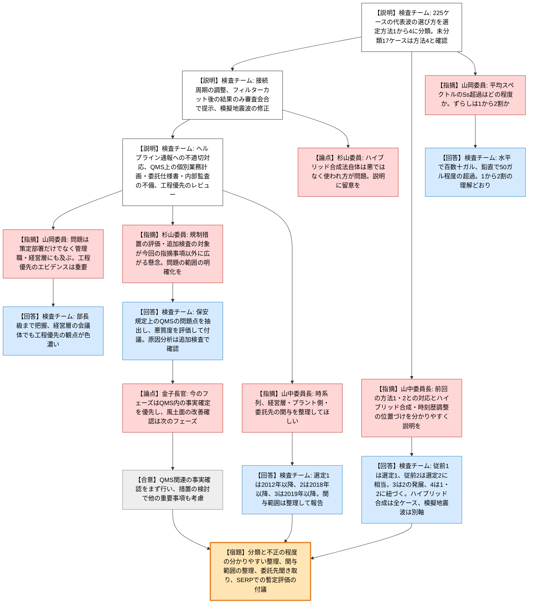
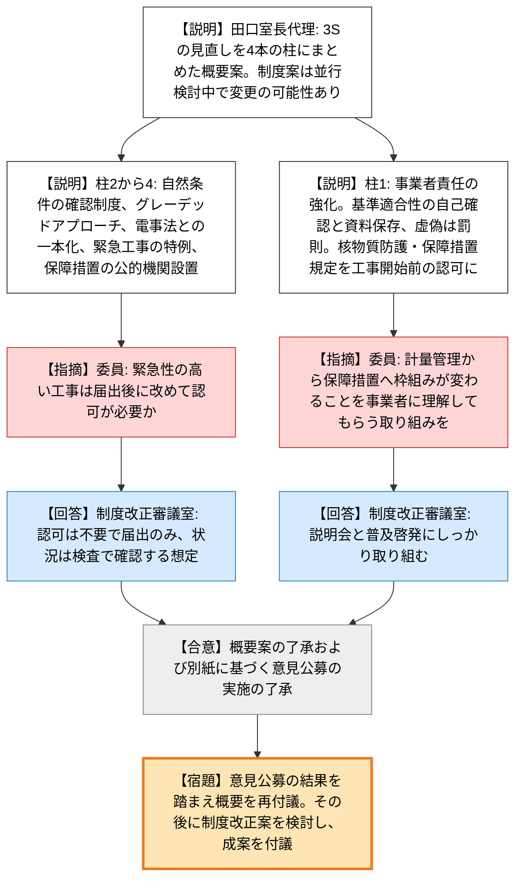
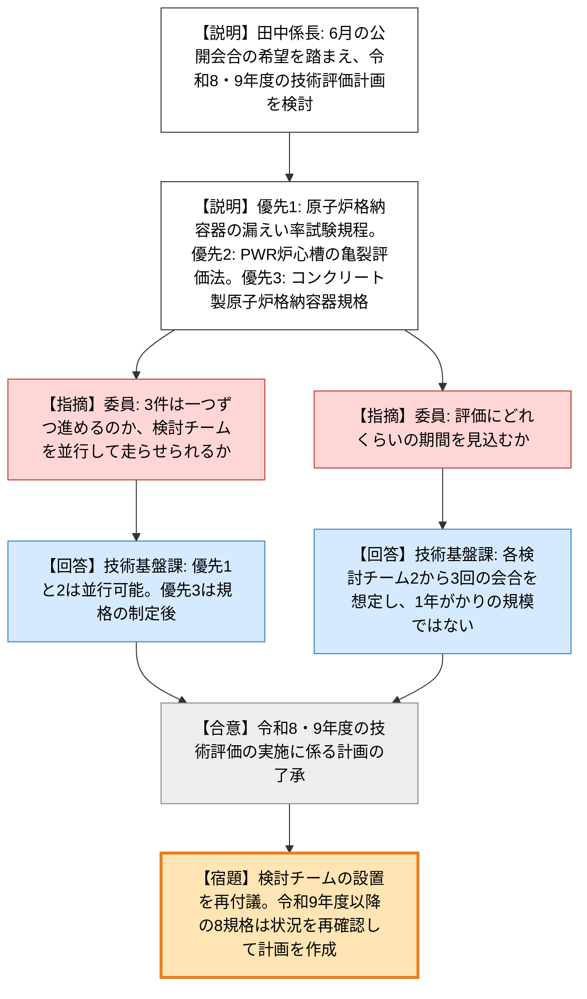
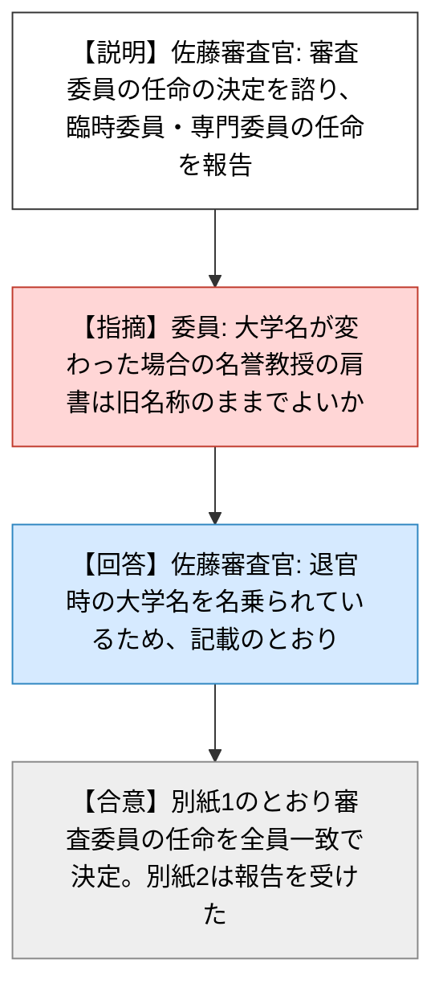

# 第39回原子力規制委員会（令和8年10月28日）
> 出典 : https://youtube.com/live/WwLvlZJDfII?si=Pce-b5Q8KrfD_jXO

## 会合の概要
* **浜岡の基準地震動不正：不正の種類は4つに整理され、「統計的な操作で1〜2割程度のずらしが可能」との感触が得られた**
  検査チームは、地震動評価（225ケース）の代表波の選び方を選定方法①〜④に分類して報告した。山岡委員は、平均スペクトルが基準地震動Ssを短周期側で水平で百数十ガル、鉛直で50ガル程度上回る例を踏まえ、Ssとの差は1〜2割程度であり、自身の事前の見積もりと整合すると述べた。山中委員長は、分類の相互関係や不正の程度がもっと分かりやすくなるよう説明の工夫を求めた。
* **問題は「地震動を作る部署」だけではなく、品質保証（QMS）と経営層の工程優先にあった**
  基準地震動の策定に係る個別業務計画が存在せず、委託仕様書もなく、内部監査やマネジメントレビューも機能していなかった。山岡委員は、基準地震動の確定時期が工程優先で扱われ、原子力安全の観点が後回しになっていた点を重視し、問題の範囲を策定部署に限るべきでないと指摘した。
* **ハイブリッド合成法それ自体は不正ではなく、「使い方」が問題**
  杉山委員は、手法そのものを悪者にしないよう説明に留意すべきと述べた。ある委員（山岡委員とみられる）は、接続周期を調整して「丁寧な計算をしなかったこと」をごまかした、との理解を示し、検査チームも同意した。
* **規制措置に向けた進め方で、委員間の認識合わせ**
  杉山委員は、評価・追加検査の対象が「今回ダメ出しされたこと」以外に広がる懸念を示した。金子長官は、現フェーズはQMS（保安規定上の品質マネジメントシステム）内の事実確定を優先し、心理的安全性など風土面の改善確認は次のフェーズで行う、と整理して委員会が了承した。
* **制度見直しの概要案・民間規格の技術評価計画・審査会の委員任命は、いずれも異論なく了承・決定**
  原子炉等規制法等の許認可制度と国内保障措置制度の見直し概要案は意見公募の実施とともに了承された。民間規格の技術評価計画（令和8・9年度）は3規格の優先順位とともに了承された。専門審査会の審査委員の任命は決定された。

---

## 議題ごとの詳細整理

### 【議題1】中部電力株式会社の不正行為に係る検査状況の報告（資料1）
* **議論の背景と論点:**
  * **背景**
    * 中部電力の浜岡原子力発電所の新規制基準適合性審査における基準地震動の策定で、不正行為が確認された事案に対する規制検査の状況報告である。
    * 検査は令和8年1月に開始された。3月31日に報告聴取命令に基づく第1次報告、9月14日に第2次報告（特別調査委員会の報告書）の一部を受理している。9月17日に第5回の検査状況報告を行い、その後10月に2回の本店検査を実施した。
  * **経緯**
    * 第2次報告書の内容を踏まえ、これまで検査で確認していなかった事項を整理して報告した。
  * **論点**
    * ① 地震動評価225ケースに対し、不正行為が及んだ範囲と具体的内容（選定方法①〜④への分類）。
    * ② ハイブリッド合成法における接続周期の設定、設計用応答スペクトルに適合する模擬地震波の作成方法に関する検査結果。
    * ③ ヘルプライン通報への対応と、保安規定に基づく品質管理（QMS）の遵守状況。
    * ④ 今後の評価の進め方（事実確認と規制措置の検討をどう整理するか）。

* **質疑応答（詳細）:**
  **＜検査チームによる説明（忠内副チーム長）＞**
    * 【説明者側】忠内副チーム長（浜岡検査チーム）
      第2次報告書では、第1次報告書の「方法1・方法2・その他・要追加調査」という分類に対し、中部電力の特別調査委員会が選定方法を改めて分類した。未分類の17ケースを検査で確認し、6ケースと11ケースのいずれも「選定方法④」に相当すると確認した。
    * 【説明者側】忠内副チーム長（浜岡検査チーム）
      選定方法①は、平均との残差が最小となる20波1組を多数作成し、定量的基準で代表波を選ぶ方法である。選定方法②は、①で基準を満たせない場合に、複数の候補波を波数積分法とハイブリッド合成して代表波を1波選び、残り19波は平均との残差が最小となるよう任意に選んで20波1組とする方法である。
    * 【説明者側】忠内副チーム長（浜岡検査チーム）
      選定方法③は、最初に多数の波を計算して選定基準でふるい分け、基準地震動の策定部署が候補を複数選び、ハイブリッド合成と施設影響確認を繰り返して代表波を決める方法である。選べない場合は計算する波の数を8000〜20000へ増やしていた。
    * 【説明者側】忠内副チーム長（浜岡検査チーム）
      選定方法④は、位相特性や破壊開始点などの入力に、別のケースの乱数を流用する方法である。不確かさを考慮したモデルの代表波を先に選び、同じ乱数設定になるよう基本震源モデルの側を選んでいた。
    * 【説明者側】忠内副チーム長（浜岡検査チーム）
      ハイブリッド合成における接続周期は、短周期側を表現する統計的グリーン関数法と、長周期側を表現する波数積分法の結果をつなぐ周期である。ある地震の例では、接続周期を1秒から2秒へ長周期側にずらすことでSs内に収めていた。別の例では、Ssを大きく上回る波数積分法の結果にフィルターカットをかけ、審査会合では、フィルターカット後の波数積分法の結果のみを示していたことが確認された。
    * 【説明者側】忠内副チーム長（浜岡検査チーム）
      模擬地震波の作成では、位相をランダムに設定して候補を多数作り、適合条件を満たすものから施設影響確認を経て選んでいた。一部の事例では、施設への影響が大きくなる時刻の加速度が小さくなるよう波形を修正したうえで、適合条件を確認していた。
    * 【説明者側】忠内副チーム長（浜岡検査チーム）
      ヘルプライン通報（令和元年、令和3年）に対し、中部電力は適切に対応していなかった。この内容は第2次報告書と同様であると記録で確認した。なお、ヘルプライン通報は保安規定上のQMSの外に位置づけられている。
    * 【説明者側】忠内副チーム長（浜岡検査チーム）
      QMS上は、新規制基準への取り組み・審査対応の業務単位でも審査項目（ハザード）単位でも、二次・三次文書（業務指針・手引き・業務計画書）が整理されていなかった。基準地震動の策定に係る個別業務計画がなく、評価やデータ分析も実施されていない。委託仕様書の承認文書も作成されず、委託先への指示は打合せやメールで行われ、記録はほとんど残っていない。
    * 【説明者側】忠内副チーム長（浜岡検査チーム）
      内部監査は、個別業務計画に基づいて業務が実施されているかを確認しておらず、専門性の高い業務を監査できる体制にもなかった。マネジメントレビューでは、内部監査結果や品質目標の達成状況等のインプット情報が整理されず、適切なレビューが行われていなかった。
    * 【説明者側】忠内副チーム長（浜岡検査チーム）
      基準地震動の確定時期は業務プロセスの有効性に影響しうる課題として抽出され、部長級や経営層の会議体で対応が検討されていた。ただし、この検討は原子力安全ではなく、確定時期を含む工程を優先する観点で行われていた。また、安全文化に関する結果に本事案を示唆する記述があったが、事案の把握には至っていない。
    * 【説明者側】忠内副チーム長（浜岡検査チーム）
      今後は、模擬地震波の作成を委託された業者への聞き取りや関係資料の確認を進め、検査結果を取りまとめる。その後、重要度評価・規制措置会合（SERP）で暫定的な評価を行い、原子力規制委員会に付議する予定である。

  **＜不正の種類と程度、分類の相互関係＞**
    * 【規制側】山中委員長
      前回までの方法①・②（多数のセットを計算して都合のよい1セットを選ぶ／多数の波から適宜、代表波を選ぶ）は不正の種類と程度が分かりやすかった。今回の4種類との対応、ハイブリッド合成法での接続周期の恣意的な設定、地震波の時刻歴の調整が①〜④に含まれるのかを整理してほしい。難しければ、大きく①と②に分けて理解してよいかも含めて説明を求めたい。
    * 【説明者側】忠内副チーム長（浜岡検査チーム）
      従前の方法①は選定方法①に、従前の方法②は選定方法②にほぼ相当する。従前の「その他」は選定方法①と④に、「要追加調査」は選定方法①〜③のいずれかに含まれる。③は②の発展形で、施設影響確認が入るため手の込んだ手順になっている。④は①②の実施後の一部ケースで確認されたため、①②に紐づく。
    * 【説明者側】忠内副チーム長（浜岡検査チーム）
      ハイブリッド合成は225ケース全てで行われており、選定方法①〜④とは別の軸の事項である。模擬地震波の作成は225ケースの代表波の話とは別であり、設計用応答スペクトルに適合する波を作る過程で行われたものである。
    * 【規制側】山中委員長
      おおむね理解できた。代表波の作成過程で複数種類の不正があり、これとは別に時刻歴波形に関する不正があった。プラント側とのやりとりで要望を聞いて評価をやり直した不正も含まれる。
    * 【規制側】山岡委員
      グループ分けは適切にまとめられているが、相互関係はなお分かりにくい。自分の理解では、③は②の派生型であり、④は①〜③を前提に、応力降下量を1.5倍した際にSsを上回らないよう元に戻って変更したものである。説明の工夫を求める。

  **＜不正によるずらしの程度（山岡委員）＞**
    * 【規制側】山岡委員
      参考1-3で、1000波を平均すると最大加速度がSsを上回るとあるが、この1000波にはどのような不確かさが入っているのか。応力降下量を大きくしたケースを見ているのか。
    * 【説明者側】鈴木氏（浜岡検査チーム）
      1000波は、震源パラメータが全く同じで、プレート間地震側・内陸地殻内地震側それぞれの乱数だけを振って計算したものである。例示は、分岐断層と連動を不確かさとして掛け合わせたケースで、Ssまで残った最終的なケースの中の1つである。
    * 【規制側】山岡委員
      全体の傾向として、平均スペクトルがSsを超えてくるのは最大加速度に近い短周期側で、水平で百数十ガル、鉛直で50ガル程度の超過という理解でよいか。審査資料ではギリギリ超えない程度だったため、差は1〜2割程度と理解している。
    * 【説明者側】鈴木氏（浜岡検査チーム）
      その理解のとおりである。トリパータイト（四分割対数）グラフで見ると、わずかに超えている程度に見える。
    * 【規制側】山岡委員
      事案発覚時に過去の資料から、方法②・③でどの程度の過小評価ができるかを見積もったところ、2割程度という感覚だった。今回の検査で確認された数字とほぼ同程度であり、納得できる。
    * 【規制側】山岡委員
      模擬地震波については、適合条件は満たしているものの、そこに至る前に施設側と調整を行う、本来やるはずのないことが行われていた点が非常に問題である。
    * 【説明者側】忠内副チーム長（浜岡検査チーム）
      施設側との調整が2回ほど行われていたのは想定外であった。施設側が解析まで行って確認していたことからも、施設側の意向がかなり組み込まれていた可能性がある。

  **＜QMSと問題の範囲＞**
    * 【規制側】山岡委員
      QMSを丁寧に調べたことを評価する。地震動評価は専門性が高く口を出せなかったという説明があるが、基準地震動の確定時期が今後の業務プロセスの有効性に影響しうるとして、安全より工程を優先したというエビデンスが得られた点は重要である。管理責任を持つ管理職や経営層にも問題があり、施設側の人々が違和感を持っていたかも含めて、策定部署だけに限定する考え方は適切でないと考える。
    * 【説明者側】忠内副チーム長（浜岡検査チーム）
      そのとおりである。部長級までは情報が伝わっていたとみられる。経営層の会議体でも工程優先の観点が色濃かったと、検査チームも受け止めている。
    * 【規制側】山中委員長
      山岡委員がかねて関心を持っていた「確からしい平均値からのずらし」の程度が、限られた条件ながら、立入検査で確認できたデータで1〜2割と評価できた。この理解でよいか。
    * 【規制側】山岡委員
      オーダーとしては納得できる相場感である。乱数を使う以上「正解」は定まらないが、統計的にどの程度の操作が可能かを理解しておくことは必要であり、ありがたい資料である。

  **＜ハイブリッド合成法の位置づけ（杉山委員）＞**
    * 【規制側】杉山委員
      統計的グリーン関数法と波数積分法のハイブリッド合成そのものが不正ではなく、客観性を失わせ、都合のよい結果を生む方法として使われた「使われ方」が問題である。「ハイブリッド合成法＝悪」と受け取られないよう、説明の仕方に注意すべきである。
    * 【規制側】山岡委員とみられる委員（発言者は文字起こしから特定できず、文脈からの推定）
      接続周期は、地下構造がどこまで分かるかで決まり、通常は1秒程度でつなぐと聞く。今回は丁寧な計算をしなかったことを、接続周期でごまかそうとしたと理解するが、よいか。
    * 【説明者側】忠内副チーム長（浜岡検査チーム）
      理解のとおりである。各方法の目的はSsを上回らせないことだが、中身を詳細に見ると種類が異なる。

  **＜今後の評価の進め方＞**
    * 【規制側】杉山委員
      SERPで評価し、追加検査や特別検査に進み、改善措置の有効性を確認する通常の流れは、今回は当てはまりにくい。審査申請は取り下げられており、「地震動を正しく評価できることの確認」を次の目標にはできないためだ。申請行為と直結しないスコープ（法令活動全般の品質保証）になり、追加検査の対象が今回指摘された事項以外に広がる懸念がある。どこに問題があったのかの範囲を明確にした報告を求める。
    * 【規制側】山中委員長
      事実確認の途中であり、規制措置の議論は事実確認を終えてから行うべきである。ただし、措置を検討するうえで抜けると困る確認事項があれば、今のうちに意見を出してほしい。
    * 【説明者側】忠内副チーム長（浜岡検査チーム）
      検査の対象は基準地震動の策定に関するものだが、そこから品質管理に関する保安規定の遵守状況を確認している。QMS上の問題点を抽出し、その悪質度を確認した評価結果を委員会に付議する。原因分析や改善活動は、追加検査になった場合に確認する。
    * 【規制側】杉山委員
      事務局の説明で問題ない。発言の意図は、委員会がどこに向かっているかをある程度意識して進めたかったことにある。

  **＜時系列、経営層・委託先の関与＞**
    * 【規制側】山中委員長
      規制措置との関係は別として、時系列を知っておきたい。これまでと違う点があれば教えてほしい。
    * 【説明者側】忠内副チーム長（浜岡検査チーム）
      選定方法①は2012年以降（新規制の初回申請は2014年）、②は2018年以降、③は2019年以降（プレート間地震との連動評価が始まった時期）、④は①②の実施後で①と同時期の2012年以降である。
    * 【規制側】山中委員長
      程度の悪い②③の不正は2018年頃以降に始まったと理解した。経営層の関与の仕方、プラント側の関与、委託先の関与（今日は詳細がなかった）について、確認すべきことがあれば進めてほしい。インタビューがおおむね終わっているなら、整理して示してもらえばよい。
    * 【説明者側】忠内副チーム長（浜岡検査チーム）
      関与の範囲、委託先の話、無理な要求の話を整理し、今後の報告で示す。
    * 【規制側】金子長官
      心理的安全性などの雰囲気は影響しているが、事実確認の中で保安規定違反との関係を評価するのは難しい。この検査フェーズでは、保安規定のQMS内の事柄を確定して措置を判断し、将来に向けた改善状況の確認は次のフェーズで行うのが適切と、事務局は受け止めている。
    * 【規制側】山中委員長
      QMS関連の事実確認をまず行い、規制措置の検討の中で、その他の重要な部分も考慮するという提案で、各委員に異論はないか。（異論なし）

* **結論と宿題事項（アクションアイテム）:**
  * 本件は報告を受けたこととし、議題を終了した。
  * 分類（選定方法①〜④）の相互関係、不正の程度を、よりわかりやすく表現するよう整理する。
  * 経営層・プラント側・委託先の関与範囲を整理し、今後の検査報告で示す。
  * 事実確認と委託先への聞き取りを進めたうえで、暫定的な評価結果をSERPで取りまとめ、委員会に付議する。

---

### 【議題2】原子炉等規制法等における許認可制度等及び国内保障措置制度の見直しの概要案及び意見公募の実施（資料2）
* **議論の背景と論点:**
  * **背景**
    * 規制の継続的改善として、審査・検査の運用実績や今後のニーズ、基準地震動の不正事案を踏まえ、制度見直しを検討してきた。
    * セーフティ、セキュリティ、セーフガード（3S）の各分野の見直しを、6月に別々に報告していた。本件はこれらを一つにまとめた概要案である。
  * **経緯**
    * 当初は8月末に委員会へ諮る予定だったが、制度検討に時間を要し、今回となった。
    * 制度案の検討は並行して進行中であり、内容の一部が変わる可能性がある。
  * **論点（概要案の4本の柱）**
    * ① 原子力施設の設計及び工事の段階からの事業者責任の強化（申請届出における責任、核物質防護・保障措置の体制整備）。
    * ② 設計プロセスに沿った審査の制度整備（自然条件を施設設計に先立って確認する制度）。
    * ③ 安全確保を早期かつ確実に実施するための許認可制度見直し（グレーデッドアプローチ、電気事業法との一本化、緊急性の高い工事の着手の特例）。
    * ④ 核不拡散に係る国際的信頼の維持向上のための規制体制の強化（保障措置の責任者・規程、公的機関の設置）。

* **質疑応答（詳細）:**
  **＜田口室長代理による概要説明＞**
    * 【説明者側】田口室長代理（制度改正審議室）
      柱①では、許可や設計及び工事計画認可の申請時に、事業者自らが基準適合性を確認し、設計に関する重要な資料を保存することを求める。保存すべき資料は委員会が定め、確認体制や実施状況は審査・検査で監督する。虚偽があった場合は罰則の対象とする。
    * 【説明者側】田口室長代理（制度改正審議室）
      核物質防護規定は設置工事の開始前に認可を受けるものとする。保障措置は、従来の計量管理に加えて、査察に必要な設備の整備（カメラへの電源供給など）を事業者に明確に求め、責任者を保障措置責任者として定める。計量管理規定は保障措置規定に改称し、工事の開始前に認可を受けるものとする。約2000の小規模事業者は従来どおりとする。
    * 【説明者側】田口室長代理（制度改正審議室）
      柱②は、これまで「事前に自然条件を認定する」と説明してきた制度を、法制度上の検討に合わせて「確認」と表現し直したもので、内容に大きな変更はない。
    * 【説明者側】田口室長代理（制度改正審議室）
      柱③では、審査期間を30日に限った届出制度などを廃止し、重要なものは許認可、軽微なものは届出とする。電気事業法の原子力発電工作物の規制は原子炉等規制法に一本化し、逆に原子炉等規制法側に、電気主任技術者・ボイラー・タービン主任技術者の選任義務の規定を整備する。新知見により即時の対応が必要な工事（例：新たな海域の活断層で津波想定が高くなった場合の原子炉建屋の水密化の高さ引き上げ、電源車等の保管位置の変更）は、工事計画認可を経ずに着手できるようにする。
    * 【説明者側】田口室長代理（制度改正審議室）
      柱④では、保障措置に要する設備整備の措置を国際規制物資使用者等に明確に求め、違反があれば是正を命じられるようにする。商業用再処理施設の運転開始に備え、IAEAの24時間体制の査察や指摘への対応のため、現行の指定機関制度を廃止して、独立行政法人として新たな公的機関を設置する方向で検討中である。委員会は、IAEAとの調整、規制上の最終判断、使用者等と公的機関への監督、規制判断を伴う立入検査を担う。
    * 【説明者側】田口室長代理（制度改正審議室）
      事業者等には制度の確実な見直しから少なくとも約1年半の準備期間が必要とみられるため、経過措置や移行期間を設けることも検討する。概要案は行政手続法上の意見公募の対象ではないが、基本的な考え方に関するものなので任意で意見公募を行う。結果を踏まえ、改めて委員会に付議して決定を受け、その後に制度改正案を検討する。

  **＜質疑・コメント＞**
    * 【規制側】長﨑委員とみられる委員（発言者は文字起こしから特定できず、文脈からの推定）
      緊急性の高い工事は届出で先行着手し、後で検査で確認するとのことだが、届出の後に改めて認可が必要になる仕組みか。
    * 【説明者側】田口室長代理（制度改正審議室）
      制度の詳細は検討中だが、現時点では認可は不要で、届出を受けて状況を検査で確認することを想定している。
    * 【規制側】長﨑委員とみられる委員（同上）
      国内保障措置制度のあり方検討会等での議論は反映されているが、事業者の3Sの中では保障措置（セーフガード）への認識がやや弱い印象がある。計量管理から保障措置という大きな枠組みに変わることを、関係事業者に分かってもらう取り組みを並行して進めてほしい。
    * 【説明者側】田口室長代理（制度改正審議室）
      説明会や普及啓発にしっかり取り組む。
    * 【規制側】委員（氏名は特定できず）
      見直し項目は経路の異なる複数のものを含み一言で表しにくいが、いずれも現在の規制委員会にとって重要な項目で、主なものは既に議論済みである。これを束ねた全体内容に異論はない。
    * 【規制側】山中委員長
      前回の大枠の資料を踏まえ、今回は詳細な見直しの提案を受けた。これまでの議論が包含されており、異論はない。概要案の了承と、別紙に基づく意見公募の実施の了承について、各委員の意見を求め、異論なく了承された。

* **結論と宿題事項（アクションアイテム）:**
  * 見直しの概要案と、意見公募の実施が了承された。
  * 意見公募の結果を踏まえ、概要を改めて委員会に付議して決定する。その後、制度改正案の検討に進み、成案が得られれば委員会に付議する。
  * 事業者等との意見交換を継続し、制度の詳細運用を検討する。保障措置の枠組みの変更について、説明会等の普及啓発を行う。

---

### 【議題3】民間規格の技術評価の実施に係る計画（令和8、9年度）（資料3）
* **議論の背景と論点:**
  * **背景**
    * 規則解釈等への引用が必要な民間規格について、事業者等と学協会の意見を聴取し、計画を立てて技術評価を行う枠組みである。
    * 令和6、7年度計画に基づき、日本電気協会の原子力発電所耐震設計技術規程の技術評価を進めており、技術的議論はおおむねまとまってきた。
  * **経緯**
    * 令和8年6月9日の公開会合で、事業者等から技術評価の希望を聴取した。それを踏まえて原子力規制庁が、令和8・9年度の計画を検討した。
  * **論点**
    * 優先順位1：日本電気協会「原子炉格納容器の漏えい率試験規程」（2026年版、9月10日発刊）。
    * 優先順位2：日本機械学会の事例規格「PWR炉心槽の亀裂評価法」（現在制定作業中、令和10年度以降の炉心槽溶接部の詳細点検に関連）。
    * 優先順位3：日本機械学会「コンクリート製原子炉格納容器規格」（2026年版、12月発刊予定。規制庁内の検査部局の希望）。

* **質疑応答（詳細）:**
  **＜田中係長による説明＞**
    * 【説明者側】田中係長（技術基盤課）
      国内PWRでは、全体漏えい率試験（A種試験）を3定検に1回実施し、実施しない定検では局部漏えい率試験を行っている。2026年版規格は、直近10年間の漏えい率が判定基準内であることを条件に、A種試験の間隔を最大10年間に延長できるとし、その間はB種・C種試験等を組み合わせて健全性を確認するものである。既に技術基準規則解釈に引用されている規格で、事業者の定期検査のリソースの適正配分に資するとして、早期の技術評価が希望された。
    * 【説明者側】田中係長（技術基盤課）
      PWR炉心槽の亀裂評価法は、海外での炉心槽溶接部の応力腐食割れ事例を受けて、事業者が2028年度から国内PWRで詳細点検を計画していることから、点検開始までの技術評価が希望された。コンクリート製原子炉格納容器規格は、供用期間中検査に関する事項を含むため、検査で事業者が行うべき内容と規制基準の関係を明確にする観点から、規制庁内の検査部局が評価を希望した。いずれも、あらかじめ技術評価しておくことは効率的な原子力規制検査に資するため妥当と判断した。
    * 【説明者側】田中係長（技術基盤課）
      優先順位1・2は技術評価の検討チームを設置して評価し、優先順位3は規格発刊後に検討チームを設置する。検討チームの設置は改めて委員会に付議する。令和9年度以降の評価が希望された8規格は、多くが改定作業中のため、状況を再確認して改めて計画を作成する。

  **＜質疑・コメント＞**
    * 【規制側】委員（氏名は特定できず）
      優先順位が3件示されているが、一つずつ片付けるのか、検討チームを同時に走らせられるのか。分野や人員、事務局の負担から見て同時に走らせられるか。
    * 【説明者側】田中係長（技術基盤課）
      3は制定後になる。1は発刊済み、2は12月発刊予定で、この2つは並行して評価できる。優先順位1と2は検査部門が両方関係し、主導が若干重なる可能性があるが、内容の確認という意味では2つを走らせられると考えている。
    * 【規制側】委員（氏名は特定できず）
      それぞれ、どのくらいの評価期間を見込んでいるか。
    * 【説明者側】田中係長（技術基盤課）
      精査が必要な部分もあるが、各検討チームで2〜3回の会合を想定しており、1年がかりの規模感ではない。
    * 【規制側】委員（氏名は特定できず）
      以前に比べて新しい規格も追加されているが、優先順位はこれで結構であり、進めてほしい。

* **結論と宿題事項（アクションアイテム）:**
  * 令和8、9年度の民間規格の技術評価の実施に係る計画が了承された。
  * 検討チームの設置について、改めて委員会に付議する。
  * 令和9年度以降に希望のある8規格は、規格の策定状況と事業者等の希望を再聴取したうえで、改めて計画を作成する。

---

### 【議題4】原子炉安全専門審査会及び核燃料安全専門審査会の審査委員の任命（資料4）
* **議論の背景と論点:**
  * **背景**
    * 原子炉安全専門審査会と核燃料安全専門審査会の審査委員の任命について、決定を諮るもの。あわせて、委員長が任命した臨時委員及び専門委員（別記1〜3）を報告するもの。
  * **論点**
    * 別紙1の審査委員の任命案の妥当性。
    * 審査委員の肩書（大学名の変更後の名誉教授の呼称）の扱い。

* **質疑応答（詳細）:**
  **＜佐藤審査官による説明＞**
    * 【説明者側】佐藤審査官（地震・津波審査部門）
      別紙1のとおり審査委員の任命の決定を諮る。別紙2（別記1〜3）の臨時委員及び専門委員の任命は、委員長による任命として報告する。

  **＜質疑・コメント＞**
    * 【規制側】委員（氏名は特定できず）
      審査委員は、いずれも非常にしっかりした方々であり、この形で問題ない。
    * 【規制側】委員（氏名は特定できず）
      大学の名称が変わった場合、名誉教授の肩書は旧名称のままでよいのか。東京工業大学のままでよいか。
    * 【説明者側】佐藤審査官（地震・津波審査部門）
      記載の審査委員は東京工業大学で退官されたため、その名称を名乗られている。
    * 【規制側】山中委員長
      別紙1のとおり審査委員を任命することについて、各委員に諮り、全員が決定してよいと回答した。別紙2は報告を受けた。

* **結論と宿題事項（アクションアイテム）:**
  * 審査委員の任命が決定され、臨時委員及び専門委員の任命が報告された。
  * その他の議題として、次週の委員会は長﨑委員がウィーンでのIAEA関連会合（ADSEC）に出席するため欠席の予定であると、委員長から連絡があった。

---

## 論理構造の可視化（Mermaid）

### 議題1：中部電力の不正行為に係る検査状況の報告

### 議題2：原子炉等規制法等の許認可制度等及び国内保障措置制度の見直し概要案

### 議題3：民間規格の技術評価の実施に係る計画（令和8、9年度）

### 議題4：原子炉安全専門審査会及び核燃料安全専門審査会の審査委員の任命

