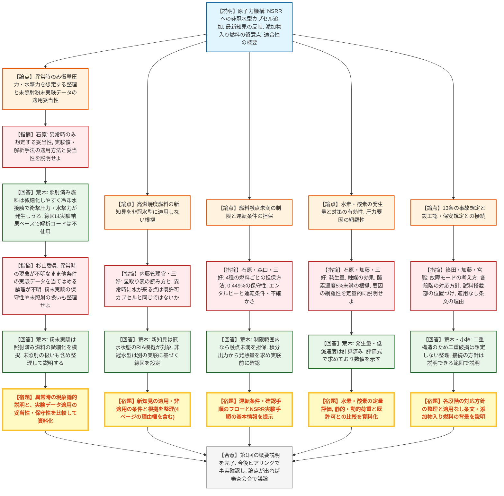

# 第600回核燃料施設等の新規制基準適合性に係る審査会合（令和8年10月28日）
> 出典 : https://youtube.com/live/BokDrmFuEfU?si=k3fkMLn0K0M0Cr4n

## 会合の概要
* **NSRR（原子炉安全性研究炉）への「非冠水型カプセル」追加申請の初回会合（概要説明）**
  令和8年7月30日付で申請された、日本原子力研究開発機構（原子力機構）原子力科学研究所NSRRの設置変更許可申請について、第1回目の審査会合として申請内容の概要が説明された。BDBA（設計基準事故を超える条件）のLOCA模擬実験を行うための新型カプセルの追加が中心で、今回は説明主体の会合であり、結論や了承は出ていない。
* **最大の争点は「異常時の衝撃圧力・水撃力」の想定とその設計線図の妥当性**
  原子力機構は、非冠水型カプセルでは通常時は衝撃圧力・水撃力が生じず、照射済み燃料に冷却水が接触する異常時のみ想定するとした。さらに、その設計線図は未照射酸化ウラン粉末実験（既許可の大気圧水カプセルでのRIA模擬）のデータで設定すると説明した。規制側は、異常時に何が起きるのかの現象論的説明が無いまま他条件の実験データを当てはめるロジックを繰り返し問い、適用の妥当性・保守性の説明を求めた。
* **高燃焼度燃料の新知見の適用範囲が非冠水型で整理されていない**
  既許可の2種カプセル（大気圧水・高圧水）には最新論文（高燃焼度燃料の知見）を反映して算定方法を見直す一方、非冠水型には反映しない整理に対し、規制側は「異常時に冷却水が燃料に触れる状況は既許可カプセルと同じではないか」と、適用・非適用の条件と根拠の整理を求めた。
* **水素・酸素対策、融点未満制限、運転条件など設計根拠の定量的説明を要求**
  被覆管の水蒸気酸化や冷却水の放射線分解で生じる水素・酸素の発生量と酸素低減用触媒（酸素濃度5%未満）の有効性、燃料融点未満の制限（最大総発熱量2.0×10の5乗J）を担保する運転条件、圧力上昇要因の網羅性などについて、いずれも定量的な評価・手順を資料に落とし込んで次回以降のヒアリングで説明するよう求められた。
* **設工認・保安規定との接続（後続規制の対応方針）も許可審査の段階から確認**
  規制庁は、カプセルの具体設計や原子炉運転管理が設工認・保安規定の領域に及ぶとしても「別手続き」で切り捨てず、許可後の対応方針と接続の見込みを説明するよう求めた。今後はヒアリングでの事実確認を経て、論点が出れば審査会合で議論する進め方が示された。

## 議題ごとの詳細整理

### 【議題1】日本原子力研究開発機構原子力科学研究所の原子炉施設（NSRR原子炉施設）の設置変更許可申請について

* **議論の背景と論点:**
  * **背景**
    * NSRRは1975年に初臨界を迎えた原子炉安全性研究炉で、パルス運転により反応度事故（RIA）時の燃料挙動を調べる。炉心中央の実験孔にカプセルを入れて実験する。
    * 今回の申請は令和8年7月30日付で、本日が第1回目の審査会合。
    * 既許可のカプセルは大気圧水カプセルと高圧水カプセルで、いずれもRIA模擬用。
  * **申請の5本柱**
    * 非冠水型カプセルの追加（BDBA条件を含むLOCA模擬実験用）。
    * 照射済み燃料のRIA模擬実験に係る最新知見の反映（既許可の2種カプセルのみが対象）。
    * 添加物入り燃料の照射における留意点の追加（低発熱量から段階的に発熱量を上げる）。
    * 敷地境界・周辺監視区域境界の変更（他の許可で既に認められた内容に合わせる）。
    * 試験炉設置許可基準規則への適合性説明（第4・8・12・13・19・29条など）。
  * **非冠水型カプセルの設計**
    * 内部カプセルと外部容器の二重構造で、試験燃料は未照射・照射済みのUO2およびMOX燃料。
    * 試験燃料加熱用ヒーターと水蒸気発生部のヒーターで高温・水蒸気環境を作り、パルス照射前に約1200度、その後パルス照射で目標温度に到達させる。
    * 水素燃焼を抑えるため、内部カプセル内に酸素低減用触媒を置き、酸素濃度を5%未満に保つ。
  * **荷重の考え方**
    * 通常時は非冠水のため衝撃圧力・水撃力は生じないが、異常で冷却水が試料搭載部に流入する場合を想定し、照射済み燃料についてのみ動的荷重として設計に考慮する。
    * 設計線図（最大圧力線図・一次圧力ピーク値の相関式・最大転換率線図）は、未照射酸化ウラン粉末燃料の実験結果から新たに設定する。機械的エネルギー転換率は衝撃圧力が0.449%の一定値。
    * 静的荷重として、水蒸気圧による圧力上昇（実験中の最大約0.7メガパスカル）と水素による内圧上昇を考える。
  * **制限条件**
    * 燃料融点（2865℃）未満で実験するため、1250J/gを制限とし、燃料最大160gで最大総発熱量は2.0×10の5乗J。
    * 最大有効破壊エネルギーは、この値に転換率0.449%を乗じた約898J。
  * **主な論点**
    * 異常時のみ衝撃圧力・水撃力を想定する整理の妥当性と、未照射粉末実験データを非冠水型へ適用する妥当性。
    * 高燃焼度燃料の新知見を非冠水型に適用しない根拠。
    * 水素・酸素の発生量と対策の有効性。
    * 燃料融点未満の担保方法（運転条件・確認手順）、圧力要因の網羅性、設工認・保安規定との接続。

* **質疑応答（詳細）:**
  * 【説明者側】原子力機構（小林ほか）
    資料1-1（概要）・1-2（適合性）・1-3（スケジュール）の順に、非冠水型カプセルの追加、新知見の反映、添加物入り燃料の留意点、適合性（第4・8・13・19・29条など）を説明した。
  * 【規制側】石原（規制庁）
    非冠水型カプセルで、照射済み燃料を入れた場合の異常時のみ衝撃圧力・水撃力を想定事象とする整理の妥当性が明確でない。実験値や解析的手法を用いる場合は、その適用方法・妥当性も合わせて説明すること（指摘）。
  * 【説明者側】荒木（原子力機構）
    未照射燃料は微細化しやすくなく、燃料溶融を起こさない範囲で実験するため、高温燃料が広い表面積で冷却水に触れる状況にならず、衝撃圧力・水撃力は発生しない。照射済み燃料は、核分裂生成物の蓄積で微細化しやすいため、異常で冷却水が接触した場合に衝撃圧力・水撃力が生じる恐れがあり、その圧力を動的荷重として考慮する。設計線図は解析ではなく実験結果に基づく。
  * 【規制側】三好（規制庁）
    資料に「新たに設定する」とあるが、今後の実験で得るデータの意味か、既存知見を異常時に適用する意味かを確認したい。評価に解析コードは使うのか。
  * 【説明者側】荒木（原子力機構）
    今後の実験ではなく、過去の実験データ（JAEAのレポート知見）に基づき今回の申請で設定する。解析コードは使っておらず、実験ベースである。
  * 【規制側】内藤管理官（規制庁）
    星取り表（資料1-1の4ページ）の読み方を確認したい。衝撃圧力・水撃力は照射済みのみを今後の設計で見るという意味か。
  * 【説明者側】荒木（原子力機構）
    最新知見の黒丸は算定方法を変更する箇所を指す。未照射燃料の衝撃圧力・水撃力も引き続き想定し、算定方法を変えないだけである。今回の知見は燃焼度が効くというもので、燃焼度のある照射済み燃料のみが対象となる。
  * 【規制側】杉山委員
    高燃焼度の新知見は既許可カプセルを含め設計線図を書き換えるものだから、異常時に冷却水が燃料周辺に来る非冠水型にも適用すべきではないか。なぜ適用しなくてよいのか。
  * 【説明者側】荒木（原子力機構）
    新知見は反応度事故模擬の冠水状態を対象としているため、非冠水型には別の実験（7ページの未照射粉末実験）に基づく線図を設定した。この粉末実験は、照射済み燃料が微細化した状態を模擬したものである。
  * 【規制側】杉山委員
    粉末実験は未照射燃料の結果なので、保守的だから使えるのか、あるいは非冠水型で粉末燃料は使わないと制限するのかをはっきりさせてほしい。未照射でも機械的エネルギーが出ないとは言えず、34ページの整理と実験条件が整合していない。
  * 【説明者側】荒木（原子力機構）
    粉末の未照射燃料でも、FPがないため発生しないという整理だったが、その点を整理し直して説明する。新知見を非冠水型に使わない根拠も説明が足りないので、4ページの右端の理由欄を含めて整理して説明する（小林）。
  * 【規制側】三好（規制庁）
    非冠水型で新知見を使わない場合、その条件や、未照射燃料を適用外とする根拠、異常時の現象の種類を含めて整理して説明すること。
  * 【規制側】石原（規制庁）
    既許可のカプセルでは考慮していない「燃料融点未満」の制限を、非冠水型で考慮する理由、および4種類の燃料ごとにこの制限をどう担保するか（運転条件を含む）。水素による内圧上昇を考慮する理由も、既許可カプセルとの差異を明確にすること（指摘）。
  * 【説明者側】荒木（原子力機構）
    非冠水型は燃料損傷を伴わない範囲で実験するため、融点未満を制限に入れた（既許可のカプセルは融点超の実験も可能なため対象外）。9ページの制限範囲内で実験すれば融点未満を担保でき、実験前に実験計画で確認する。水素は被覆管と水蒸気の反応で実験中に溜まるため、静的荷重として考慮する。
  * 【規制側】三好（規制庁）
    水素の発生は、既許可のRIA実験とLOCA模擬で現象が異なる。定性説明でなく、評価方法・条件設定の妥当性を含めて定量的に説明すること。
  * 【説明者側】荒木（原子力機構）
    水素発生量は解析で計算しているので定量的に示せる。評価方法・手順・前提となる試験条件の範囲も説明する。
  * 【規制側】石原（規制庁）
    水素・酸素の発生量と、その対策（酸素低減用触媒）の有効性、酸素濃度を5%未満に抑えられる理由を、触媒の効果を含めて定量的に説明すること（指摘）。
  * 【説明者側】荒木（原子力機構）
    酸素の発生速度と、触媒による低減速度を計算しているので、数値を今後示す。
  * 【規制側】加藤（規制庁）
    6ページの内部カプセルの圧力上昇要因が網羅的に抽出されているか、各要因を評価式・実験値・解析コードのどれで求めるかと適用の妥当性を説明すること（指摘）。また設計最高使用圧力は、静的荷重と動的荷重の両方を加味して設定するのか。
  * 【説明者側】荒木（原子力機構）
    要因は評価式で求めたものがあり、今後説明する。設工認で静的・動的の両荷重を設定する。静的荷重は実験中最大約0.7メガパスカルを想定し、動的荷重は非冠水用の新線図のため既許可のRIA実験用カプセルより低くなる見込み（数値は現時点では示せない）。
  * 【規制側】加藤（規制庁）
    静的・動的荷重の程度や安全上の余裕を既許可のカプセルと比較した設計方針と、許可と設工認の接続・設工認での対応方針も説明すること。後続規制で手戻りが出ないよう、今後の実験計画を踏まえ、設置変更許可・設工認・保安規定の各段階で何を示すかの対応方針を整理して説明すること。
  * 【説明者側】荒木（原子力機構）
    決まっていない部分もあるが、許可の範囲で説明できる分と、設工認との接続の方針は説明できる範囲で説明する。
  * 【規制側】石原（規制庁）
    11ページの取扱手順で、未照射UO2燃料の場合だけ、内部カプセルの健全性確認や外部容器の解体の手順が個別に示されておらず（一括した「解体」の記載にとどまっており）、燃料ごとの取扱手順が整理されていないのではないか。
  * 【説明者側】荒木（原子力機構）
    未照射燃料はNSRR内で内部カプセル・外部容器とも解体するため、図では一括して「解体」と記載している。照射済みのUO2・MOX燃料は、内部カプセルから試験燃料を取り出す作業がNSRR施設ではできず、輸送して他施設で行うため書き分けている。
  * 【規制側】石原（規制庁）
    違いは理解した。今後の資料に補足を追記してほしい。7ページの水撃力の求め方で、未照射粉末実験の図が非冠水型に適用できる妥当性が明確でない。両者の発生メカニズムを説明した上で、適用の妥当性を示すこと（指摘）。
  * 【説明者側】荒木（原子力機構）
    粉末実験は、粉末燃料を既許可の大気圧水カプセルに入れ、パルス直後に水に触れさせて、非冠水状態から水に触れたときのエネルギーを調べたもの。照射済み燃料の微細化を模擬しているため使用できると考えるが、妥当性は今後説明する。
  * 【規制側】杉山委員
    通常ではなく異常時の話だが、異常時に何を想定しどんな現象が起きるのかの説明が一切ない。他の実験データを当てはめる前に、非冠水型カプセルの異常時の現象論的説明と参照データの条件を比較し、適用の妥当性を示すこと。
  * 【規制側】森口（規制庁）
    9ページの最大有効破壊エネルギーに乗じる0.449%は、7ページの図でほぼ1点の実験値を採用しているように見え、どこに安全上の余裕があるのか理解できない。また、制限値（発熱量）を守るための運転条件・確認手順は何か。
  * 【説明者側】荒木（原子力機構）
    7ページの図は2点だがほぼ1点の線で設定しており、余裕などは今後説明する。運転では原子炉の積分出力が発熱量に関係し、事前に積分出力から発熱量を求め、2.0×10の5乗Jを超えないことを実験前に確認している。手順をフローで示す。
  * 【規制側】篠田（規制庁）
    13条（過渡・事故）で、既許可の解析における事故（シール部破損）の評価が、非冠水型でも変更不要で代表性があるのか、評価結果に包絡されるのかを確認したい。説明は、二重のシールが破損しない設計とするという趣旨に読めるため、これまでの荷重の議論と整合するかも含め、非冠水型の故障モードとして何を考慮するのが妥当かを改めて詳細に説明すること。
  * 【説明者側】荒木（原子力機構）
    シール部破損事故は一重カプセルからの漏えいを想定する評価で、既許可・非冠水型とも二重構造でシール部も同様の設計のため、二重が壊れることは想定しない整理としている。
  * 【規制側】森口（規制庁）
    最新知見の相関式を申請書にそのまま反映する場合の保守性の担保方法を確認したい。また、実験条件側（高燃焼度燃料の実験制限など）に反映しなくてよい理由は何か。
  * 【説明者側】荒木（原子力機構）・小林
    荒木は、論文の数値を使うが、設工認で安全係数をかけて設計荷重を定めるため保守性は担保できると回答した。小林は、新知見により既許可カプセルの設計荷重は厳しくなるため、設工認の変更や、既許可カプセルを使う場合の実験条件の制限・設工認の取り直しといった整理が必要になると補足した。
  * 【規制側】三好（規制庁）
    エンタルピー制限を守る運転条件は、カプセルが変わると中性子スペクトルが変わり、同じ積算出力でも試験燃料に与えるエンタルピーが変わる。不確かさを含めて運転をどう制限するのか、既許可のRIAと変わるのか変わらないのか説明すること。
  * 【規制側】杉山委員
    同旨の指摘は3回目なので、新カプセルに限らずNSRR実験の手順（到達エンタルピーは燃焼度等で変わるため個々の実験で決めるが、出力を何で制限するかの具体的な行為）を基本情報として示してほしい。既存カプセルの設工認の取り直しの可否など、具体的手続きは別チャンネルで調整する。
  * 【規制側】篠田（規制庁）
    22ページの添加物入り燃料の取扱い制限について、運転経験を含む背景から丁寧に説明すること。
  * 【規制側】石原（規制庁）
    適合性資料で適用なしとされた第16条（燃料体等の取扱施設・貯蔵施設）、22条（放射性廃棄物の廃棄施設）、32条（炉心等）、37条（原子炉停止系統）は、実験用装荷物のカプセルが要求に影響しうるため、既許可に影響しない・設計を変更しない理由と妥当性を評価結果を含めて説明すること（指摘）。
  * 【規制側】宮脇（規制庁、事務局を代表）
    本日は概要説明であり、今後は法令基準の各条文への適合性確認としてヒアリングで事実確認し、審査会合で議論する。確認の視点は次の通り。①非冠水型カプセルの閉じ込め機能を事故時・取扱時を含め維持するため、何を考慮して設計前提・制限値としたか。考慮対象の成り立ちや相互作用の評価方法、不確かさ・安全余裕の考慮、前提や制限値の担保方法。②設工認・保安規定との接続は「別手続き」として切り捨てず、許可後の対応方針と見込みを説明する（変更許可申請書に書き込む意味ではない）。③新知見の評価見直しは、従来評価に代わる適用の考え方と適用範囲、および既許可カプセルへの影響。④留意事項の追加も、篠田とのやり取りの通り確認する。説明はなるべく資料に落とし込んで分かりやすく行うこと。
  * 【説明者側】荒木（原子力機構）
    第1回は申請内容そのものの説明を主眼とし、なぜそうしたか、適用してよいかの説明を省略したため分かりにくかった。本日の議論を踏まえて書面にし、次回ヒアリングで順次説明する。資料1-3のスケジュールは申請時点の想定にすぎず、順次見直す。
  * 【規制側】杉山委員
    非冠水型は二重構造で、衝撃圧力・水撃力には内側の内部カプセルが耐える理解だが、その外側にある試料搭載部（さらに別の容器）は、水蒸気を流すためだけで安全上は期待しないものか。設計上の位置づけを説明し、安全上期待しないだけでなく、悪さをしない（悪影響がない）ことも示すこと。

* **結論と宿題事項（アクションアイテム）:**
  * **決定事項:** 第1回の概要説明であり、規制側が了承・不了承を判断した事項は無い。今後はヒアリングでの事実確認を経て、論点が出れば審査会合で議論する。
  * **宿題事項（原子力機構が書面・資料で説明する事項）:**
    * 異常時（照射済み燃料と冷却水の接触）のみ衝撃圧力・水撃力を想定する整理の妥当性と、異常時の現象論的説明。実験値・解析手法を使う場合はその適用方法・妥当性。
    * 未照射粉末実験データ（転換率0.449%の設定を含む）を非冠水型に適用する妥当性・保守性（実験条件と発生メカニズムの比較を含む）。
    * 高燃焼度燃料の新知見を非冠水型に適用しない根拠と、適用・非適用の条件整理（4ページの理由欄の見直し）。新知見反映の保守性、既許可カプセルへの影響。
    * 燃料融点未満の制限（4種類の燃料ごと）を担保する運転条件・確認手順（積分出力から発熱量を求める流れ、エンタルピーの不確かさ、新旧カプセルのスペクトルの影響）と、NSRR実験手順の基本情報。
    * 水素・酸素の発生量、触媒の効果と酸素濃度5%未満の有効性の定量的説明、静的圧力要因の網羅性・評価方法、静的荷重と動的荷重の程度と設計方針の既許可との比較。
    * 取扱手順の補足（未照射と照射済みでの解体場所の違いなど）、13条（シール部破損事故）の故障モードの考え方の詳細、試料搭載部の設計上の位置づけと悪影響がないことの説明。
    * 設置変更許可・設工認・保安規定の各段階での対応方針の整理と接続の見込み。
    * 適用なしとした条文（第16・22・32・37条）が既許可に影響しない理由、添加物入り燃料の留意点（22ページ）の運転経験を含めた背景説明。
    * 資料1-3の説明スケジュールの見直し。

## 論理構造の可視化（Mermaid）

### 【議題1】日本原子力研究開発機構原子力科学研究所の原子炉施設（NSRR原子炉施設）の設置変更許可申請について

