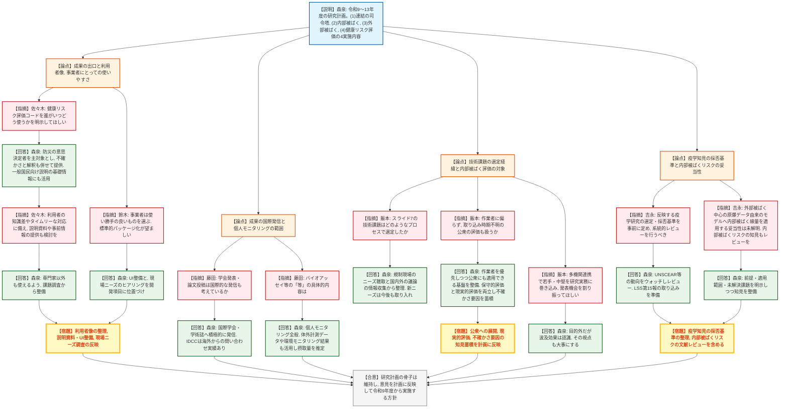
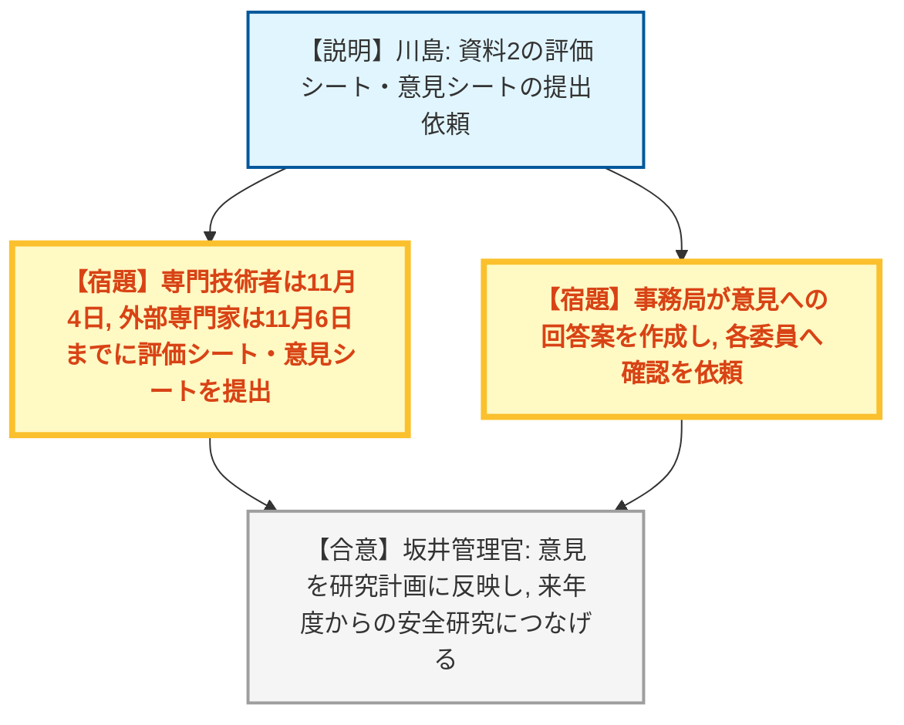

# 第3回放射線防護技術評価検討会（令和8年10月29日）
> 出典 : https://youtube.com/live/WEtSpWd0RiE?si=_VsckSy1xa0cvUBe

## 会合の概要
* **令和9〜13年度の新規安全研究プロジェクトの事前評価**
  原子力規制庁（放射線廃棄物研究部門）が、「放射線防護のための線量評価及び健康リスク評価の精度向上と放射線規制への展開に関する研究」の計画案を説明し、専門技術者3名・外部専門家2名が研究手法や成果の取りまとめ方の技術的妥当性を評価した。
* **「出口」と利用者像の明確化が最大の論点**
  電力中央研究所・東京電力・日本原子力研究開発機構（JAEA）の専門技術者は、放射線健康リスク評価コードや内部被ばく線量評価コード（IDCC）を「誰が・いつ・どう使うか」の明示と、事業者が現場で使いやすい標準的パッケージとしての整備を求めた。規制庁は、防災の意思決定者から事業者、一般国民への情報提供まで見据えると回答した。
* **研究テーマの選定経緯と内部被ばく評価の対象拡大**
  外部専門家の飯本氏（東京大学）は、技術課題の選定プロセスと、作業者に偏らない公衆の内部被ばく評価（取り込み時期不明に伴う不確かさへの対応）を確認した。規制庁は、規制現場のニーズ聴取と国際議論の動向把握から課題を導いており、公衆への展開も視野に入れ、保守的評価に加えて現実的評価も行うと答えた。
* **疫学知見の採否基準と内部被ばくリスクの扱い**
  外部専門家の吉永氏（広島大学）は、リスクモデルに反映する放射線疫学知見の選定基準を事前に定めること、および外部被ばく中心の原爆被爆者データ由来のリスクモデルへ内部被ばく線量を適用する妥当性の検証を求めた。規制庁は、国際機関の検討状況の調査とレビューを進め、LSS（寿命調査）第15報の取り込みを準備すると答えた。
* **全体として可否判定ではなく助言聴取。後日、評価シート・意見シートで回収**
  対立的な指摘はなく、各委員の意見は研究計画へ反映する方針が示された。評価シート・意見シートの提出期限は、専門技術者が11月4日、外部専門家が11月6日。

---

## 議題ごとの詳細整理

### 【議題1】安全研究プロジェクトの技術的観点からの評価（放射線防護のための線量評価及び健康リスク評価の精度向上と放射線規制への展開に関する研究　事前評価）
* **議論の背景と論点:**
  * **背景（規制課題）**
    * 我が国の放射線防護体系を、国際的に調和し最新の科学的水準に見合うものへ改善する必要がある（平成28年のIAEAによるIRRS指摘を受けた放射線規制の再構築が出発点）。
    * 放射線審議会ではICRP 2007年勧告等の国内法令への取り入れや、女性の放射線業務従事者の線量限度が議論されており、その審議に資する知見と技術基盤が必要。
    * 核融合など原子力・放射線利用の新たな展開を踏まえ、内部被ばくの遡及的線量評価に関する技術基盤の整備が喫緊の課題。
    * 外部被ばくでは、新たな実用量の将来的な導入の検討が必要。
    * 年齢・性別・健康状態等に応じた、定量的な放射線健康リスク評価が求められている。
  * **目的（研究計画の2本柱）**
    * 令和8年度までの成果の継続・発展として、内部被ばく線量評価コード（IDCC）と放射線健康リスク評価コードに最新知見を反映し、精度を向上させる。
    * 新規目標として、個人モニタリング、線量評価、リスク評価、防護措置の意思決定・災害対策に至る各要素を効果的に連結する知見・技術基盤を整備する。
  * **研究内容（令和9〜13年度の5年間、4実施内容）**
    * （1）放射線防護の各要素の効果的な連結に関する調査・研究（全体の司令塔。国内外の被ばく事故対応事例の調査から着手し、課題を（2）〜（4）へ反映する）。
    * （2）内部被ばく線量評価の精度向上と規制への展開（ICRP EIR Part 2・Part 3の取り込み、バイオアッセイ等の個人モニタリング研究、体内動態パラメータの最適化）。
    * （3）外部被ばく線量評価の知見整備（ICRP 2007年勧告の取り入れ、現行・新実用量に基づく測定の不確かさと、線量限度遵守における安全裕度の考え方の検討。新実用量の導入議論の本格化は2030年代以降と見込む）。
    * （4）放射線健康リスク評価の精度向上（最新の放射線疫学知見と国内の保健統計・がん統計の反映、不確かさの定量化、入出力インターフェースの整備）。
  * **成果の活用先**
    * 放射線審議会での審議、RI規制法・炉規法へのICRP 2007年勧告の取り入れ、濃度限度等の改正議論。
    * 実務者向けマニュアルの整備、災害対策における意思決定の参考情報の提供、原子力災害時の防護措置の考え方の検証。
  * **論点**
    * 健康リスク評価コードの出力の利用者像と、使いやすさ・説明責任を踏まえた実用化の水準。
    * 技術課題（スライド7）の選定経緯と、新たな国際的視点の取り込み方。
    * 内部被ばく評価の対象を作業者に限らず公衆へ広げるか。取り込み時期不明に伴う不確かさにどう向き合うか。
    * リスクモデルへ反映する疫学知見の採否基準と、内部被ばくのリスク評価の妥当性。
    * 成果の国際発信と、若手人材の育成。

* **質疑応答（詳細）:**
  **＜進め方の説明（事務局）＞**
    * 【事務局】平・川島（技術基盤課）
      研究手法や成果の取りまとめ方法等の技術的妥当性について、国内外の過去の研究・最新知見の反映、解析・実験手法の適切さ、重大な見落としや観点の欠落の有無といった観点で、専門技術者と外部専門家の意見を聴取するとした。質疑は専門技術者、外部専門家の順で、1質問ごとに回答を得る形で進めた。

  **＜専門技術者：電力中央研究所　佐々木氏＞**
    * 【専門技術者】佐々木（電力中央研究所）
      実施内容（1）が司令塔として（2）〜（4）の連結を進める構成は非常に良い取り組みと評価した。そのうえで、健康リスク評価コードの入出力インターフェースの検討にあたり、誰がいつどのような状況で使うのかを明示すれば、規制以外の出口（社会への役立ち）も見えやすくなると指摘した。
    * 【説明者側】森泉（規制庁　放射線廃棄物研究部門）
      このコードは規制庁や研究者だけが使うものではなく、原子力・放射線災害対策の準備や事後対策で意思決定を行う方々が、リスクを定量的に把握するために使うものと説明した。単純なリスク増分の数値だけでなく、不確かさと、その見方・解釈の情報も併せて提供する。さらに、出力情報を整理して、一般国民や地域住民への分かりやすい説明資料の基礎とすることも想定している。
    * 【専門技術者】佐々木（電力中央研究所）
      利用者は知識や背景が様々で、事後対応ではタイムリーな判断も求められる。コードに加えて説明資料や事前の情報提供のあり方も、（1）が（2）〜（4）や他との連携を含めて検討することを期待すると述べた。
    * 【説明者側】森泉（規制庁）
      専門家以外も有効に使えるよう、課題の調査から着手して整備を進めると回答した。

  **＜専門技術者：東京電力ホールディングス　鈴木氏＞**
    * 【専門技術者】鈴木（東京電力ホールディングス）
      福島第一事故以降、事業者を取り巻く環境と放射線場が大きく変わっている。事案発生時に事業者は使い勝手の良いものを選ぶ傾向があり、現状は表計算ソフトによる計算も多い。IDCCや健康リスクコードが標準的なパッケージとして整備されていれば使いやすく、トラブル時に説明責任を果たし社会の安心を得るうえでも望ましい、とコメントした。取り組みの発信と社会の理解も重要と述べた。
    * 【説明者側】森泉（規制庁）
      現場での使い勝手は非常に重要と認識している。現在もユーザーインターフェースの整備を検討しており、出力数値の解釈に必要な情報も添えて提供する必要があると考える。令和9年度からの計画にも、コードの使い勝手に関するヒアリングなど現場のニーズ調査と、その反映を開発項目として位置づけていると回答した。
    * 【専門技術者】鈴木（東京電力ホールディングス）
      研究にとどまらず、実用できる水準まで持っていくことが重要で、使う側にとっても有益と述べ、協力する意向を示した。

  **＜専門技術者：日本原子力研究開発機構　藤田氏＞**
    * 【専門技術者】藤田（JAEA）
      スライド13・14で研究計画と成果の出し方が明示されており、現場側として何を考えるべきかが分かり、ありがたいと評価した。そのうえで、学会発表や論文投稿は国内だけでなく、考え方が国際的に受け入れられることを見据えた国際的な発信も考えているのかを質問した。
    * 【説明者側】森泉（規制庁）
      国際学会・国際学術誌への投稿は積極的に行う。IDCCについても、過去の国際会議での発表に対して海外から問い合わせがあったとし、国際的な活用も十分可能と考えていると回答した。
    * 【専門技術者】藤田（JAEA）
      スライド10の「バイオアッセイ等の個人モニタリングに関する研究」の「等」にはどのようなことを想定しているのか、現時点のアイデアを質問した。
    * 【説明者側】森泉（規制庁）
      最終的には個人モニタリング全般に対応したい。具体的には、ホールボディカウンタ等によるガンマ線放出核種の体外計測データの活用や、取り込み事故現場の環境モニタリング結果からの摂取量推定を挙げた。それらに基づいて線量評価を行い、さらにリスク評価につなげる。藤田氏は、必要なものを多様な視点で扱うと分かり了解した。

  **＜外部専門家：東京大学　飯本氏＞**
    * 【外部専門家】飯本（東京大学）
      スライド7の技術課題には、現行研究の継続・発展分と新たな視点のものが混在している。オールハザードやホリスティックといった近年の世界的なキーワードもあるなか、次の5年で扱う課題をどのようなプロセスで選んだのか、経緯と考え方を質問した。
    * 【説明者側】森泉（規制庁）
      技術課題は、規制課題を解決するために必要な技術という観点から整理した。規制現場を担当する部門のニーズを聴取してまとめたものである。あわせて、本プロジェクトとは別に国内外の議論を情報収集しており、オールハザード・ホリスティックの考え方も福島第一事故後の教訓から注目されてきたものとして把握している。今後新たなニーズが出れば研究に取り入れていくと回答した。
    * 【外部専門家】飯本（東京大学）
      内部被ばくは核融合のトリチウム、再処理の稼働、医療用放射性物質の利用などで取り込むべき課題が多く、テーマ選定は重要と評価した。一方、説明は作業者の線量評価に重点があるように聞こえたとして、いつどのように吸入・摂取したか分かりにくい公衆の被ばくがこの研究に入るのかを質問した。不確実な要素が多く、結果として安全裕度が大きな評価になりがちである点にも言及した。
    * 【説明者側】森泉（規制庁）
      大量の放射性核種を扱う施設での取り込みの可能性を踏まえ、まず作業者の評価体制・技術基盤の整備を優先するが、公衆を視野から外してはおらず、将来公衆にも適用できる基盤にする。最大の不確かさ要因は取り込み時期・経路が不明なことである。予防的措置には最大線量となる条件での評価が有効だが、実際に被ばくが起きた場合は最も現実的にありそうな線量も重要で、保守的評価と現実的評価の両方が必要と述べた。不確かさ要因の知見を蓄積すれば、線量の幅や解釈、不確かさを小さくする測定・モニタリングの準備にもつながるとした。
    * 【外部専門家】飯本（東京大学）
      評価値は放射線防護上のメッセージにもなるため、公衆を含めて数値の信頼性を高める努力が必要と述べた。また、公衆の課題全体の解決は難しいため、作業者の評価を進めつつ並行して論点だけでも整理すれば、規制研究として十分役立つとした。
    * 【外部専門家】飯本（東京大学）
      （要望）少人数の実働メンバーで丁寧に対応している規制庁の放射線防護研究を評価している。人材確保・育成が重要になるなか、委託・共同研究、外部調査などを組み合わせ、できるだけ多くの機関と組んで若手・中堅を研究実務に巻き込み、学会発表や論文執筆の機会を割り振って動機づけしてほしいと求めた。
    * 【説明者側】森泉（規制庁）
      人材育成は本プロジェクトの目的・スコープには入っていないが、庁内の研究職だけでは実施できないテーマであり、国内外の専門家の協力を得ながら進める。そのなかで若い世代に機会を与えられる波及効果は認識しており、計画の目的ではないものの、その視点も大事にすると回答した。

  **＜外部専門家：広島大学　吉永氏＞**
    * 【外部専門家】吉永（広島大学）
      スライド12の放射線健康リスク評価の精度向上について、反映する放射線疫学研究の検討対象とする範囲や、反映の可否を決める基準を事前にある程度定めておくべきと指摘した。主体は原爆被爆者の寿命調査（LSS）や世界の放射線作業従事者の大規模国際研究と想定されるが、系統的レビューで採否を専門的に評価するのかを確認した。
    * 【説明者側】森泉（規制庁）
      指摘のとおりと考える。UNSCEAR等の国際的な検討の場の状況を研究計画のなかで継続的に把握し、報告書や論文について精度・確かさ・適用可能範囲をレビューして整理する。コンセンサスが多く得られたモデルから取り入れていく方針とした。直近ではLSS第15報が近年中に公表される見込みであり、その取り込みを準備すると回答した。
    * 【外部専門家】吉永（広島大学）
      外部被ばくが中心の原爆被爆者の疫学データから開発されたリスク評価コードに内部被ばく線量をそのまま使うことは、内部被ばくの線量反応・リスクモデルが外部被ばくと一致するのかが科学的に十分分かっていない以上、慎重に扱うべきと指摘した。内部被ばくリスクに関する疫学知見も系統的にレビューし、精度向上への反映可能性を検討する材料に含めてほしいと求めた。
    * 【説明者側】森泉（規制庁）
      疫学に限らず、知見には議論中のものや未解明の点、前提・適用可能範囲があることを常に念頭に置いてレビュー・理解に努める。国内外の研究者との意見交換や学会発表を通じて情報を収集し、未解決の課題も明示しながら、コードの開発とコードが出力するリスクの解釈のための知見を整備すると回答した。

* **結論と宿題事項（アクションアイテム）:**
  * **決定事項:** 本検討会は可否を決める場ではなく、事前評価に向けた専門的助言の聴取である。いただいた意見は研究計画に反映し、令和9年度からの安全研究につなげる方針が、規制庁の坂井管理官から示された（予算の移管手続き等は今後の工程として残る）。研究計画の骨子（4実施内容と、(1)を司令塔とする連結構造）自体に対する反対意見は出ていない。
  * **宿題事項（研究計画に反映すべき意見）:**
    1. 健康リスク評価コードの利用者像（防災現場の意思決定者、事業者、一般国民）と利用場面を整理し、説明資料や事前の情報提供も含めて検討すること。
    2. 事業者が現場で使いやすい標準的パッケージとして整備するため、ユーザーインターフェースの整備と、ヒアリングによる現場ニーズの調査・反映を行うこと。
    3. リスクモデルに取り入れる疫学知見の選定・採否基準を整理し、LSS第15報の取り込みを準備すること。また、内部被ばくリスクに関する疫学知見のレビューも含めること。
    4. 内部被ばく評価では、作業者を優先しつつ公衆への適用を見据え、保守的評価に加えて現実的評価、および不確かさ要因に関する知見の蓄積を進めること。
    5. 国際学会・国際学術誌への発信を積極的に行うこと。
    6. 若手・中堅の研究参加の機会に配慮すること（計画の目的外だが、規制庁として大事にする意向を表明）。

---

### 【議題2】その他
* **議論の背景と論点:**
  * **背景**
    * 事前評価のため、検討会後に専門技術者・外部専門家から評価シート・意見シート（資料2）を提出してもらう手続きの案内。
  * **論点**
    * 提出期限と、その後の回答案確認の進め方。

* **質疑応答（詳細）:**
    * 【規制側】坂井（規制庁　安全技術管理官（放射線廃棄物担当））
      多くの質問・意見への謝意を述べたうえで、いただいた意見は研究計画に反映して来年度からの安全研究につなげる、基本的には本日説明した方針のもとで進める、と挨拶した。意見への回答も改めて確認してもらうよう依頼した。
    * 【事務局】川島（技術基盤課）
      資料2の評価シート・意見シートは、専門技術者は11月4日まで、外部専門家は11月6日までに事務局へ送付すること。いただいた意見に対しては回答案を作成し、各委員へ確認の連絡をするとした。

* **結論と宿題事項（アクションアイテム）:**
  * **決定事項:** 上記の手続きで進め、第3回放射線防護技術評価検討会は終了した。
  * **宿題事項:**
    1. 専門技術者は11月4日まで、外部専門家は11月6日までに、評価シート・意見シートを事務局へ提出すること。
    2. 事務局は、いただいた意見への回答案を作成し、各委員へ確認を依頼すること。

---

## 論理構造の可視化（Mermaid）

### 【議題1】安全研究プロジェクトの技術的観点からの評価（事前評価）

### 【議題2】その他

