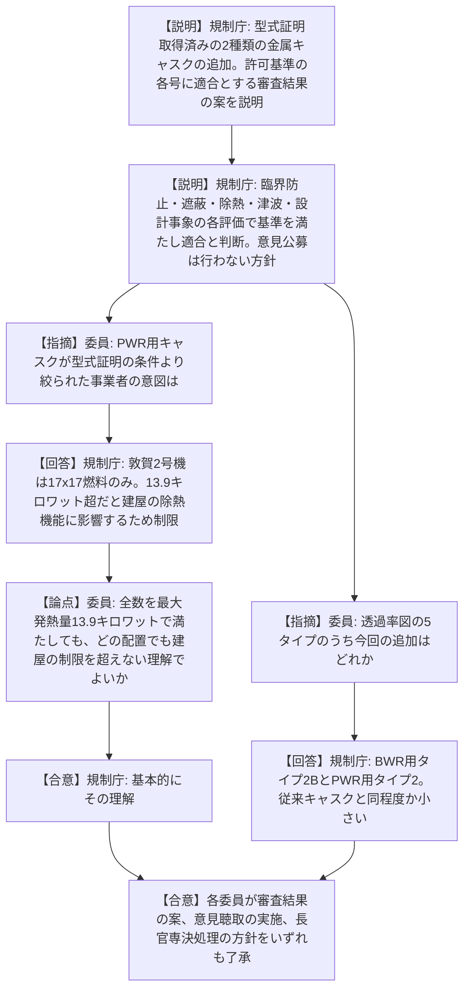
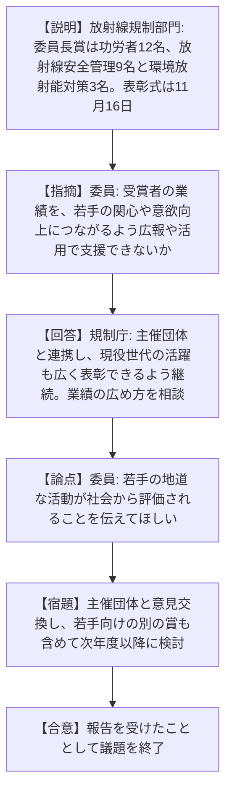
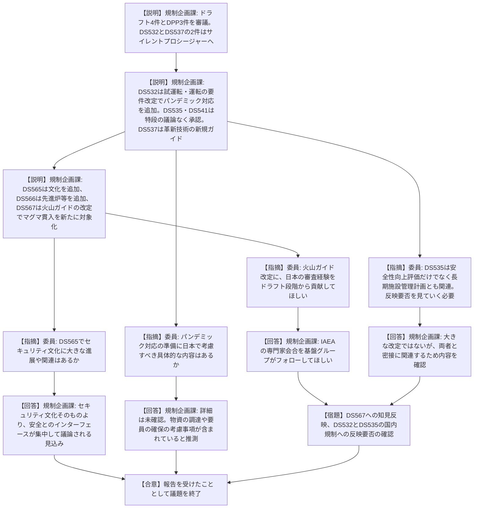

# 第40回原子力規制委員会（令和8年11月4日）
> 出典 : https://youtube.com/live/z9LQgc5NPPs?si=n5wOwZt2HoOMlHcR

## 会合の概要
* **リサイクル燃料備蓄センターへの型式証明取得済み金属キャスク2種類の追加は、審査結果の案を全会一致で決定**
  型式証明で適合性確認済みの金属キャスク（東京電力柏崎刈羽のBWR燃料用と、日本原電の敦賀2号機のPWR燃料用）の追加であり、科学的・技術的意見の募集は行わないこととした。委員からは、PWR用キャスクの使用条件が型式証明より絞られた理由、および透過率図の対象キャスクの確認が行われたが、異論はなく、原子力委員会・経済産業大臣への意見聴取の実施も決定した。
* **許可処分は、意見聴取で特段の意見がなければ原子力規制庁長官の専決処理で行う方針を了承**
  意見聴取の結果、許可に特段の意見がない場合は、委員会へ改めて付議せず長官専決で処分する運用が、各委員から異論なく了承された。
* **放射線安全管理・環境放射能対策功労の表彰：委員から「若手の意欲向上につながる取組」を求める声**
  委員長賞受賞者は功労者12名（放射線安全管理9名、環境放射能対策3名）で、表彰式は11月16日に予定されている。受賞者が高齢層に偏りがちな点を踏まえ、委員から、若手の活動を評価し関心を高める広報や活用への協力が提案された。委員長は、次年度以降に別の賞も含めて主催団体と意見交換して検討するよう促した。
* **IAEA安全基準委員会（CSS）第60回会合：要件文書2件を含む基準案が審議され、2件はサイレントプロシージャーへ**
  DS532（試運転・運転の要件）とDS537（革新技術の安全性実証）の2件は、会合での確認が尽くせず書面手続に回った。火山ハザードのガイド（DS567）の改定開始については、日本の審査経験を早い段階から反映するよう委員が強く求めた。

---

## 議題ごとの詳細整理

### 【議題1】リサイクル燃料貯蔵株式会社リサイクル燃料備蓄センター使用済燃料貯蔵事業変更許可申請書に関する審査の結果の案の取りまとめ－型式証明を受けた金属キャスクの追加－（資料1）
* **議論の背景と論点:**
  * **背景**
    * 令和8年4月9日、リサイクル燃料貯蔵から、原子炉等規制法に基づく使用済燃料貯蔵事業の変更許可申請書が提出された。
    * 審査会合（杉山委員が担当）を2回開催し、9月29日に補正書が提出された。
    * 申請内容は、型式証明を受けた2種類の金属キャスクの追加である（東京電力柏崎刈羽のBWR燃料用と、日本原電の敦賀2号機のPWR燃料用）。
  * **経緯**
    * 型式証明で金属キャスク本体の適合性は確認済みのため、その部分の審査は省略し、型式証明からの引き継ぎ事項を含めて適合性を審査した。
    * 既許可の3種類のうち2種類は、前回の変更許可でも型式証明を受けたものを追加しており、今回も同一の変更内容である。
  * **論点**
    * 許可基準への適合（事業目的以外の利用のおそれ、技術的能力、経理的基礎、災害の防止、品質管理）の確認結果。
    * 災害の防止に関する個別評価（臨界防止、遮蔽、除熱、津波、設計事象としての転倒等）。
    * 審査結果の案の決定、原子力委員会・経済産業大臣への意見聴取の実施決定、および許可処分を長官専決とする扱いの了承。

* **質疑応答（詳細）:**
  **＜審査結果の案の説明＞**
    * 【説明者側】木原企画調査官（核燃料施設審査部門）
      審査結果の案（別紙1）は、金属キャスクの種類の追加であり事業の目的の変更はないことから、使用済燃料貯蔵施設が目的以外に利用されるおそれはないとした。技術的能力は、受入れ・貯蔵の業務に変更がなく、組織や技術者の確保、品質保証活動等も確認し、必要な能力があると認めた。経理的基礎は、東京電力・日本原電との役務契約が継続しており、資金調達も従来どおりであることを確認した。品質管理体制も従来の許可から変更がなく、基準に適合するとした。
    * 【説明者側】木原企画調査官（核燃料施設審査部門）
      型式証明を受けた金属キャスクの追加で、科学的・技術的に重要な判断を伴わないことから、審査結果の案について科学的・技術的意見の募集は行わないこととしたい。決定を得た場合は、原子力委員会（別紙2）と経済産業大臣（別紙3）への意見聴取を実施し、結果に特段の意見がなければ長官専決で処分することの了承を求めた。
    * 【説明者側】尾崎主任安全審査官（核燃料施設審査部門）
      PWR用キャスクは、型式証明を受けた設計のうち17×17燃料のみを収納し、最大崩壊熱量も13.9キロワットに制限して貯蔵する。既許可の3種類のうち2種類は前回も型式証明取得済みのものを追加しており、今回も同一の変更内容である。
    * 【説明者側】尾崎主任安全審査官（核燃料施設審査部門）
      臨界防止は、型式証明を受けたキャスクを複数貯蔵しても臨界のおそれがないことから適合とした。遮蔽は、γ線・中性子線が貯蔵建屋のコンクリート壁を透過する率が、赤線で示した基準を追加キャスクはいずれも下回り、敷地周辺の線量が線量告示の限度である年間1ミリシーベルトを超えないことを確認した。
    * 【説明者側】尾崎主任安全審査官（核燃料施設審査部門）
      除熱は、追加する2種類を貯蔵した場合の貯蔵建屋の評価部位の温度がいずれも基準温度を下回り、建屋が金属キャスクの除熱機能を阻害しないことを確認した。津波は、平成31年に原子力規制委員会が決定した審査方針（津波で貯蔵建屋が損傷しても、損傷後1年間の敷地境界線量が1ミリシーベルトを超えない）に基づいて評価し、いずれも基準値を超えないことを確認した。
    * 【説明者側】尾崎主任安全審査官（核燃料施設審査部門）
      設計事象については、追加キャスクの転倒等を評価し、公衆に放射線被ばくのリスクを及ぼすおそれがないことを確認して適合とした。

  **＜PWR用キャスクの使用条件を絞った意図＞**
    * 【規制側】委員
      質問ではなく確認として、型式証明の条件より絞った条件で今回申請されたPWR用キャスクについて、事業者側の意図を説明してほしい。
    * 【説明者側】尾崎主任安全審査官（核燃料施設審査部門）
      収納する燃料が敦賀2号機のもので、17×17燃料のみであるため、それに合わせて燃料の仕様を絞っている。13.9キロワットへの制限は、これを超えると貯蔵建屋の除熱機能に影響が出るおそれがあるためであり、型式証明の設計内容を一部制限する形になっている。
    * 【規制側】委員
      今回の制限値に絞ることで、貯蔵容量の全てを最も発熱量が高い13.9キロワットのキャスクで満たしても建屋の制限値を超えず、どの配置でも超えようがないという理解でよいか。
    * 【説明者側】尾崎主任安全審査官（核燃料施設審査部門）
      基本的にその理解である。

  **＜透過率図で今回扱うキャスク＞**
    * 【規制側】委員（上記とは別の委員）
      28ページの透過率の図には5タイプのキャスクが示されているが、今回追加するのはこのうちどれか。
    * 【説明者側】尾崎主任安全審査官（核燃料施設審査部門）
      下の2つで、BWR用キャスクのタイプ2Bと、PWR用キャスクのタイプ2である。図では色の区別が見にくいが、この2種類が今回の追加分である。
    * 【規制側】委員（上記と同じ委員）
      従来から受け入れが決まっているキャスクと同程度か、それより小さい透過率で示されていると理解した。これで結構である。

  **＜委員の所見と決定＞**
    * 【規制側】委員
      従来の許可で行った審査と類似の審査が行われており、特段の問題はないと考える。
    * 【規制側】山中委員長
      本申請は科学的・技術的に重要な判断を伴わないとして意見公募は行わず、別紙1のとおり審査結果の案を取りまとめることと、別紙2・別紙3のとおり原子力委員会・経済産業大臣への意見聴取事項を決定し実施することについて、各委員に諮った。各委員はいずれも決定してよいと答えた。
    * 【規制側】山中委員長
      意見聴取の結果、許可することに特段の意見がなければ、長官専決処理で行う方針について了承を諮り、委員から了承の意が示されたため、その方針を了承した。

* **結論と宿題事項（アクションアイテム）:**
  * 科学的・技術的意見の募集は行わず、別紙1のとおり審査結果の案を取りまとめることを決定した。
  * 別紙2・別紙3のとおり、原子力委員会および経済産業大臣への意見聴取を実施することを決定した。
  * 意見聴取の結果、許可することについて特段の意見がなければ、原子力規制庁長官の専決処理で変更許可の処分を行う方針を了承した。
  * 宿題事項は特に示されていない。

---

### 【議題2】令和8年度放射線安全管理功労・環境放射能対策功労表彰の受賞者（資料2）
* **議論の背景と論点:**
  * **背景**
    * 公益財団法人原子力安全技術センター、公益社団法人日本アイソトープ協会、公益財団法人日本分析センター、放射線障害防止中央協議会の主催団体が、放射線安全管理や環境放射能対策で優れた成果を挙げた人に、原子力規制委員会委員長賞を授与する。
  * **経緯**
    * 本表彰は昨年度から復活した制度である。今年度は4月から6月末まで推薦を募り、主催団体の表彰委員会が、放射線安全管理功労者9名、環境放射能対策功労者3名の委員長賞受賞を決定した。
    * 表彰式は11月16日（月）10時30分から予定されている。
  * **論点**
    * 表彰の目的である「関係者の意欲向上」「国民理解の増進」に向け、規制庁が広報や活用でどう協力するか。
    * 受賞者が高齢層に偏りがちな中で、若手の関心や意欲向上にどうつなげるか。

* **質疑応答（詳細）:**
  **＜報告＞**
    * 【説明者側】長田補佐（放射線規制部門）
      主催団体が選んだ功労者12名（放射線安全管理9名、環境放射能対策3名）の委員長賞授与を、報告事項として説明した。表彰者の選考要領は別紙に記載され、表彰式は11月16日10時30分から実施する。

  **＜若手の意欲向上に向けた協力＞**
    * 【規制側】委員
      受賞者は、安全管理や環境モニタリング、研究・技術開発、教育、行政支援で長年優れた成果を挙げ、我が国の放射線安全管理・環境放射能対策の向上に貢献した先生方である。表彰の目的に「関係者の意欲向上」「国民理解の増進」があることから、規制庁側も広報や活用でさらに協力し、若い方の業務への関心や意欲向上につなげられないか。
    * 【説明者側】長田補佐（放射線規制部門）
      表彰は功績のあった方々を対象とするため、選考過程でどうしても高齢の方が多くなる。現在、分野の第一線で活躍する方々も広く受賞できるよう、また表彰が意欲向上につながるよう、主催団体と連携して継続したい。
    * 【説明者側】川口監視情報課長（放射線防護グループ）
      特に環境放射能対策では、長年の調査研究を経て受賞された方が多く、どのような業績かを広く知ってもらうことが重要である。主催団体と相談し、その業績を広める方法があるか検討する。
    * 【規制側】委員
      直接的な意欲向上にはつながらないかもしれないが、若い方々の地道な活動が社会から評価されるものだということを伝えてほしい。
    * 【規制側】山中委員長
      昨年からの表彰の復活は、功労者の長年の貢献を表彰する趣旨で始めた。委員の指摘のとおり、若手や放射線管理を担う方々を励ます意味でも、主催団体との意見交換を踏まえ、従来にはなかった全く別の賞を考えることもあり得る。次年度以降の検討を求めた。

* **結論と宿題事項（アクションアイテム）:**
  * 本件は報告を受けたこととして、議題を終了した。
  * 宿題：規制庁は、主催団体と意見交換し、若手の意欲向上につながる取組（受賞者の業績の広報、別の賞の可能性を含む）を次年度以降に検討する。

---

### 【議題3】国際原子力機関（IAEA）安全基準委員会（CSS）第60回会合結果概要（資料3）
* **議論の背景と論点:**
  * **背景**
    * 先々週にウィーンで開催されたCSSで審議された基準案について、定例報告として説明された。
    * 審議対象はドラフト4件（DS532、DS535、DS537、DS541）と文書作成計画書（DPP）3件（DS565、DS566、DS567）である。要件文書はDS532とDS565（GSR Part 2の改定）の2件で、残りはガイド文書であり、DS537のみが新規である。
  * **経緯**
    * 通常はCSSの場で承認されるが、今回は2件（DS532、DS537）が、書面でコメントを集め、なければ承認とするサイレントプロシージャーに回された。
    * DS532は、会合中に一委員から書きぶりへのコメントがあり、関係者で議論して元の文書に戻す結論としたが、念のため同手続とした。DS537は、期限後に多数のコメントが寄せられ、IAEA事務局の改定案をその場で確認しきれなかったため同手続とした。
  * **論点**
    * 国内規制への関係（SSR-2/2は事業者向けの要件、DS535は安全性向上評価と長期施設管理計画に関連、DS567は火山ガイドのベース文書の改定）。
    * 火山ハザードのガイド改定（DS567）への日本の知見の反映。
    * 安全文化とセキュリティ文化、パンデミック対応など、新たに盛り込まれる内容。

* **質疑応答（詳細）:**
  **＜個別基準の概要＞**
    * 【説明者側】山田情報分析官（原子力規制企画課）
      DS532は、2016年にリビジョン1が出たSSR-2/2（試運転及び運転）の改定である。その後に改定された基準文書との整合と、積み上がった知見の反映を行い、コロナを経験したことを踏まえたパンデミック対応の準備の推奨事項を新たに追加した。サイレントプロシージャーに回った1件はこの文書である。
    * 【説明者側】山田情報分析官（原子力規制企画課）
      DS535は、2013年発行のSSG-25（定期安全レビュー）の改定で、その後に改定された文書との整合を取るもので、特段の大きな議論なく承認された。DS537は、SMR（小型モジュール炉）や先進炉、革新的製造技術に対応した新規ガイドである。経験の蓄積不足、既存の安全ガイドの不備、安全評価用解析コードの整備不足といった課題への対応方法を示す。
    * 【説明者側】山田情報分析官（原子力規制企画課）
      DS541は、2011年発行のSSG-18（気象・水文ハザード）の改定で、1F事故の教訓を反映する。ハザード推定の不確実性、設計基準を超える外部事象への安全裕度の考慮、複数ハザードの組合せに関する推奨事項を取り込み、特段の大きな議論なく承認された。
    * 【説明者側】山田情報分析官（原子力規制企画課）
      DPPのDS565は、GSR Part 2の改定で、タイトルを「安全のためのリーダーシップ、マネジメント及び文化」へ変更し、従来入っていなかった「文化」を加える。日本が今年1月に受け入れたIRRSでもマネジメントシステムの指摘が多かったことから、内容を明確化・強化する方向で進める。全員の支持を得て計画は承認された。
    * 【説明者側】山田情報分析官（原子力規制企画課）
      DS566は、2015年発行のSSG-28（試運転）の改定で、先進炉やデジタル計装制御の推奨事項を加える。SSR-2/2の改定との整合も取る。DS567は、2012年発行のSSG-21（火山ハザード）の改定で、1990年代の知見に基づく現行ガイドでは扱っていない、貫入した火成岩のマグマが地下施設に影響する事象を新たに対象とし、放射性廃棄物処分施設もタイトルに追加する。いずれも特段の異論なく承認された。
    * 【説明者側】山田情報分析官（原子力規制企画課）
      国内規制との関係では、SSR-2/2は事業者向けの要件であり、国内の法令・規定に反映すべき点があるかの観点で見直しが必要かもしれない。DS535のベースであるSSG-25は、安全性向上評価のガイドとして直接引用しているため、反映点の確認が必要である。DS567は、国内の火山ガイドがSSG-21をベースに作られていることから、今後の内容を十分にフォローする必要がある。

  **＜火山ハザードのガイド改定への貢献＞**
    * 【規制側】委員
      火山関係は審査の中で苦労も含めて経験を積み、うまくいっている部分もあるため、その経験をSSG-21の改定作業に日本としても貢献してほしい。ドラフトの段階から早くIAEAと協力するのがよい。
    * 【説明者側】山田情報分析官（原子力規制企画課）
      今後の作業の進め方はまだはっきりしていないが、通常IAEAはコンサルタンシーミーティング（専門家会合）を開くので、基盤グループがそこでしっかりフォローしてほしい。

  **＜DS535と長期施設管理計画＞**
    * 【規制側】委員
      DS535（SSG-25の改定）は、安全性向上評価だけでなく長期施設管理計画とも関わりが深い。大きな改定や追加事項があれば、必要に応じて国内に反映する必要があるため、その観点でも見ていく必要があると考える。
    * 【説明者側】山田情報分析官（原子力規制企画課）
      あまり大きな改定ではないと考えるが、指摘のとおり安全性向上評価だけでなく長期施設管理計画とも密接に関連するため、中身をよく確認する必要がある。

  **＜DS565におけるセキュリティ文化の扱い＞**
    * 【規制側】委員
      現行のGSR Part 2には、安全文化とセキュリティ文化の考え方を共有・融合するよう求める要件がある。今回の安全文化に関する検討で、セキュリティ文化について大きな進展があり、それが反映されたり、関連性があったりするのか。
    * 【説明者側】山田情報分析官（原子力規制企画課）
      IAEA文書ではセキュリティシリーズとセーフティシリーズが別の扱いだが、両者のインターフェースは安全分野の議論の中で取り扱う必要があり、IRRSでもモジュールとして位置づけられている。基本は両者が互いを損なわないようにすることで、今回の見直しでは、セキュリティ文化そのものよりインターフェースへの対応が集中して議論されるとみている。

  **＜パンデミック対応の内容＞**
    * 【規制側】委員
      DS532に加えたパンデミック対応の準備について、日本で考えておくべき具体的な内容は含まれるのか。
    * 【説明者側】山田情報分析官（原子力規制企画課）
      文書を細かく確認していないため具体的な紹介はできないが、パンデミック下でも事業を継続する必要があることから、物資の調達や要員の確保などについての考慮事項が含まれていると考える。

* **結論と宿題事項（アクションアイテム）:**
  * 本件は報告を受けたこととして、議題を終了した。
  * 宿題：DS567（火山ハザード）の改定作業へ、日本の審査経験を反映するよう、IAEAの専門家会合への対応を進める。
  * 宿題：DS532（SSR-2/2）の国内法令・規定への反映要否、DS535（SSG-25）の安全性向上評価・長期施設管理計画への反映要否を確認する。

---

## 論理構造の可視化（Mermaid）

### 議題1：リサイクル燃料備蓄センターの型式証明取得済み金属キャスク追加（審査結果の案）

### 議題2：令和8年度放射線安全管理功労・環境放射能対策功労表彰の受賞者

### 議題3：IAEA安全基準委員会（CSS）第60回会合結果概要

