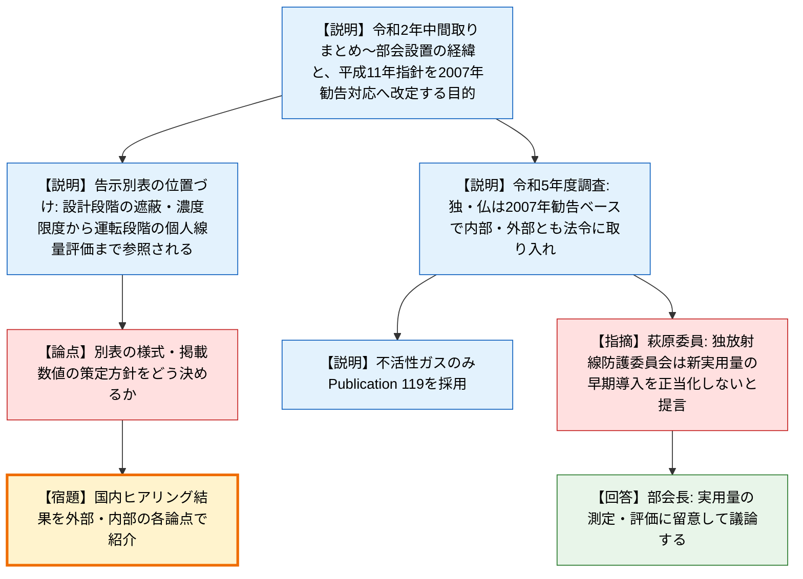
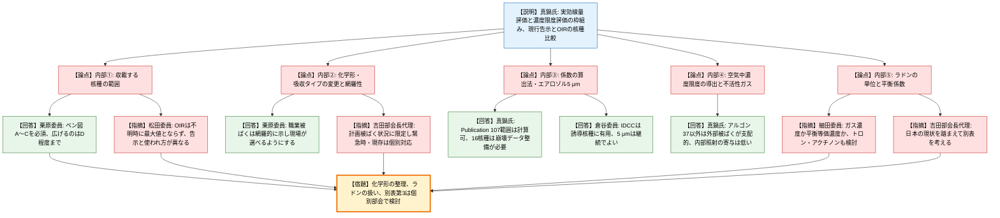
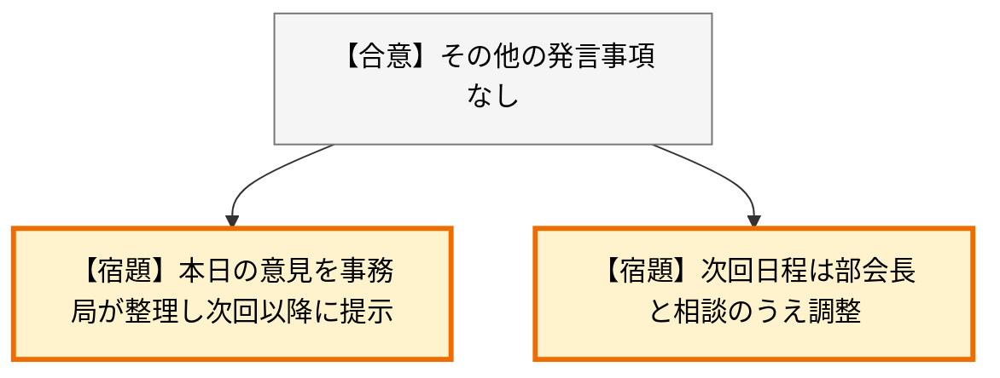

# 第2回放射線審議会外部被ばく・内部被ばくの評価法（実効線量係数等）に係る技術的指針合同検討部会（令和8年11月9日）
> 出典 : https://youtube.com/live/GhZPG2UlYiE?si=Su3P2zRYN56oqRyl

## 会合の概要
* **告示別表の「位置づけ」を踏まえ、ICRP2007年勧告取り入れ後の様式・掲載数値の策定方針を議論**
  事務局は、RI法の数量告示別表が施設の設計(遮蔽計算・濃度限度)から運転段階(個人線量評価)まで参照される基準であることを整理したうえで、外部被ばく4論点・内部被ばく5論点を提示した。前回部会で求められた海外(独・仏)の取り入れ状況と国内ヒアリング結果も共有された。
* **外部被ばくの最大の争点は「照射条件」と「エネルギー範囲の段差」**
  ICRP Publication 116では高エネルギー側で後方(PA)照射が最大となる。佐藤委員は、ICRU Report 95(H*)が最大値となる照射条件を採る考え方を既に採用している点を踏まえ、告示別表も最大値で揃えないと20 MeV付近で段差が生じると主張した。一方、吉田部会長代理は、告示別表の値が過大になると過度に厳しい規制になりうると慎重な整理を求めた。
* **「なぜ変えるのか」を説明できることが改訂の条件として強調された**
  小田委員らから、90年勧告と2007年勧告で線量限度や評価手法の骨格は変わっておらず、変更するなら理由を明確に説明できなければならないとの指摘が相次いだ。部会長も、規制する側・される側双方が納得できる整理が必要との認識を示した。
* **内部被ばくは「収載する核種・化学形」の範囲と、被ばく状況の整理が焦点**
  現行告示とOIRシリーズで核種の重なり・不一致があるため、栗原委員は、ベン図のA〜C(現行告示収載分を含む)を必須とし、広げるのはD程度までにとどめる案を示した。吉田部会長代理は、2007年勧告で「行為と介入」から「被ばく状況」に枠組みが変わった点を踏まえ、告示別表は計画被ばく状況を対象とすべきと整理した。ラドンは単位(ガス濃度か平衡等価濃度か)や日本の現状を踏まえた扱いが論点として挙がった。
* **本日は結論を出さず、意見を事務局が整理して次回以降に提示する運び**
  技術的指針に関わる詳細(モンテカルロ計算の指針整備等)は、外部被ばく・内部被ばくの個別部会で議論する方針が確認された。議題2(その他)での発言はなかった。

---

## 議題ごとの詳細整理

### 【議題1】実効線量係数等(ICRP2007年勧告の取り入れ)の検討状況

#### 1-A 検討経緯・告示別表の位置づけ・海外の取り入れ状況

* **議論の背景と論点:**
  * 背景: 令和2年の中間取りまとめで、外部被ばく・内部被ばく、職業被ばく・公衆被ばくの線量を同時に法令へ取り入れることが適当とされ、令和7年2月に部会の設置が決定した。
  * 経緯: 平成11年の技術的指針(1990年勧告対応)を2007年勧告対応へ改定する作業の一環で、合同部会は共通論点・基本方針を扱い、詳細は個別部会で進める体制となっている。
  * 論点: 今回は、告示別表(RI法数量告示)の様式と掲載数値の策定方針を議論する。外部被ばく4論点、内部被ばく5論点に整理し直した。
  * 位置づけ: 告示別表は、施設設計段階での遮蔽計算・線量評価、排気中・排水中の濃度限度、運転段階での個人線量や摂取量に基づく内部被ばく評価に使われる。
  * 海外動向: 令和5年度調査(2024年1月時点)で独・仏は2007年勧告に基づく係数を法令に取り入れていた。

* **質疑応答(詳細):**
    * 【事務局】
      令和5年度の調査では、英・独・仏・加・韓のうち、独・仏が内部被ばくの計算規定と線量係数を2007年勧告ベース(OIRシリーズと比較検証したもの)で法令に規定していた。外部被ばくは事務局が追加確認し、独・仏とも2007年勧告の荷重係数・導出法を採用、仏はPublication 116の換算係数を使用、測定量は両国とも従来のICRU Report 57/Publication 74の実用量を採用していた。不活性ガスのみPublication 119(1990年勧告ベースの線量係数要覧)を使っている。
    * 【萩原委員(QST)】
      2026年7月にドイツ放射線防護委員会が、ICRU Report 95の新しい実用量の導入は便益が作業量・費用に比べ不十分として早期導入を正当化しないと提言した。ドイツは今後も従来の実用量を使う方針である。
    * 【部会長(高橋)】
      外部被ばくの検討では、実用量を実際に測定して線量を評価することに十分留意しなければならない。萩原委員の情報も参考に議論を進める。

* **結論と宿題事項(アクションアイテム):**
  * **決定事項:** 海外調査結果(独・仏の取り入れ状況)と告示別表の位置づけについて、特段の異論なく共有された。
  * **宿題事項:** 前回要望のあった国内ヒアリング結果は、外部・内部の各論点の説明の中で紹介することとされた。

#### 1-B 外部被ばくの評価法に係る技術的事項(外部①〜④)

* **議論の背景と論点:**
  * 背景: 現行告示は光子(別表第5)10 MeVまで、中性子(別表第6)20 MeVまでを規定し、範囲外は個別審査としている。電子は規定していない。Publication 116では線種が大幅に増え、エネルギー範囲も拡張された。
  * 論点(外部①②): 遮蔽計算での重要性を踏まえ、追加すべき線種と採用するエネルギー範囲をどうするか。
  * 論点(外部③): 光子は現行が空気カーマ当たりの実効線量のみだが、Publication 116ではフルエンス当たりも与えられた。追加の要否が問われる。
  * 論点(外部④): 現行はAP(前方)照射の値を引用するが、高エネルギー側ではPA(後方)照射の値が大きくなる。各エネルギーで最大となる照射条件を採るか、エネルギー間の内挿との整合をどうするかが問われる。
  * ヒアリング・文献: 多くの施設は線種追加・範囲拡張を不要と回答した。加速器の遮蔽では光子・中性子が中心で、100 MeV以上の電子加速器ではミュオンも重要になりうる。20 MeVを超える中性子が問題となるのは高エネルギー加速器施設に限られる。

* **質疑応答(詳細):**
    * 【事務局】
      Publication 116の追加線種のうち、遮蔽計算での重要性から必要な線種を絞り込めるかを論点とする。光子のフルエンス換算係数は現場から合理的との意見があり、照射条件は過小評価の懸念も出ている。
    * 【栗原委員】
      管理区域境界や敷地境界で問題になる線種は、結局中性子と光子だろう。Publication 116は多くの線種を整備しているが、告示別表に何を入れるかは整理した方がよく、あまり盛り込みすぎるべきではない。
    * 【萩原委員(QST)】
      栗原委員に同意する。高エネルギー加速器では多くの二次粒子が生成され、最終的に遮蔽体後で問題になるのは光子・中性子だが、そこに至る評価には換算係数だけでは足りず、モンテカルロ計算など高度な評価が必要となる。範囲外は個別審査という扱いは重要であり、モンテカルロ計算に関する技術的指針も併せて整理して個別審査に対応できるようにするのがよい。
    * 【藤淵委員(九州大学)】
      範囲外を施設ごとに独自評価すると、値が施設によってばらつくことが懸念される。また、換算係数は主に遮蔽計算で使うが、それ以外の被ばく評価での使用場面があるのか、あるなら光子・中性子だけでよいのか知りたい。
    * 【部会長(高橋)】
      告示別表への取り入れとは別に、Publication 116を我が国の防護の仕組みの中でどう活用するかの問題である。統一的な換算係数があるなら使うべきで、現行の技術的指針でもICRU Report 57の換算係数を使うと示しているので、その方向で検討する。
    * 【佐藤委員】
      20 MeV以下を告示別表に入れること自体はよいが、高エネルギーを技術的指針で扱うなら、AP照射が最小になる領域との間に段差ができないよう整合を取る必要がある。ICRU Report 95のH*も実効線量が最も高い照射条件で定義されており、導入は今でなくとも、最大値を採るという概念は既に定義されているので、最大値を採用すべきだ。
    * 【部会長(高橋)】
      エネルギー範囲は未決定だが、段差は現場の対応が最も困り、規制側も明確にしておくべき点なので、佐藤委員の意見を参考にする。
    * 【栗原委員】
      光子のフルエンス当たり実効線量の追加には賛成である。施設が未建設で線量を計算する段階では、フルエンスからの換算係数があった方が合理的である。一方、照射条件は悩ましく、現行指針でも実用量と実効線量の関係をAP照射だけでよいと整理した経緯がある。スペクトル全体を考えるとモノエナジーの最大値が現場でどう影響するか、同様の検討が必要だ。
    * 【部会長(高橋)】
      現場の測定値との関係は現行の技術的指針で整理済みであり、外部被ばくの個別部会で検討することになる。
    * 【小田委員】
      値を変えるには大きな説明責任があり、なぜ追加し、なぜ変えたのかを明確にしておくべきだ。最大の照射条件を採ることも「もともとの考えだった」と説明できればよい。空気カーマは古い時代の名残であり、フルエンスを採ることも説明しやすさの観点から重要である。
    * 【部会長(高橋)】
      1990年勧告と2007年勧告では評価方法の骨格も線量限度も変わっていないので、変更するなら理由を明確にして説明しないと、規制する側もされる側も不明点が残る。部会で順次クリアにしていく。
    * 【小田委員】
      2007年勧告をそのまま取り入れるのではなく、90年から2007年の間やその後に手法や知見が進歩している。現在合理的と考えられ、今後採用されそうな考え方は、明確に説明できるなら先取りしてもよく、議題のタイトルも2007年勧告に限った書き方では不十分だ。
    * 【部会長(高橋)】
      現行指針(1990年勧告対応)は勧告から約10年で策定されたが、2007年勧告から既に約20年が経ち、防護の考え方や技術も進んでいる。その動向も見極めて合理的に説明する。
    * 【佐藤委員】
      萩原委員が提案した技術指針の議論は、告示別表の議論とは別に考えるという理解でよいか。
    * 【部会長(高橋)】
      その理解でよい。技術的指針に関する詳細は、冒頭の説明(6ページ)のとおり各個別部会で進めるので、意見は引き続き出してほしい。
    * 【吉田部会長代理】
      20 MeV付近の段差はユーザーにも混乱を招くので避けるべきだが、最大値を採るなら理由の説明が重要である。告示別表の値が過大になると非常に厳しい規制につながるおそれがあり、日本の国内法令では最適化が最小化のように使われやすい現状も踏まえて内容を考える必要がある。
    * 【部会長(高橋)】
      重要な指摘なので、整理したうえで告示別表を提示する。

* **結論と宿題事項(アクションアイテム):**
  * **決定事項:** 光子のフルエンス当たり実効線量の追加を支持する意見が多かった。線種は光子・中性子が中心との認識で概ね一致したが、正式な決定には至っていない。
  * **宿題事項:**
    * 最大の照射条件を採用する場合の変更理由と、告示別表が過大にならないための整理を示す。
    * 範囲外(高エネルギー加速器等)の個別審査に対応するため、モンテカルロ計算に関する技術的指針の整備を外部被ばくの個別部会で検討する。
    * 現場の測定値(実用量)との関係を個別部会で検討する。

#### 1-C 内部被ばくの評価法に係る技術的事項(内部①〜⑤)

* **議論の背景と論点:**
  * 背景: 現行告示別表第2は核種・化学形ごとの実効線量係数と空気中濃度限度、公衆に係る排気中・排水中濃度限度を規定し、主にICRP Publication 68・78に基づく。職業被ばくは2007年勧告対応のOIRシリーズが公表され、公衆はEIRシリーズが順次公開予定(現状はPart 1)である。
  * 論点(内部①): 現行告示とOIRで共通する核種は877、現行のみが122、OIRのみが10、Publication 107のみが204ある。どこまで収載するか。
  * 論点(内部②): 化学形・吸収タイプの分類が変更された核種(セシウム137、ストロンチウム90、水素、硫黄等)や、「アンスペシファイド」の値が必ずしも保守的でない点の扱い。
  * 論点(内部③): 実効線量係数の算出法。OIRにない核種の算出、エアロゾルの粒径(職業被ばくはAMAD 5 μmが標準)。
  * 論点(内部④): 空気中濃度限度の導出シナリオ(呼吸率・作業時間)と、設計・管理上問題にならない化学形の扱い。別表第3は個別部会で検討する。
  * 論点(内部⑤): 不活性ガス等(Publication 144・151)とラドン(現行はPublication 65の線量換算)の濃度限度の導出。

* **質疑応答(詳細):**
    * 【真鍋氏(JAEA安全研究センター)】
      内部被ばくでは、摂取時の実効線量(実効線量係数×摂取量)と、施設設計・放射線管理用の濃度限度(所定の摂取シナリオと実効線量係数から導出)の2つを評価する。OIRの核種はそのまま整備でき、OIRにない核種も崩壊データを整備すれば計算可能となる。
    * 【部会長(高橋)】
      内部被ばくは外部被ばくと異なり、ICRP刊行物に基づく数値と国内で独自計算する数値が混在する。まず告示別表に載せる核種・化学形を議論したい。ラドンも含めて議論する。
    * 【松田委員】
      OIRシリーズは現実的な値を示す方向で、不明な場合に最も高い値になるとは限らず、告示とは使われ方が異なる。そこを整理したうえで、どれを取り入れるかを考える必要がある。
    * 【栗原委員】
      収載核種は、30ページのベン図のA・B・Cは必須で、特に現行告示にあるものは引き続き押さえるべきだ。D・Eまで含めると膨大になるため、個人的にはDぐらいまでにとどめるのがよい(今後詳細に議論が必要)。
    * 【栗原委員】
      別表第2の第2〜4欄は職業被ばく向けなので、各事業所が合理的な線量係数を使えるよう網羅的に示すのがよい。例えばJAEA核燃料サイクル工学研究所では、プルトニウムの化学形が再処理施設(硝酸塩)とMOX燃料施設(酸化物)で異なり、現場の化学形を考慮した係数で濃度限度を運用している。
    * 【栗原委員】
      公衆に係る第5・6欄は、現行告示で最も厳しい化学形(例: セシウムならタイプS)を示している。設計段階で保守的に扱う考え方があったと推察され、事故時には個別に評価するので、別表の扱いとは分けて考えるべきである。
    * 【吉田部会長代理】
      2007年勧告で防護の枠組みが「行為と介入」から「被ばく状況と被ばくのカテゴリー」に変わり、OIR・EIRもそれで構成されている。告示別表は計画被ばく状況の職業被ばく・公衆被ばくを対象とし、緊急時・現存被ばく状況は個別に対応すべきだ。現行告示に食品中の放射性物質の値があった理由は私には分からないが、2007年勧告の考え方に基づいて別表を構成する必要がある。
    * 【部会長(高橋)】
      吉田部会長代理の指摘のとおりで、現存・緊急時被ばくの考え方が入り込んでいる面があり、整理が必要である。ただ、実効線量係数は放射性同位元素を誤って摂取した場合にも適用されるため、被ばく状況も考えて核種の種類を決めていくことになる。
    * 【部会長(高橋)】
      実効線量係数は、核種が決まれば、IDCC(真鍋氏が開発)でどの核種・化学形でも算出できると考えてよいか。
    * 【真鍋氏(JAEA)】
      Publication 107に含まれる核種は計算可能である。そこに含まれない16核種は崩壊データの整備が必要で、現状は算出できないが、データを整備すれば可能になる。
    * 【倉谷委員】
      放射化物など、ICRPが当時Publication 68・78で十分に扱っていなかった誘導核種の係数が現場には必要で、IDCCならICRP方式に沿って網羅できる点は大きなメリットだ。エアロゾル5 μmは、元の作業環境調査データに基づく設定で、新たな知見がなければ継続採用でよく、事故時は個別評価とするのが妥当である。
    * 【栗原委員】
      希ガスなどの不活性ガスは内部被ばくの寄与が小さいのか教えてほしい。
    * 【部会長(高橋)】
      Publication 68でも、アルゴン37を除き外部被ばくが支配的と説明されているが、真鍋氏の理解はどうか。
    * 【真鍋氏(JAEA)】
      アルゴン37のように低エネルギーの電子しか出さない核種は呼吸器内の内部照射が中心になるが、それ以外は外部被ばくのみ考慮すれば十分である。
    * 【栗原委員】
      空気中濃度限度は、公衆は70歳までの平均線量、作業者は週1 mSvとなる導出という現行指針の方法でよいと考える。
    * 【松田委員】
      呼吸器内の空気量の設定次第で結果は変わるのではないか。
    * 【真鍋氏(JAEA)】
      委託事業の中で検討したところ、設定を変えても内部照射の寄与は低いという結果だった。
    * 【栗原委員】
      現行告示のラドンは第2・4欄の吸入のみで作業者向けに数値があり、公衆はNORM扱いで第5・6欄に値がない。ICRP Publication 137は単位がmSv/Bqではないため、平衡係数などを仮定して置き換えるのか、どこまで考えるのかが今後の議論になる。
    * 【細田委員(弘前大学)】
      ラドンは、ガス濃度で与えるのか、平衡等価濃度で与えるのかが重要な論点である。トロンも検討するなら平衡係数の代表値を決めにくく、ラドンとトロンで与え方が違えば混乱する。Publication 137・158にはBq当たりの係数もあるはずで、どの単位を採るか、さらに医療で使う核種に由来するアクチノンを考慮するかも検討が必要だ。
    * 【吉田部会長代理】
      放射線審議会ではNORMに対する防護の基本的考え方を整理しており、職場のラドンは審議中である。ICRPの考え方は世界各国の状況を含むバリエーションに富んだもので、ウラン鉱山のない日本の現状を考えて告示別表を作るべきだ。
    * 【部会長(高橋)】
      総会でのラドン・NORMの議論も参考に整理しながら進める。

* **結論と宿題事項(アクションアイテム):**
  * **決定事項:** 収載核種は、現行告示収載分を含むベン図A〜Cを必須とし、広げすぎない方向の意見(栗原委員)が示された。告示別表は計画被ばく状況の職業被ばく・公衆被ばくを対象とする方向も示された。いずれも正式決定ではない。
  * **宿題事項:**
    * 化学形・吸収タイプの変更、アンスペシファイドの扱い、ユーザビリティ(現場の化学形に応じた係数の選択)を踏まえた別表の設計を整理する。
    * ラドン(トロン・アクチノンを含む)の単位・平衡係数、日本の現状を踏まえた扱いを検討する。
    * 別表第3の扱いは個別部会で検討する。

### 【議題2】その他
* **議論の背景と論点:**
  * 追加の議題・発言希望はなかった。
* **質疑応答(詳細):**
    * 【部会長(高橋)】
      議題1で得た意見は、事務局で必要な整理・反映を行い、次回以降に提示するよう求めた。
    * 【事務局】
      承知した。次回日程は部会長と相談のうえ調整する。
* **結論と宿題事項(アクションアイテム):**
  * **宿題事項:** 本日の意見を整理した資料の提示と、次回日程の調整(事務局)。

---

## 論理構造の可視化(Mermaid)

### 【議題1-A】検討経緯・告示別表の位置づけ・海外動向

### 【議題1-B】外部被ばくの評価法に係る技術的事項

```mermaid
graph TD
    classDef explain fill:#e3f2fd,stroke:#1565c0,color:#000
    classDef point fill:#ffe0e0,stroke:#c62828,color:#000
    classDef answer fill:#e8f5e9,stroke:#2e7d32,color:#000
    classDef homework fill:#fff3cd,stroke:#ef6c00,stroke-width:3px,color:#000
    classDef agree fill:#f5f5f5,stroke:#757575,color:#000

    B1["【説明】現行: 光子10 MeV・中性子20 MeVまで、AP照射、光子は空気カーマ基準"]:::explain
    B2["【説明】Publication 116で線種増加・範囲拡張・フルエンス基準追加・PA照射が高エネルギーで最大"]:::explain
    B3["【説明】国内ヒアリング: 線種追加・範囲拡張は不要との回答が多い"]:::explain

    B1 --> B2
    B1 --> B3

    B4["【論点】外部①②: 追加する線種とエネルギー範囲"]:::point
    B5["【指摘】栗原委員: 境界で問題になるのは光子・中性子、盛り込みすぎは避ける"]:::point
    B6["【指摘】萩原委員: 範囲外は個別審査、モンテカルロ計算の技術指針も整理を"]:::point
    B7["【指摘】藤淵委員: 独自評価で施設間ばらつきの懸念、遮蔽以外の用途は"]:::point
    B8["【回答】部会長: 統一的な換算係数を使う方向で、詳細は技術指針で検討"]:::answer

    B2 --> B4
    B4 --> B5
    B4 --> B6
    B4 --> B7
    B7 --> B8
    B6 --> B9["【宿題】モンテカルロ計算の技術指針整備を個別部会で検討"]:::homework

    B10["【論点】外部③: 光子のフルエンス当たり実効線量の追加"]:::point
    B11["【合意】栗原委員・小田委員: 追加に賛成、施設未建設時の計算に合理的"]:::agree

    B2 --> B10
    B10 --> B11

    B12["【論点】外部④: 照射条件を最大値にするか、段差の回避"]:::point
    B13["【回答】佐藤委員: 最大値を採用すべき、20 MeV付近の段差を避ける、H*も同じ概念"]:::answer
    B14["【指摘】栗原委員: モノエナジーの最大値が現場スペクトルでどう影響するか要検討"]:::point
    B15["【指摘】吉田部会長代理: 値が過大になると厳しい規制につながるため理由の説明が重要"]:::point
    B16["【指摘】小田委員・部会長: 変更理由の明確な説明が必要"]:::point
    B17["【宿題】変更理由と過大にならない整理を示す、実用量との関係は個別部会で検討"]:::homework

    B2 --> B12
    B12 --> B13
    B12 --> B14
    B12 --> B15
    B12 --> B16
    B13 --> B17
    B14 --> B17
    B15 --> B17
    B16 --> B17
```

### 【議題1-C】内部被ばくの評価法に係る技術的事項

### 【議題2】その他

