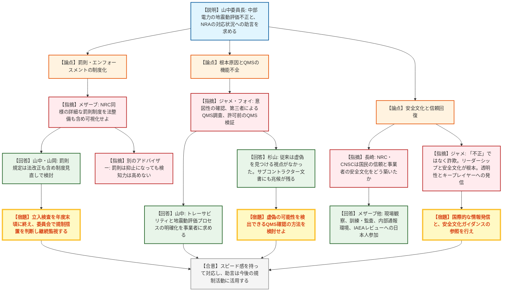
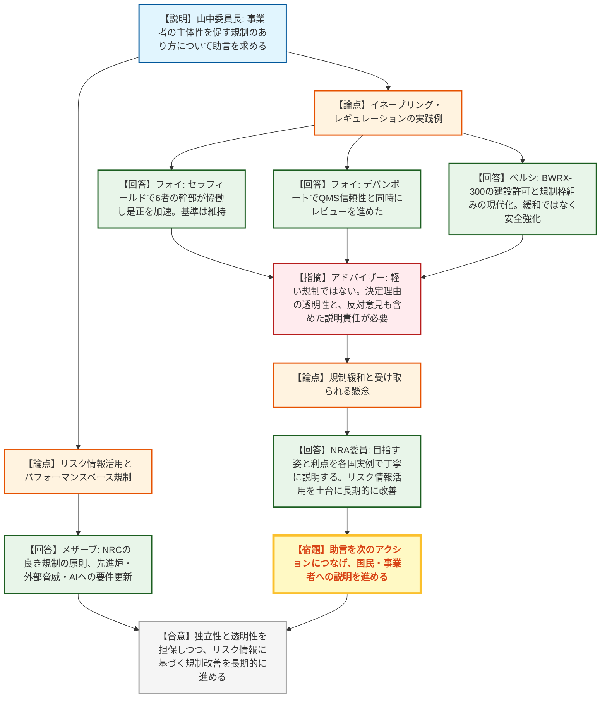

# 第１回原子力規制国際アドバイザーと原子力規制委員会との意見交換会合（令和8年11月9日）
> 出典 : https://youtube.com/live/fga8JJVhL-4?si=Zt3v4mf7mqt6bHQL

## 会合の概要
* **中部電力浜岡原発の基準地震動データ不正を、海外4名の元規制トップが「詐欺」「安全文化の欠落」として厳しく指弾**
  メザーブ氏(元米NRC委員長)、ジャメ氏(元仏ASN委員)、ベルシ氏(前カナダCNSC委員長)、フォイ氏(元英ONR長官)の4名が、事案を「単なる不正」にとどまらず、QMS(品質マネジメントシステム)・ガバナンス・リーダーシップ・安全文化の根本的欠落として受け止めるべきだと一致して指摘した。
* **罰則(エンフォースメント)規定の整備を求める声と、「罰則だけでは検知力は上がらない」という留保**
  メザーブ氏は、NRCのような深刻度・意図性に応じた詳細な罰則制度を法整備も含めて可視化すべきと主張した。一方で別のアドバイザーは、罰則は抑止にはなっても不正の検知能力を高めないとし、根本原因の理解・内部通報環境・現場での安全文化の観察を重視した。
* **NRA側は、トレーサビリティ確保、罰則規定の検討(法改正含む)、立入検査の年度末終了見込みを明言し、QMS確認の「不正を見抜く視点」の欠如を課題と認識**
  山中委員長・山岡委員・杉山委員らは、従来QMSの確認は技術的品質の確保が主眼で、虚偽の存在を見つけ出す視点がなかったと率直に認めた。
* **信頼回復は「時間がかかる」ため、透明性・一貫したメッセージ・早い行動が必要との助言**
  ジャメ氏はフランスでの鋼材データ不正の経験から、事業者・国民・NGO・労働組合・政府を含むキープレイヤーへ体系的に情報発信し続けることを勧めた。NRAとしても、立入検査の一区切り後に国際的な情報発信を行うと応じた。
* **議題2「事業者の主体的な安全性向上を促す規制(イネーブリング・レギュレーション)」では、緩和ではなく安全強化であることの説明責任が焦点**
  英国のセラフィールドやデバンポート造船所、カナダのBWRX-300の例が示され、NRAは「不正を受けた規制強化への期待が高まる中でも、事業者の主体性を引き出す方針は変えない」との立場から、世間への丁寧な説明が必要になると認識した。

---

## 議題ごとの詳細整理

### 【議題1】データ信頼性確保と不正事案への規制対応
* **議論の背景と論点:**
  * 背景
    * 中部電力が浜岡原発の基準地震動評価において、地震波データを意図的に操作した不正事案が発生し、NRAは立入検査を続けている。
    * 山中委員長は、不正事案への対応状況と再発防止の取組を理解してもらったうえで、今後の規制活動の改善・実効性向上への助言を得たいと述べた。
  * 論点
    * 不正の意図性・動機の確認と、根本原因の追求(エンフォースメントと是正措置の設計)。
    * 事業者のQMS・安全文化・ガバナンスの機能不全と、それを承認前に確認できなかった規制側の課題。
    * 罰則制度のあり方と、その抑止力の限界。
    * 失われた信頼(国民・産業界・規制当局自身への信頼)をどう回復するか。

* **質疑応答（詳細）:**
  **＜アドバイザーからの冒頭意見＞**
    * 【アドバイザー】メザーブ氏(元米NRC委員長)
      評価の誠実性を欠き、地震動を意図的に操作した可能性があることは極めて深刻で、日本国民の規制への信頼にも関わる。NRCでは約100ページに及ぶエンフォースメント文書があり、深刻度・意図性・根本原因・是正措置を踏まえ民事罰が決まるが、日本も国会に働きかけて同様の罰則制度を可視化すべきである。さらに、根本原因の追求と事業者独自の調査、安全が最優先であるべきという義務の徹底、内部告発者への報復の防止が必要である。
    * 【アドバイザー】ジャメ氏(元仏ASN委員)
      最重要の確認事項は、中部電力が意図的に地震動を操作したのか(浜岡)と、それがNRAに受理された方法・数値とどう異なるかである。優先すべきは現在の発電所の安全性確認であり、停止中でもリスクはゼロではないため、真の地震動レベルでのリスク評価が必要である。不正は安全管理システム全体と、NRA・産業界への信頼を揺るがすため、回復は時間を要する。
    * 【アドバイザー】ベルシ氏(前カナダCNSC委員長)
      本件は規制の仕組み・技術・安全文化・リーダーシップ・QMS・管理システムのあり方を問う。信頼回復の戦略を規制当局と原子力セクター全体で考えるとともに、NRA自身がレビュープロセスのどこに問題があったかを評価すべきである。再稼働審査の再開条件を明確にして効率的に伝えること、事案の教訓を世界で共有することも求められる。
    * 【アドバイザー】フォイ氏(元英ONR長官、本会合は初参加)
      地震動評価は安全上極めて重要な分析であり、虚偽データが提出され、その検証のためのガバナンスやQMSが機能しなかった。根本原因分析・是正措置の策定・第三者によるQMS調査・安全文化とリーダーシップの調査が必要である。安全より再稼働スケジュールを優先した点は許されず、QMSは許可前に検証し、事業者の解析手法も規制当局が事前に確認しておくべきである。

  **＜NRA委員の応答＞**
    * 【規制側】山岡委員
      メザーブ氏の罰則詳細化の指摘と、QMSを積極的に活用する指摘が印象的だった。現状は問題がなければQMSを強く確認しないが、事業者に各レベルのQMS記録を残してもらい、規制側もそれを確認することが再発防止に重要と理解した。
    * 【規制側】山中委員長
      QMSにおけるデータのトレーサビリティを事業者に求めること、地震動評価プロセスの明確化は、NRAの改善点として委員会内で定めている。罰則規定は法改正も含めた制度見直しで検討する。中部電力への立入検査は本年度末頃の終了を目途とし、その後に委員会で規制措置を判断し、是正措置も継続して監視する。区切りの段階で国際的な情報発信も行う。
    * 【規制側】委員(発言者の氏名は文字起こしから特定できず)
      事案は事実の確認と法令に照らした評価を進めている段階だが、4名から国際的な尺度で助言を得られたことは貴重だった。トレーサビリティの不備とデータ不正操作は、研究者・技術者の倫理に照らして驚きだった。制度見直しの検討に対する助言にも感謝する。
    * 【規制側】杉山委員
      QMSの主目的は技術的な品質確保であり、虚偽の可能性を含めて検出する視点はこれまで規制側になかった。調査報告では、中部電力と解析を担うサブコントラクターとの文書の中にも、今思えば虚偽や不正をうかがわせる部分が残っており、今後のQMS確認で何をすべきかは大きな課題と認識した。

  **＜罰則・QMS・安全文化をめぐる議論＞**
    * 【アドバイザー】発言者不詳(文字起こしから特定できず)
      罰則制度を考える必要があるが、まず日本国内で信頼を取り戻すことが重要である。全員が不正を探知できるよう記録とQMSを整え、個人が不正を申告しやすく、規制当局にアクセスしやすい環境を作ることが信頼回復につながる。杉山委員の指摘のとおり、事業者の業務管理・計画確認・計算・記録の取り扱いまで見ていく必要があり、QMSはそのための大きなツールとなる。
    * 【アドバイザー】メザーブ氏(NRCの経験に基づく発言から推定)
      NRCの検査プロセスにも罰金を含む仕組みはあるが、重大な不正ではその影響が大きく、罰金で済ませればよいわけではない。検査(ROP)をより効率的にして問題を見つけ、不正の重要度に応じた段階の判断を公表し、国会にも報告する必要がある。また、安全文化は複雑な問題のため、IAEAがレビューする場合は日本人を1〜2名チームに入れ、国際コンセンサスを助けるべきである。
    * 【規制側】長崎委員
      信頼回復に向け、NRCやCNSCは国民の信頼をどう獲得し、事業者に安全文化の重要性を認識させるためにどこで努力したのか。今回、中部電力の社員には「規制側より自分たちのほうが分かっている」という思い込みがあったようで、現場を持たない規制当局が事業者と同等の実力を持つことも信頼の前提と考える。
    * 【アドバイザー】メザーブ氏(推定)
      安全文化は運用の基本であり、規則の作り方が安全文化に影響するなら是正が必要である。個別ケースに応じた是正措置を取り、民事罰だけでなく、訓練の監視、外部監査役の現場招聘、朝の会議で安全が強調されているかの観察などで、事業者の姿勢を見極められる。現場を毎日見ている人を見ることが正確な評価につながる。
    * 【アドバイザー】発言者不詳(文字起こしから特定できず)
      罰則は抑止にはなっても、問題発生時の検知能力は高めない。安全文化は意思決定と態度に現れるため、訓練・監査・指摘事項への対応、安全機器の保守の先送り、施設のリーダーシップを見るべきである。
    * 【アドバイザー】ジャメ氏(推定)
      この事業者は安全文化を理解できていない可能性があり、過去の意見対立への対処も見るべきである。懸念表明から対策までの時間を考えると、ステークホルダーへのメッセージも懸念される。「不正」では弱い言葉であり、虚偽データの提出は詐欺に当たる。QMSよりもリーダーシップの責任と安全文化が根本にあり、是正には長い時間がかかるうえ、企業のDNAの見直しも必要である。
    * 【アドバイザー】ジャメ氏(推定)
      NRAと中部電力は一緒に根本原因を追求し、何を是正し、再発防止に何をするかを、電力会社と一般市民へ段階的に発信すべきである。フランスでは、約7年前に高圧容器などに使われる鋼材データの不正があったが、信頼回復は時間がかかるため、まず透明性を保ち妥協せず、素早く動き、事業者とはタフな対話をしつつ、全てのステークホルダーに同一のメッセージを出すことが重要だった。政府、事業者、規制者、NGO、労働組合、経済団体のリーダーなど30人程度をキープレイヤーとして選び、問題を見つけた際は体系的に情報提供した。
    * 【アドバイザー】発言者不詳(文字起こしから特定できず)
      安全文化に関する文書は多数あり、規制当局向けと事業者向けの2種類のガイダンスがある。評価の進め方も含めて、参考資料として後ほどNRAに提供したい。

* **結論と宿題事項（アクションアイテム）:**
  * **決定事項:** 本議題は意見交換であり、会合として新たな決定はない。山中委員長は、助言を踏まえて「できる限りスピード感を持って」中部電力の事案に対応し、国際的な情報発信も積極的に行うと述べた。
  * **宿題事項(NRA側):**
    * QMSにおけるデータのトレーサビリティの確保と、地震動評価プロセスの明確化を事業者に求める。
    * 罰則規定の整備を、法改正も含めて検討する(深刻度・意図性に応じた詳細化を含む)。
    * 虚偽・不正の可能性を検出できるQMS確認の方法を検討する。
    * 中部電力への立入検査を年度末頃を目途に終了し、委員会で規制措置を判断する。その後も是正措置を継続監視する。
    * 立入検査の区切りで国際的な情報発信を行う。
    * 安全文化の評価(IAEAレビューへの日本人参加の助言など)や、アドバイザーから提供される安全文化の参考文書を踏まえて対応を検討する。

---

### 【議題2】事業者の主体的な安全性向上を促す規制(イネーブリング・レギュレーション)
* **議論の背景と論点:**
  * 背景
    * 議題1の不正を受けて規制強化への期待が高まっている一方、安全確保の主体は事業者であり、規制の厳格化だけでは事業者の取組の可能性を狭め、日本の安全水準を相対的に下げかねないという問題意識がNRA側にある。
  * 論点
    * 規制当局が事業者の継続的な安全性向上をどう促すか(規制活動・コミュニケーション)。
    * イネーブリング・レギュレーションが「規制緩和」と受け取られないようにするための考え方と実践例。
    * リスク情報活用・パフォーマンスベース規制への移行と、先進炉・外部脅威・AIへの対応。

* **質疑応答（詳細）:**
    * 【アドバイザー】メザーブ氏(元米NRC委員長)
      NRCは独立性・オープン性・効率性・明確性・信頼性という「良き規制の原則」を定めており、日本にも参考になる。規制はリスク情報とパフォーマンスに基づき、最大のリスクに対応すべきであり、要件の緩和は目的を見失わせるため、新たな要件は安全を高めるために必要となる。また、処方的規制から目標設定型のパフォーマンスベース規制への移行や、ナトリウムやヘリウムを使う先進炉への要件の見直しが必要である。気候変動に伴う外部脅威(台風・海面上昇)への要件更新や、AIの活用への備えも早期に着手し、事業者だけでなく市民も巻き込んだ対話が必要である。
    * 【アドバイザー】フォイ氏(元英ONR長官)
      ONRはNRCと同様にリスクインフォームド規制を行い、最も深刻なリスクに優先的に資源を配分しつつ、事業者に対して一貫性を持って規制する。2013年頃からセラフィールドの高ハザード施設が許容できないリスクと判断され、規制当局、NDA、事業者など6者の上級幹部が同じ場で課題を話し合い、是正プログラムを加速した。これがイネーブリング・レギュレーションであり、基準は維持し、執行姿勢も変えない。
    * 【アドバイザー】フォイ氏(同上)
      別の例として、イングランド南部のデバンポート造船所では、QMSの信頼性に問題があった際に、安全ケースの共有や事業者の内部評価、規制側のレビューを同時並行で進め、潜水艦のドック復帰を含むプログラムを前進させた。AIについては、規制当局のサンドボックスという形で産業界と一緒に検討を進められる。
    * 【アドバイザー】ベルシ氏(前カナダCNSC委員長)
      カナダの規制枠組みも技術中立・パフォーマンスベース・リスクインフォームドであり、イネーブリング・レギュレーションは安全を緩めるものではなく、強化するものである。2025年4月に建設許可が出たダーリントンのBWRX-300(小型炉)では、建設が進んで引き返せない段階が来るため、安全評価を進めながら独立性を保って柔軟に対応した。2026年7月にCNSCが規制枠組みの現代化戦略を公表し、全ステークホルダーを巻き込み透明性を持って意思決定している。
    * 【アドバイザー】発言者不詳(文字起こしから特定できず)
      イネーブリング・レギュレーションは軽い規制ではなく、人々を守るものであり、独立した機関として一貫して決定し、決定の理由について透明性を持つ必要がある。通常のエンゲージメントに、気候変動などで異なる意見を持つ人も招いて説明責任を果たすことが、信頼の醸成につながる。
    * 【規制側】委員(発言者の氏名は文字起こしから特定できず)
      議題2をこちらから提示した理由は、中部電力の問題で規制強化への期待が高まる一方、安全確保は誰が行うべきかを考えると、事業者自身の主体的な取組が不可欠だからである。ルールを厳しくするだけでは、事業者の可能性を狭めて国際的に見た日本の水準を相対的に低くするおそれがある。事業者の主体性を引き出す姿勢が規制緩和と捉えられる懸念も理解し、アプローチの目指すところと利点を丁寧に説明し、次のアクションにつなげたい。
    * 【規制側】委員(発言者の氏名は文字起こしから特定できず)
      ベースとなるのは、リスク情報の活用とリスクに基づく規制であり、同じ安全目標に向けて関係者が議論し、規制当局は独立性と透明性を担保して規制する。英国のイネーブリング・レギュレーションや、米国・カナダの新規炉向け規制をすぐに導入できるとは考えていないが、その考え方を基に長期的に規制を改善していきたい。

* **結論と宿題事項（アクションアイテム）:**
  * **決定事項:** 意見交換であり、新たな決定はない。NRAは、事業者の主体性を引き出すアプローチを、規制緩和ではなく安全強化としてどう説明するかを課題として受け止めた。
  * **宿題事項(NRA側):**
    * イネーブリング・レギュレーションの目指す姿とその利点を、各国の実例を用いて国民・事業者に丁寧に説明する。
    * アドバイザーの助言を、NRAの次のアクションにつなげる。
    * リスク情報活用を土台とした規制の改善を長期的に進める。

---

## 論理構造の可視化（Mermaid）

### 【議題1】データ信頼性確保と不正事案への規制対応

### 【議題2】事業者の主体的な安全性向上を促す規制(イネーブリング・レギュレーション)

