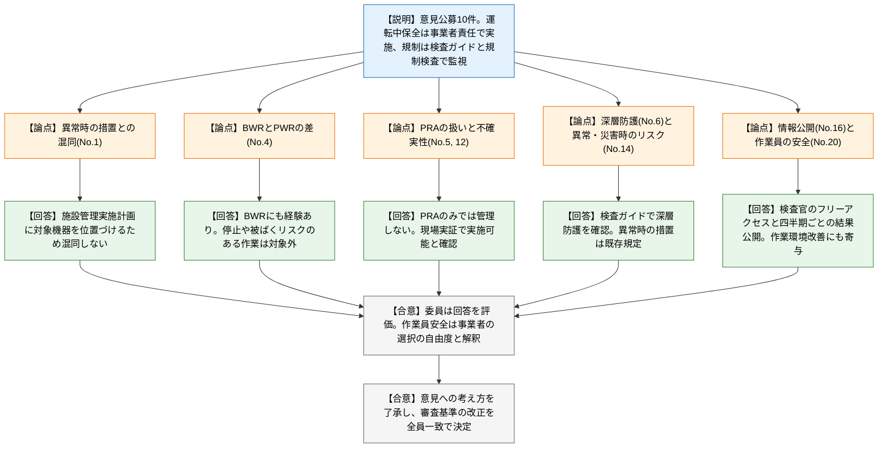
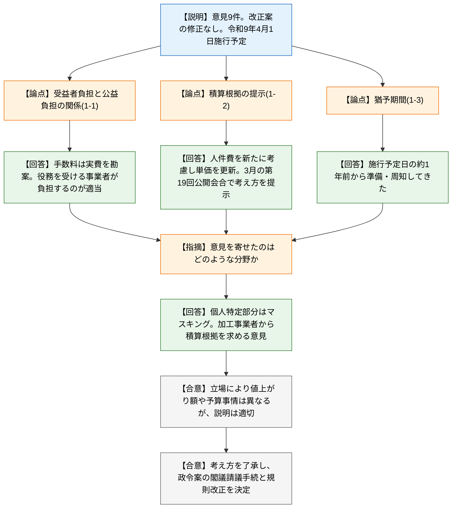
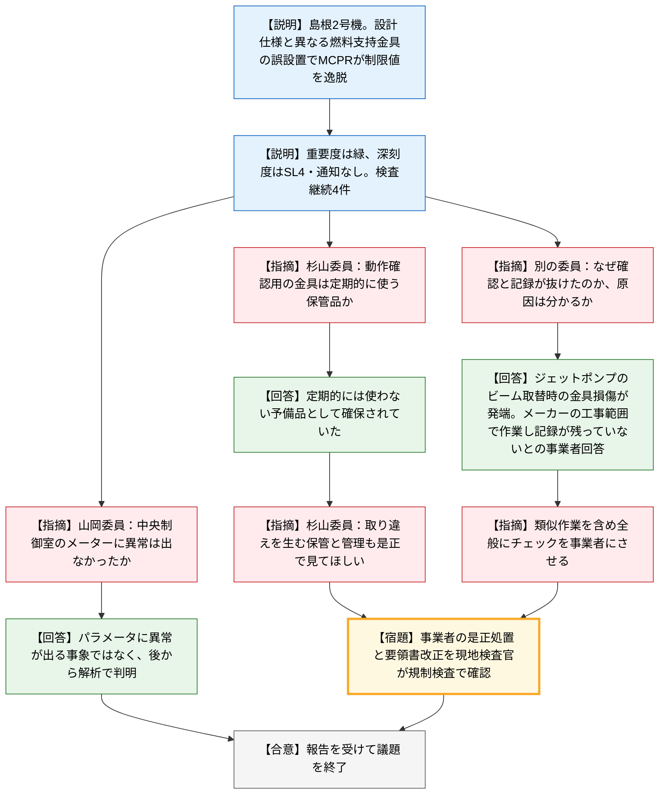
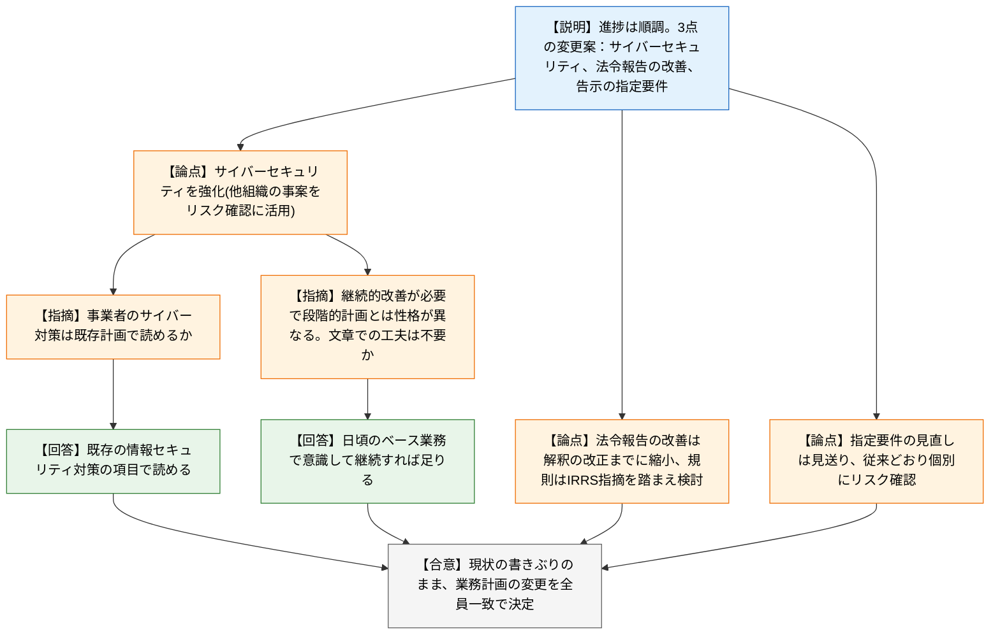
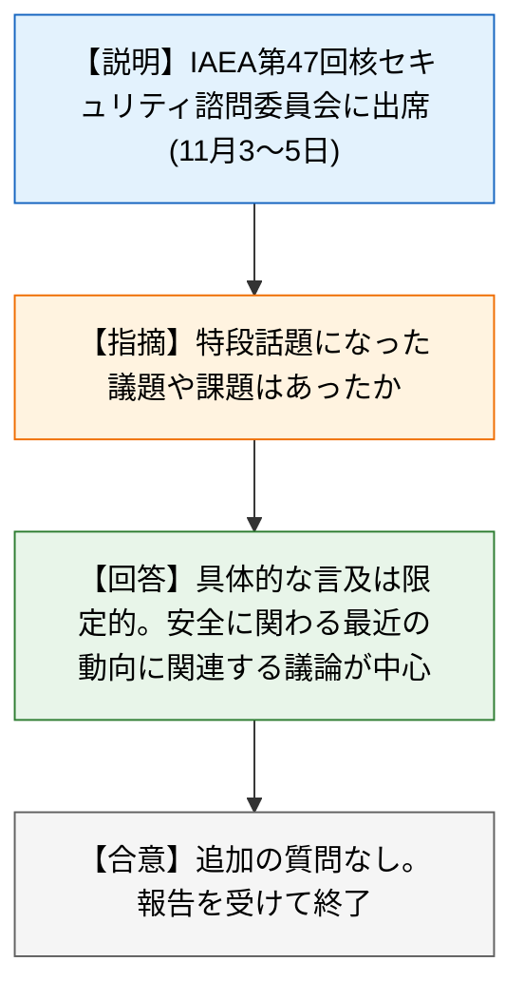

# 第41回原子力規制委員会（令和8年11月11日）
> 出典 : https://youtube.com/watch?v=WMa0WJLFbEY&si=XMwOlBFVGDlL5p2J

## 会合の概要
* **運転中保全の保安規定審査基準の改正：意見公募10件を踏まえても原案は変更せず、全委員一致で決定**
  計画的な運転中保全（オンラインメンテナンス）の実施に係る審査基準の改正案に対し、深層防護、PRAの不確実性、BWRとPWRの差、作業員の安全などの意見が寄せられた。規制庁は「事業者責任で実施される」「規制検査で監視する」との立場で回答した。委員からは「意見の質が高く、容認に向けた我々の説明が強化された」との評価が示された。
* **原子力規制検査の手数料改正：意見9件でも改正案の修正はなく、政令案は閣議請議手続へ**
  受益者負担と公益負担の関係、積算根拠、猶予期間への意見に対し、実費を勘案し人件費を新たに考慮した算定であること、事前の公開会合で考え方を示してきたことを説明した。政令・規則とも決定され、12月中旬頃の公布、令和9年4月1日の施行を予定している。
* **第2四半期の検査結果：島根2号機で検査指摘事項1件（重要度は緑、深刻度はSL4・通知なし）**
  約30年前の第5回定期検査で、設計仕様と異なる動作確認用の燃料支持金具を誤って設置したことが判明した。第6〜第18運転サイクルで最小限界出力比（MCPR）が運転上の制限値を満たさない期間があったが、燃料の健全性は維持されていた。委員からは、保管・管理の仕方や、確認が抜けた原因の掘り下げ、類似作業への水平展開を求める声が相次いだ。
* **年度業務計画の変更：サイバーセキュリティは強化、法令報告の改善と告示指定要件の見直しは範囲を縮小・見送り**
  計画はいずれも順調と評価された一方、3点が変更された。サイバーセキュリティについて委員は、年度で区切れず継続的に改善すべき性格の業務であると強調した。
* **長崎委員がIAEAの核セキュリティ諮問委員会（第47回）への出張を報告**
  11月3〜5日の会合で核セキュリティについて議論した。具体的な内容への言及は限定的だった。

## 議題ごとの詳細整理

### 【議題1】実用発電用原子炉及びその附属施設における発電用原子炉施設保安規定の審査基準の一部改正案に対する意見公募の結果及び審査基準の改正（資料1）
* **議論の背景と論点:**
  * **背景**
    * 9月2日の委員会で、計画的な運転中保全の実施に係る保安規定審査基準の一部改正案について意見公募の実施が了承された。
    * 意見公募は9月3日から10月2日までの30日間行われ、提出意見は10件だった。
  * **経緯**
    * 提出意見を踏まえて特に変更を加えた点はなく、意見に対する考え方（別紙1）の了承と、審査基準の改正（別紙2）の決定が付議された。
  * **論点**
    * ① 運転中保全は事業者の責任で実施されるものであり、規制側はAOT（許容待機除外時間）内での実施、安全措置、PRA等による事前の有効性検証を求め、規制検査で監視するという整理。
    * ② 異常時の措置との混同、BWRとPWRの差、PRAの扱い、深層防護、情報公開、作業員の安全といった個別意見への回答の妥当性。

* **質疑応答（詳細）:**
  **＜規制庁による説明（意見に対する考え方）＞**
    * 【説明者側】大坪技術基準一係長（技術基盤課）
      共通的な考え方として、運転中保全の具体的な手順は個別の発電所の状況を踏まえて事業者が整備するものとした。本改正案はAOT内での実施、保全作業中の安全措置、PRA等による措置の有効性の事前検証を求めており、規制委員会は検査官が確認する事項を整理した検査ガイドで、原子力規制検査により事業者のリスク管理を監視する。ガイドは今後の経験を踏まえて継続的に改善する。
    * 【説明者側】大坪係長（整理番号1：異常時の措置との混同）
      現行の審査基準には異常時の措置としての規定がある。今回追加するのは計画的に実施するものであり、施設管理実施計画に対象機器を明確に位置づけることとしているため、やむを得ず実施する場合と混同することは考えにくいとして、原案のままとした。
    * 【説明者側】大坪係長（整理番号4：BWRとPWRの差）
      現場実証はPWRで実施したが、BWRでもAOT内での予防保全を目的とした作業には一部経験がある。事業者との面談では、原子炉停止を引き起こしかねない作業や被ばくリスクが高い作業など、作業安全に問題がある場合は運転中保全は実施困難との説明を受けている。規制委員会も運転中保全で実施が見込まれる保全作業の例を示しており、問題はないとした。
    * 【説明者側】大坪係長（整理番号5：PRAによる措置の具体化）
      本審査基準は保安規定の認可審査で確認すべき事項を定める文書であり、PRA等を用いた措置の有効性の検証方法まで限定する性質のものではないとして、原案のままとした。
    * 【説明者側】大坪係長（整理番号6：深層防護）
      深層防護を確保すべきとの意見に対し、先般策定した検査ガイドにも記載があると回答した。深層防護は最も重要な視点の一つであり、引き続き事業者の活動を監視するとした。
    * 【説明者側】大坪係長（整理番号12：PRAの検証・不確実性、実証結果）
      PRAモデルには常に不完全性が伴い、PRAのみでリスクを管理する考えではない。現場実証では、計画段階で代替手段やPRAの結果も参照しながら実施可能性を検討していたことを確認した。実際の作業でも特段困難な点はなく、AOT内でリスク上昇を抑えつつ運転中保全が実施可能と確認しており、その結果を踏まえて基準を改正した。
    * 【説明者側】大坪係長（整理番号14：異常・災害時のリスク）
      異常時の措置は今回の改正範囲の外であり、既に規定がある。当該基準に従って認可された保安規定に基づいて必要な措置が講じられるとした。
    * 【説明者側】大坪係長（整理番号16：情報公開と第三者による検証）
      原子力規制検査では検査官がフリーアクセスで事業者の活動を監視でき、運転中保全でも作業計画時の検討状況から現場の状況までアクセスできる。検査結果は四半期ごとに公開しており、引き続き透明性の確保に努めるとした。
    * 【説明者側】大坪係長（整理番号20：作業員の安全）
      原子炉停止を引き起こすおそれのある作業や被ばくリスクの高まる作業は運転中保全の対象にしない。また、作業負荷の平準化など作業環境の改善にも一定の寄与があり、作業者の安全上問題はないとした。

  **＜委員による確認・コメント＞**
    * 【規制側】委員（1人目）
      寄せられた意見は質が高く、回答によって我々の説明が強化された。今後オンラインメンテナンスを容認していく際の説明に反映してよい内容だと評価した。
    * 【規制側】委員（1人目）
      作業員の安全（整理番号20）については、「これで大丈夫」というより、定期検査中に大勢が集中して作業する形と、運転期間を含め年間を通じて分散して作業する形のどちらが作業員にとって安全かについて、事業者に選択の自由度が与えられた点に意味があると解釈した。より安全な側を事業者が選べるようになったとして、今回の対応全般を適切と評価した。
    * 【規制側】委員（2人目）
      回答に異論はなく、技術的な議論は以前の会合で行っているため、特段問題はないとした。
    * 【規制側】山中委員長
      別紙1の考え方の了承を諮り、了承された。続いて別紙2の審査基準の改正決定を諮り、委員全員が決定してよいと答えた。

* **結論と宿題事項（アクションアイテム）:**
  * 別紙1（提出意見に対する考え方）を了承し、別紙2のとおり審査基準の改正を決定した。条件付きの了承や持ち越しとなった宿題事項はない。
  * 意見公募を踏まえた修正はなく、運転中保全は検査ガイドに基づく規制検査で監視していく方針が確認された。

### 【議題2】原子力規制検査の手数料改正のための核原料物質、核燃料物質及び原子炉の規制に関する法律施行令及び原子力規制検査等に関する規則の改正（資料2）
* **議論の背景と論点:**
  * **背景**
    * 令和7年12月3日の委員会で令和7年度補正予算案の概要を報告した際、近年の物価・人件費の高騰を踏まえ、検査手数料の算定方法の妥当性等を含めて見直すことになった。
  * **経緯**
    * 令和8年9月17日の委員会で改正案と意見公募の実施が了承され、翌日から意見公募を実施した。提出意見は9件で、修正すべき点はなかった。
  * **論点**
    * ① 検査を受ける受益者の負担と公益負担の関係（整理番号1-1）。
    * ② 手数料の積算根拠の提示（整理番号1-2）。
    * ③ 施行までの猶予期間（整理番号1-3）。
    * ④ 影響を受ける被規制者の範囲と、提出意見の分野。

* **質疑応答（詳細）:**
  **＜規制庁による説明＞**
    * 【説明者側】宮坂係長（検査監督総括課）
      意見公募に対する考え方（別紙1）の了承と、炉規法施行令の改正政令案の閣議請議手続への移行、原子力規制検査等に関する規則の改正の決定を求めた。政令の閣議決定と規則の公布は12月中旬頃、施行は令和9年4月1日を予定している。
    * 【説明者側】宮坂係長（1-1：受益者負担と公益負担）
      手数料は国が特定の者のために役務を提供する際の反対給付として徴収するものである。炉規法上の手数料は規制活動に係る実費を勘案して額を定めており、検査の実施に要する費用は役務の提供を受ける事業者が負担するのが適当と回答した。
    * 【説明者側】宮坂係長（1-2：積算根拠）
      実費を勘案した結果として、今回新たに人件費を考慮し、物件費と旅費の単価を最新のものにした。事業者や外部有識者との公開の意見交換会合（検査制度に関する意見交換会合）の本年3月の第19回で算定の考え方を資料で示しており、標準的な検査時間も過去の制度立案時のワーキンググループ資料で公開していると回答した。
    * 【説明者側】宮坂係長（1-3：猶予期間）
      3月の公開会合の資料で、算定の考え方とあわせて改正スケジュールも示しており、施行予定日の約1年前から準備してきたと回答した。

  **＜委員による質疑＞**
    * 【規制側】委員
      対象事業者は電力会社や核燃料の製造者がメインと認識しているが、国立大学・私立大学など多数の被規制者がいる。意見を寄せたのはどのような分野の方々か、情報があれば教えてほしいと質問した。
    * 【説明者側】井上係長（検査監督総括課）
      提出意見は個人の特定につながる部分をマスキングして公表している。パブリックコメントや意見交換会合の議事録にもあるとおり、加工事業者から、手数料の積算根拠を示すようにという意見が出ていると回答した。意見交換会合には発電用原子炉設置者をはじめ広い被規制者に案を示しており、公開会合の場で加工事業者からも同趣旨の意見を受けたと補足した。
    * 【規制側】委員
      立場によって実際の値上がり額は様々であり、次年度から適用となれば大学のような組織では予算の事前申請に計上する必要もあるなど、組織ごとの事情はあると指摘した。そのうえで、理解を得たうえで進めるものであり、今回示された説明は適切だと評価した。
    * 【規制側】山中委員長
      別紙1の考え方の了承を諮り、了承された。続いて別紙2の政令案による閣議請議手続への移行と別紙3の規則改正の決定を諮り、委員全員が決定してよいと答えた。

* **結論と宿題事項（アクションアイテム）:**
  * 別紙1を了承し、炉規法施行令の改正政令案を規制委員会の案として閣議請議手続に進めること、および原子力規制検査等に関する規則の改正を決定した。宿題事項はない。
  * 今後は政令の閣議決定と規則の公布を12月中旬頃、施行を令和9年4月1日とするスケジュールで進める。

### 【議題3】令和8年度第2四半期の原子力規制検査等の結果（資料3）
* **議論の背景と論点:**
  * **背景**
    * 令和8年度第2四半期の原子力規制検査等の結果の報告である。
    * 今期の検査指摘事項は1件（島根原子力発電所2号機）で、検査継続案件は4件ある。
  * **経緯**
    * 島根2号機では、第18回定期事業者検査で燃料支持金具の1個の通水穴の寸法が設計仕様より小さいことが確認された。調査の結果、第5回定期検査で設計仕様の異なる動作確認用の金具を誤って設置していたことが判明した。
  * **論点**
    * ① 最小限界出力比（MCPR）の運転上の制限を満たさない期間があったことの重要度・深刻度の判定。
    * ② 異常が運転パラメータに表れなかったのかという確認。
    * ③ 取り違えを生んだ保管・管理の問題と、確認が抜け記録も残っていない原因の把握、類似作業への水平展開。

* **質疑応答（詳細）:**
  **＜規制庁による説明＞**
    * 【説明者側】井上専門員（実用炉監視部門）
      通水穴の寸法が小さい金具が設置されたことで燃料集合体内の冷却水量が減少し、限界出力等に影響が生じる。仕様の異なる金具を設置していた第6〜第18運転サイクルについてMCPRへの影響を評価したところ、全運転サイクルで運転上の制限値を満足しない期間が認められた。
    * 【説明者側】井上専門員
      第5回定期検査の交換当時、事業者の管理文書（工事管理品質保証要領）は、受け入れた機器が設計仕様と同一であることを銘板・刻印等で確認し、取替部品記録を作成することを定めていた。その記録が保管されていないことを確認し、パフォーマンス劣化等を判定した。
    * 【説明者側】井上専門員（スクリーニングと重要度）
      MCPRが運転上の制限値を下回る状態で異常な過渡変化が起これば、燃料の許容設計限界値を下回る可能性があったため、検査指摘事項に該当すると判定した。実際には許容設計限界値を下回る過渡変化は発生せず、炉水中のよう素濃度や排ガス放射線モニタにも異常はなく、燃料の健全性は維持されたとして、重要度は緑と判断した。
    * 【説明者側】井上専門員（深刻度）
      保安規定第25条と第81条の違反が長期間繰り返され、違反や運転上の制限の逸脱が規制当局に報告されなかったことは、規制活動に影響を及ぼす結果となったと判断した。意図的な不正行為は確認されておらず、事業者は改善措置活動など適切な是正処置を実施しているとして、深刻度はSL4・通知なしと判定した。
    * 【説明者側】井上専門員（検査継続案件ほか）
      検査継続は4件で、浜岡の基準地震動の策定に係る不正行為、美浜3号機の高圧ヒータードレンベント配管の損傷、大飯3号機の界磁喪失警報発信による発電機自動停止に伴う原子炉停止、川内1・2号機の系統分離対策における火災防護対象機器等の選定時の不十分な評価である。前期の継続案件のうち、ある3号機の原子炉出力記録系の選択スイッチ誤りによる記録不備は、出力領域は記録できていなかったが中間領域は正常に記録され、適切な是正処置も実施されたため、検査指摘事項等に該当しないと判定した。
    * 【説明者側】井上専門員（意見聴取・安全実績指標・福島第一）
      報告書案に対し、島根と大飯の事業者から記載適正化の意見があり、報告書に反映する。安全実績指標は緑を超えるものはないと認識しており、正式には事業者から11月16日までに提出される。福島第一の実施計画検査は今期、検査指摘事項・検査継続案件ともに該当なしである。前期の継続案件（付近の通信ケーブル測量工事における放射線管理の不備）は、作業員の追加被ばくは有意でなく担当部署のルールの認識不足によるものだったとして、指摘事項等に該当しないと判断した。

  **＜委員による質疑＞**
    * 【規制側】山岡委員
      島根の件は結果的に特段の問題はなかったと理解するが、中央制御室の機器のメーター等に違和感が出る程度のものでもなかったのかと確認した。
    * 【説明者側】小野上席監視指導官
      結果的に、中央制御室のパラメータに異常が出る事象ではなかった。今回のような事象は中央制御室で確認するのは難しかっただろうと回答した。
    * 【規制側】山岡委員
      後から解析してみて、運転上の制限値を下回っていたことが分かったという理解でよいか確認し、規制庁もそのとおりと答えた。
    * 【規制側】杉山委員
      取り違えて取り付けられたのは動作確認用の金具だが、定期的に使うために保管していたものかと質問した。
    * 【説明者側】小野上席監視指導官
      定期的に使うものではなく、予備品のような形で確保されていたと聞いていると回答した。
    * 【規制側】杉山委員
      本来使うべきものと取り違えるような保管の仕方にも、取り替え行為自体にも問題があった。是正にあたっては、そうしたものの管理や、間違いを防ぐ仕組みもきちんと見てほしいと要望した。
    * 【規制側】委員（別の1人）
      杉山委員の指摘と重なるが、銘板・刻印の確認と記録作成が行われていなかった点で、「今後確認する」という対応は一般的だが、それでは足りない。そもそもなぜ確認が抜けたのか、何が起きていたのか、これから分かってくるのかと質問した。
    * 【説明者側】小野上席監視指導官
      取り替えの経緯は、炉内のジェットポンプのビームの取替工事で、新しいビームを炉内に落とし、それが燃料支持金具を傷つけたため金具を取り替えたというものだと説明した。通常の工事であれば工事記録やチェックシートが残るが、事業者によると、メーカーの工事範囲の中で作業を行ったため記録が残っていないのだろうとの回答だった。
    * 【規制側】委員（別の1人）
      約30年前のことで当時の担当者も退職しており、「だろう」以上のことは分からないかもしれない。それでも推定を重ねながら、必ず今後につなげてほしいと要望した。
    * 【規制側】委員（山中委員長または別の委員）
      再発防止策を改めて求める趣旨で、関連する作業は他にも多々あるため、全般にわたって事業者にしっかりチェックさせるよう要望した。
    * 【説明者側】小野上席監視指導官
      事業者は是正処置を行い、要領書等も改正したと聞いている。その実施状況は、現地の検査官が規制検査等で確認していくと回答した。

* **結論と宿題事項（アクションアイテム）:**
  * 本件報告を受けたとして議題を終了した（報告事項のため決定事項はない）。
  * 島根2号機の再発防止策について、金具等の保管・管理、類似作業の確認の徹底、確認が抜けた原因の把握を、現地検査官による規制検査で確認していくことが確認された。
  * 安全実績指標は、事業者から11月16日までに正式提出される予定である。

### 【議題4】令和8年度原子力規制委員会年度業務計画の変更（資料4）
* **議論の背景と論点:**
  * **背景**
    * 10月26日に、規制庁長官以下の幹部職員によるマネジメント委員会で年度業務計画の進捗を確認・評価し、いずれも順調と評価された。一方、新たな課題の発生や状況の変化を踏まえ、一部計画の見直しが必要と認められた。
  * **経緯**
    * 順調な例として、経過措置規定の見直しや、1F事故後15年の節目の国際ワークショップ開催が挙げられた。計画に追加した良好な取り組みとして、放射性物質の輸送に係るわかりやすい情報発信や、RI事業所への無通告立入検査の導入に伴う事業者への丁寧な対応が挙げられた。
  * **論点（変更案の3点）**
    * ① サイバーセキュリティ：国内外の脅威や他組織で発生した事案を自らのシステムに置き換え、リスクがないか確認して強化を進める。
    * ② 炉規法に基づく法令報告の改善：昨年度に了承された改善の方向性について、規則等の改正としていたところを解釈の改正までとし、規則はIRRSの指摘等を踏まえて今後検討する。
    * ③ 告示に基づく施設の指定要件（敷地境界で毎時5マイクロシーベルトを目安）の明確化：指定実績を踏まえ、リスクに応じた指標を検討したが、指定対象施設が少ないことなどから見直しは必ずしも必要でないとし、従来どおり個別に施設のリスクを確認して指定する。

* **質疑応答（詳細）:**
  **＜規制庁による説明＞**
    * 【説明者側】藤川監察官（監査・マネジメント推進室）
      計画の進捗評価の概要と、上記3点の変更案およびその理由を説明した。変更は新旧対照表（別紙1）にまとめており、審議のうえ決定してほしいと求めた。

  **＜委員による質疑＞**
    * 【規制側】委員（1人目）
      サイバーセキュリティの変更は規制委員会・規制庁自身を守る観点のものだが、事業者側にもサイバーセキュリティ対応の強化を求めたい。それは明示的に変更せずとも従来の計画で読めるという理解でよいかと確認した。
    * 【説明者側】藤川監察官
      そのとおりである。事業者向けの取り組みは、既存の計画の中で原子力施設の情報セキュリティシステム対策などとして記載されており（資料49ページ）、読める形になっていると回答した。
    * 【規制側】委員（2人目）
      サイバーセキュリティは、被害を受けた場合、被害者側であっても社会的信頼を損なうことがある。他の事案の発生にかかわらず、常にウォッチして継続的に改善を図ることが重要である。「ここまでが令和8年度、ここからが令和9年度」と段階的に進める他の事業計画とは性格が異なる点を認識しておきたいと述べた。
    * 【規制側】委員（山中委員長または別の委員）
      文章を工夫するなど、記載で対応できることはないかと質問した。
    * 【説明者側】藤川監察官
      現時点で直ちにというところではなく、日頃のベースとなる業務の中で意識して継続すればよいと考えていると回答した。
    * 【規制側】委員
      状況は継続的に、ますます厳しくなるため、常に意識してほしい。年度が変わってもこの項目がなくなることはないと思うので、この書きぶりでよいと述べた。
    * 【規制側】委員
      修正項目は適切に取り上げられ、検討の結果不要とされた項目はそのように修正されている。例年に比べ修正項目は少なかったが、半期での見直しとしてこの提案でよいと述べ、決定を諮った。
    * 【規制側】山中委員長
      別紙1のとおり年度業務計画の変更を決定してよいかを諮り、委員全員が決定してよいと答えた。

* **結論と宿題事項（アクションアイテム）:**
  * 別紙1のとおり令和8年度原子力規制委員会年度業務計画の変更を決定した。
  * サイバーセキュリティは年度で区切れない継続的な業務であることが委員間で共有された（記載の修正は行わず、既存の書きぶりのまま）。宿題事項はない。

### 【議題5】長崎委員の出張報告（資料5）
* **議論の背景と論点:**
  * **背景**
    * 長崎委員が、IAEAで開催された第47回核セキュリティ諮問委員会に出席した。
  * **論点**
    * 特段話題になった議題や課題があったか。

* **質疑応答（詳細）:**
  * 【説明者側】長崎委員
    先週の11月3日から5日にIAEAで開催された第47回の核セキュリティ諮問委員会に出席し、核セキュリティについてメンバーと議論したと報告した。
  * 【規制側】山中委員長
    特段話題になった議題や課題があったかと質問した。
  * 【説明者側】長崎委員
    具体的なことは申し上げにくいとしつつ、安全に関わる最近の動向に関連した議論が中心だったと回答した。
  * 委員からの追加の質問・コメントはなく、会議は終了した。

* **結論と宿題事項（アクションアイテム）:**
  * 報告を受けて議題を終了した。宿題事項はない。

## 論理構造の可視化（Mermaid）

### 【議題1】運転中保全の保安規定審査基準の改正

### 【議題2】検査手数料の改正

### 【議題3】第2四半期の原子力規制検査等の結果

### 【議題4】令和8年度年度業務計画の変更

### 【議題5】長崎委員の出張報告

