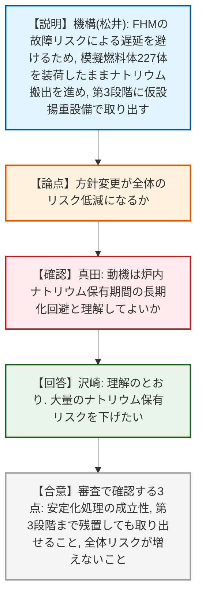
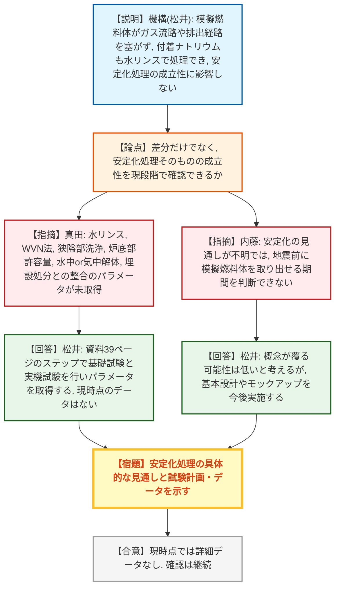
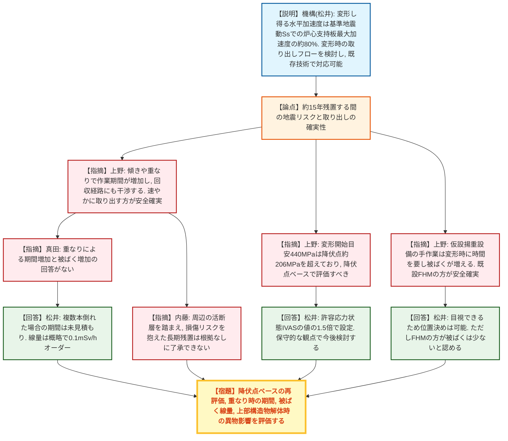
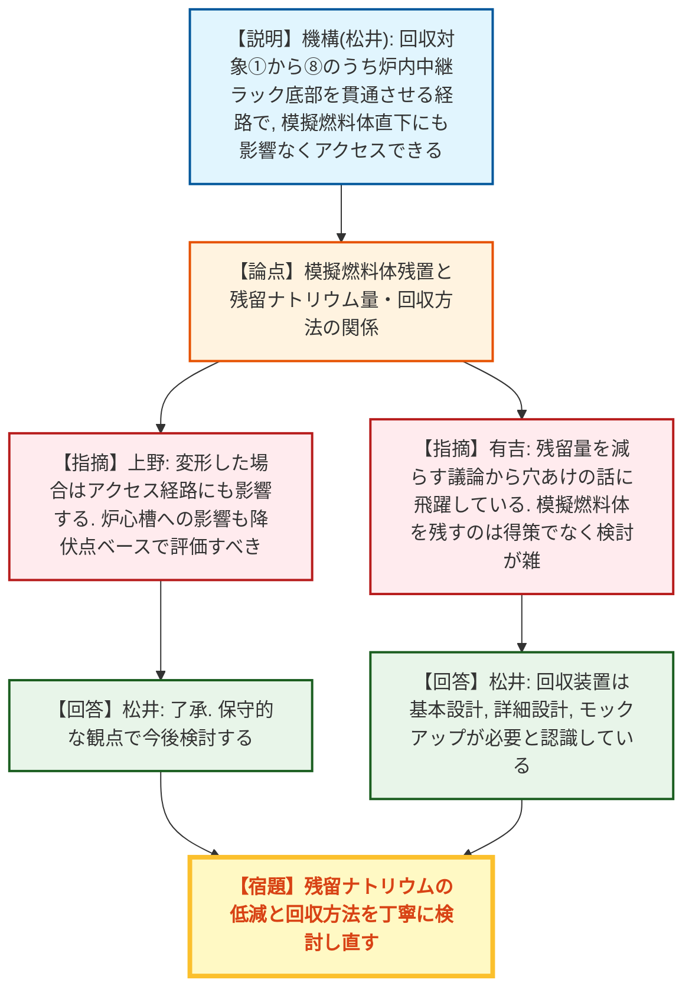
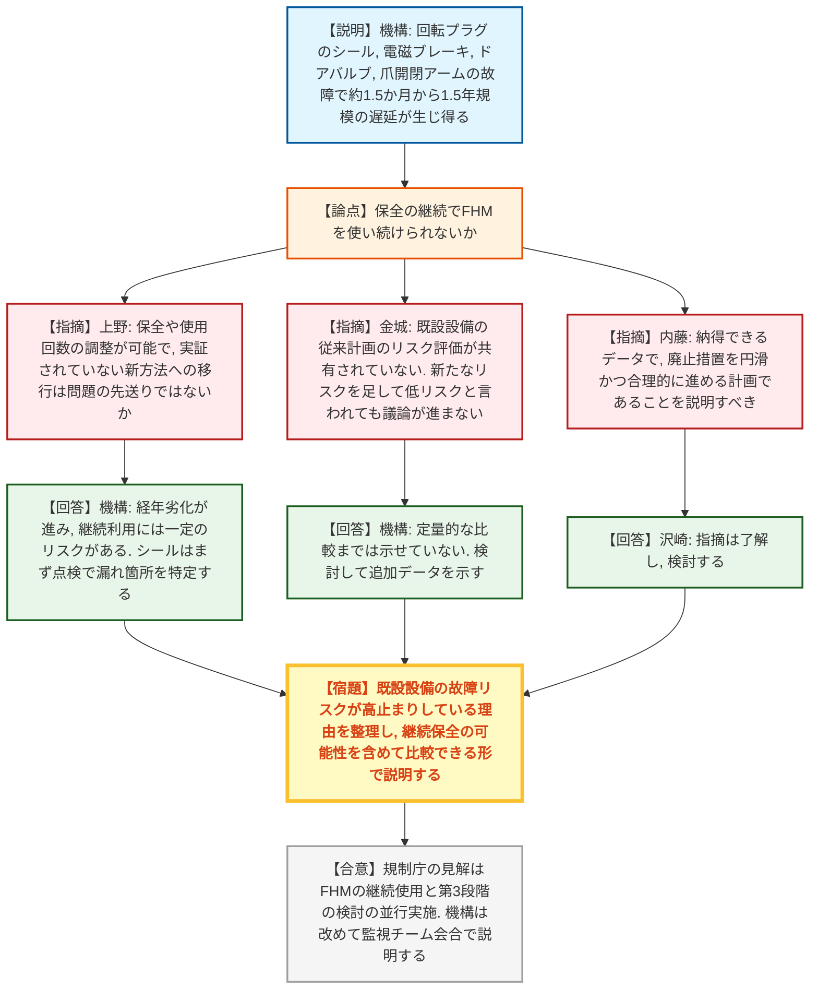

# 第54回もんじゅ廃止措置安全監視チーム（令和8年11月12日）
> 出典 : https://youtube.com/live/6-Xl38n12Lw?si=EuLL0Wjhv7JyJi_J

## 会合の概要
* **前回持ち越しとなった遮蔽体等取り出し作業の見直し(未照射模擬燃料体227体の第3段階への先送り)について、原子力機構が資料で合理性を説明**
  原子力機構は、燃料交換装置(FHM)など既設の燃料取扱設備の故障リスク(回転プラグのエラストマーシール、昇降駆動装置の電磁ブレーキ、ドアバルブ、爪開閉アーム)により取り出しが長期化し、放射性バルクナトリウムの搬出が遅れてナトリウム保有リスクが長期化することを避けるため、模擬燃料体は残置したままナトリウム搬出・残留ナトリウム回収・安定化処理を進め、第3段階に仮設の揚重設備で取り出す方針が合理的だと説明した。
* **ナトリウム安定化処理の成立性が「生煮えのエビデンス」であるとの強い指摘**
  規制庁は、模擬燃料体を残置する以上、従来は後段の課題として先送りしていた安定化処理(水リンス、WVN法、狭隘部の洗浄、炉底部の残留量、解体方法、埋設処分の受入基準との整合)を現段階で一定程度確認する必要があると指摘した。機構は現時点で必要なパラメータは得られておらず、今後の基礎試験・実機試験で取得するとした。
* **模擬燃料体の長期残置(約15年)に伴う地震リスクと取り出し作業のリスク増大**
  機構の評価では、変形が生じ得る水平加速度は基準地震動Ssに対する炉心支持板最大加速度の約80%に相当する。規制庁は、変形開始の目安を降伏点ではなく約440MPaで評価している点、模擬燃料体の重なりによる作業期間延長や仮設設備による手作業での被ばく増加が検討されていない点を指摘し、機構も期間見積もりが未実施であることを認めた。
* **規制庁の見解: FHMの継続使用と第3段階の検討の並行実施**
  規制庁は、残置によって新たなリスクが追加されるうえ、既設設備を使う従来計画のリスク評価が共有されていないとして、FHMの継続使用を行いながら第3段階の検討を並行して進めるよう求めた。
* **機構は検討の上、次回以降の監視チーム会合で改めて説明**
  各リスクを比較可能な形で示し、リスクを低減する計画であることを納得できるデータで説明するよう求められ、機構は検討して改めて説明することとなった。

---

## 議題ごとの詳細整理

### 【議題1】もんじゅの廃止措置計画変更認可申請(令和8年8月31日申請)(廃止措置第2段階前半の遮蔽体等取り出し作業の見直し等)

* **議論の背景と論点:**
  * **背景:**
    * 現行計画では、第2段階中にバルクナトリウムの搬出、ナトリウム設備の解体着手準備、遮蔽体等の取り出し完了を優先して行い、炉内に残る未照射の模擬燃料体227体もFHMで取り出す予定だった。
    * 放射化した遮蔽体等の取り出しは既に終了している。
    * 機構はFHMの不具合対応に約1年を要した実績から、故障リスクが想定以上に高いと評価した。
  * **機構の提案:**
    * 模擬燃料体を炉内に装荷したままバルクナトリウムの抜き出し・残留ナトリウム回収・安定化処理を行い、第3段階に目視可能な状態で仮設の揚重設備により取り出す。
    * 模擬燃料体の取り出しは1日2体として約半年を想定し、第3段階の詳細計画の中で開始時期の前倒しにより吸収できるとしている。
  * **論点1:** 模擬燃料体を残置したままでも、残留ナトリウムの安定化処理が成立するか(現時点のエビデンスで確認できるか)。
  * **論点2:** 模擬燃料体を約15年残置する間に地震で変形・転倒した場合、取り出しが困難にならないか、期間や被ばくが増えないか。
  * **論点3:** FHMの故障リスクを理由に既設設備の使用を取りやめ、実証されていない新たな方法に移ることが、全体としてリスク低減になるのか。

* **質疑応答（詳細）:**

  **＜申請の位置づけと審査で確認すべき事項の整理＞**
    * 【規制側】真田（原子力規制庁）
      機構の動機は、FHMの故障による遅延でナトリウム保有期間が長期化するのを避けるため、先にナトリウムを抜き出し、模擬燃料体を第3段階に回すことだと理解してよいか確認した。機構(沢崎)は、燃料体とナトリウムの共存を解消した後、残るリスクである大量のナトリウム保有を下げる考えだと答え、認識が一致した。
    * 【規制側】真田（原子力規制庁）
      今回の申請は第3段階の具体的内容をほとんど含まず方向性のみを示したものと理解していると述べた。そのうえで審査では、(1)模擬燃料体を残置してもナトリウムの安定化処理ができること、(2)第3段階まで放置しても模擬燃料体を問題なく取り出せること、(3)変更が全体のリスクアップにならないこと、の3点を確認する必要があるとし、機構(沢崎)も同じ認識だと回答した。

  **＜ナトリウム安定化処理の成立性＞**
    * 【規制側】真田（原子力規制庁）
      安定化処理の実現可能性について6点の不明点を挙げた。水リンスとWVN法は、他のナトリウム炉では基礎試験からスケールアップ試験、実機適用判断まで段階的に確認しており、炉底部の処理許容量も含め、現時点で必要なパラメータが得られていない。
    * 【規制側】真田（原子力規制庁）
      模擬燃料体の付着ナトリウムは狭隘部の洗浄が課題で、隙間の幅と除去可能量の関係を試験で確認する必要がある。また、水中解体か気中解体かが未整理のまま気中解体を前提に議論が進んでおり、炉内の高線量下での汚染拡大防止、穴あけによる残留ナトリウム回収、放射化汚染評価の妥当性確認といった監視チームでの従来の議論も反映されていない。
    * 【規制側】真田（原子力規制庁）
      スーパーフェニックスの例では、安定化処理の方法を将来の埋設処分の受入基準との関係まで考慮して決めている。水リンスによる洗浄が従来の洗浄と同等に扱えるか、廃棄体化装置の導入計画と整合するかも分からず、議論すべき内容が増えたと懸念を示した。
    * 【規制側】真田（原子力規制庁）
      安定化処理ができないとは言っていないが、他国は自プラントへの適用可否を確認してから進めている。「他国でできているからもんじゅでもできる」は論理の飛躍であり、生煮えのエビデンスでは確認できないとした。
    * 【説明者側】松井（原子力機構）
      資料の24ページ以降で、模擬燃料体があってもガスの流れや反応生成物の排出性は問題ないことを差分として評価・提示したと説明した。規制庁から、差分以外の本筋部分(炉容器全体の安定化)の説明を求めているのかと問われると、その理解で整合したと認めた。
    * 【説明者側】松井（原子力機構）
      炉容器全体の安定化処理は資料39ページのステップ(基礎試験、実機試験)で進める計画であり、水素などの監視パラメータや許容量は今後示す必要があると認識しているが、現時点で取得済みのデータはないと答えた。
    * 【規制側】内藤（原子力規制庁）
      当初計画では、取り出せるものを全て取り出した上で、どんがらの状態でナトリウムを回収・安定化し順次解体する計画だった。今回は、想定地震で構造が持たない模擬燃料体を残すため、地震が来る前にナトリウム安定化から模擬燃料体の取り出しまで終えられるかを判断する必要があり、安定化処理の成立性をある程度具体的に示すよう求めた。
    * 【規制側】内藤（原子力規制庁）
      ナトリウムを反応させる方法では、体積に対する表面積が小さいと反応が進まないため、どの程度まで量を抜く必要があるかを含めた技術的妥当性が必要である。期間が伸びる可能性が高い計画では、地震時のリスクに対する時間余裕を判断できないため、合理的な廃止措置計画と言えないとした。
    * 【説明者側】松井（原子力機構）
      スペックが決まっている段階にはなく、基本設計やモックアップなどを今後行うが、概念そのものが覆る可能性は低いと考えて申請したと答えた。規制庁から、39ページの内容は今後の検討事項であり、現時点で説明できる詳細なデータはないという理解でよいかと確認され、機構は同意した。

  **＜模擬燃料体の長期残置に伴う地震リスクと取り出し方法＞**
    * 【規制側】上野（原子力規制庁）
      模擬燃料体を約15年保管する間に地震で傾きや重なりが生じれば、取り出し作業が困難になり作業期間が増加する。また、変形した模擬燃料体は、バルクナトリウム抜き出し時の1次メンテナンス冷却系入口配管や残留ナトリウムの回収経路に干渉するおそれもある。以上から、先送りせずに速やかに取り出す方が安全確実だと指摘した。
    * 【規制側】上野（原子力規制庁）
      変形開始の目安を約440MPaで評価しているが、ステンレス鋼の降伏点は約206MPaであり、すでに降伏点を大きく超えている。降伏点ベースで評価すれば、現評価の約半分の地震でも変形し得る。
    * 【説明者側】松井（原子力機構）
      440MPaは、基準地震動Ssを用いた評価として、許容応力状態ⅣASの低温側の値(2/3Suと2.4Smの小さい方である293.5MPaの1.5倍)を用いて設定したと説明した。降伏点ベースでの評価は、保守的な観点も含めて今後の検討で行うとした。
    * 【規制側】上野（原子力規制庁）
      既設FHMは位置決め、浮き上がり防止、落下防止などの安全機能を持つ。一方、仮設の揚重設備で原子炉容器を開放して行う手作業は、模擬燃料体が変形すると時間を要し、放射線管理も必要になる。既設FHMを使う方が安全確実ではないかと指摘した。
    * 【説明者側】松井（原子力機構）
      仮設の揚重設備では目視で直接確認できるため、ナトリウム中で高精度の位置決めが求められるFHMと比べ、位置決めの問題は解消できると考えているとした。
    * 【規制側】上野（原子力規制庁）
      上部構造物の解体で生じる切断片や部品が模擬燃料体の狭隘部に入り込み、固着して取り出しを困難にする可能性もある。「作業方法・条件が同じ」として評価不要とせず、適切に評価すべきだと求めた。機構(松井)は、解体の詳細化の中でその観点も含めて検討すると答えた。
    * 【規制側】真田（原子力規制庁）
      模擬燃料体の重なりによる作業期間の増加と、仮設設備による手作業で被ばくが増える点について、回答がまだないと指摘した。
    * 【説明者側】松井（原子力機構）
      複数本が倒れた場合の作業期間は現時点で見積もれておらず、通常の1日2体より時間を要する可能性は認めた。放射線管理についても、完全遠隔のFHMの方が被ばく量は少なくなると認め、仮設設備使用時の作業エリアの線量は概略評価で0.1mSv/h程度のオーダーとしたが、汚染分布の評価は継続中だとした。
    * 【規制側】真田（原子力規制庁）
      重なりによる追加の工程遅延リスクと被ばくリスクの増加は機構も同意したと整理した。被ばく線量の増加幅は、インベントリの更新が必要で概略検討にとどまるため不明(アンノウン)だと指摘した。
    * 【規制側】内藤（原子力規制庁）
      想定する地震について、もんじゅ周辺には白木-丹生断層、浦底-柳ヶ瀬山断層、柳ヶ瀬・関ヶ原断層帯など、規模の大きな地震を起こし得る断層が囲んでいる。地震による損傷リスクを抱えたまま模擬燃料体を長期間残置することは、根拠が示されない限り了承できないと述べた。

  **＜残留ナトリウム回収への影響(資料22ページ)＞**
    * 【説明者側】松井（原子力機構）
      残留ナトリウムの回収対象箇所①〜⑧のうち、模擬燃料体と物理的に離れた箇所は影響を受けない。炉内中継ラック(⑥)や模擬燃料体直下の⑦⑧については、⑥の底部を貫通させて空間を確保することで、模擬燃料体の影響を受けずにアクセスできると評価したと説明した。
    * 【規制側】上野（原子力規制庁）
      22ページは模擬燃料体がまっすぐ立つ前提の図であり、長期保管で変形すれば、今アクセスできるとしている箇所にも影響が出るおそれがある。降伏点ベースで炉心槽への影響も評価すべきだと求めた。機構(松井)は了承した。
    * 【規制側】有吉（原子力規制庁）
      模擬燃料体を残置すれば残留ナトリウムは増えるはずなのに、残留量を減らす議論から、いきなり穴を開けてアクセスする話に飛躍している。まずナトリウムを抜く段階でなるべく減らし、残ったものをどう抜くかを丁寧に検討すべきで、現段階の検討は雑だと指摘した。
    * 【規制側】有吉（原子力規制庁）
      海外の先行例に基づく概念としては理解できるが、実現可能性はまだ見えない。模擬燃料体がない方がアクセスの選択肢が増えるため、現段階で残すのは得策ではないと述べた。
    * 【説明者側】松井（原子力機構）
      残留ナトリウム回収装置は今後基本設計・詳細設計・モックアップが必要と認識しており、一つずつクリアして実施につなげると答えた。

  **＜設備保全とFHM継続利用＞**
    * 【規制側】上野（原子力規制庁）
      機構は点検や予備品確保などの故障リスク低減策を講じてきたのに、遅延リスクを理由にFHMの使用を取りやめる必要があるのか疑問である。回転プラグは継続的な保全や使用回数の調整が可能ではないかと述べた。また、エラストマーシールのシリコンオイル供給系の圧力上昇について、供給量・ドレン量・カバーガス圧力などを確認した上で影響を評価しているのかを確認した。
    * 【規制側】上野（原子力規制庁）
      FHMによる取り出しは現時点で実施可能であり、実証されていない新たな方法へ移行すれば新たなリスクが生じ、問題を先送りしているのではないかと指摘した。また、227体を連続して取り出すことを前提とせず、機器の状況を見ながら取り出し体数を調整する対応もあり得ると述べた。
    * 【説明者側】機構担当者(原子力機構)
      既設FHMはリスクの洗い出しと保全を重ねてきたが、経年劣化が進んでおり、顕在化していないリスクが今後現れる可能性は否定できないため、継続利用には一定のリスクがあると判断した。エラストマーシールは、まず点検して漏れ箇所を特定し、その結果で評価することが現時点では大切と答えた。
    * 【説明者側】沢崎（原子力機構）
      大量のナトリウムを保有し続けるリスクを下げるのが得策と考えて申請したと補足した。第3段階の原子炉容器解体までに検討期間が十分あり、海外の実例もあるため、模擬燃料体は残しても取り出せると考えたとした。取り出し体数の調整についても、やる場合は一括で行っても大丈夫かを検討すると答えた。

  **＜リスク認識の共有と総括＞**
    * 【規制側】内藤（原子力規制庁）
      機構がナトリウムのリスクを早く下げたいと考えた点は理解するが、そのために生じる他のリスクに目をつぶることはできない。モックアップを含む試験データに基づき、安定化までの期間をどれだけ見込めるかを示し、廃止措置を円滑かつ合理的に進める計画であることを、納得できるデータで説明するよう求めた。
    * 【規制側】金城（原子力規制庁）
      今回初めて参加したが、議論が噛み合わない原因は、既設設備(FHM、既存のナトリウム貯蔵設備)を使う従来計画のリスクの捉え方が共有されていない点にある。既設設備ならリスク評価が済んでおり、被ばくも最小限に抑えられるのに、模擬燃料体の残置や仮設クレーン使用などの新たなリスクを加えて「こちらの方が低リスク」と言われても議論が進まないと指摘した。さらに、故障リスクが低減策後も高止まりしている理由を含め、共通認識を持てるよう説明を求めた。
    * 【説明者側】機構担当者(原子力機構)
      当初は老朽化した既設設備の遅延リスクを真っ先に考えたと述べた。各リスクを定量的に比較できる形では示せていないことを認め、残置による新たなリスクやリスクアップが合理的な範囲で管理できるかを検討し、不十分なデータは追って示すとした。
    * 【規制側】栗崎（原子力規制庁）
      本日の議論を踏まえ、規制庁の見解として、FHMの継続使用を行いつつ、並行して第3段階の検討を進めるよう求めた。機構は改めて検討し、監視チーム会合で説明するよう依頼した。

* **結論と宿題事項（アクションアイテム）:**
  * **決定事項:** 本日の説明で、模擬燃料体の残置を含む方針変更の合理性は確認されなかった。規制庁は、FHMの継続使用と第3段階の検討の並行実施を見解として示し、機構が改めて監視チーム会合で説明することとなった。
  * **宿題事項:**
    1. 模擬燃料体の残置に伴うリスク(安定化処理の成立性、地震による変形・重なり、取り出し期間の延長、被ばく増加)と、既設設備の故障リスクを、比較可能な形で定量的に整理して示すこと。
    2. ナトリウム安定化処理(水リンス、WVN法、狭隘部洗浄、炉底部の許容残留量、解体方法、埋設処分の受入基準との整合、廃棄体化装置の導入計画との整合)の具体的な見通しと、試験計画・データを示すこと。
    3. 変形開始の目安を降伏点ベースで再評価し、炉心槽への影響や、残留ナトリウム回収経路・1次メンテナンス冷却系入口配管への影響を保守的に評価し直すこと。
    4. 地震で模擬燃料体が転倒・重なりを生じた場合の取り出し作業期間と、仮設の揚重設備使用時の被ばく線量(汚染分布評価を含む)を見積もること。
    5. 上部構造物の解体時に生じる切断片・異物が模擬燃料体に与える影響を評価すること。
    6. FHMの故障リスクが低減策を講じても高止まりしている理由を整理し、継続保全(エラストマーシールの点検・特定、取り出し体数の調整等)による対応の可能性も含め、規制庁と共通認識を持てる説明を行うこと。

---

## 論理構造の可視化（Mermaid）

### 【議題1-1】方針変更の位置づけと審査で確認すべき事項

### 【議題1-2】ナトリウム安定化処理の成立性

### 【議題1-3】模擬燃料体の長期残置に伴う地震リスクと取り出し方法

### 【議題1-4】残留ナトリウム回収への影響

### 【議題1-5】設備保全とFHM継続利用, リスク認識の共有

