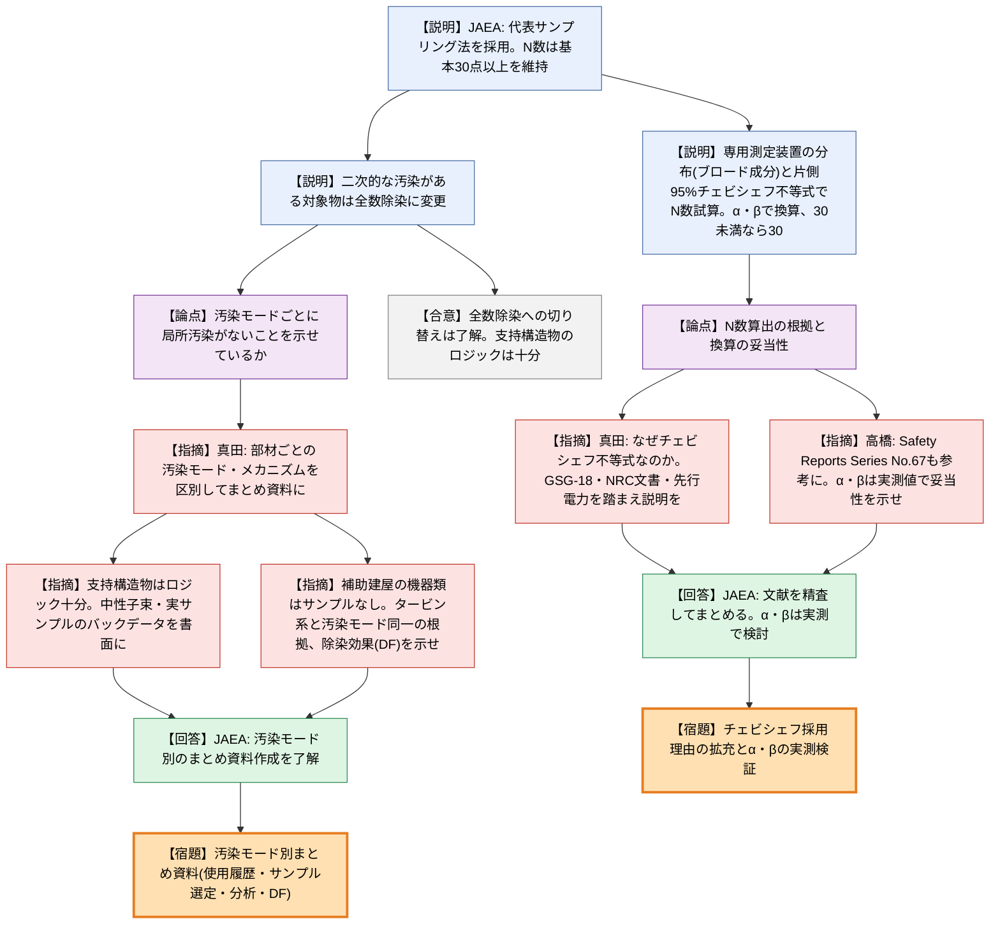
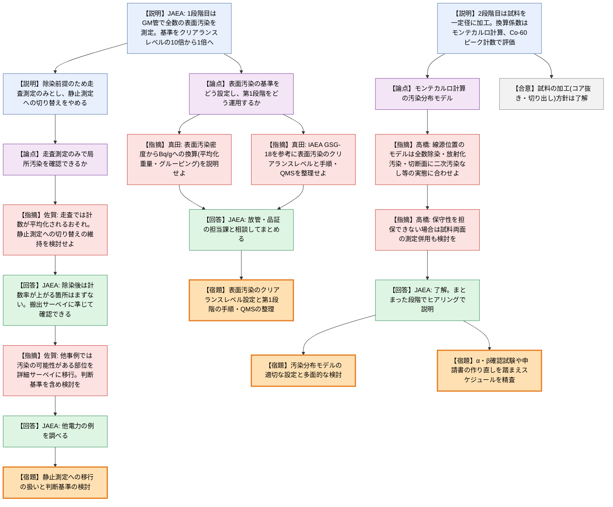

# 第17回クリアランスに関する審査会合（令和8年11月16日）
> 出典 : https://youtube.com/live/OpSWhSTSsLc?si=eHEqQhJ3DaqYjIkc

## 会合の概要
* **前回指摘への対応方針の報告:** JAEA（ふげん）は、6月1日の第15回会合の指摘を受けた第2回クリアランス認可申請の見直し状況を報告した。代表サンプリング法のN数の考え方、1段階目（GM管による表面汚染測定）と2段階目（ゲルマニウム半導体検出器による濃度決定）の測定方法の3項目が対象。二次的な汚染がある対象物を「全数除染」とし、汚染がおおむね同じであることの判断基準を「クリアランスレベルの10倍」から「クリアランスレベルそのもの（1倍）」に厳しくする方針転換を示した。
* **規制庁の受け止め:** 全数除染への切り替えは了解され、JAEAも閉会時に「大きな変更方針は間違っていないと理解した」と述べた。一方で規制庁は、「方針は違っていないが、具体的にどうやるのかを、データや海外の知見を踏まえて整理して説明してほしい」と求め、説明の具体化・根拠の拡充が全面的に求められた。
* **主な宿題:** ①汚染モード（二次的汚染と放射化汚染の混在／放射化汚染のみ）ごとに局所汚染がないことを示すまとめ資料、②IAEA GSG-18等を参考にした表面汚染のクリアランスレベルの設定と第1段階の測定（QMSを含む）の具体化、③チェビシェフの不等式を用いる理由の説明と、補正係数α・βを実測で裏付けること、④モンテカルロ計算での汚染分布モデルを実態に合わせて設定すること。
* **方針変更への差し戻し:** JAEAが全数除染を理由に「走査測定のみ」に簡略化する方針としたのに対し、規制庁は局所汚染の確認と除染の確認の観点から、計数率が上昇した箇所で静止測定に切り替える当初の方法の維持を検討するよう求めた。
* **スケジュール:** α・βを確かめる試験や申請書全体の作り直しが残っており、最終会合までの工程は、JAEAが実測作業等を踏まえて精査することになった。

## 議題ごとの詳細整理

### 【議題1】国立研究開発法人日本原子力研究開発機構 新型転換炉原型炉ふげんにおいて用いた資材等に含まれる放射性物質の放射能濃度の測定及び評価の方法の認可申請について（資料1、別紙1）
* **議論の背景と論点:**
    * 背景: ふげんの第1回申請はトレイ型の専用測定装置で対象物を全数測定する方式だったが、第2回申請は一部の測定単位の放射能濃度から評価単位の濃度を決める代表サンプリング法を採用する。
    * 背景: 申請対象物は、(1)タービン系の解体撤去物（第1回申請と同じ範囲）、(2)原子炉建屋内の支持構造物、(3)原子炉補助建屋の原子炉冷却系関連機器類の3つに分かれる。評価対象核種はコバルト60とセシウム137。
    * 経緯: 第15回会合（6月1日）で、サンプル数と選定方法の妥当性、「汚染がおおむね同じ」の判断基準（クリアランスレベルの10倍以下）の適切さ、走査測定から静止測定に移る判断基準、全γ線計数を用いることと平板のみの基礎試験の妥当性を指摘されていた。
    * 論点1: 局所汚染がないことを、対象物の汚染モード・汚染メカニズムごとに示せているか。
    * 論点2: 全数除染後の第1段階の表面汚染測定で、何を基準に「汚染がおおむね同じ」と判断するか（表面汚染のクリアランスレベルの設定）。
    * 論点3: N数の算出にチェビシェフの不等式を使う理由と、専用測定装置のデータをゲルマニウム半導体検出器用に換算する補正係数α・βの妥当性。
    * 論点4: 第1段階を走査測定のみとしてよいか。
    * 論点5: 加工した測定用試料の換算係数をモンテカルロ計算で設定する際の汚染分布モデル。

* **質疑応答（詳細）:**

  **① JAEAからの説明（変更方針と検討状況）**
    * **【説明者側】（JAEA 添島）:** N数は基本的に30点以上を維持する方針とし、その根拠を第1回申請で使った専用測定装置の豊富な放射能濃度分布データで説明する。二次的な汚染がある対象物は全数除染し、評価単位からランダムサンプリングする。
    * **【説明者側】（JAEA 添島）:** 1段階目の測定では、汚染がおおむね同じであることの基準をクリアランスレベルの10倍からクリアランスレベルそのもの（1倍）に変更する。除染を前提とするため、静止測定への切り替えはやめて走査測定のみとする。
    * **【説明者側】（JAEA 添島）:** 2段階目の測定では、試料形状を単純化するため、コアドリルやボール盤でくり抜くなどして径が一定になるよう加工する。換算係数は、非汚染の平板と標準線源の試験ではなくモンテカルロ計算コードで設定し、過剰な保守性を避けるため全γ線計数ではなくコバルト60のγ線ピーク計数から濃度を求める方式に変更する。
    * **【説明者側】（JAEA 添島）:** タービン系の解体撤去物は二次的な汚染が圧倒的に多く、放射化汚染は冷却材中の酸素17の放射化で生じた窒素17のβ崩壊に伴う中性子によるもの。専用測定装置の分布にはブロードとシャープの2つの山があり、濃度への影響が大きいブロードな分布の平均値と標準偏差をN数試算の基本情報とする。
    * **【説明者側】（JAEA 添島）:** N数は、片側95%のチェビシェフの不等式をNについて解いた式で求める。専用測定装置の平均値に因子α、標準偏差に因子β（評価サイズの違いを考慮）を掛けてゲルマニウム用に換算し、許容値Lは5%とした。計算結果が30を下回る場合は30とする。
    * **【説明者側】（JAEA 添島）:** 評価単位の濃度は、N個のサンプルの算術平均値に標準偏差の4.5倍を加えた値とする（片側チェビシェフの不等式、95%以上の確率でk=4.5）。セシウム137は既存の核種分析データの母集団平均濃度の95%上限値（2003年3月29日時点で1.09×10^-3 Bq/g）を適用し、コバルト60の許容値は逆算で9.89×10^-2 Bq/g（同時点、実際は測定日に減衰補正）となる。
    * **【説明者側】（JAEA 添島）:** 原子炉建屋内の支持構造物はH鋼・I型鋼などの単純形状の炭素鋼で、放射化汚染のみ。中性子分布に偏りがないことと、代表箇所の実サンプルがクリアランス基準値より1〜2桁低いことを確認済み。測定データがまだ少ないため、N数はタービン系の評価から求めた値を用いる。
    * **【説明者側】（JAEA 添島）:** 原子炉補助建屋の原子炉冷却系関連機器類は、炉心から遠く実測の中性子線量率も1μSv/h以下で、放射化汚染の考慮は不要。二次的な汚染は全数除染するため、分布の平均値・標準偏差はタービン系と同程度以下と考え、タービン系のN数を用いる。
    * **【説明者側】（JAEA 添島）:** 1段階目の測定でのセシウム137の放射能濃度は10^-3 Bq/gのオーダーで、コバルト60に対して1%程度にとどまる。このため、GM管式サーベイメータの感度のエネルギー依存性を考慮しても、汚染がおおむね同じかの判断にはほぼ寄与しないと考えている。

  **② 汚染モードごとの局所汚染の説明（規制庁 真田）**
    * **【規制側】（規制庁 真田）:** 代表サンプリング法は、JRR-3等の審査実績で局所汚染の影響が小さければ全数測定でなくてよいとされた事例を踏まえて審査基準に明記したもの。全数除染への切り替えは了解するが、汚染モードの異なる部材が区別されずに説明されているため、部材ごとの汚染モード・汚染メカニズムを整理し、局所汚染がないことをまとめ資料で示してほしい。
    * **【規制側】（規制庁 真田）:** 放射化汚染のみの原子炉建屋内の支持構造物は「対象物が同一の炭素鋼、中性子束に偏在なし、実サンプルがクリアランスレベルの1/10〜1/100」というロジックで十分だが、中性子束データ、実サンプルの選定根拠・分析方法などのバックデータを書面にまとめてほしい。JAEAは汚染モード別のまとめ資料作成を了解した。
    * **【規制側】（規制庁 真田）:** 補助建屋の機器類は今後解体するため実サンプルを取らないので、タービン系と汚染モードが同一であることを確認できる必要がある。それぞれの具体的な物、使用履歴、汚染モード（既存の汚染評価があればそれも）、タービン系のサンプルの選定・分析方法、除染方法と見込まれる除染効果（ふげんのDF試験データ）を書面で示してほしい。JAEAは了解した。
    * **【規制側】（規制庁 真田）:** ふげん全体のロジックは「除染→第1段階で表面汚染を全数測定→ランダムサンプリング」と理解した。除染で局所汚染の影響が除かれ、第1段階のサーベイでクリアランスレベルを下回る見込みであることを整理してほしい。表面汚染密度（Bq/cm²）をBq/gに換算するには形状・厚さ・密度を考慮した平均化重量の設定が必要で、形状ごとのグルーピングなども含めて説明を求める。
    * **【規制側】（規制庁 真田）:** IAEAのクリアランスガイドGSG-18には、表面汚染を測ってから追加除染の要否を判断し、ゲルマニウムでバルクの濃度を判定する一連の手順や、表面汚染のクリアランスレベルとその算出方法が示されていると認識している。これを参考に、表面汚染の全数測定の具体的な方法と、現場運用を担保するQMSを含めた全体像をペーパーにまとめてほしい。JAEAは放管・品証の担当課と相談してまとめると回答した。
    * **【規制側】（規制庁 真田）:** N数の資料はいきなりチェビシェフの不等式から始まっており、なぜそれでよいのか分からない。GSG-18は最小試料数を統計的に決めることを推奨し、そこで引用されるNRCの文書がチェビシェフの不等式の上限値を用いている。こうした文献や先行電力の引用文献を集め、95%ルールを使う理由を拡充してほしい。JAEAは文献を精査してまとめると回答した。

  **③ N数の試算方法と補正係数α・β（規制庁 高橋）**
    * **【規制側】（規制庁 高橋）:** GSG-18の参考文献であるIAEAセーフティレポートシリーズNo.67にも採取すべき試料数の項目があるので、併せて参考にして整理してほしい。
    * **【規制側】（規制庁 高橋）:** 専用測定装置の分布から求まるN数を、評価サイズ・評価方法の違いを考慮した因子α・βで平均値と標準偏差に乗じて換算する考え方までは理解した。α・βの具体的な設定方法の整理に加え、専用測定装置とゲルマニウム半導体検出装置の実測値でα・βの妥当性を示してほしい。
    * **【説明者側】（JAEA 添島）:** α・βは実測データがないと結論が出せないと考えており、指摘のとおり実測による検討を行う。

  **④ 1段階目の測定方法（静止測定の扱い、規制庁 佐賀）**
    * **【規制側】（規制庁 佐賀）:** 走査測定では局所的に放射能が高い部分が検出器を通過する時間が短く、計数値が平均化されるおそれがある。静止測定は一定位置で十分な時間測るため、局所的な偏在の影響を確認しやすい。局所汚染がないこと・除染が適切に行われたことの確認は重要なので、当初計画どおり計数率が上昇した箇所で静止測定に切り替える方法の維持を検討してほしい。
    * **【説明者側】（JAEA 添島）:** 当初は除染を前提としていなかったため、局所汚染で針が振れたら静止測定に切り替える考えだった。除染後は特定箇所で計数率が上がることはまずないと考え、走査測定のみとした。搬出時のサーベイに準じたやり方で、汚染が偏っていないことを確認できると考えている。
    * **【規制側】（規制庁 佐賀）:** 他のクリアランス事例でも、ふげんと同様に測定前に表面汚染密度測定を行い、汚染の可能性があると判断した部位は詳細サーベイに移行している。こうした事例を参考に、静止測定への移行の判断基準も含めて検討してほしい。JAEAは他電力の例も調べると回答した。

  **⑤ 2段階目の測定（モンテカルロ計算の汚染分布モデル、規制庁 高橋）**
    * **【規制側】（規制庁 高橋）:** 形状がさまざまな対象物をコア抜きや四角状の切り出しで一定サイズに加工する点は了解した。モンテカルロ計算で複数パターンを検証して保守的な換算係数を設定する際、自己吸収補正係数を設定するための線源位置のモデルについては、全数除染すること、放射化汚染も存在すること、切り出した面には二次汚染があり得ないことなども含め、実態に合うよう汚染モデルを適切に設定してほしい。JAEAは了解した。
    * **【規制側】（規制庁 高橋）:** モデル構築の中で保守性を担保できない場合は、試料の両面を測定して結果を組み合わせる評価方法も考えられるので、多面的に検討し、ヒアリング等で説明してほしい。JAEAはトピックごとにまとまった段階でヒアリングで説明すると回答した。

  **⑥ 今後のスケジュールと総括**
    * **【規制側】（規制庁 川崎）:** 本日のコメントと未説明事項は資料の30〜31ページにまとめられているので、整理して説明してほしい。今後の説明の全体スケジュールをどう考えているか。
    * **【説明者側】（JAEA 添島）:** 最終会合までの工程案はヒアリングで一度示したが、α・βを確かめる試験や、それを踏まえた申請書全体の作り直しとそのヒアリングもあるため、時期は精査させてほしい。規制庁は、実測作業等を踏まえて精査することで了解した。
    * **【説明者側】（JAEA 中村）:** 大きな変更方針は間違っていないと理解した。IAEAのクリアランスガイドなどをさらに調べて精査し、より丁寧に説明する。
    * **【規制側】（規制庁 進行役）:** 基本的な考え方は違っていないが、具体的にどうやるのかについて、データや海外の知見を踏まえ、整理された形で説明することを求める。

* **結論と宿題事項（アクションアイテム）:**
    * **【合意】**: 二次的な汚染がある対象物（タービン系の解体撤去物、原子炉補助建屋の原子炉冷却系関連機器類）を全数除染する方針への切り替えは、規制庁が了解した。原子炉建屋内の支持構造物の局所汚染がないことのロジック（同一の炭素鋼・中性子束の偏在なし・実サンプルがクリアランスレベルの1/10〜1/100）は「ロジックとしては十分」とされた。
    * **【合意】**: 試料をコア抜き等で一定サイズに加工してゲルマニウムで測る方針は了解された。基本的な方向性は規制庁・JAEA双方で違っていないことが確認された。
    * **【宿題】**: 汚染モード別のまとめ資料。支持構造物は中性子束データ・実サンプルの選定根拠・分析方法などのバックデータ。タービン系と補助建屋の機器類については、使用履歴・汚染モードが同一と言える根拠、サンプルの選定・分析方法、除染方法と除染効果（DF）。
    * **【宿題】**: IAEA GSG-18等を参考に、表面汚染のクリアランスレベル（平均化重量、形状によるグルーピングを含む）の設定方法と、第1段階の表面汚染全数測定の具体的手順・QMSを整理する。
    * **【宿題】**: チェビシェフの不等式（95%ルール）を使う理由を、GSG-18、IAEAセーフティレポートシリーズNo.67、NRCの文書、先行電力の引用文献を踏まえて拡充する。補正係数α・βの設定方法を整理し、専用測定装置とゲルマニウム半導体検出装置の実測値で妥当性を示す。
    * **【宿題】**: 第1段階で計数率が上昇した箇所を静止測定に切り替える方法の維持を、他事例を参考に、移行の判断基準も含めて検討する。
    * **【宿題】**: モンテカルロ計算での線源位置（汚染分布）のモデルを実態に合わせて設定し、保守性を担保できない場合は試料両面の測定の併用なども検討する。
    * **【宿題】**: α・βの確認試験や申請書の全面的な作り直しを踏まえ、最終会合までのスケジュールを精査する。

## 論理構造の可視化（Mermaid）

### 【議題1】ふげん第2回クリアランス認可申請（代表サンプリング法・N数）

### 【議題1】ふげん第2回クリアランス認可申請（1段階目・2段階目の測定方法）

