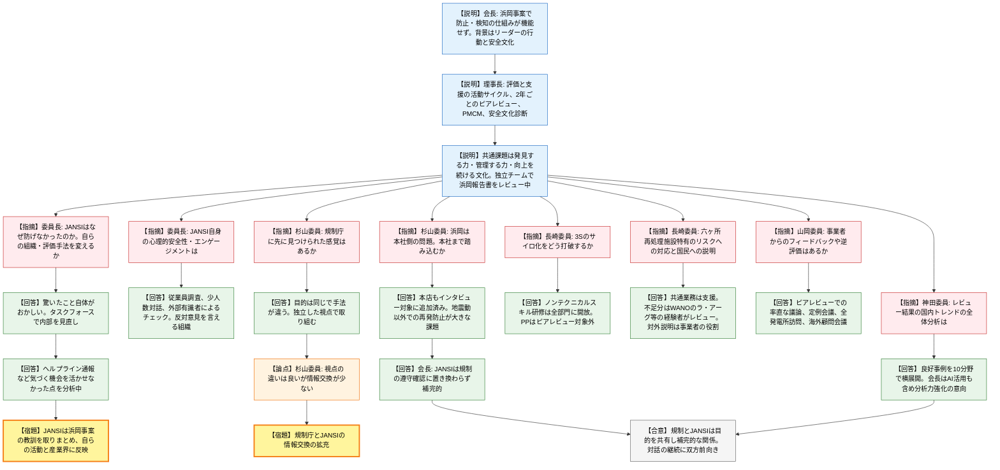
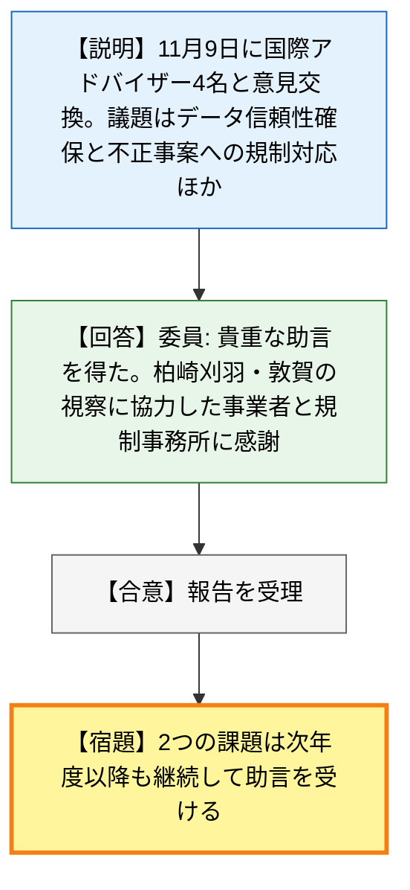
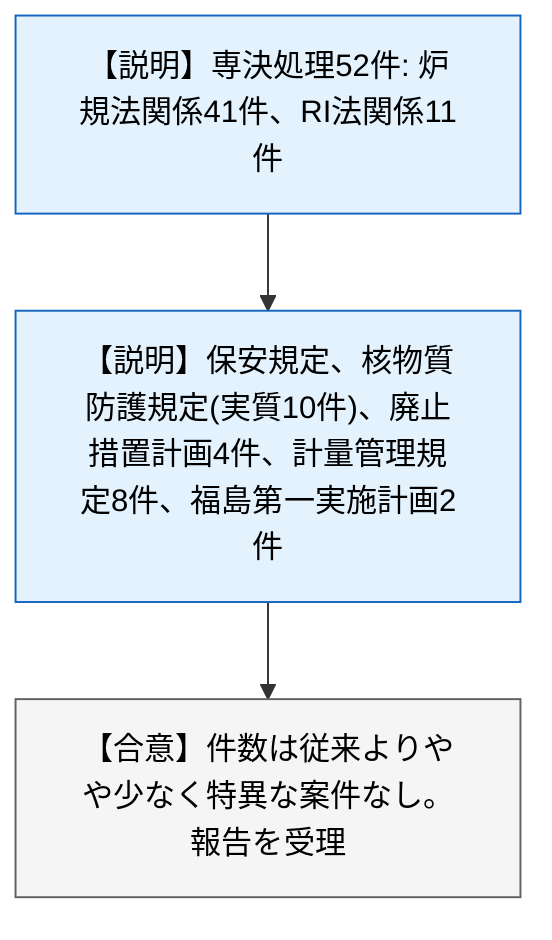

# 第43回原子力規制委員会（令和8年11月18日）
> 出典 : https://youtube.com/live/Ypc75_XzFcg?si=2d4IgrD7IpvWbEU7

## 会合の概要
* **長く途絶えていた原子力安全推進協会（JANSI）との意見交換を実施。冒頭から中部電力浜岡原子力発電所の基準地震動策定に関する不適切事案が主題に**
  ウェブスター会長は、不適切な行為を防止・検知する複数の仕組みが機能しなかったと認め、背景には組織の安全文化を形作るリーダーの行動・意思決定があると述べた。JANSIは中部電力の調査報告書を事業者から独立した立場でレビューするチームを設け、教訓の抽出を進めている。
* **山中委員長は「JANSIはなぜ防げなかったのか」「JANSI自身の組織文化はどうか」と正面から問うた**
  JANSI側は「驚いたこと自体がおかしい」と受け止め、タスクフォースで自らの活動の見直しを検討中と回答した。ヘルプラインへの通報や外部からの問い合わせなど、立ち止まる機会が何度もあったのに活かされなかった点に着目していると説明した。
* **規制とJANSIは「補完的」な関係であることを双方が確認。一方で情報交換の少なさも浮き彫りに**
  杉山委員は、全国の検査指摘事項が多くないのはJANSI・WANOのピアレビューがあってこそと評価しつつ、本社側で起きた浜岡事案は従来の発電所中心のレビューでは検出が難しかったと指摘した。JANSIは本店も安全文化診断のインタビュー対象に加えていると応じた。会長は、JANSIの活動が規制の遵守確認に置き換わることはなく、補完的な関係だと強調した。
* **3S（安全・核セキュリティ・保障措置）のサイロ化、六ヶ所再処理施設の特殊性、事業者からのフィードバック、レビュー結果の全体傾向分析など、委員から多角的な質問**
  JANSIは、核物質防護（PP）はピアレビューの対象外とする一方、ノンテクニカルスキル研修は全部門に開放していると説明した。再処理施設については、WANOに在籍するラ・アーグ（仏）やセラフィールド（英）の経験者のレビューで補っていると回答した。会長は、AIの活用も含め、パフォーマンス情報の分析力を強化する意向を示した。
* **国際アドバイザー会合の結果概要と、第2四半期の専決処理（52件）の報告を受理**
  国際アドバイザー会合で議論した不正事案への対応などの課題は、次年度以降も継続して助言を受ける方針とされた。専決処理は従来の四半期より件数がやや少なく、特異な案件もないとして報告を受けた。

## 議題ごとの詳細整理

### 【議題1】原子力規制委員会と原子力安全推進協会との意見交換（資料1）
* **議論の背景と論点:**
  * **背景**
    * JANSIは福島第一原子力発電所事故を受けて2012年に設立された、原子力産業界の自主規制機関。米国のINPO（原子力発電運転協会）の経験を参考にしている。
    * 山中委員長によれば、JANSIとの意見交換は相当長い間行われていなかった。昨年秋にWANO（世界原子力発電事業者協会）関係者から、WANOには規制当局と課題分析を共有した実績があるとして、意見交換を勧められたことが今回の開催につながった。
  * **JANSIの説明（ウェブスター会長）**
    * 浜岡原子力発電所の基準地震動策定に関する不適切事案について、中部電力の調査報告書のとおり、不適切な行為を防止・検知する複数の仕組みが機能しなかったと述べた。背景にある問題は、組織の安全文化を形作るリーダーの行動や意思決定にあるとした。
    * JANSIは中部電力の改革を支援し、教訓を他の原子力事業者と共有するとともに、問題を検知するJANSI自身の能力も高めていく。理事会やアドバイザリー委員会を含む産業界の関係者と対策を議論しており、タイムリーな対応が重要と認識していると述べた。
    * ミッションは「日本の原子力産業界における世界最高水準の安全性の追求」。事業運営の5原則はINPOが47年間実践してきたものと同じで、特に「CEOの関与」（全原子力事業者の社長が理事を務め、社長研修等に参加）と「独立性」（リソースは会員に依存するが、個々の会員とは完全な独立性を保つ）を重視している。
    * 2019年に策定した10年戦略を、2024年に大幅改定した。ガバナンス面では、社長で構成する理事会に加え、国内・国際の2つのアドバイザリー委員会が外部の視点を提供している。
    * 設立当初の困難は2015年のINPOによる独立評価でも指摘され、理事会の再構成などの改革を行った。ピアレビューは2022年にWANOとの同等性が認定され、今年、初の包括的な評価を経て認定が更新された。
    * 産業界では戦略目標と中間指標を設定しており、WANOの「アクション・フォー・エクセレンス」を掲げる国際的な目標とも整合している。
  * **JANSIの説明（加藤理事長、資料7〜16ページ）**
    * 活動サイクルは、優れた仕事のやり方（エクセレンス）を設定し、事業者とのギャップを評価し、支援でギャップを埋めるというもの。
    * ピアレビューはJANSIとWANOが交互に実施するため、日本の事業者は2年ごとにいずれかのピアレビューを受ける（世界的に見ても最も高い頻度）。JANSIがWANOの代行でピアレビューを行うこともある。約30名が2週間ほど現場に滞在し、前後に長い分析期間を設ける。最後は社長と面談し、理事長と社長の1対1のミーティングも行う。
    * 支援として、ピアレビューを「人間ドック」とすれば普段の健康管理にあたるPMCM（通常のモニタリング）を、WANOと共同で再稼働プラントに実施している。
    * 安全文化醸成活動として、アンケートやインタビューによる発電所現場診断を概ね4年ごとに行い、社長に報告している。運転経験情報については、原子力規制庁と四半期ごとに情報交換している。人材育成では、リーダーシップやコミュニケーション等のノンテクニカルスキルの研修を、社長から現場の主任クラスまで11コース実施している。
    * 活動から得た共通課題は、「発見する力」（課題を自ら見つけ解決するサイクル）、「管理する力」（将来の課題を事前に認識し管理する）、「向上を続ける文化・人材育成」の3つ。
    * 浜岡の不適切事案は産業界全体の信頼に関わる重大な事案と受け止めている。JANSI内に、中部電力の調査委員会報告書を事業者から独立した立場でレビューするチームを作り、レビューと教訓の抽出を行っている。
    * 注目しているのは、立ち止まって修正する機会が何度かあったのに活かされなかった点。地震動策定という特定の課題ではなく、地震動以外で同様の課題が生じたときに組織として修正できるかどうかに着目している。
  * **論点**
    * JANSIが浜岡事案を防げなかったことを受け、JANSI自身の組織・評価手法をどう変えるのか。
    * JANSI自身の組織文化（職員の心理的安全性・エンゲージメント）をどう評価しているか。
    * 規制検査とJANSIのピアレビューの関係（補完性・情報交換）。本社側で起きた事案にどう踏み込むか。
    * 3Sのサイロ化への対応、再処理施設特有のリスクへの対応、事業者からのフィードバック、レビュー結果の全体傾向の分析。

* **質疑応答（詳細）:**
  * 【規制側】山中委員長
    NRAとして審査・検査に大きな抜けがあったとは考えていないが、審査の初期段階で不正が起きた事実を重く受け止め、不正を抑止する制度の見直しと、NRA自身の組織文化の問い直しに着手していると述べた。そのうえで、規制を超えたエクセレンスの追求を掲げるJANSIとして、中部電力の不正事案を防げなかったことをどう考え、自身の組織や評価手法を変えるのかを質問した。
  * 【説明者側】ウェブスター会長
    不適切事案に驚いたが、驚くこと自体がおかしいと受け止めている。調査報告書で既存のバリアが機能しなかったことが分かり、JANSI内部に目を向け、弱みへの感度を上げる改革を考えていると回答した。報告書を待つだけでなく、江藤部長の下にタスクフォースを設置し、JANSIのリーダー経験者も参画して対策を検討してきたとした。
  * 【説明者側】加藤理事長
    現在分析中だが、ヘルプラインへの通報や外部からの問い合わせなど、気づく機会が何回かあったと述べた。なぜ活かせなかったのか、今後どう活かすかに着目し、JANSIの活動への反映と、産業界に検討してもらう事項を取りまとめていると説明した。
  * 【規制側】山中委員長
    事業者の安全文化を評価する前に、JANSI自身の組織文化、特に職員の心理的安全性とエンゲージメントの実態を会長はどう評価しているかを質問した。
  * 【説明者側】ウェブスター会長
    幹部とスタッフによる自己評価、産業界からのフィードバック、指標による監視で、明確な目標に向けて活動できているかを評価していると回答した。3年に1回の従業員調査（仕事の満足度、ミッション達成への士気等）を真剣に受け止めて改善につなげているほか、年6回の来日のたびに職員と少人数で、事前に質問を自由に受け付ける対話を行っているとした。
  * 【説明者側】加藤理事長
    JANSIは約200名と、1基だけの発電所より小さい組織で、ワンフロアにいるため見通しが良いと述べた。自らの評価が歪まないよう、ピアレビューのプロセスを退職者にレビューしてもらい、安全文化診断の集約結果も外部有識者に見てもらってから出していると説明した。理事長自身も月1〜2回、6人程度の職員との少人数ミーティングを行っているとした。
  * 【説明者側】田南常務執行役員
    着任後1年余りで最も驚いたのは、理事長の発言にも「私は反対です」と平気で言える、ストレートにものが言える組織であることだと述べた。INPO・米国の文化の影響に加え、各発電所の幹部経験者など強い専門性と信念を持つ人が集まっていることが背景にあり、心理的安全性が非常に高いと評価した。
  * 【規制側】山中委員長
    委員就任から9年以上で初めてJANSIと意見交換でき、JANSIが浜岡事案を見抜けなかったことを受けて自ら改革を進めていること、職員の心理的安全性やエンゲージメントに注意を払っていることを直接聞けたとまとめた。
  * 【規制側】杉山委員
    JANSIのピアレビューは規制当局から見ても非常に重要であり、全国の発電所の検査指摘事項が多くないのはJANSIやWANOのピアレビューがあってこそと述べた。それでも一定数の指摘事項が生じることを、JANSIは「規制庁に先に見つけられた」と感じるのか、実務に近い立場からの所見を求めた。
  * 【説明者側】加藤理事長
    規制庁とJANSIは目的は同じだが手法が異なると回答した。規制は保安規定など決められたルールへの適合を見るのに対し、JANSIは世界の発電所のエクセレンスとの比較で各発電所を見ているとした。
  * 【説明者側】渡邉ピアレビュー計画部長
    世界の良好な活動や所員の振る舞いと比べて足りない点を指摘していると説明した。規制庁の指摘事項も情報としては見ているが、「先に見つけられた」という意識はなく、発電所の安全性向上という目的のもと、独自の活動に取り組んでいると回答した。
  * 【説明者側】加藤理事長
    渡邉部長の説明は独立した視点を持ちたいという趣旨だと補足した。事象が起きる前に見つけたい気持ちはあるが、検査官と同じ見方ではなく、違う観点から問題や良い点を見つけたいと述べた。
  * 【規制側】杉山委員
    規制庁は基準適合性の観点で見る部分が多く、視点が異なること自体は良いことだと述べた。一方で、それぞれが何を重視して検査・レビューしているかを含め、情報交換が少ないと感じており、もう少し連携を図れるとよいとした。
  * 【規制側】杉山委員
    JANSIのレビューは主に発電所を対象としている（資料4ページ）が、浜岡の問題は発電所というより本社側で起きたと指摘した。従来の枠組みでは検出は難しかったと考えられるとして、今後は本社まで踏み込むのか、安全文化醸成というより大きな活動の中で改善するのかを質問した。
  * 【説明者側】加藤理事長
    放射性物質を扱う発電所が最もリスクが高いため注力してきたと説明した。今回の事案を受け、活動の改善点と事業者への要望をまとめている過程で、杉山委員の指摘の方向性も出てくる可能性があるとした。地震動だけに注目するのではなく、同様のことが別の分野・場所で起きないようにすることがより大きな課題だと述べた。
  * 【説明者側】江藤安全基盤部長
    安全文化アセスメントでは、安全に関わる振る舞いを支える組織文化をインタビューに基づいて評価し、懸念があればマネジメントでの対処を提案していると説明した。本店の考え方もサイトの活動に影響するため、本店にもインタビュー対象として加わってもらう活動を既に行っていると回答した。
  * 【説明者側】ウェブスター会長
    「補完的」という言葉が非常に重要だと述べた。明確に定められた規制への準拠を検査で細かく見ることにJANSIの活動が置き換わることは決してなく、補完し合う関係だとした。JANSIのレビューは2〜4年程度の周期で新鮮な目で行うため、双方が違う結論に至ることもありうるとし、今回は大きな穴があったことが明らかになったので、そこに注力して何をすべきか考えると述べた。
  * 【規制側】長崎委員
    人は易きに流れやすく、「規制庁に怒られなければいい」という低いところで満足しないよう、事業者により高い目標へのインセンティブを与えていることが分かって良かったと述べた。そのうえで、発電所の現場で安全・核セキュリティ・保障措置（3S）の部門がサイロ化する可能性があり、その壁を破る業界共通のベストプラクティスをどう抽出・共有するかを質問した。
  * 【説明者側】加藤理事長
    リーダーシップやコミュニケーション等のノンテクニカルスキルの研修は、本店・安全担当・核物質防護（PP）担当・核物質計量管理の担当など、全ての人にオープンにしていると回答した。PPは情報管理が厳しいためピアレビューの対象外だが、以前の柏崎刈羽でのPP事案の際には、事業者間でPP関係者がピアレビューを行う際の着眼点などを支援したと説明した。
  * 【規制側】長崎委員
    安全が先行しがちで、PPには特殊性もあるが、3Sをうまく進めてほしいと要望した。続いて、六ヶ所再処理施設は国内唯一で、世界でもオラノのラ・アーグくらいしかない巨大な化学プラントであり、比較対象がないと独自の基準で現状に満足しやすいと指摘した。軽水炉の経験の流用ではなく再処理施設特有のリスクに基づく取組をどう進めるか、また評価結果を内部で閉じず地元や国民に論理的に説明すべきではないかと質問した。
  * 【説明者側】加藤理事長
    再処理施設は発電所と異なるが、制御室での運転員の振る舞い（スリーウェイコミュニケーション等）、保修の業務、放射線管理など共通部分も多いと回答した。理事会には日本原燃の社長も入っており、支援の提案やリクエスト対応を行い、安全文化診断も再処理工場を対象にしているとした。経験の少ない分野は、WANOにいるラ・アーグや（操業を終えた）セラフィールドの再処理施設の経験者がレビューする仕組みがあると説明した。地元・国民へのメッセージの出し方は各事業者が担うものと考えていると述べた。
  * 【規制側】山岡委員
    JANSIが事業者を評価・支援する一方で、事業者側からのレスポンスや逆評価を聞く場はあるのかを質問した。先ほど社内では忖度があるという話もあったことから、関心があるとした。
  * 【説明者側】加藤理事長
    2週間以上現場に滞在するピアレビューでは、JANSIの見立てに対して発電所の責任者から率直な見解が示され、同意できないとの反応もあり、事業者からのフィードバックは非常に強いと回答した。各社の原子力部長級・本部長・社長との定例会議や、他社の人員と共に毎年全発電所を訪問してJANSIへの要望・不満を聞く機会もあると説明した。カナダ・フランス・米国・スペインの有識者による顧問会議からも意見を得ているとした。
  * 【規制側】山岡委員
    こうした組織は外部から批判的に見てもらうことが大事なので、今後も続けてほしいと述べた。
  * 【規制側】神田委員
    世界のエクセレンスを手本にしたレビューと支援で、良好事例が一部の発電所から全発電所へ広がるといった国内のトレンドを、個々の発電所単位ではなく全体としてどう分析しているかを質問した。例えば「この種のエクセレンスは日本では比較的実施が容易」「この項目と組織の特徴に関係がありそう」といった分析は、規制組織とJANSIがより補完的・相乗的な関係になるうえで一つの要素になるとした。
  * 【説明者側】渡邉ピアレビュー計画部長
    例として、使用済燃料プール周りの異物管理について、世界の良好な管理方法を日本の発電所に紹介し、管理水準が上がった事例を挙げた。運転・緊急時対応・保修・教育訓練など10分野（資料9ページ）で、JANSIを中心に事業者間の横の連携を取り、得られた知見を各発電所に展開していると説明した。世界の水準は上がり続けるため、最新情報を伝え続けることがJANSIの役割であり、事業者には水平展開が重要だと述べた。
  * 【説明者側】ウェブスター会長
    JANSIはパフォーマンスに関する生の情報を豊富に持っており、今年は竹越常務を筆頭に包括的にレビューし、9月の社長研修の資料にまとめ、そこからテーマが見えてきたと述べた。これは第一歩であり、分析能力を高め、AIの活用で潜在的な問題を特定しやすくしたいとした。問題が起きてから是正するだけでなく、傾向として見えている段階で捉えて対策を取れるよう強化したいと述べた。
  * 【規制側】山中委員長
    個別事業者の検査（レビュー）結果を共有した意見交換はできないことは承知しているが、課題の分析や国全体で共有できる事案について意見交換したいと述べた。JANSIは規制を超えたエクセレンスの追求を目標としていると理解しているとし、会長と理事長に最後のコメントを求めた。
  * 【説明者側】加藤理事長
    JANSIが事業者と真摯に議論するための情報管理について理解に感謝すると述べた。2年前の取組（名称は聞き取り不明瞭）で示された、日本の規制当局・事業者・関係機関の特徴や困難さを意識し、コミュニケーションを良くするための配慮をしながらこうした場を持ちたいとした。また「規制を超えて」とは、規制を守るのは当然のこととして、さらに高みを目指すという意味だと補足した。
  * 【説明者側】ウェブスター会長
    双方のミッションには補完性があると認識しており、今後もさらに対話を続けたいと述べた。

* **結論と宿題事項（アクションアイテム）:**
  * 意見交換として実施し、山中委員長が「貴重な意見交換ができた」と総括して終了した。決定事項はない。
  * JANSIは浜岡事案について、独立したレビューチーム・タスクフォースで教訓を抽出し、自らの活動と産業界への要望に反映する取りまとめを進めている（結果は今後）。
  * 杉山委員から、規制庁とJANSIの間の情報交換（何を重視して検査・レビューしているか）の拡充が提起された。双方とも今後の対話継続に前向きな姿勢を示した。

### 【議題2】原子力規制国際アドバイザーと原子力規制委員会との意見交換会合の結果概要（資料2）
* **議論の背景と論点:**
  * **背景**
    * 11月9日（月）、原子力規制国際アドバイザー4名（リチャード・メザーブ氏、フィリップ・ジャメ氏、ルミナ・ベルシ氏、マーク・フォイ氏）と意見交換会合を行った。
    * 議題は2つで、1つ目はデータ信頼性確保と不正事案への規制対応。2つ目の議題名は今回の説明の文字起こしからは聞き取れなかった（11月9日の会合の記録では「事業者の主体的な安全性向上を促す規制（イネーブリング・レギュレーション）」）。
  * **論点**
    * 各アドバイザーから、自国での知見・経験を踏まえた助言を受けたことの報告。

* **質疑応答（詳細）:**
  * 【説明者側】船田国際室長
    会合の開催概要と議題を説明し、アドバイザーからそれぞれの知見・経験を踏まえた助言を得たと報告した。
  * 【規制側】委員（発言者名は文字起こしから特定できず）
    各アドバイザーから貴重な指摘・意見を得られ、良い機会だったと述べた。ジャメ氏が会合前週に柏崎刈羽原子力発電所を、フォイ氏が会合の翌々日に敦賀発電所を訪問したことについて、東京電力・日本原電と、協力した各規制事務所のスタッフに感謝を述べた。
  * 【規制側】山中委員長
    取り上げた2つの課題は継続的に議論・助言が必要な重要な課題であり、次年度以降も継続してアドバイスを受け、議論を進めていきたいと述べた。

* **結論と宿題事項（アクションアイテム）:**
  * 報告を受けて議題を終了した。
  * 2つの課題について、次年度以降も国際アドバイザーから継続的に助言を受ける方針。

### 【議題3】令和8年度第2四半期における専決処理（報告）（資料3）
* **議論の背景と論点:**
  * **背景**
    * 第2四半期の専決処理案件のうち、原子力規制委員会への報告が必要なものの概要報告。
  * **内訳（計52件）**
    * 原子炉等規制法関係41件:
      * 保安規定の変更認可（例: JAEA原子力科学研究所の放射性廃棄物の廃棄施設）
      * 核物質防護規定の変更20件（治安機関への意見聴取と認可を1セットで行うため、実質10件）
      * 廃止措置計画の認可等4件（例: 新型転換炉ふげんの廃止措置の進捗に伴うもの）
      * 核燃料物質使用施設の保安規定の変更認可（例: 大洗の研究所の液体廃棄物施設の使用終了に伴うもの）
      * 計量管理規定の変更認可8件（例: 女川原子力発電所）
      * 福島第一原子力発電所の実施計画の変更認可2件（例: 大型廃棄物保管庫、セシウム吸着装置の吸着塔保管施設の設置）
    * RI法関係11件: 放射性同位元素の使用の許可、合併に伴う地位の承継など。

* **質疑応答（詳細）:**
  * 【説明者側】小西総務課係長
    資料3に基づき、上記の内訳と主な案件の例を説明した。
  * 【規制側】山中委員長
    委員からの質問・コメントはなかった。件数も従来の四半期と比べやや少なく、特異な案件もないと述べた。

* **結論と宿題事項（アクションアイテム）:**
  * 報告を受けて議題を終了した。宿題事項はない。
  * その他の案件はなく、会議は終了した。

## 論理構造の可視化（Mermaid）

### 【議題1】原子力規制委員会と原子力安全推進協会との意見交換

### 【議題2】原子力規制国際アドバイザーと原子力規制委員会との意見交換会合の結果概要

### 【議題3】令和8年度第2四半期における専決処理（報告）

