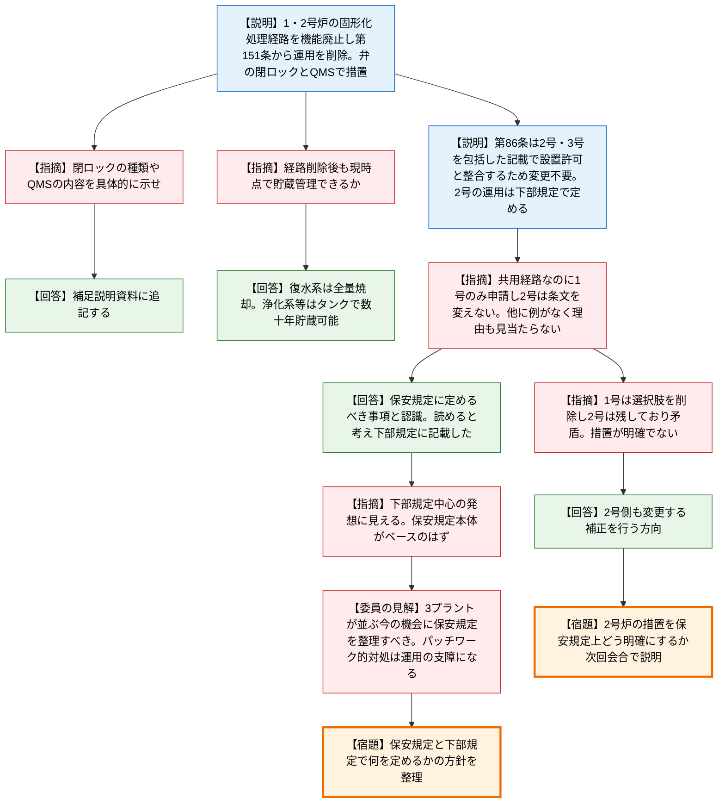
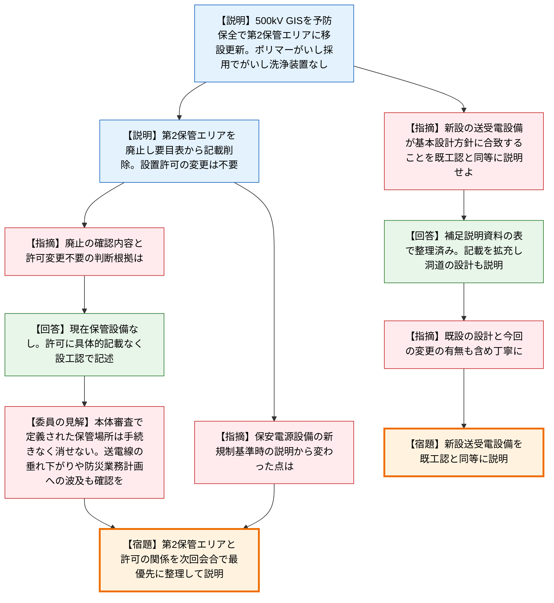
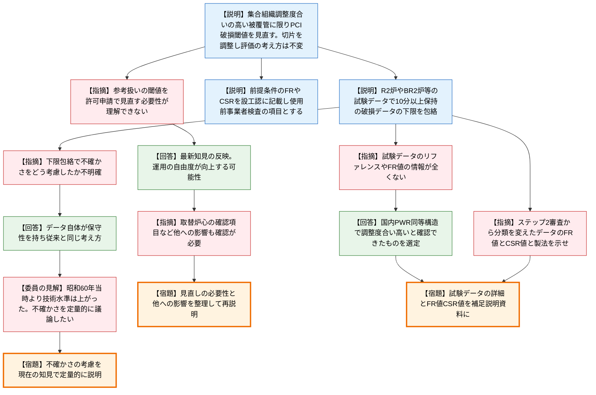
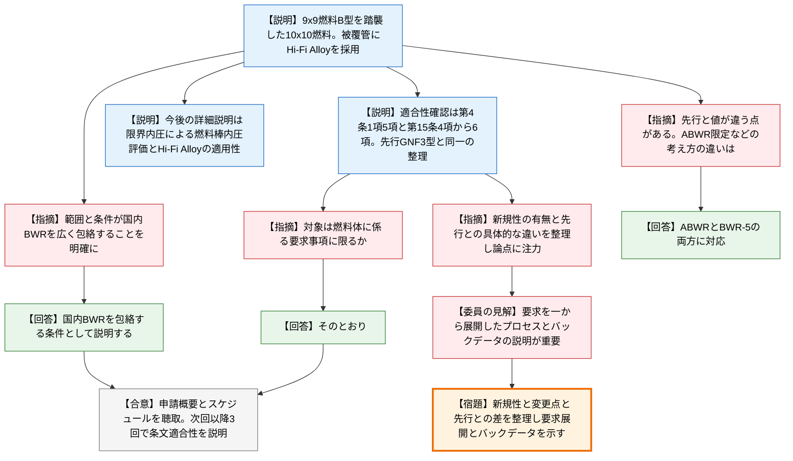
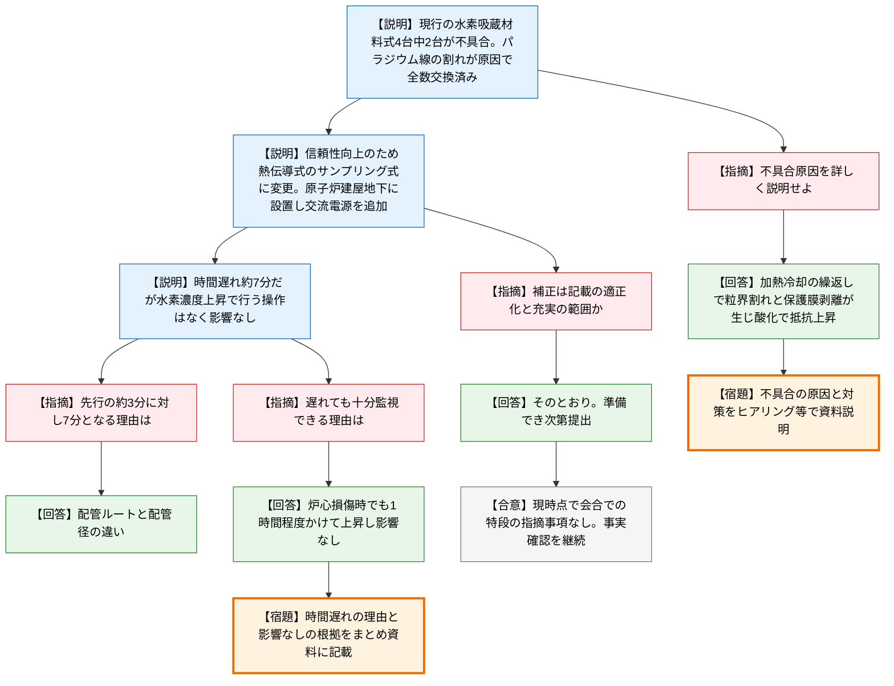
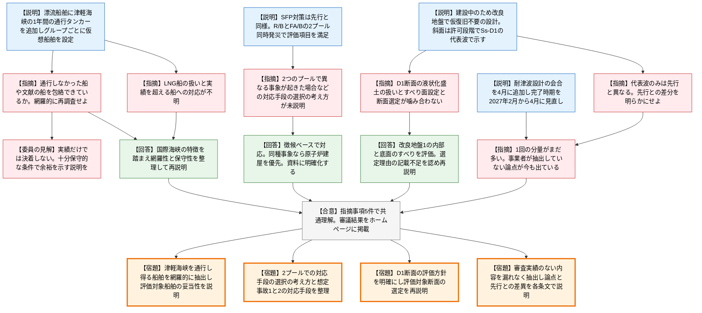

# 第1440回原子力発電所の新規制基準適合性に係る審査会合（令和8年11月19日）
> 出典 : https://youtube.com/live/LT8-QoiBiLU?si=1W2bnjBMTfTVY4vy

## 会合の概要
* **6議題を約8時間かけて審査。多くの議題で「説明不足」「論点の未抽出」が指摘された**
  中国電力(島根)、九州電力(玄海)、関西電力(高浜)、東芝(NX-1型燃料)、東北電力(女川)、電源開発(大間)の6件を扱った。初回の概要説明だった東芝・東北電力を除き、いずれも次回以降の会合での再説明が求められた。
* **島根の保安規定変更で、杉山委員・規制庁が「保安規定よりも下部規定を中心に考えているのではないか」と事業者の姿勢を問題視**
  使用済樹脂等の固形化処理経路を使わない措置について、1号炉は申請したのに共用している2号炉は申請していない矛盾が指摘された。中国電力は2号炉も補正する方向を示し、廃止措置中・運転中・新規の3プラントが並ぶ今の機会に保安規定を整理するよう促された。
* **玄海の特高開閉所更新では、移設先の「第2保管エリア」廃止の扱いが最大の論点に**
  事業者は設置許可の変更は不要と説明した。これに対し杉山委員は、本体審査で定義された保管場所が手続きなく消えるわけにはいかないと指摘し、アクセスルートへの影響や原子力事業者防災業務計画への波及も含めて整理するよう求めた。
* **高浜の高燃焼度燃料では、PCI破損閾値の見直しについて「何のために見直すのか」から再説明を要求**
  規制庁は、試験データの詳細(リファレンス、FR値・CSR値)の提示と、不確かさの考慮を定量的に説明するよう求めた。杉山委員は、今後も使える確実なデータに基づく審査実績にすべきだとした。
* **大間では計5件の指摘事項が確定。過去2回の会合で出した「審査実績のない内容を漏れなく抽出せよ」との指摘を、改めて重ねて指摘**
  5件は、漂流船舶の網羅的な抽出、2つの使用済燃料プールでの対応手段の選択の考え方(2件)、斜面の評価対象断面の選定、審査実績のない内容の漏れない抽出である。最後の1件について規制庁は、過去の指摘にもかかわらず事業者が抽出していない論点が今も出ていると指摘した。耐津波設計の一通りの説明完了時期は2027年2月から4月に見直された。

---

## 議題ごとの詳細整理

### 【議題1】中国電力（株）島根原子力発電所の使用済樹脂等の処理方法の変更等に係る保安規定変更認可申請の審査について
* **議論の背景と論点:**
  * **背景:**
    * 2026年8月27日の申請。変更は2点ある。1点目は、ドラム詰め装置の固化方式の変更に伴い、使用済樹脂・フィルタスラッジの処理の運用を一部変更するもの(第2編第151条)。2点目は、実用炉規則の改正(第77条等の削除)に伴う条文の変更・削除(第6条・第10条・第106条・第117条・第119条)。
    * 1・2号炉の使用済樹脂等の固形化処理は30年以上使用実績がないため、運用を削除する。復水系の樹脂等は全量焼却しており、ドラム詰め装置への主経路を削除する。原子炉浄化系・燃料プール冷却浄化系の樹脂等は放射能濃度が高く現行の埋設センターで受け入れられないため、当面は貯蔵タンクで保管し、副経路を削除する。
    * 1号炉の樹脂等は、1・2号炉共用の2号炉ドラム詰め装置で処理していた。この経路を機能廃止し、弁の閉ロック運用とQMS文書への規定で措置する。
    * 第1編第86条は2号炉・3号炉を包括した記載(「または」でつなぐ記載)で設置許可と整合しているため変更不要とし、2号炉の詳細な運用は下部規定で定めるとした。
  * **論点:**
    * (1) 経路を使用しない措置の具体的な内容と管理方法。
    * (2) 経路を削除した後も廃棄物を適切に貯蔵管理できるか。
    * (3) 1・2号炉共用の経路なのに、1号炉だけ申請し2号炉の保安規定を変更しないことの妥当性。
    * (4) 保安規定と下部規定の関係に対する事業者の認識。

* **質疑応答（詳細）:**
  **＜中国電力の説明の要点＞**
    * 【説明者側】中国電力 山崎
      変更点は上記の2点で、施行は認可日から10日以内とする。第151条の変更は廃棄物処理施設の使用前事業者検査の終了日以降、実用炉規則改正に伴う変更は初回の安全性向上評価の届出(炉規法第43条の3の29)以降に適用する。後者は先行のPWRプラントと同様の内容である。
    * 【説明者側】中国電力 山崎
      2号炉のドラム詰め装置で固形化処理を行うには設置許可の変更が必要なため、事業者の判断で処理を行うことはない。

  **＜質疑＞**
    * 【規制側】規制庁 担当者
      6ページの措置について、対象・種類・具体的な管理方法と、他に講じる措置の有無を質問した。
    * 【説明者側】中国電力 中野
      赤枠の範囲を機能廃止し、第1弁の閉ロック運用とQMS文書への規定で、運用上使えないようにする。切り離す部分もあると回答した。
    * 【規制側】規制庁 担当者
      弁の閉ロックの種類や、QMSで運用する内容を、補足説明資料に具体的に追記するよう求めた。中国電力は了承した。
    * 【規制側】規制庁 担当者
      2019年の審査では、経路を削除しても廃棄物を適切に貯蔵管理できると説明されていた。現時点での発生量の見通しと運用への影響を質問した。
    * 【説明者側】中国電力 中野
      復水系は全量焼却で今後も同じ運用とする。原子炉浄化系等はL1相当で現状は埋設できないため貯蔵タンクで保管するが、設置許可の発生量条件から試算すると向こう数十年は貯蔵でき、評価に変更はないと回答した。
    * 【規制側】規制庁 担当者
      タンク容量が十分であることを補足説明資料に記載するよう求めた。中国電力は了承した。
    * 【規制側】規制庁 後藤
      経路は1・2号炉共用で、両号炉に措置を講じているのに、申請は1号炉のみである。1号炉固有の事情(廃止措置段階であることなど)があるかを質問した。
    * 【説明者側】中国電力 佐藤
      共用設備であり、1号炉固有の事情はないと回答した。
    * 【規制側】規制庁 後藤
      3号炉には適用するが2号炉には適用しない措置を、条文を変えずに下部規定で定めて運用している例は他にあるかを質問した。
    * 【説明者側】中国電力 佐藤
      今回の第86条以外にはないと回答した。
    * 【規制側】規制庁 後藤
      2号炉の申請がないため、措置が保安規定の審査基準に適合するかを確認できない。条文を変えずに下部規定だけを変える運用は他に例がなく、特段の理由も見当たらない。措置は保安規定で明確にする必要があるという認識を問うた。
    * 【説明者側】中国電力 佐藤
      保安規定の審査基準で定まっており、保安規定に定めるべき事項と考えていると回答した。
    * 【規制側】杉山委員
      事業者は下部規定をメインに考え、それと整合する最低限の変更だけを保安規定本文に入れればよいと考えているように見える。本来は保安規定本体がベースで、下部規定がそれにぶら下がるものだと指摘した。
    * 【説明者側】中国電力 佐藤
      「または」の記載で読めるとして下部規定に記載したもので、保安規定に定めるべきと考えていないわけではないと回答した。
    * 【規制側】杉山委員
      読もうと思えば読めるのかもしれないが、とても分かりにくい。そこを指摘していると述べた。
    * 【規制側】規制庁 有森
      1号炉では「または」以降を削除して措置を表したのに、2号炉では選択肢を残しており矛盾している。2号炉で移送経路を使用しない措置が明確になっていないのではないかと指摘した。
    * 【説明者側】中国電力 佐藤
      指摘のとおりであり、2号炉側も変更する補正を行う方向で考えると回答した。
    * 【規制側】規制庁 有森
      放射性廃棄物の貯蔵保管や放射線安全確保の措置も、下部規定を中心に運用されている印象を受けた。保安規定に何を定め、下部規定で何を管理するかを整理し、今後の会合で説明するよう求めた。中国電力は了承した。
    * 【規制側】規制庁 村田管理官
      杉山委員と同じ認識を持った。「現場は現場、保安規定は保安規定」と捉えているように受け取れる。保安規定に基づいて措置することが大前提であり、この条文に限らず発電所全体の認識として改めてほしいと述べた。
    * 【規制側】杉山委員
      島根は廃止措置中の1号炉、運転中の2号炉、新たに運転を始める3号炉と状況が多様である。状況が大きく変わる今、保安規定を一度整理するよう促した。パッチワーク的な対処では細かさのレベルが混在し、運用上の支障にもなりかねないとした。
    * 【規制側】規制庁 田中
      次回会合では、2号炉の措置を保安規定上どう明確にするかの整理結果をまず説明し、その上で手続きを考えるよう求めた。補足説明資料の追記を含め事実確認を続け、新たな論点があれば会合で議論するとした。

* **結論と宿題事項（アクションアイテム）:**
  * **決定事項:** 中国電力は2号炉側も保安規定を変更する補正を行う方向を示した。継続審査。
  * **宿題事項(規制側から事業者への要請):**
    * 2号炉で固形化処理への移送経路を使用しない措置を、保安規定上どう明確にするかを整理し、次回会合で説明すること(手続きはその上で検討)。
    * 保安規定に何を定め、下部規定で何を管理するかの方針を整理して説明すること。
    * 弁の閉ロックの種類やQMSでの運用内容、貯蔵タンク容量が十分であることを補足説明資料に追記すること。

---

### 【議題2】九州電力（株）玄海原子力発電所3号機及び4号機の特高開閉所の更新工事に係る設計及び工事計画認可申請の審査について
* **議論の背景と論点:**
  * **背景:**
    * 令和8年10月1日の申請(3号機・4号機)。500kVガス絶縁開閉装置(GIS)を予防保全の観点で更新する。工事中も既設GISの運転を続け、外部電源の回線数を確保するため、構内の別の場所(第2保管エリア)に新設し、第2保管エリアは廃止する。
    * 更新後はがいしを磁器がいしからポリマーがいしに変更する。ポリマーがいしは塩害に対して撥水性が回復する特性があるため、がいし洗浄装置を設けない設計とする。220kV GISは更新せず、磁器がいしと洗浄装置を継続する。
    * 基本設計方針の記載は「がいし洗浄装置を設置」から「塩害を考慮した設計」に変わる。適用規格にJEC-2350(ガス絶縁開閉装置)を追加する。申請対象条文は技術基準規則第45条第6項(設置許可基準規則第33条第6項)。
    * 第2保管エリアに保管できると要目表に記載している可搬型重大事故等対処設備から、その記載を削除する(現在そこに保管している設備はない)。工事完了は2032年を目指す。
  * **論点:**
    * (1) 位置が変わり全く新しく設置する送受電設備について、既工認と同等の設計説明がされているか。
    * (2) 第2保管エリア廃止の扱い(設置許可の変更が不要という判断、アクセスルートへの影響、関連文書への波及)。

* **質疑応答（詳細）:**
  **＜九州電力の説明の要点＞**
    * 【説明者側】九州電力 原
      新しいGISを別の場所に設置してから系統を切り替えるため、切替時を除き更新中も既設GISの運転を継続できる。遮断器は別表第1に該当しないため申請対象外とし、取付箇所の記載(屋外EL11m→EL21m)の適正化のみ行う。工事の方法とQMSは既工認(令和8年9月24日付)から変更はない。
    * 【説明者側】九州電力 原
      第2保管エリアの廃止にあたっては、可搬型重大事故等対処設備の分散配置、アクセスルートの確保、運用面を確認・整理した。位置的分散の要求がある条文(第54条〜第72条のうち5条文)を申請対象とし、それ以外の適用条文は設計に変更がないため申請対象外と整理した。

  **＜質疑＞**
    * 【規制側】規制庁 中野
      基本設計方針にある「開閉所から主発電機側の送受電設備」は、今回の設備のどの範囲にあたるかを質問した。
    * 【説明者側】九州電力 原
      引留鉄構から500kV GISまでが開閉所で、そこから洞道内のケーブル、主変圧器、主発電機に至る範囲が該当すると回答した。
    * 【規制側】規制庁 中野
      位置が変わり全く新しく設置する設備であり、「十分な支持性能を持つ地盤に設置」「耐震性の高い可とう性のあるがいし」等の方針に合致することを、既工認と同等の内容で資料により説明するよう求めた。
    * 【説明者側】九州電力 小柳
      補足説明資料187〜188ページの表で整理済みで、岩盤に直接支持するか、必要に応じマンメイドロックで立ち上げて支持すると回答した。記載不足の部分は拡充するとした。
    * 【規制側】規制庁 中野
      既工認では電路の複数化や洞道の安定性なども説明されており、それに比べて今回は全体的に説明不足だと指摘した。
    * 【説明者側】九州電力 小柳
      基本設計方針の変更箇所を重点的に説明したが、開閉所の位置が変われば洞道の位置も変わるので、新たに構築する洞道の設計も説明すると回答した。
    * 【規制側】規制庁 中野
      洞道は一例であり、既工認の説明内容を見返して同等の説明をするよう求めた。九州電力は了承した。
    * 【規制側】規制庁 後藤
      第2保管エリア廃止にあたって確認・整理した内容の説明と、設置変更許可は不要と判断した根拠を求めた。
    * 【説明者側】九州電力 原
      現在は第2保管エリアに保管している設備はなく、他のエリアに分散配置しているため運用上問題ない。設置許可には第2保管エリアの具体的な記載がなく、具体的な設計は設工認で述べているため、許可の変更申請は不要と考えると回答した。
    * 【規制側】規制庁 後藤
      これまでの説明との関係を含め、今後の会合で丁寧に説明するよう求めた。
    * 【規制側】規制庁 金城
      開閉所の位置が大きく変わる。新規制基準適合時の保安電源設備の説明(設置許可基準規則第33条)から変わった点がないか、ヒアリングでもよいので説明を準備するよう求めた。九州電力は了承した。
    * 【規制側】杉山委員
      第2保管エリアの存在はどこで定義されているのか。要目表から消せばよいものではない。本体審査で置き場として定義され、アクセスルートの要件を満たす管理義務がある以上、手続きなく消えるわけにはいかないと指摘した。
    * 【規制側】杉山委員
      GISの移設で高圧送電線がアクセスルートの上を通る場合、ケーブルが切れて垂れ下がっても大丈夫といった説明が本体許可時にあったはずで、変更点と影響を確認したい。最新状態がどの文書(安全性向上評価の届出書など)で分かるのかも不明であり、原子力事業者防災業務計画にも第2保管エリアが出てくるなど波及先が多いので、全てまとめて確認・説明するよう求めた。
    * 【説明者側】九州電力 福島
      許可からの第2保管エリアの説明を整理し、審査の中で確認してもらうと回答した。
    * 【規制側】規制庁 有森
      がいしだけが変わるのではなく工事範囲は広く、その結果として基本設計方針の記載変更ががいしの部分になったという説明のはずだと述べた。送受電設備をどう設計するのかを説明するよう求めた。
    * 【説明者側】九州電力 小柳
      補足説明資料187〜188ページの、技術基準規則第45条に対する表に、より細かい観点で説明を追加すると回答した。
    * 【規制側】規制庁 有森
      既に認可・設置された設備がどう設計されていて、今回変更があるのかないのかも含めて丁寧に説明するよう求めた。
    * 【説明者側】九州電力 小柳
      今回の工事の内容と併せ、現状の設計も説明すると回答した。
    * 【規制側】規制庁 田中
      論点は大きく2点で、特に第2保管エリアと許可との関係について、次回会合でまず整理結果を説明するよう求めた。その他は事務的に事実確認を行い、必要があれば次回会合で議論するとした。

* **結論と宿題事項（アクションアイテム）:**
  * **決定事項:** 継続審査。第2保管エリアと設置許可の関係の整理を最優先とする。
  * **宿題事項(規制側から事業者への要請):**
    * 第2保管エリアの定義と、廃止にあたって削除すべき記載、アクセスルート(送電線の垂れ下がり等)への影響、関連文書(安全性向上評価の届出書、原子力事業者防災業務計画等)への波及を整理し、設置変更許可が必要かどうかを含めて次回会合で説明すること。
    * 新しい送受電設備(洞道等を含む)が基本設計方針に合致することを、既工認と同等の内容で、既設の設計との差分も含めて説明すること。
    * 新規制基準適合時の保安電源設備(設置許可基準規則第33条)の説明から変わった点の有無を説明すること(ヒアリングでも可)。

---

### 【議題3】関西電力（株）高浜発電所3号炉及び4号炉の高燃焼度燃料導入に係る設置変更許可申請の審査について
* **議論の背景と論点:**
  * **背景:**
    * 本年1月9日の申請で、今回が7回目の審査会合。第1408回審査会合(4月28日)で指摘されたPCI(ペレット-被覆管相互作用)破損閾値の見直しについて回答した。
    * PCI破損は、昭和60年に原子力安全委員会が了承した「燃料被覆管は機械的に破損しないことの解釈の明確化」で検討されている。そこでは判断基準を変える必要はないとされ、PWRでは燃料中心温度がUO2融点未満であることを確認すればよいとされた。ステップ2燃料でも、PCIは「その他考慮事項」として破損しないと説明してきた。
    * 集合組織調整度合いを高めた被覆管は耐PCI性能が向上することが炉外試験・出力急昇試験で確認されたとして、関西電力はこの被覆管に限ってPCI破損閾値を見直す。燃焼度依存性の係数は変えず切片を調整するもので、評価の考え方は変えないとする。
    * 試験データはR2炉・BR2炉等で取得し、試験条件・測定方法は従来データと同等とした。閾値は10分以上保持したデータを用い、破損データの下限を包絡するように設定した。前提条件(FR・CSR等)は設工認の添付書類に記載し、使用前事業者検査の検査項目とする方針。
  * **論点:**
    * (1) 閾値は設置許可上参考扱いなのに、許可申請の中で見直す必要性。
    * (2) 試験データの詳細(リファレンス、被覆管のFR値・CSR値)。
    * (3) 閾値設定における不確かさの考慮。

* **質疑応答（詳細）:**
  **＜関西電力の説明の要点＞**
    * 【説明者側】関西電力 橋爪
      運転時の異常な過渡変化時のPmaxとΔPがそれぞれの閾値を同時に超えない範囲ではPCI破損は生じない、という確認方法は従来と同じである。集合組織調整度合いの高い被覆管以外は、従来の閾値を用いる。
    * 【説明者側】関西電力 橋爪
      低燃焼度で閾値が高くなるのは、FP蓄積量が少なくPCI破損に必要な揮発性FPの放出に要するPmaxが高いことと、ペレット-被覆管ギャップがありΔPが高くなることによる。ステップ2燃料でも同じ傾向を示す。また、破損しやすい30〜45GWd/tの領域のデータを充実させた。
    * 【説明者側】関西電力 橋爪
      被覆管はピルガー圧延で製造し、外径の減少を小さく肉厚の減少を大きくする製法で集合組織調整度合いが高くなる。指標はFR(c軸が半径方向を向く割合)で、CSR(収縮ひずみ比)とも良い相関がある。

  **＜質疑＞**
    * 【規制側】規制庁 西内
      PCI破損閾値は従来も見直し後も参考扱いとの説明であれば、基準適合性の観点から許可申請の中で見直す必要性が理解できない。何をしたいのか、見直すと何が変わるのかを整理して再度説明するよう求めた。
    * 【説明者側】関西電力 担当者
      被覆管の耐PCI性能の向上を裏付けるデータが取得できたので、最新知見を反映し、被覆管の性能に応じた閾値に見直したいと回答した。運用の自由度が向上する可能性もあるとした。
    * 【規制側】規制庁 西内
      運用の幅が広がるなら、取替炉心で設けている安全性の確認項目が変わらないかなど、他への影響も確認が必要だと指摘した。資料で整理し、会合で改めて説明するよう求めた。
    * 【規制側】規制庁 西内
      見直しに使った試験データ(従来の閾値に使ったデータも含む)について、リファレンスや被覆管のFR値などの情報が全くない。データの詳細を示した上で、閾値の妥当性を説明するよう求めた。
    * 【説明者側】関西電力 担当者
      国内PWRと燃料棒・ペレットの構造が同等の試験データから、集合組織調整度合いが高いと確認できたものを選んだ。調整度合いが低いものや、古くて確認できないものは除外したが、それ以外に除外したデータはないと回答した。
    * 【規制側】規制庁 西内
      除外の考え方も含め、試験でFR等をどう確認したのかを、リファレンスとともに補足説明資料にまとめるよう求めた。
    * 【説明者側】関西電力 担当者
      データの出典の文献情報や、同時期・同工程で製造された被覆管の測定値から説明できるので整理すると回答した。
    * 【規制側】規制庁 西内
      5ページ(数値はマスキング)の閾値設定で、不確かさをどう考慮したかが前回会合でも明確でなかったと指摘した。
    * 【説明者側】関西電力 担当者
      中燃焼度域で破損しやすい特性と、無限保持時間とみなせる10分超の破損データを用いている。データ自体が保守性を持つので、その下限を包絡すれば十分な保守性があると回答した。考え方は従来の閾値と変わらないとした。
    * 【規制側】規制庁 西内
      従来と同じだから良いというものではない。現在の知見に基づき関西電力がどう考えたのかを整理し、不確かさについて改めて説明するよう求めた。
    * 【規制側】杉山委員
      不確かさは重要であり、昭和60年当時と比べて技術水準は上がっている。保守性のあるデータといってもその幅は様々で、ある程度定量的に議論したいと述べた。非公開ならマスキングでよいので審査チームには詳細を開示し、今後も使える確実なデータに基づく審査実績にしてほしいとした。
    * 【規制側】規制庁 北野管理官
      先行のステップ2燃料の審査で従来の被覆管のデータとしていたものが、今回は集合組織調整度合いの高い被覆管のデータに変わっているものがある。5ページの凡例(現行製法被覆管、旧製法被覆管、集合組織調整管)ごとのCSR値・FR値と、分類を変えたデータのCSR値・FR値・製法を追加で説明するよう求めた。関西電力は了承した。
    * 【説明者側】関西電力 安住
      資料3-2(説明スケジュール)で、本日の指摘への回答資料は次回会合までに準備し、日程は相談の上スケジュールに反映すると説明した。
    * 【規制側】規制庁 秋元
      今回はコメント回答を聴取し、不明な点を西内・北野管理官から指摘した。指摘事項は資料を準備した上で今後の会合で説明するよう求めた。
    * 【説明者側】関西電力 藤田
      本日の指摘はもっともだと受け止めた。過去のデータと新しいデータの扱いを整理しておくことは今後の燃料の審査でも重要なので、しっかり考えてまとめ、今後も使えるものを示したいと応じた。

* **結論と宿題事項（アクションアイテム）:**
  * **決定事項:** PCI破損閾値の見直しについて、回答は了承されず継続審査。
  * **宿題事項(規制側から事業者への要請):**
    * PCI破損閾値を設置変更許可の中で見直す必要性(何をしたいのか、何が変わるのか)と、取替炉心の安全性確認など他への影響を整理して説明すること。
    * 見直しに使った試験データの詳細(リファレンス、データの選定・除外の考え方、FR値・CSR値の確認方法)を補足説明資料として示すこと。
    * ステップ2燃料の審査時から分類を変えたデータを含め、凡例ごとのCSR値・FR値と製法を説明すること。
    * 閾値設定での不確かさの考慮を、現在の知見に基づき、定量性を持って説明すること。

---

### 【議題4】（株）東芝の燃料体（ＮＸ１型）の設計に係る型式証明申請の審査について
* **議論の背景と論点:**
  * **背景:**
    * 初回の申請概要説明。NX-1型は、9×9燃料(B型)の基本設計を踏襲し、燃料棒配列を10×10とした国内BWR向けの燃料体である(チャンネルボックスは申請に含まない)。
    * 被覆管には、ジルカロイ-2より鉄の添加量を増やして耐水素吸収性を改善したジルコニウム合金「Hi-Fi Alloy(ハイファイアロイ)」を新たに採用する。ウォーターチャンネルは9×9燃料B型で実績のある角管状の構造である。
    * 燃料要素の項目・数値は、先行して型式証明を受けたGNF3型と公開範囲で同様。燃料集合体最高燃焼度は55,000MWd/t。
    * 適合性を確認する条文は先行申請と同じく、設置許可基準規則第4条(地震)第1項・第5項と第15条(炉心等)第4〜6項。
    * 今後詳細に説明する事項は、(1) 燃料棒内圧が冷却材圧力を超える可能性があるため新たに設定する限界内圧による評価方法、(2) Hi-Fi Alloyの適用性の2点。次回以降3回で条文適合性を説明する予定。
  * **論点:**
    * (1) 使用できる範囲・条件が、国内BWRを広く包絡する設定になっているか。
    * (2) 設計・評価の新規性の有無と、先行審査事例との違いの整理。

* **質疑応答（詳細）:**
  **＜東芝の説明の要点＞**
    * 【説明者側】東芝 説明担当者
      燃料棒の熱機械設計コードは、トピカルレポートで妥当性を確認したもので、NX-1型が適用範囲内であることを確認した。地震時の荷重条件は、既許可の国内BWRの地震力から設定した9×9燃料の荷重条件を上回るよう設定した(先行と同じ方針)。
    * 【説明者側】東芝 説明担当者
      機械設計では、学会の技術レポートに基づき機能要求を性能水準要求へ展開・整理した。結果は9×9燃料と基本的に同じだが、燃料棒内圧に係る要求は先行申請と同様に新たに設定した。製造・検査は9×9燃料から変更はなく、Hi-Fi Alloyには申請範囲を超える燃焼度・期間での海外使用実績(10×10燃料を含む)がある。

  **＜質疑＞**
    * 【規制側】規制庁 担当者
      8ページで地震時の荷重条件は国内BWRを上回ると明記されているが、他の範囲・条件も特定プラントを想定したものではなく、国内BWRで広く使えるよう包絡して設定していることが分かるよう、今後の会合で明確に説明するよう求めた。
    * 【説明者側】東芝 説明担当者
      国内BWRプラントを包絡する条件として今後説明すると回答した。
    * 【規制側】規制庁 河合
      今回の対象は第4条第1項・第5項と第15条第4〜6項で、炉心全体に係る要求事項は除き、特定機器である燃料体に係る要求事項を対象としているという理解でよいか確認した。
    * 【説明者側】東芝 説明担当者
      その認識のとおりと回答した。
    * 【規制側】規制庁 平野
      機械設計・耐震設計では、従来の9×9燃料やGNF3型と比べて新規性のある設計はないとの説明だったが、解析手法など具体的な部分では違いもあるのではないかと述べた。今後は、新規性の有無、従来燃料からの変更点、先行審査との具体的な違いを整理し、論点に注力して説明するよう求めた。
    * 【説明者側】東芝 説明担当者
      従来燃料に対する評価や先行の型式証明申請との対応を中心に説明すると回答した。
    * 【規制側】杉山委員
      先行のGNF3型は、規制委員会の体制になって大きな燃料設計・材料変更を扱う最初のケースで、旧原子力安全委員会時代の9×9燃料の設計報告書をベースにせず、学会の技術レポート等を参照して「燃料が安全であるとは何を示すことか」から考えたと述べた。そのプロセス(要求の展開)の説明が重要であり、その上で個別のパラメータをバックデータとともに示してほしいとした。
    * 【規制側】規制庁 西内
      使用できる範囲・条件(型式証明特有の、設置変更許可との関係の事項)は商業機密でマスキングされているが、先行審査実績と値が異なる点も見受けられる。ABWRに限定するなど、範囲の考え方に違いはないかを質問した。
    * 【説明者側】東芝 説明担当者
      ABWRとBWR-5の両方に対応できるものとして申請していると回答した。
    * 【規制側】規制庁 西内
      先行審査実績と同様の考え方・設計方針と理解し、今後の会合で具体的な適合方針と併せて確認するとした。
    * 【規制側】規制庁 秋元
      申請概要とスケジュールを聴取し、今後の審査に向けた指摘・確認を行った。指摘事項は資料を準備して今後の会合で説明するよう求めた。
    * 【説明者側】東芝 矢野
      指摘を承知し、今後丁寧に説明すると回答した。

* **結論と宿題事項（アクションアイテム）:**
  * **決定事項:** 申請概要と今後のスケジュール(次回以降3回で条文適合性を説明)を聴取した。
  * **宿題事項(規制側から事業者への要請):**
    * 使用できる範囲・条件が、特定プラントではなく国内BWRを広く包絡する設定であることを明確に説明すること。
    * 設計・評価の新規性の有無、従来燃料からの変更点、先行審査事例との具体的な違いを整理し、論点に注力して説明すること。
    * 安全設計の要求を機能要求から性能水準要求へ展開したプロセスを説明し、個別パラメータをバックデータとともに示すこと。

---

### 【議題5】東北電力（株）女川原子力発電所２号炉の原子炉格納容器内水素濃度計の変更に係る設置変更許可申請の審査について
* **議論の背景と論点:**
  * **背景:**
    * 9月2日の申請で、初回の概要説明。現行の重大事故等対処設備「格納容器内水素濃度(D/W)」「同(S/C)」(各2個、計4台)のうち2台で、前サイクルの運転中に不具合が起きた(2025年5月にS/C側1台、6月にD/W側1台が正しい値を示さなくなった)。8月に計画停止し、健全な2台を含む全4台を交換した。
    * 原因は、検出器の製造・性能試験の過程で加熱と冷却を多数繰り返したことによる、主要部品のパラジウム線の割れの進展等。再発防止対策を施した検出器で監視はできているが、保安規定の運転上の制限の対象であることも踏まえ、運用性・保守性の観点からさらに信頼性を高めるため、使用実績があり検出原理・測定方式・設置場所の異なる「格納容器内雰囲気水素濃度(SA)」に変更する。
    * 主な変更点は、検出方式(水素吸蔵材料式→熱伝導式)、測定方式(格納容器内での直接検出→格納容器外へのサンプリング式)、設置場所(格納容器内→原子炉建屋地下1階・地下中1階)、電源(直流に加え交流が必要)。測定範囲(0〜100%)は変わらない。1系統でD/WとS/Cを交互に測定でき、これが2系統ある。
    * サンプリングにより約7分の時間遅れが生じるが、水素濃度の上昇をもって実施する操作はないため事故対応上の影響はないとする。起動操作は中央制御室の運転員1名が行い、判断から測定開始まで20分以内。有効性評価(格納容器破損防止の3シナリオ)では、代替交流電源の受電後に起動操作が加わるが、運転員で対応可能で影響はないとした。工事は第13回定期事業者検査で行う計画。
  * **論点:**
    * (1) 先行プラントと比べた時間遅れの差と、遅れても監視に支障がない理由。
    * (2) 不具合原因の詳細(申請とは直接関係しない確認)。
    * (3) 補正申請の範囲。

* **質疑応答（詳細）:**
  **＜東北電力の説明の要点＞**
    * 【説明者側】東北電力 濱
      設置許可基準規則への適合性として、設計基準側は第7条・第11条(原子炉建屋に設置)、重大事故等対処設備側は第37条以降の各条文を整理した。第43条では、設計基準対象設備の格納容器内水素濃度(原子炉建屋地上2階)と、独立性・位置的分散を図っている(SAは地下中1階、サンプリング配管も独立)。
    * 【説明者側】東北電力 濱
      電源は所内蓄電式直流電源設備、常設代替直流電源設備、可搬型代替直流電源設備、常設・可搬型代替交流電源設備から給電できる。代替パラメータは他チャンネルの同設備で、設計基準側の水素濃度でも推定できる。安全パラメータ表示システムにより、中央制御室待避所や緊急時対策所でも監視できる。
    * 【説明者側】東北電力 濱
      先行プラントとの主な違いは個数、サンプリングライン構成、排出先、時間遅れである。女川2号の排出先はS/C(先行はD/W)だが、S/Cの容量に対して微量で、圧力挙動や気体組成への影響はないとした。

  **＜質疑＞**
    * 【規制側】規制庁 菊川
      先行審査実績(島根など)では同種の設備で時間遅れが約3分なのに、今回は7分である。差がどこから生じるのかを質問した。
    * 【説明者側】東北電力 担当者
      設備構成と設置場所が異なり、配管のルートや太さが違うことによる差だと回答した。
    * 【規制側】規制庁 菊川
      現行より遅れが大きくなっても、十分監視できるといえる理由を質問した。
    * 【説明者側】東北電力 飯塚
      水素濃度の値を判断基準としてSAの手順を開始するような使い方はしていないため、事故対応上の影響はないと回答した。
    * 【規制側】規制庁 菊川
      新規制基準適合時の資料では、事象発生から水素濃度は大きく変動するが、格納容器内の酸素濃度を十分低く抑えるので問題ないという理解でよいかを確認した。
    * 【説明者側】東北電力 担当者
      水素濃度が最も急に動く炉心損傷のタイミングでも1時間程度かけて上昇し、他の時点でも時間オーダーの変化であるため、7分の遅れは監視に影響しないと回答した。
    * 【規制側】規制庁 菊川
      口頭の説明が資料になく、3分から7分への変化がさらりと書かれているだけなので、まとめ資料に記載するよう求めた。東北電力は了承した。
    * 【規制側】規制庁 金城
      申請とは直接関係しないが、不具合原因のパラジウム線について詳しく説明を求めた。水素吸蔵材料式と聞くと静的触媒式水素処理装置(PAR)の原理のようにも思えるが、検出器なので違うだろうとした。
    * 【説明者側】東北電力 亀岡
      資料は用意していないとして口頭で説明した。パラジウム線が水素を吸蔵すると抵抗が変化し、それを測る原理である。製造・試験で加熱冷却を相当数繰り返したことでパラジウム線に粒界割れが生じ、酸化防止の二酸化ケイ素膜にも割れ・剥離が生じた結果、パラジウムの酸化が進んで抵抗が上がり、見かけ上水素濃度が上昇したとした。対策としてヒーターの入切回数を減らしたと述べた。
    * 【規制側】規制庁 金城
      原因と対策について、ヒアリングでよいので詳しい資料で説明するよう求めた。東北電力は了承した。
    * 【規制側】規制庁 西内
      補正申請の予定を質問した。
    * 【説明者側】東北電力 佐藤
      技術的能力の手順の反映や保安規定との整合の観点などで補正が必要で、準備でき次第速やかに提出すると回答した。
    * 【規制側】規制庁 西内
      今回聴取した範囲を超えて追加説明が必要になるものではなく、適合性説明の範囲内での記載の適正化・充実という理解でよいかを確認した。東北電力はそのとおりと回答した。
    * 【規制側】規制庁 西内
      現時点で、今後の会合で改めて説明を聴取するような特段の指摘事項はないと認識しているとした。事実確認を続け、新たな論点があれば会合で議論するとした。
    * 【説明者側】東北電力 阿部
      その認識のとおりであり、指摘された点は補足説明資料・まとめ資料やヒアリングで説明し、補正の準備を進めると回答した。

* **結論と宿題事項（アクションアイテム）:**
  * **決定事項:** 申請概要を一通り聴取した。現時点で会合での特段の指摘事項はなく、事実確認を継続する。東北電力は、関連範囲の記載の適正化・充実のための補正を準備でき次第提出する。
  * **宿題事項(規制側から事業者への要請):**
    * 時間遅れ(先行約3分に対し7分)の理由と、遅れても監視・事故対応に影響しない根拠をまとめ資料に記載すること。
    * 現行水素濃度計の不具合の原因(パラジウム線の割れ・酸化のメカニズム)と対策を、資料でヒアリング等にて説明すること。

---

### 【議題6】電源開発（株）大間原子力発電所の設計基準への適合性及び重大事故等対策について
* **議論の背景と論点:**
  * **背景:**
    * 今回の説明は3件とスケジュール。(1) 設計基準第6条の外部火災(漂流船舶の火災・爆発)の指摘事項回答、(2) 使用済燃料貯蔵プール(SFP)の燃料損傷防止対策の有効性評価(想定事故1・2、過去の指摘事項回答を含む)、(3) 可搬型重大事故等対処設備の保管場所とアクセスルート、(4) 説明スケジュール・審査資料リスト。
    * 大間はフルMOX炉心の建設中プラントで、原子炉建屋(R/B)と燃料補助建屋(FA/B)の2か所にSFPを設置する計画。津軽海峡は通行制限のない国際海峡である。
  * **論点:**
    * (1) 漂流船舶の評価で、津軽海峡を通行し得る船舶を包絡できているか。
    * (2) SFPが2つあるという大間の特徴を踏まえた、対応手段の選択の考え方。
    * (3) アクセスルート周辺斜面の安定性評価(代表波での評価の妥当性、評価対象断面の選定)。
    * (4) 審査実績のない内容・論点を事業者が漏れなく抽出できているか。

#### (1) 外部火災影響評価(漂流船舶の火災・爆発)の指摘事項回答
* **質疑応答（詳細）:**
  **＜電源開発の説明の要点＞**
    * 【説明者側】電源開発 藤原
      第1426回会合で、日本の登録船と世界最大級のタンカーで設定した船舶が外国籍船舶を包絡しているか示されていないと指摘された。AIS情報で2026年6月30日までの1年間に津軽海峡を通行したタンカーのデータを追加収集したところ、載貨重量トン数(DWT)と喫水の関係は日本の登録船とおおむね同じ傾向だったが、日本の登録船にない規模の外国籍船も確認された。
    * 【説明者側】電源開発 藤原
      そこで、評価対象の船舶データに津軽海峡の通行船舶を加えて拡充し、文献(世界の船舶データを分析した主要諸元に関する解析)の分布ともおおむね整合し、特定の船型に偏っていないことを確認した。データが大きく逸脱していないことを定期的に確認する旨を、保安規定に基づくマニュアルに定める。
    * 【説明者側】電源開発 藤原
      バルチック海運取引所の標準的な船型区分を参考に、石油タンカーを3グループ(1万t以下、1万〜12万t、12万t以上)、ガスタンカーを3グループ(5,000t以下、5,000〜2.2万t、2.2万t以上)に分け、境界は一部重複させた。各グループでDWT最大・喫水最小を組み合わせた仮想船舶を設定し、全グループで離隔距離が危険距離・危険限界距離を上回ることを確認した。

  **＜質疑＞**
    * 【規制側】規制庁 宇田川
      津軽海峡は国際航路で、通行し得るタンカーは世界中のタンカーである。調査期間内に通行しなかったタンカーの扱いを質問した。
    * 【説明者側】電源開発 内原
      1年間の実航行データは、外国籍の船舶を含め、津軽海峡を実際に通行する船舶の実態を把握するために収集したもので、世界の船舶を対象とした文献データと比べて、特定の船型・サイズに偏っていないことを確認している。評価では個別の船舶をそのまま使わず、保守的な諸元の仮想船舶でばらつきを考慮している。諸元は経済性・港湾条件・航路条件で決まり、年によって通行船舶が変動しても、日本の登録船と1年間の通行実績から実態を把握しているため、データは妥当だと回答した。
    * 【規制側】規制庁 宇田川
      2017年の文献なので直接比較はできないが、文献掲載船舶には喫水がより浅い船舶や世界最大級のタンカーより大きい船舶もあり、今回の調査データだけでは十分と判断できないと指摘した。文献掲載船舶が仮想船舶のグループの外に出る懸念もあるとして、小型から大型まで網羅的な再調査を求めた。
    * 【説明者側】電源開発 担当者
      国際海峡という特徴を踏まえると網羅性の説明が不十分だという指摘と受け止め、網羅性・十分性・評価上の保守性を整理して改めて説明すると回答した。
    * 【規制側】規制庁 伊藤
      指摘をまとめると、津軽海峡を通行する可能性のある船舶を網羅的に抽出した上で、評価対象船舶の設定の妥当性を改めて説明することだと確認した。電源開発は了承した。
    * 【規制側】杉山委員
      網羅性を徹底しても、それより大きな船ができればそれまでで、過去の実績だけでは決着しない議論だと述べた。今後の可能性も含めて十分保守的な条件で評価し、それでも大丈夫だと示すしかない。グルーピングにより余裕のある評価ができるはずなので、納得しやすい説明を組み立てるよう求めた。
    * 【規制側】規制庁 金城
      5ページのAISデータ(石油タンカー・ガスタンカー)と、国交省のデータ(石油タンカー、LPG、LNG)との関係が分からないと指摘した。国交省データにはLNG船がかなりの数あり、LNG船を評価でどう扱っているのか、マクロな説明が必要だとした。
    * 【説明者側】電源開発 担当者
      LNGとLPGはガスタンカーとしてまとめて設定している。国内ではLNG船の通行は少ないと理解しているが、傾向の違いも含めて検討すると回答した。
    * 【規制側】規制庁 金城
      国交省のデータはLNGを船で運んでいるデータであり、それも含めてどう評価するかを説明するよう求めた。
    * 【規制側】規制庁 伊藤
      ガスタンカーは、DWTで積載量を決め、積荷は評価上厳しくなるLPGと仮定しているという理解でよいかを確認した。電源開発はそのとおりと回答した。
    * 【規制側】規制庁 金城
      その説明は資料のどこにもないので記載すること、また津軽海峡はロシアとの関係からLNG船が想定されるので説明を加えるよう求めた。
    * 【規制側】規制庁 伊藤
      実績を超える大きな船が今後現れる可能性への対応について明確な回答がなかったとした。マニュアルで定期的に確認するという記載だけでなく、実績を超えるものをどう整理して扱うかを説明するよう求めた。
    * 【説明者側】電源開発 担当者
      実績は現時点の評価であり、将来にわたり評価条件を逸脱しないことを確認していく必要があると認識しているとした。その点も含めて改めて説明すると回答した。
    * 【規制側】規制庁 天野
      審議結果として指摘事項1件を読み上げ、電源開発と認識を合わせた(結論欄参照)。
    * 【説明者側】電源開発 石倉
      認識の相違はない。国際航路であることは大間の特徴と理解しており、データの拡充を検討し、資料全体で考え方を十分なロジックで説明できるよう対応すると述べた。

#### (2) 使用済燃料貯蔵プールの燃料損傷防止対策の有効性評価(想定事故1・2)
* **質疑応答（詳細）:**
  **＜電源開発の説明の要点＞**
    * 【説明者側】電源開発 大島
      「大間の重大事故等対策のコンセプト、それを達成する設備・手順の整備方針、有効性評価での整理を説明すること」との指摘のうち、炉心損傷防止・格納容器破損防止・停止中の燃料損傷防止は6月の第1412回会合で説明済みで、今回はSFPについて説明した。燃料の冷却・放射線の遮蔽・未臨界の維持を基本とし、水位が異常に低下しても燃料の冠水を維持する。建屋内の環境悪化を考慮して現場作業への依存を減らすため、可搬型設備による対応を基本としつつ、建屋内には常設配管・常設スプレイヘッダを設ける。
    * 【説明者側】電源開発 大島
      対策は先行プラントと基本的に同様で、大間固有の対策内容はない。R/BとFA/Bのいずれのプールにも同等の対策を講じる。
    * 【説明者側】電源開発 辻村
      審査実績のない内容を網羅的に抽出し、抽出済みの論点以外に新たな論点はないことを確認した。本事象固有の審査実績のない内容として、2つのSFPの同時発災を仮定した評価(要員・資源量の観点で厳しくなるよう設定)、FA/B SFPの地震によるスロッシング後の水位設定、使用済制御棒の線源強度設定を挙げた。
    * 【説明者側】電源開発 辻村
      FA/B SFPは詳細設計前のため、スロッシング後の水位を、遮蔽が維持される最低水位である通常水位から約4.0m下と保守的に設定した。使用済制御棒は運転実績がないため、ハフニウム型とB4C型のうち線源強度の大きいハフニウム型を代表とした。崩壊熱はMOX燃料のみの貯蔵を想定し、遮蔽水位の評価の線源は文献値のウラン235核分裂生成物のγ線エネルギーを用い、ウラン燃料・MOX燃料を包絡することを確認した。
    * 【説明者側】電源開発 辻村
      FA/B SFPは、R/B SFPで21か月以上冷却した使用済燃料を貯蔵する設計である。崩壊熱はR/Bが約12MW、FA/Bが約1.2MW。
    * 【説明者側】電源開発 辻村
      想定事故1(冷却機能・注水機能の喪失)では、R/Bは事象発生12時間後(可搬型設備の条件)、FA/Bは沸騰で水位が下がり始める約57時間後から燃料プールスプレイ系(可搬型)で注水する。想定事故2(サイフォン現象による小規模漏えいと注水機能喪失)では、サイフォンブレイク配管で漏えいが止まり、水位は両プールとも事象発生と同時に通常水位から約0.3m下まで低下すると設定した。注水開始はR/Bが12時間後、FA/Bが約17.5時間後。いずれも評価項目を満足し、必要な要員・資源を確保できることを確認した。

  **＜質疑＞**
    * 【規制側】規制庁 津谷
      資料6-2-7(技術的能力)にはR/BとFA/BのSFPの手順が記載されている。しかし、2つのプールで対応が必要になったとき、例えば同じ起因事象でもR/BとFA/Bで異なる事象が起きた場合の対応手順が説明されていないと指摘した。大間の特徴を踏まえ、重大事故時の対応手段の選択の考え方を整理して説明するよう求めた。
    * 【説明者側】電源開発 佐藤
      大間は徴候ベースの手順書を採用しており、事故の状況やパラメータの変化傾向に応じて対応の優先順位を決める(技術的能力1.0で説明済み、先行BWRと同様)。2つのプールが同時に発災しても、水位・水温・漏えいの有無を監視して対応する。想定事故のように同種の事象であれば、貯蔵燃料の崩壊熱の違いが分かっているので、基本的に原子炉建屋を優先すると回答した。
    * 【規制側】規制庁 津谷
      その考え方が資料に見当たらないので、説明資料に反映するよう求めた。
    * 【説明者側】電源開発 佐藤
      技術的能力の資料には設備・判断基準・手順・成立性を記載しており、各建屋でそれぞれ対策は成立するとして優先順位は記載していなかったと述べた。プールが2つあることを考慮し、同時に同種の事象が起きた場合に原子炉建屋を優先するといった基本的な考え方を明確にし、記載を検討すると回答した。
    * 【規制側】規制庁 津谷
      対応手段の選択の考え方に基づき、想定事故1・2の有効性評価における対応手順も必要に応じて整理して説明するよう求めた。電源開発は了承した。
    * 【規制側】規制庁 津谷
      2つのSFPという特徴も踏まえ、論点を明確にして基準適合性を説明することが重要だとこれまでも述べてきたが、その方針で説明しているのかを確認した。
    * 【説明者側】電源開発 佐藤
      各建屋で成立性があることは有効性評価でも確認しており、論点には該当しないと整理して資料に記載していなかったと述べた。議論を踏まえ、同時対応時の基本的な考え方は明確にすべきと考えたので、整理して説明すると回答した。
    * 【規制側】規制庁 天野
      審議結果として指摘事項2件(第54条・技術的能力1.11関係と、第37条の有効性評価関係)を読み上げ、電源開発と認識を合わせた(結論欄参照)。
    * 【説明者側】電源開発 石倉
      2つのプールは大間の設計上の特徴である。徴候ベースで対応するので1つでも2つでもやることは変わらないと考えていたが、決め打ち的な説明になっていたと述べた。事象の進展を踏まえ徴候を捉えれば優先順位をつけた対応は可能であり、それが伝わるよう整理して説明すると回答した。
    * 【規制側】規制庁 天野
      同時に同種の事象が起きた場合だけでなく、それぞれのプールで異なる事象が起きた場合の対応も含めて整理するという認識でよいかを確認した。電源開発はその部分も含めて整理すると回答した。

#### (3) 可搬型重大事故等対処設備の保管場所及びアクセスルート
* **質疑応答（詳細）:**
  **＜電源開発の説明の要点＞**
    * 【説明者側】電源開発 後藤
      資料6-3-1を用いて説明した(資料6-2-7は質疑で必要に応じ参照)。審査実績のない事項は2点で、新たな論点として抽出した事項はない。1点目は、建設中プラントであることを踏まえ、液状化や周辺構造物の倒壊の影響を低減できる設計としたことである。先行炉では液状化で車両が通れない段差が生じる箇所があるが、大間は改良地盤の採用で段差の発生を抑え、構造物が倒壊しても必要な幅員を確保するため、アクセスルートの仮復旧作業が不要となる。
    * 【説明者側】電源開発 後藤
      2点目はプラントウォークダウンである。先行炉は現場で地中埋設構造物や屋内設置物の転倒防止措置を確認しているが、大間は建設中のため、設計図による机上検討で地中埋設構造物を抽出し、屋内設置物が屋内アクセスルートに影響しないよう運用管理する方針とした。方法は異なるが同等の目的を達成するとした。
    * 【説明者側】電源開発 後藤
      保管場所は、地震・津波等の自然現象や故意による大型航空機の衝突も考慮し、防火帯の内側に位置的分散を図って2か所設定した。対象建屋から100m以上の離隔を確保している。屋外アクセスルートは緊急時対策所を起点に複数ルートを確保した。地震以外に大きな影響を及ぼす事象はない。津波の影響評価は暫定値による確認で、正式な値で見直した後に改めて説明する。保管場所の地盤支持力は評価中である。
    * 【説明者側】電源開発 後藤
      屋外アクセスルートは7つの被害要因に対し、仮復旧なしで可搬型設備が通行できることを確認した。周辺構造物の損壊を考慮しても通行に必要な幅員4.0mを確保し、屋外タンクからの溢水は最大浸水深約4cmで通行可能。液状化による段差・傾斜は評価基準値(傾斜15%以下)を満たし、地中埋設構造物は機能維持またはコンクリート巻立て補強で影響が小さいとした。
    * 【説明者側】電源開発 後藤
      斜面はA1・C1・D1断面を選定し、改良地盤で十分なすべり安全率を確保する方針である。基準地震動Ss全波による評価は詳細設計段階で示し、設置許可段階では最大加速度が大きく継続時間が長いSs-D1による結果を示す。その結果は次回会合で説明する。
    * 【説明者側】電源開発 後藤
      屋内アクセスルートは建屋への入口を複数設け、そのうち位置的に分散した入口を少なくとも2か所設定する。地震による内部溢水は床開口部からの排水でおおむね30cm程度に抑えられ通行できる。最終的に水が滞留する区画では30cmを超えるため、地下2階の別の入口から入室して対応する。夜間・休日は緊急呼出システム等で要員を招集し、大間町で震度6弱以上の地震が起きた場合は自主参集とする。現場要員は事象発生から4時間、本部要員は12時間までに参集できる計画とした。

  **＜質疑＞**
    * 【規制側】規制庁 地震・津波審査部門 審査官
      斜面の評価で、許可段階ではSs-D1を代表波として示し、他の波は設計段階とする説明は、全波のすべり安全率を許可段階で説明した先行炉と異なる。代表波でよいと考えた理由を質問した。
    * 【説明者側】電源開発 佐々木
      大間の評価対象は改良地盤を含む断面のみで、改良範囲の拡大などで十分な安全率を確保できるため、Ss-D1の結果で方針の成立性を示すと回答した。先行でも、泊3号炉のようにマンメイドロックによる補強地盤について、許可段階で評価方法を示し、詳細設計段階で全波の結果を示した例があり、評価方法や範囲の観点では先行実績の範囲内と整理したとした。
    * 【規制側】規制庁 地震・津波審査部門 審査官
      泊でも周辺斜面の崩壊については全波ですべり安全率を説明しており、マンメイドロックの部分だけの話なので、大間と同じ状況とは考えていないと述べた。先行事例との差分を明らかにして論点を説明するよう以前から伝えているのに、まだ認識が合っていないと指摘した。
    * 【説明者側】電源開発 担当者
      先行炉と比べた評価結果の提示時期などについて認識の違いがあり、整理が不足していたと回答した。今後はより分析して論点を明らかにするとした。
    * 【規制側】規制庁 地震・津波審査部門 審査官
      42ページのフローでは、すべり安全率1.0を上回ることで保管場所等に影響しないと判断する流れであり、許可段階で説明すべきものだと指摘した。代表波以外の波の結果が必要かどうかは、今後提出される代表波の結果と併せて確認するとした。
    * 【説明者側】電源開発 担当者
      許可段階でSs全波の説明が必要と認識したと回答した。
    * 【規制側】規制庁 地震・津波審査部門 審査官
      現段階で全波の結果を出すよう求めているわけではないと補足した。まず代表波の結果を確認し、それで許可の判断ができるか、他の波の結果も必要かを判断するとした。電源開発は、まず代表波の結果を示すと応じた。
    * 【規制側】規制庁 地震・津波審査部門 審査官
      今回は評価結果ではなく評価対象断面の選定までの審議であることを確認した。42ページのフローでは、同一の地質材料なら斜面の高さと勾配で評価上厳しい断面を選定するという理解でよいかを確認した。電源開発(佐々木)はそのとおりと回答した。
    * 【規制側】規制庁 地震・津波審査部門 審査官
      A1・C1断面は単調な斜面で高さや勾配から選ぶのは理解できる。一方D1断面には、液状化するとしている埋戻し盛土材があり、状況が異なると指摘した。資料には「地形変化点を固定点としてすべり面を設定」とあり、文字どおりなら海側の盛土材の中にすべり面のほとんどが入り安全率が小さくなるはずだが、別の資料には改良地盤を通るすべりを引くとある。盛土材内の海側のすべりも1を上回るようにするのか、アクセスルートに影響するすべりだけを評価対象にするのかを明確にするよう求めた。
    * 【説明者側】電源開発 佐々木
      D1断面では3種類のすべり面を考えていると回答した。直線すべりは改良地盤1の左下端部を起点に設定する。円弧すべりは盛土材ののり尻を固定点とし、改良地盤内を通りアクセスルートに影響する円弧すべりのみを評価して、すべり安全率が1を十分上回ることを確認するとした。
    * 【規制側】規制庁 地震・津波審査部門 審査官
      改良地盤1の中のすべりを見るのであれば、盛土材が高い・急だという理由での断面選定は関係なくなり、すべり面の設定方法と断面の選定方法が噛み合っていないと指摘した。
    * 【説明者側】電源開発 佐々木
      D1断面は改良範囲が他の2断面と異なる点を資料で十分説明できていなかったとして、記載を充実・適正化すると回答した。
    * 【規制側】規制庁 地震・津波審査部門 審査官
      事業者の考えは、海側の盛土材は崩れてもよく、改良地盤1で評価するというものだと確認した。盛土材の中に相対的に硬い改良地盤1を作るのであれば、改良地盤1自体の安定性をどう評価するのかを質問した。
    * 【説明者側】電源開発 佐々木
      改良地盤1と岩盤の境界にすべり面を設定し、すべり安全率で評価すると回答した。
    * 【規制側】規制庁 地震・津波審査部門 審査官
      改良地盤1の基礎底面のすべりで厳しい断面を選ぶなら、見るべきは盛土材の高さ・勾配ではなく、改良地盤1自体の高さや底面の傾斜などの形状、底面下の地質、陸側に盛土材があるか構造物があるかなどだと指摘した。それらを考慮して厳しい断面を選定できているかが今の資料では分からないとした。
    * 【説明者側】電源開発 佐々木
      まとめ資料ではD1〜D4断面を示しているが、D1断面を選んだ理由の記載が不足していたと認識したとして、改めて説明すると回答した。
    * 【規制側】規制庁 地震・津波審査部門 審査官
      安全率を評価する範囲、すべり面の設定の考え方、改良地盤1自体の評価の内容・手順を明確にしないと、厳しい断面が選定されているか確認できないと述べた。次回会合で安定性の評価結果を説明する際に、D斜面の評価対象断面の選定の考え方を改めて整理して説明するよう求めた。電源開発は、解析結果と併せて断面の選定方法も説明すると応じた。
    * 【規制側】規制庁 地震・津波審査部門 審査官
      指摘ではないとした上で、第5条(耐津波)の評価では液状化に伴う沈下をかなり保守的に仮定しており、埋戻し盛土材が液状化するという前提は今回と共通していると述べた。条文ごとに着目点が違い仮定が変わることはあり得るが、それぞれ何をどう仮定・想定しているのか、違いが分かるよう整理するよう求めた。
    * 【説明者側】電源開発 坂田
      第5条でも地盤の変状として斜面崩壊や沈下を保守的に評価してきたとした。整理して今後説明すると回答した。

#### (4) 説明スケジュール・審査資料リスト
* **質疑応答（詳細）:**
  **＜電源開発の説明の要点＞**
    * 【説明者側】電源開発 石川
      資料6-4-1で、前回(9月10日)会合からの変更点を説明した。前回の指摘を踏まえ、先行審査実績を改めて参照して現実的なスケジュールとなるよう検討した結果、耐津波設計の審査会合を4月に追加して3回に分けて全体を説明することにした。これに伴い、一通りの説明完了時期を2027年2月から2027年4月に見直した。耐震設計と耐津波設計は4月の会合で一通り説明したいと考えている。
    * 【説明者側】電源開発 石川
      第40条(SAの耐震設計)は、地震PRAの後ろ倒しを踏まえ追而の反映時期を1月から2月に見直した。地震・津波審査側では、岸壁形状の変更に伴う基準津波への影響確認の会合が11月から12月、砂移動の会合が12月から1月になる見通しである。地震PRAで一部再計算が必要と判明したこともあり、地震PRA・津波PRAの会合時期を2月から4月に見直した。
    * 【説明者側】電源開発 石川
      その他、外部火災の指摘事項2件を分けて回答すること、格納容器破損防止(DCH)の前回指摘への回答を2月とすることなどを記載した。資料6-4-2では第39条の追而解消時期の見直しと提出実績を反映した。

  **＜質疑＞**
    * 【規制側】規制庁 地震・津波審査部門 審査官
      保管場所・アクセスルートは2月に次の会合があり、代表波の結果が示される想定だと思われる。今後、代表波以外の計算や断面の追加が必要になれば、2月はさらに遅れる要素があると考えてよいかを質問した。
    * 【説明者側】電源開発 坂田
      断面が増えたり全波の評価が必要になったりした場合は、数か月程度延びると見込んでいると回答した。
    * 【規制側】規制庁 地震・津波審査部門 審査官
      スケジュールを見ただけでは代表波だけを前提に書いているかは分からない。先行との差分をあらかじめ示して認識を合わせておくことが、効率的な審査のためにも大事だと述べた。
    * 【規制側】規制庁 秋元
      9月10日の指摘を受けて会合回数を見直し、完了を2027年4月とした点について、全く不可能とまでは言わないが、一般的に見て1回の会合で扱う分量がまだ多いと指摘した。審査実績のない内容を多く含む場合は1回で扱える項目が限られることも考えられるため、現実的で合理的なスケジュールか引き続き検討するよう求めた。電源開発は引き続き検討すると回答した。
    * 【規制側】規制庁 秋元
      令和8年6月9日の会合で「令和7年6月26日の会合の指摘を踏まえ、審査実績のない内容を漏れなく抽出し、論点を明確にした上で、先行審査実績との差異の理由、基準適合性の根拠、明確なロジック、妥当性等を各条文で分かりやすく説明すること」と指摘した。しかし本日も、SFPの論点やアクセスルートの評価など、事業者が抽出していない論点が出てきている。改めて同じ趣旨を、申請者の責務として行うよう指摘事項とした。
    * 【説明者側】電源開発 曽野
      以前にも指摘を受けている事項で、想定事故やアクセスルートなどは説明できていると考えていたが、説明不足だったと認識していると述べた。論点の抽出は事業者から早く説明し、審査が長くならないよう取り組むと回答した。
    * 【規制側】規制庁 天野
      全体のまとめとして、外部火災・SFP関係の3件に加え、保管場所・アクセスルートと説明スケジュール等の指摘事項2件を読み上げた。審議結果案は「案」を取って当日作成資料としてホームページに掲載するとした。
    * 【説明者側】電源開発 石倉
      全体について認識の相違はない。斜面についても、何をこの地点特有の問題と捉え、どう評価・説明して基準適合を示すかという考えを十分書けていなかったと述べた。スケジュールについても、何を差分と捉えるかの認識が不十分だったとし、それを整理することが論点の明確化と効率的な審査に絶対に必要だと改めて認識した、気を引き締めて取り組むと述べた。

* **結論と宿題事項（アクションアイテム）:**
  * **決定事項:** 審議結果として指摘事項計5件(外部火災1件、SFP関係2件、保管場所・アクセスルート1件、説明スケジュール等1件)が確定し、電源開発と共通理解が得られた。耐津波設計の一通りの説明完了時期は2027年4月に見直された。
  * **宿題事項(規制側から事業者への要請):**
    * 【第6条 外部火災】漂流船舶の火災・爆発の影響評価で、津軽海峡を通行する可能性のある船舶を網羅的に抽出した上で、評価対象船舶の設定の妥当性を改めて説明すること(LNG船の扱い、実績を超える船舶への対応、ガスタンカーでLPGを想定する考え方の記載を含む)。
    * 【第54条・技術的能力1.11】原子炉建屋と燃料補助建屋の2か所にSFPを設置する大間の特徴を踏まえ、2つのプールで対応が必要なとき(それぞれのプールで異なる事象が起きた場合を含む)の重大事故時の対応手段の選択の考え方を整理して説明すること。
    * 【第37条 有効性評価】上記の考え方に基づき、想定事故1・想定事故2の有効性評価における対応手段を整理して説明すること。
    * 【技術的能力1.0 保管場所・アクセスルート】D1断面で周辺の埋戻し盛土材が液状化するとしていることを地震時の斜面安定性評価でどう考慮するのか、具体的な評価方針(すべり安全率を評価する対象、すべり面の設定方法、改良地盤1自体の安定性評価の考え方等)を明確にした上で、評価対象断面の選定について改めて説明すること。
    * 【説明スケジュール等】令和7年6月26日・令和8年6月9日の会合の指摘を踏まえ、審査実績のない内容を漏れなく抽出し、論点を明確にした上で、先行審査実績との差異の理由、基準適合性の根拠、明確なロジック、妥当性等を各条文で分かりやすく説明すること。
    * (指摘事項外)1回の会合の分量を含め、スケジュールが現実的・合理的か引き続き検討すること。第5条(耐津波)と今回の評価で、液状化に関する仮定・想定の違いを整理すること。

---

## 論理構造の可視化（Mermaid）

### 【議題1】島根 保安規定変更(使用済樹脂等の処理方法)

### 【議題2】玄海3・4号 特高開閉所更新工事

### 【議題3】高浜3・4号 高燃焼度燃料(PCI破損閾値の見直し)

### 【議題4】東芝 NX-1型燃料 型式証明

### 【議題5】女川2号 格納容器内水素濃度計の変更

### 【議題6】大間 外部火災・SFP有効性評価・保管場所とアクセスルート・スケジュール

